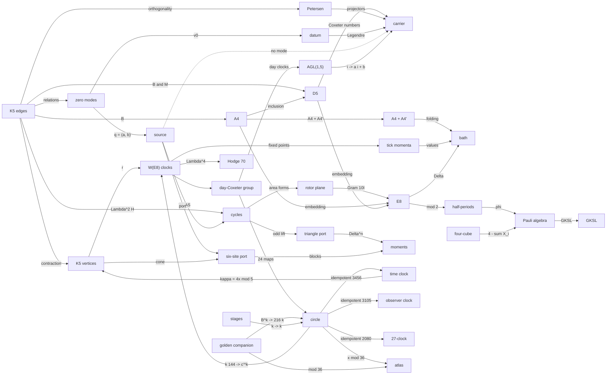

# All dots joined

Every object the model builds is a dot, and every map between two dots that layer 23 (`oes/dots.py`) builds and checks is a join. A dashed arrow is an obstruction: a proof that the map does not exist. Two dots that share an integer are not joined by it; those integers stay readings (`docs/LEDGER.md`). Generated by `dots_page()`; `tests/test_model.py` checks that this file is current.

33 dots and 47 joins. With the obstruction left out, the joins that hold connect every dot: the diagram is one piece.

## Dots

| dot | what it is | layers |
|---|---|---|
| K5 vertices | R^5, the five atoms | 1 |
| K5 edges | Lambda^2 R^5, the ten atoms | 1, 23 |
| carrier | R^15 with D^2 = M M^T + M^T M, spectrum 0^5 3^8 8^2 | 1 |
| zero modes | ker M, the five dark modes | 1, 5 |
| cycles | ker B = Lambda^2 H, six | 22, 23 |
| rotor plane | the C5-fixed plane of the cycles | 22, 23 |
| Petersen | the graph on the ten edges | 1, 22 |
| datum | (psi0, v0) with energy 34 | 1, 22 |
| source | q'' + 4q = 0 on ker M + ker M | 4 |
| A4 | the 20 roots e_i - e_j | 11 |
| D5 | the 40 roots +-e_i +- e_j | 23 |
| E8 | the lattice and its 240 roots | 3, 11 |
| A4 + A4' | index 5 in E8 | 11, 23 |
| bath | Delta = 240 - sum of root translations | 8, 22 |
| tick momenta | the 25 fixed momenta of the tick | 23 |
| half-periods | Lambda / 2 Lambda, 256 | 22 |
| Pauli algebra | M16(R) with L | 22 |
| GKSL | the semigroup e^-tL | 22 |
| triangle port | the oriented triangle 0-1-2 on the lattice | 22, 23 |
| six-site port | K5 coned off, an A5 simplex | 4, 22, 23 |
| moments | the Stieltjes data of the ports | 22 |
| W(E8) clocks | c', g = r r', d, v, m | 19, 21 |
| day-Coxeter group | <c', d>, order 120 | 21, 22 |
| AGL(1,5) | the affine group of the pentagon | 21 |
| circle | Z/4320 | 19 |
| time clock | <864> = Z/5 | 21, 22 |
| observer clock | <1080>, inside the 2-clock <135> | 22, 23 |
| 27-clock | <160>, the nakshatra | 20, 23 |
| atlas | Z/36 = circle / <36> | 23 |
| golden companion | B = [[1, 1], [1, 0]] | 21, 22 |
| stages | the fifteen indices | 22 |
| four-cube | the 81-cell complex of [0, 1]^4 | 21, 23 |
| Hodge 70 | Lambda^4 R^8 = 35 + 35 | 23 |

## Joins

| from | to | the map | status | check |
|---|---|---|---|---|
| K5 edges | A4 | the signed incidence: its columns are a positive system of A4 | THEOREM | `k5_roots` |
| K5 edges | D5 | the two incidences: the twenty positive roots of D5 | THEOREM | `k5_roots` |
| A4 | D5 | A4 is the sub-root-system e_i - e_j of D5 | THEOREM | `k5_roots` |
| D5 | carrier | M M^T = h(D5) I - h(A4) P: spec D^2 = {0, h(D5) - h(A4), h(D5)} = {0, 3, 8} | THEOREM | `k5_roots` |
| K5 edges | K5 vertices | B is contraction with u = (1, 1, 1, 1, 1) on Lambda^2 R^5 | THEOREM | `exterior` |
| K5 edges | zero modes | ker M is the space of relations among the roots e_i + e_j | THEOREM | `k5_roots` |
| K5 edges | Petersen | Petersen is the orthogonality graph of the roots e_i + e_j | THEOREM | `petersen_roots` |
| Petersen | carrier | the Petersen projectors are the carrier's edge projectors | THEOREM | `counts.petersen_projectors` |
| K5 edges | cycles | ker B = Lambda^2 of the sum-zero hyperplane; cuts u ^ H | THEOREM | `exterior` |
| cycles | rotor plane | the C5-fixed plane, spanned by the invariant area forms | THEOREM | `exterior` |
| rotor plane | E8 | the rotor pair of near and far roots, turned by a Weyl doubling | THEOREM | `counts.rotor_plane` |
| zero modes | datum | the datum's velocity is the alternating 4-cycle in ker M | THEOREM | `counts.tick_tock` |
| datum | carrier | H = 1/2 \|v\|^2 + 1/2 psi D^2 psi = 34, the zero modes holding 2 | THEOREM | `counts.tick_tock` |
| zero modes | source | the native source lives on ker M + ker M | THEOREM | `source_port` |
| source | cycles | a ^ b -> [A(a), A(b)], an oriented K5 cycle (rank 6, kernel 4) | THEOREM | `source_port` |
| source | carrier | 4 is not in spec D^2: the source is not a carrier mode | OBSTRUCTION | `field` |
| source | six-site port | the port metric and the boundary rotation of the native action | SELECTED_REFERENCE | `native_port` |
| A4 | E8 | the first five coordinates: A4 and D5 roots are E8 roots | THEOREM | `embed` |
| D5 | E8 | the first five coordinates | THEOREM | `embed` |
| A4 | A4 + A4' | index 5, root cosets 40, 50, 50, 50, 50, glue x -> +-2x | THEOREM | `glue_cosets` |
| A4 + A4' | bath | the bath on E8 / L0 = Z/5: 0, 250^4 | THEOREM | `glue_cosets` |
| W(E8) clocks | tick momenta | the 25 fixed momenta of the tick g | THEOREM | `tick_momenta` |
| tick momenta | bath | the bath is 0 once and 250 at the other 24 | THEOREM | `tick_momenta` |
| E8 | bath | 240 - sum of the 240 root translations; frame 60 I | THEOREM | `triangle_port` |
| E8 | half-periods | Lambda -> Lambda / 2 Lambda; 120 root classes | THEOREM | `counts.folded_bath` |
| half-periods | Pauli algebra | the Walsh-Hadamard conjugate of the folded bath is L in the Pauli basis | THEOREM | `counts.pauli_quotient` |
| Pauli algebra | GKSL | -L(X) = 2 sum (A X A^T - X) over the 120 antisymmetric Paulis | THEOREM | `counts.pauli_quotient` |
| cycles | triangle port | the triangle 0-1-2 lifted to its A4 roots | THEOREM | `triangle_port` |
| triangle port | moments | MOMENT_BIT's moments; heat t^-7 / (22394880000000 pi^4) | THEOREM | `triangle_port` |
| K5 vertices | six-site port | the origin and the lifted vertices e_i + e_5: K5 coned off | THEOREM | `cone` |
| six-site port | moments | 241 I - J, 183 I + 52 J, 35366 I + 8134 J | THEOREM | `cone` |
| K5 vertices | W(E8) clocks | r acts on the carrier's coordinates as the vertex rotation; g = r r' on A4 | THEOREM | `clock_joins` |
| circle | W(E8) clocks | the Coxeter subgroup <144> onto <c'>, 864 -> g | SELECTED_REFERENCE | `clock_joins` |
| circle | time clock | the time part of the primary split | THEOREM | `primary_split` |
| circle | observer clock | the 2-part; the observer clock is its order-4 subgroup | THEOREM | `primary_split` |
| circle | 27-clock | the 27-part, generated by the nakshatra 160 | THEOREM | `primary_split` |
| time clock | K5 vertices | translation by 864 intertwined with the vertex rotor | THEOREM | `counts.two_clocks` |
| W(E8) clocks | day-Coxeter group | the day-Coxeter group, order 120, derived group the tick | THEOREM | `clock_joins` |
| day-Coxeter group | circle | every homomorphism to the circle kills the commutator | THEOREM | `counts.circle_maps` |
| day-Coxeter group | AGL(1,5) | G / centre on the five day clocks: the tick rotates, the day doubles | THEOREM | `clock_joins` |
| AGL(1,5) | carrier | the twenty affine maps of the vertices commute with D^2 | THEOREM | `clock_joins` |
| circle | atlas | onto Z/36 with kernel the seam <36>; doubling contracts it | THEOREM | `atlas` |
| golden companion | circle | order 20 mod 5, the order of the golden step; 720 mod 4320 | SELECTED_REFERENCE | `pisano` |
| golden companion | atlas | order 24, the tick in atlas steps | THEOREM | `pisano` |
| stages | circle | the fifteen indices as steps, with first landings | THEOREM | `counts.check_claims` |
| four-cube | Pauli algebra | the four-cube's vertices are four qubits | THEOREM | `four_cube` |
| W(E8) clocks | Hodge 70 | reflections swap the 35 + 35 halves, the clocks keep them | THEOREM | `hodge70` |

## Not joined

| object | why | status |
|---|---|---|
| separate model's joined model (22:02) | 158 check groups, 12 review groups, 80 matrices, 63 typed relationships; sha256 b0c17731... | REPORTED |
| canon SMEAR (184 / 481) | a rank-6 port T and a rank-4 projector P with minor -512 alpha^4 / 25; the operands are not stored here | REPORTED |
| source-to-cube bridge | rank 10 with an exact left decoder (canon); not stored here | REPORTED |
| AIR_801's 31 points | the orbit list 6 + 6 + 6 + 6 + 3 + 3 + 1 needs a permutation of 31 points; none is stored | REPORTED |
| air | no air operator is stored, and none is formed | UNFORMED |

AUTH = NOT_PASS. ScientificGold = FALSE. No term is added to the action.
