# All dots joined, at every level

Every object the model builds is a dot, and every map between two dots that layer 23 (`oes/dots.py`) builds and checks is a join. A dashed arrow is an obstruction: a proof that the map does not exist. Two dots that share an integer are not joined by it; those integers stay readings (`docs/LEDGER.md`). The dots sit on six levels, from the integers up to physics. Every layer of the build has a dot, every level is joined inside, and every pair of levels is joined directly. Generated by `dots_page()`; `tests/test_model.py` checks that this file is current.

```mermaid
flowchart TB
    subgraph level1["level 1: number"]
        circle["circle"]
        time["time clock"]
        observer["observer clock"]
        c27["27-clock"]
        atlas["atlas"]
        coil["coil"]
        grain["grain"]
        vortex["vortex"]
        miss["miss set"]
        stages["stages"]
        memory["memory clock"]
    end
    subgraph level2["level 2: symmetry"]
        clocks["W(E8) clocks"]
        G120["day-Coxeter group"]
        AGL["AGL(1,5)"]
        S5["S5"]
        pgl["PGL(2,5)"]
        golden["golden companion"]
        hodge["Hodge 70"]
        air801["801 matrix"]
        words["fifteen words"]
        regular["regular clocks"]
    end
    subgraph level3["level 3: combinatorics"]
        V["K5 vertices"]
        E["K5 edges"]
        cycles["cycles"]
        rotor["rotor plane"]
        petersen["Petersen"]
        cube["four-cube"]
        surface["surface"]
        simplex["4-simplex"]
        pg25["PG(2,5)"]
        synthemes["synthemes"]
    end
    subgraph level4["level 4: lattice"]
        A4["A4"]
        D5["D5"]
        E8["E8"]
        L0["A4 + A4'"]
        frame["eight-root frame"]
        momenta["tick momenta"]
        halfper["half-periods"]
        census["critical census"]
        torus["nine-torus"]
        rootgraph["root graph"]
        cyclo["cyclotomic line"]
        residue["residue plane"]
        sun["sun's decad"]
        principal["principal circle"]
    end
    subgraph level5["level 5: operator"]
        carrier["carrier"]
        kerM["zero modes"]
        datum["datum"]
        source["source"]
        literal["literal operands"]
        bath["bath"]
        walks["closed walks"]
        moments["moments"]
        measure["spectral measures"]
        triangle["triangle port"]
        sixsite["six-site port"]
        pauli["Pauli algebra"]
        gksl["GKSL"]
        goldenport["Golden port"]
        wedgeport["root-wedge port"]
        darkport["dark ports"]
        parent["360 parent"]
    end
    subgraph level6["level 6: physics"]
        triple["spectral triple"]
        readout["readout"]
        waves["sound and light"]
        binding["binding"]
        calibration["calibration"]
        gravity["product geometry"]
        cosmology["FLRW"]
        charges["five-site charges"]
        assignment["root assignment"]
    end
    E -->|"B"| A4
    E -->|"B and M"| D5
    A4 -->|"inclusion"| D5
    D5 -->|"Coxeter numbers"| carrier
    E -->|"contraction"| V
    E -->|"relations"| kerM
    E -->|"orthogonality"| petersen
    petersen -->|"projectors"| carrier
    E -->|"Lambda^2 H"| cycles
    cycles -->|"area forms"| rotor
    rotor -->|"Gram 10I"| E8
    kerM -->|"v0"| datum
    datum -->|"Legendre"| carrier
    kerM -->|"q = (a, b)"| source
    source -->|"W_AS"| cycles
    source -.->|"no mode"| carrier
    source -->|"port"| sixsite
    A4 -->|"embedding"| E8
    D5 -->|"embedding"| E8
    A4 -->|"A4 + A4'"| L0
    L0 -->|"folding"| bath
    clocks -->|"fixed points"| momenta
    momenta -->|"values"| bath
    E8 -->|"Delta"| bath
    E8 -->|"mod 2"| halfper
    halfper -->|"phi"| pauli
    pauli -->|"GKSL"| gksl
    cycles -->|"odd lift"| triangle
    triangle -->|"Delta^n"| moments
    V -->|"cone"| sixsite
    sixsite -->|"blocks"| moments
    V -->|"r"| clocks
    circle -->|"k 144 -> c'^k"| clocks
    circle -->|"idempotent 3456"| time
    circle -->|"idempotent 3105"| observer
    circle -->|"idempotent 2080"| c27
    time -->|"kappa = 4x mod 5"| V
    clocks -->|"c' and d"| G120
    G120 -->|"24 maps"| circle
    G120 -->|"day clocks"| AGL
    AGL -->|"i -> a i + b"| carrier
    circle -->|"x mod 36"| atlas
    golden -->|"B^k -> 216 k"| circle
    golden -->|"mod 36"| atlas
    stages -->|"k -> k"| circle
    cube -->|"4 - sum X_i"| pauli
    carrier -->|"line graph of K6"| sixsite
    E -->|"paired response"| kerM
    E8 -->|"7-design"| bath
    bath -->|"return counts"| walks
    walks -->|"binomial transform"| moments
    clocks -->|"Lambda^4"| hodge
    coil -->|"gcd 8"| circle
    coil -->|"x -> x mod 5"| time
    c27 -->|"160 k -> 16 k mod 36"| atlas
    atlas -->|"Z/180 = Z/36 x Z/5"| time
    golden -->|"k -> 216 k mod 5"| time
    S5 -->|"vertex permutations"| carrier
    AGL -->|"F20 inside S5"| S5
    AGL -->|"x -> a x + b"| pgl
    pgl -.->|"not the carrier's S5"| carrier
    AGL -->|"the cone's rotation"| sixsite
    grain -->|"index 9"| coil
    grain -->|"j -> 9 j"| c27
    atlas -->|"x mod 9"| vortex
    c27 -->|"kernel the sun"| vortex
    miss -->|"Z/4320 = <864> + <5>"| circle
    observer -->|"inclusion"| miss
    c27 -->|"onto the golden cosets"| coil
    E8 -->|"a maximal clique"| frame
    frame -->|"six-point faces"| sixsite
    golden -->|"B^k -> v^k"| clocks
    cube -->|"the cuts mod 2"| E
    E -->|"K5 inside K6"| surface
    surface -->|"PSL(2,5)"| pgl
    E8 -->|"the dual torus"| momenta
    E8 -->|"the band on the alcove"| census
    momenta -->|"fixed points are critical"| census
    census -->|"nine frequencies"| torus
    census -->|"characteristic roots"| walks
    bath -->|"periodic restriction"| pauli
    literal -->|"U"| source
    moments -->|"Hausdorff"| measure
    carrier -->|"D"| triple
    kerM -->|"index"| triple
    source -->|"hidden sector"| readout
    carrier -->|"Hodge block"| waves
    E -->|"d0 = B^T"| waves
    cycles -->|"helicities"| waves
    A4 -->|"the sound Hessian"| waves
    source -->|"Lambda^2 ker D"| binding
    triple -->|"first-order form"| readout
    triple -->|"commutant"| binding
    triple -->|"complement"| waves
    readout -->|"Salina-Prema"| calibration
    circle -.->|"no internal clock"| calibration
    triple -->|"heat coefficients"| gravity
    gravity -->|"G and Lambda_cc"| cosmology
    E8 -->|"inner product 1"| rootgraph
    rootgraph -->|"pair sums"| walks
    rootgraph -->|"eigenvalue 28"| frame
    E -->|"grade 2"| simplex
    time -->|"the tick on every grade"| simplex
    golden -->|"B -> -(T + T^-1)"| E
    air801 -->|"the projective class"| pgl
    surface -->|"the Veronese conic"| pg25
    pgl -->|"the symmetric square"| pg25
    air801 -->|"orbits 1 + 3 + 3 + 6 + 6 + 6 + 6"| pg25
    census -->|"the decay rates"| gksl
    stages -->|"first landings"| time
    E8 -->|"Lambda^4 of the lattice"| hodge
    torus -->|"the speed of the flow"| calibration
    literal -->|"the incidences"| E
    measure -->|"the band"| census
    waves -->|"invariant ratios"| calibration
    datum -->|"the stiff sector"| cosmology
    momenta -->|"the Hessian"| golden
    sixsite -->|"twice the pentagon Laplacian"| golden
    source -->|"the joint observer"| readout
    atlas -->|"the sideband lift"| circle
    V -->|"a charge on the sites"| charges
    simplex -->|"q(S) on the faces"| charges
    charges -->|"the anomaly"| binding
    charges -->|"the dark U(5)"| kerM
    charges -.->|"B1"| carrier
    time -->|"the tick on Lambda / 2 Lambda"| halfper
    time -->|"a tick-equivariant semigroup"| gksl
    time -->|"the tick on sound and light"| waves
    golden -->|"B -> (I + Curl)/2"| waves
    AGL -->|"the helicity character"| waves
    pgl -->|"the outer automorphism of S6"| S5
    S5 -->|"W(A4)"| A4
    S5 -->|"the Weyl group of 5 + 10"| binding
    air801 -->|"the two triangulations"| surface
    time -->|"a fifth root of unity in F16"| cube
    grain -->|"the golden index"| time
    miss -->|"the kernel"| time
    stages -->|"the stages that never land"| miss
    circle -->|"x mod 9"| vortex
    rotor -->|"a quarter turn"| AGL
    triangle -->|"a 2-face"| simplex
    hodge -->|"the deck involution"| halfper
    halfper -->|"three critical types"| census
    L0 -->|"the characters of E8 / L0"| momenta
    literal -->|"W_p"| sixsite
    measure -->|"the sector measures"| sixsite
    petersen -->|"orthogonality"| D5
    observer -->|"inclusion"| coil
    torus -->|"the nine frequencies"| bath
    circle -->|"one step, one step"| memory
    memory -->|"the 9-cycle"| vortex
    memory -->|"the 10-cycles"| time
    L0 -->|"the branching"| assignment
    E8 -->|"the second moment"| assignment
    charges -->|"charges on the roots"| assignment
    E -->|"the 10 of matter"| assignment
    AGL -->|"the doubling on E8 / L0"| assignment
    S5 -->|"one orbit of choices"| assignment
    sixsite -->|"the port's twin duad"| assignment
    binding -->|"three generations"| assignment
    rootgraph -->|"the bath between roots"| bath
    walks -->|"the walks are the port"| sixsite
    clocks -->|"two order-5 actions"| halfper
    simplex -->|"the cycles bound"| cycles
    charges -->|"the charge on the edges"| E
    cycles -->|"the root-site isometry"| goldenport
    goldenport -->|"the Golden moments"| bath
    goldenport -->|"two windows on one bath"| sixsite
    charges -->|"the marked charge map"| goldenport
    S5 -->|"the twelve markings"| cycles
    goldenport -->|"the infrared channels"| moments
    words -->|"the twisted duads"| surface
    words -->|"the Coxeter five-cycle"| A4
    words -->|"the extension's golden equation"| golden
    S5 -->|"the parity contexts"| waves
    waves -->|"the Hodge defect"| goldenport
    waves -->|"the Hodge-isotropic overlap"| sixsite
    waves -->|"the Hodge repair"| bath
    words -->|"the six Sylow views"| S5
    words -.->|"no native Golden action"| carrier
    circle -->|"the root address"| E8
    time -.->|"the phase is not a glue class"| L0
    AGL -->|"the carrier's doubling"| L0
    S5 -->|"a regular orbit"| datum
    charges -->|"the charge map"| cycles
    kerM -->|"the midpoint"| cycles
    AGL -->|"the affine group on the frames"| circle
    time -->|"free pentagons"| rootgraph
    time -->|"one zero mode per character"| kerM
    time -->|"an automorphism of the triple"| triple
    source -->|"the Agni-Soma light"| waves
    source -->|"the F20 factorization"| charges
    source -->|"the E8 pullback"| goldenport
    source -->|"the phase quadratures"| readout
    pgl -->|"the six Sylow sign lines"| kerM
    halfper -->|"the band edge"| bath
    L0 -->|"the root wedge"| wedgeport
    cycles -->|"an S5-isometry"| wedgeport
    wedgeport -->|"scalar moments"| bath
    S5 -.->|"no Lorentz form"| wedgeport
    wedgeport -->|"three windows"| goldenport
    wedgeport -->|"the clique's view"| sixsite
    rootgraph -->|"every order"| moments
    bath -->|"the Schur memory"| sixsite
    A4 -->|"the light is the A4 Hodge star"| waves
    pgl -->|"the exceptional action"| synthemes
    synthemes -->|"the syntheme Dirac operator"| carrier
    V -->|"vertices as synthemes"| synthemes
    E -->|"edges as synthemes"| synthemes
    pgl -->|"the complex six-line frame"| source
    words -->|"the regular word lanes"| source
    words -.->|"index 3 per lane"| source
    cycles -.->|"no A5 map to the sites"| sixsite
    halfper -->|"quadrupolar at the band top"| wedgeport
    pgl -->|"six rotor planes"| rotor
    pgl -->|"the pair frame's blind lines"| waves
    wedgeport -->|"the parity pair"| triangle
    L0 -->|"the norm-four shell"| darkport
    darkport -->|"the dark moments"| bath
    pgl -->|"the dark intertwiner"| darkport
    L0 -->|"the triple wedge"| darkport
    darkport -->|"thirty-two at every order"| moments
    darkport -->|"the six F20 views"| rotor
    pgl -->|"the Golden repair"| words
    source -->|"the global decoder"| words
    V -->|"the five K4 planes"| darkport
    bath -->|"absolutely continuous"| measure
    walks -->|"the free chain"| measure
    V -->|"the matching planes"| source
    source -->|"exactly five dark planes"| darkport
    source -->|"two rotating branches"| readout
    wedgeport -->|"one-frequency tomography"| darkport
    E -->|"the quadratic frames"| source
    darkport -->|"dark intensities"| readout
    source -->|"cubic-null triangles"| cycles
    A4 -->|"the Fibonacci bridge"| golden
    darkport -->|"the dark measurement"| readout
    source -->|"plane tomography"| readout
    darkport -->|"the seventh sensor"| readout
    source -->|"preparability"| darkport
    cycles -->|"the exterior code"| darkport
    source -->|"two instruments"| darkport
    bath -->|"causal records"| source
    parent -->|"the Golden adapter"| source
    parent -->|"Golden30"| golden
    A4 -->|"the marked injection"| parent
    parent -->|"the blind 126"| readout
    synthemes -.->|"two 36s"| parent
    E8 -->|"the cyclotomic line"| cyclo
    cyclo -->|"the clocks are Galois"| clocks
    clocks -->|"the residue plane"| residue
    residue -->|"one residue line"| L0
    residue -->|"the tick's normalizer"| pgl
    L0 -->|"either factor"| A4
    residue -->|"the six axes"| surface
    residue -->|"the Singer cycle"| air801
    cyclo -->|"the Gauss sum"| golden
    L0 -->|"the shadows"| carrier
    pgl -->|"the hexad"| parent
    circle -->|"the address map"| parent
    clocks -->|"Springer"| regular
    regular -->|"three cyclotomic lines"| cyclo
    regular -->|"the centralizer of 5"| residue
    regular -->|"the centralizer of 3"| sun
    regular -->|"the centralizer of 2"| halfper
    cyclo -->|"the prime over 3"| sun
    sun -->|"W(3)"| rootgraph
    regular -.->|"no fourth line"| cyclo
    cyclo -->|"the primes over 2"| halfper
    sun -->|"the decad"| parent
    sun -->|"the clocks on the decad"| AGL
    circle -.->|"no homomorphism"| parent
    clocks -.->|"solvable clocks"| parent
    sun -->|"243"| bath
    residue -->|"Pontryagin duality"| momenta
    halfper -->|"the quadric sums"| gksl
    halfper -->|"two stabilizers"| pauli
    sun -->|"F9 = F3[phi]"| golden
    halfper -->|"F4 = F2[phi]"| golden
    memory -.->|"no clock of order 90"| clocks
    circle -.->|"no faithful circle"| clocks
    E8 -->|"the Weyl vector"| principal
    circle -->|"k -> k rho / 4320"| principal
    principal -->|"Kostant"| clocks
    principal -->|"the regular steps"| regular
    principal -->|"248 - chi"| bath
    principal -->|"the critical steps"| census
    time -->|"the A4 + A4 vertex"| principal
    observer -->|"the D5 + A3 vertex"| principal
    c27 -->|"the A8 vertex"| principal
    synthemes -->|"the syntheme incidence"| petersen
    residue -->|"the six-line quotient"| rootgraph
    time -->|"the phase on the Sylow labels"| pgl
    assignment -.->|"one root of every pair"| binding
    circle -->|"24 maps, one orbit"| memory
    memory -->|"up to doubling"| vortex
    memory -->|"up to doubling"| time
    kerM -->|"the massless tower"| gravity
    kerM -->|"the dark momentum"| cosmology
    cosmology -->|"the mass scale"| calibration
    G120 -->|"the unit group"| residue
    frame -->|"A8"| census
    AGL -->|"the Frobenius"| cube
    grain -->|"the regular steps"| principal
    pg25 -->|"secants through a point"| synthemes
    E8 -->|"unique up to W(E8)"| principal
    principal -->|"the critical steps"| grain
    time -->|"the golden step"| observer
    observer -->|"the three small clocks"| grain
    observer -->|"the regular class 4"| regular
    principal -->|"modulo the regular steps"| atlas
    principal -->|"the Sylow 3-subgroup"| c27
    grain -->|"plus the 27-clock"| coil
    principal -->|"the steps the tick does not see"| miss
    principal -->|"the 27-clock modulo the sun"| vortex
    golden -->|"the tick's cosine"| clocks
    golden -->|"the Galois conjugation"| G120
    golden -->|"the cosine rings"| regular
    torus -->|"the critical steps"| principal
    torus -->|"the half-periods"| halfper
    torus -->|"the sun's momenta"| sun
    torus -->|"the tick's momenta"| momenta
```

71 dots and 322 joins: 289 THEOREM, 10 SELECTED_REFERENCE, 7 CONDITIONAL and 16 OBSTRUCTION. With the obstructions left out, the joins that hold connect every dot: the diagram is one piece. Every dot lies on at least three maps, and neither two maps nor two dots hold it together: removing any two maps, or any two dots with their maps, leaves the rest connected. THEOREM joins alone connect every dot but the product geometry and FLRW. Those two need an external 4-manifold, cutoff and mass scale, so they attach through CONDITIONAL joins: the heat coefficients (J10), the massless tower, the Friedmann flow, the stiff sector, the dark momentum and the cosmos's calibration. The memory clock is reached by the circle's 24 maps onto it, all conjugate under its symmetry, without the selection. No one or two THEOREM maps, and no one or two dots, hold the THEOREM diagram together, and THEOREM maps join every pair of levels at least twice.

## Levels

| level | what lives there | dots | joins inside | joins to the next level |
|---|---|---|---|---|
| 1. number | the circle and its clocks | circle, time clock, observer clock, 27-clock, atlas, coil, grain, vortex, miss set, stages, memory clock | 32 | 8 |
| 2. symmetry | groups, their actions and modules | W(E8) clocks, day-Coxeter group, AGL(1,5), S5, PGL(2,5), golden companion, Hodge 70, 801 matrix, fifteen words, regular clocks | 15 | 12 |
| 3. combinatorics | graphs, complexes and the cube | K5 vertices, K5 edges, cycles, rotor plane, Petersen, four-cube, surface, 4-simplex, PG(2,5), synthemes | 13 | 5 |
| 4. lattice | roots, lattices and tori | A4, D5, E8, A4 + A4', eight-root frame, tick momenta, half-periods, critical census, nine-torus, root graph, cyclotomic line, residue plane, sun's decad, principal circle | 30 | 26 |
| 5. operator | spaces with operators, ports and moments | carrier, zero modes, datum, source, literal operands, bath, closed walks, moments, spectral measures, triangle port, six-site port, Pauli algebra, GKSL, Golden port, root-wedge port, dark ports, 360 parent | 35 | 24 |
| 6. physics | geometry, readout, waves, binding and the conditional cosmos | spectral triple, readout, sound and light, binding, calibration, product geometry, FLRW, five-site charges, root assignment | 11 | - |

## Level pairs

The maps that join each pair of levels directly.

| | number | symmetry | combinatorics | lattice | operator | physics |
|---|---|---|---|---|---|---|
| number | - | 8 | 3 | 13 | 3 | 2 |
| symmetry | 8 | - | 12 | 24 | 12 | 7 |
| combinatorics | 3 | 12 | - | 5 | 19 | 7 |
| lattice | 13 | 24 | 5 | - | 26 | 5 |
| operator | 3 | 12 | 19 | 26 | - | 24 |
| physics | 2 | 7 | 7 | 5 | 24 | - |

## Dots

| dot | what it is | level | layers |
|---|---|---|---|
| K5 vertices | R^5, the five atoms | combinatorics | 1 |
| K5 edges | Lambda^2 R^5, the ten atoms | combinatorics | 1, 23 |
| carrier | R^15 with D^2 = M M^T + M^T M, spectrum 0^5 3^8 8^2 | operator | 1 |
| zero modes | ker M, the five dark modes | operator | 1, 5 |
| cycles | ker B = Lambda^2 H, six | combinatorics | 22, 23 |
| rotor plane | the C5-fixed plane of the cycles | combinatorics | 22, 23 |
| Petersen | the graph on the ten edges | combinatorics | 1, 22 |
| datum | (psi0, v0) with energy 34 | operator | 1, 22 |
| source | q'' + 4q = 0 on ker M + ker M | operator | 4 |
| A4 | the 20 roots e_i - e_j | lattice | 11 |
| D5 | the 40 roots +-e_i +- e_j | lattice | 23 |
| E8 | the lattice and its 240 roots | lattice | 3, 11 |
| A4 + A4' | index 5 in E8 | lattice | 11, 23 |
| bath | Delta = 240 - sum of root translations | operator | 8, 22, 27 |
| tick momenta | the 25 fixed momenta of the tick | lattice | 23, 27 |
| half-periods | Lambda / 2 Lambda, 256 | lattice | 22, 26, 27 |
| Pauli algebra | M16(R) with L | operator | 22, 27 |
| GKSL | the semigroup e^-tL | operator | 22, 27 |
| triangle port | the oriented triangle 0-1-2 on the lattice | operator | 22, 23 |
| six-site port | K5 coned off, an A5 simplex | operator | 4, 22, 23 |
| moments | the Stieltjes data of the ports | operator | 22 |
| closed walks | W_n on the lattice, each step a root; one operator of order 16, degree 58 mod primes | operator | 3, 14 |
| W(E8) clocks | c', g = r r', d, v, m | symmetry | 19, 21 |
| day-Coxeter group | <c', d>, order 120 | symmetry | 21, 22 |
| AGL(1,5) | the affine group of the pentagon | symmetry | 21 |
| circle | Z/4320 | number | 19, 28 |
| time clock | <864> = Z/5, the principal points of order 5 (rho/5) | number | 21, 22, 28 |
| observer clock | <1080>, the principal points of order 4 (rho/4), the regular class 4 = d^6; inside the 2-clock <135> | number | 22, 23, 28 |
| 27-clock | <160>, the nakshatra | number | 20, 23, 28 |
| atlas | Z/36 = circle / <36>, the circle modulo its regular steps | number | 23, 28 |
| golden companion | B = [[1, 1], [1, 0]] | symmetry | 21, 22 |
| stages | the fifteen indices | number | 22 |
| four-cube | the 81-cell complex of [0, 1]^4 | combinatorics | 21, 23 |
| Hodge 70 | Lambda^4 R^8 = 35 + 35 | symmetry | 23 |
| coil | <8>, the 540 multiples of 8: the grain plus the 27-clock | number | 23, 28 |
| S5 | the 120 vertex permutations, the cone point's stabilizer in S6 | symmetry | 1, 23 |
| PGL(2,5) | the transitive S5 in S6, on the projective line over F5 | symmetry | 23 |
| grain | <72> = <216> x <1440>, the golden orbit times the sun: the 60 points k rho/60 the critical steps generate | number | 23, 28 |
| vortex | Z/9, the address mod 9: the 27-clock modulo the sun | number | 23, 28 |
| miss set | <5>, the 864 points the tick does not see: the kernel of the time coordinate | number | 23, 28 |
| eight-root frame | the origin and eight roots with pairwise products 1: a maximal 9-clique, index 3 | lattice | 23 |
| spectral triple | (A, H, D, gamma) on l2(V u E), dim 15, with D^2 = M M^T + M^T M | physics | 2, 9 |
| surface | RP^2: the hemi-icosahedron on the six axes and its complement, 1-skeleton K6 | combinatorics | 3, 9 |
| readout | the carrier as a control system x' = Ax, A = [[0, I], [-D^2, 0]], with named readouts | physics | 5, 9 |
| product geometry | M4 x F and its spectral action, with M4, f, L and m free (conditional) | physics | 6, 9 |
| FLRW | the carrier field on a flat FLRW background (conditional) | physics | 7 |
| literal operands | the owner's native_source_matrices, SHA-256 73e07429... | operator | 10 |
| binding | the commutant of D and the anomaly-free content 5 + Lambda^2 5 | physics | 12 |
| calibration | t = tau u and the readout law omega = omega_hat / tau (TIME_BIND) | physics | 13 |
| spectral measures | the six-port's sector measures on [0, 256], with Gauss and Lobatto envelopes | operator | 15 |
| critical census | the band's 11 critical families on the alcove, 243600 points | lattice | 16, 28 |
| sound and light | the K5 edge Hodge complex: sound im d0, light ker d0^T, Curl = *d1 | physics | 17 |
| nine-torus | T^9 of the nine positive critical frequencies, with a dense flow | lattice | 18 |
| root graph | the 240 roots, adjacent at inner product 1: a four-class association scheme | lattice | 3, 22, 23 |
| cyclotomic line | E8 = Z[zeta30] with the trace form Tr(alpha x ybar), alpha = (2 + 2 eta + eta^2)/15, and c' = zeta30 | lattice | 25 |
| residue plane | E8/(1 - g)E8 = F25, the tick's 25 fixed momenta, and its six lines | lattice | 25 |
| 4-simplex | the 31 faces of the simplex on the five vertices, its boundaries and the tick on every grade | combinatorics | 17, 23 |
| 801 matrix | AIR_801's [[108, 801], [106, 901]], mod 5 a Singer cycle of order 24 | symmetry | 23 |
| PG(2,5) | the projective plane over F5: the conic, 15 exterior and 10 interior points | combinatorics | 23 |
| root assignment | Standard-Model quantum numbers on the 240 roots under A4 + A4' | physics | 24 |
| Golden port | the hub's root-site cycle port T_G = F P_cycle on ten roots | operator | 23 |
| five-site charges | Q = Y + T3 = diag(-1/3, -1/3, -1/3, 1, 0), the removed shell's charges | physics | 12, 23 |
| memory clock | the 120-state quotient of layer 3's memory operator, of order 90 | number | 3, 27 |
| fifteen words | the dihedral closure of 088, 086 and 980 under rotation and reversal, a D3-module of rank 15 | symmetry | 23 |
| root-wedge port | the hub's unmarked S5 port T_S x(rho) = <x, v ^ w>/sqrt24 on the 240 roots | operator | 23 |
| synthemes | the 15 perfect matchings of the six Sylow labels, 5 + 10 under the exceptional S5 | combinatorics | 23 |
| dark ports | the hub's norm-four ports of the dark four: A on the 120 sites of the orbit of (-1, 0, 0, 1, 1, 0, 1, 0), and the triple wedge on 1200 sites | operator | 23 |
| 360 parent | Q[A6] with the right action of r = (01234) and t = (23)(45), and the coset readers O90 and O36 | operator | 23, 26 |
| regular clocks | the thirteen regular classes of W(E8), powers of c', d and v with characteristic polynomials Phi_d^(8/phi(d)) and centralizers of order prod_(d \| d_i) d_i | symmetry | 26 |
| sun's decad | E8/(1 - s)E8 = F81 = F9^2 for the sun s = c'^10, with the form <x, (s - s^2) y> mod 3; its ten F9-lines pull back to ten 4A2 frames | lattice | 26, 27 |
| principal circle | k -> k rho / 4320 in the momentum torus R^8 / E8, rho the Weyl vector; unique up to W(E8) | lattice | 28 |

## Joins

| from | to | the map | status | check |
|---|---|---|---|---|
| K5 edges | A4 | the signed incidence: its columns are a positive system of A4 | THEOREM | `k5_roots` |
| K5 edges | D5 | the two incidences: the twenty positive roots of D5 | THEOREM | `k5_roots` |
| A4 | D5 | A4 is the sub-root-system e_i - e_j of D5 | THEOREM | `k5_roots` |
| D5 | carrier | M M^T = h(D5) I - h(A4) P: spec D^2 = {0, h(D5) - h(A4), h(D5)} = {0, 3, 8} | THEOREM | `k5_roots` |
| K5 edges | K5 vertices | B is contraction with u = (1, 1, 1, 1, 1) on Lambda^2 R^5 | THEOREM | `exterior` |
| K5 edges | zero modes | ker M is the space of relations among the roots e_i + e_j | THEOREM | `k5_roots` |
| K5 edges | Petersen | Petersen is the orthogonality graph of the roots e_i + e_j | THEOREM | `petersen_roots` |
| Petersen | carrier | the Petersen projectors are the carrier's edge projectors | THEOREM | `counts.petersen_projectors` |
| K5 edges | cycles | ker B = Lambda^2 of the sum-zero hyperplane; cuts u ^ H | THEOREM | `exterior` |
| cycles | rotor plane | the C5-fixed plane, spanned by the invariant area forms | THEOREM | `exterior` |
| rotor plane | E8 | the rotor pair of near and far roots, turned by a Weyl doubling | THEOREM | `counts.rotor_plane` |
| zero modes | datum | the datum's velocity is the alternating 4-cycle in ker M | THEOREM | `counts.tick_tock` |
| datum | carrier | H = 1/2 \|v\|^2 + 1/2 psi D^2 psi = 34, the zero modes holding 2 | THEOREM | `counts.tick_tock` |
| zero modes | source | the native source lives on ker M + ker M | THEOREM | `source_port` |
| source | cycles | a ^ b -> [A(a), A(b)], an oriented K5 cycle (rank 6, kernel 4) | THEOREM | `source_port` |
| source | carrier | 4 is not in spec D^2: the source is not a carrier mode | OBSTRUCTION | `field` |
| source | six-site port | the port metric and the boundary rotation of the native action | SELECTED_REFERENCE | `native_port` |
| A4 | E8 | the first five coordinates: A4 and D5 roots are E8 roots | THEOREM | `embed` |
| D5 | E8 | the first five coordinates | THEOREM | `embed` |
| A4 | A4 + A4' | index 5, root cosets 40, 50, 50, 50, 50, glue x -> +-2x | THEOREM | `glue_cosets` |
| A4 + A4' | bath | the bath on E8 / L0 = Z/5: 0, 250^4 | THEOREM | `glue_cosets` |
| W(E8) clocks | tick momenta | the 25 fixed momenta of the tick g | THEOREM | `tick_momenta` |
| tick momenta | bath | the bath is 0 once and 250 at the other 24 | THEOREM | `tick_momenta` |
| E8 | bath | 240 - sum of the 240 root translations; frame 60 I | THEOREM | `triangle_port` |
| E8 | half-periods | Lambda -> Lambda / 2 Lambda; 120 root classes | THEOREM | `counts.folded_bath` |
| half-periods | Pauli algebra | the Walsh-Hadamard conjugate of the folded bath is L in the Pauli basis | THEOREM | `counts.pauli_quotient` |
| Pauli algebra | GKSL | -L(X) = 2 sum (A X A^T - X) over the 120 antisymmetric Paulis | THEOREM | `counts.pauli_quotient` |
| cycles | triangle port | the triangle 0-1-2 lifted to its A4 roots | THEOREM | `triangle_port` |
| triangle port | moments | MOMENT_BIT's moments; heat t^-7 / (22394880000000 pi^4) | THEOREM | `triangle_port` |
| K5 vertices | six-site port | the origin and the lifted vertices e_i + e_5: K5 coned off | THEOREM | `cone` |
| six-site port | moments | 241 I - J, 183 I + 52 J, 35366 I + 8134 J | THEOREM | `cone` |
| K5 vertices | W(E8) clocks | r acts on the carrier's coordinates as the vertex rotation; g = r r' on A4 | THEOREM | `clock_joins` |
| circle | W(E8) clocks | the Coxeter subgroup <144> onto <c'>, 864 -> g | SELECTED_REFERENCE | `clock_joins` |
| circle | time clock | the time part of the primary split | THEOREM | `primary_split` |
| circle | observer clock | the 2-part; the observer clock is its order-4 subgroup | THEOREM | `primary_split` |
| circle | 27-clock | the 27-part, generated by the nakshatra 160 | THEOREM | `primary_split` |
| time clock | K5 vertices | translation by 864 intertwined with the vertex rotor | THEOREM | `counts.two_clocks` |
| W(E8) clocks | day-Coxeter group | the day-Coxeter group, order 120, derived group the tick | THEOREM | `clock_joins` |
| day-Coxeter group | circle | every homomorphism to the circle kills the commutator | THEOREM | `counts.circle_maps` |
| day-Coxeter group | AGL(1,5) | G / centre on the five day clocks: the tick rotates, the day doubles | THEOREM | `clock_joins` |
| AGL(1,5) | carrier | the twenty affine maps of the vertices commute with D^2 | THEOREM | `clock_joins` |
| circle | atlas | onto Z/36 with kernel the seam <36>; doubling contracts it | THEOREM | `atlas` |
| golden companion | circle | order 20 mod 5, the order of the golden step; 720 mod 4320 | SELECTED_REFERENCE | `pisano` |
| golden companion | atlas | order 24, the tick in atlas steps | THEOREM | `pisano` |
| stages | circle | the fifteen indices as steps, with first landings | THEOREM | `counts.check_claims` |
| four-cube | Pauli algebra | the four-cube's vertices are four qubits | THEOREM | `four_cube` |
| carrier | six-site port | the 15 atoms are the bonds of K6 = K5 coned; D is the spoke-rim block of its line graph | THEOREM | `cone_line_graph` |
| K5 edges | zero modes | with the cyclic orientation [M; B] has rank 9; its kernel, near minus far, is the C5-fixed line of ker M | THEOREM | `paired_response` |
| E8 | bath | eps = 30\|k\|^2 - (3/2)\|k\|^4 + (1/24)\|k\|^6 + O(\|k\|^8) | THEOREM | `band_expansion` |
| bath | closed walks | W_n = <delta_0, A^n delta_0> and E_n = <delta_0, Delta^n delta_0> | THEOREM | `walks_join` |
| closed walks | moments | E_n, the one-site port's moments, is the binomial transform of W_n | THEOREM | `walks_join` |
| W(E8) clocks | Hodge 70 | reflections swap the 35 + 35 halves, the clocks keep them | THEOREM | `hodge70` |
| coil | circle | the tick, the observer and the nakshatra generate the 540 multiples of 8, index 8; the smear step 184 = 23 x 8 generates the same subgroup | THEOREM | `coil` |
| coil | time clock | onto the time coordinate with kernel the pada subgroup <40>: the tick misses its 108 points and meets the other 432 | THEOREM | `coil` |
| 27-clock | atlas | the nakshatra walk: period 9, each stable address three times; the 27-coordinate is 25 k mod 27 | THEOREM | `nakshatra_map` |
| atlas | time clock | 36 = 1 mod 5: x = a + 36((t - a) mod 5), so every address carries all five time coordinates and the tick bit (t != 0) does not see the address | THEOREM | `address_lift` |
| golden companion | time clock | the k-th golden point misses the tick iff 5 \| k iff 5 \| F_k; no trace L_n of a golden power is a multiple of 5 | THEOREM | `golden_family` |
| S5 | carrier | S5 acts on the 15 atoms and commutes with D; in S6 these are exactly the 120 permutations of K6 that keep D, and atoms and bonds are one S5-set | THEOREM | `cone_symmetry` |
| AGL(1,5) | S5 | AGL(1,5) = F20, the twenty affine maps of the vertices, is where the cone S5 and PGL(2,5) meet in S6 | THEOREM | `cone_symmetry` |
| AGL(1,5) | PGL(2,5) | the stabilizer of infinity in PGL(2,5), and its only elements that keep D | THEOREM | `cone_symmetry` |
| PGL(2,5) | carrier | on the 15 bonds PGL(2,5) has one orbit and involution character 3, the carrier's S5 two orbits and transposition character 7: equal on F20 and C5, not as S5-modules | OBSTRUCTION | `cone_symmetry` |
| AGL(1,5) | six-site port | the 5-cycle with the cone point fixed, traces 1, 1, 1, 1, 6; a 6 x 6 block of order 5 with traces 1 (MPKG) is similar to it over Q | THEOREM | `mpkg_block` |
| grain | coil | the multiples of 72 are the golden orbit <216> times the sun <1440>, a direct product of 60 points of index 9 in the coil; doubling doubles the golden index and inverts the sun | THEOREM | `grain` |
| grain | 27-clock | the 27-clock reads only the sun coordinate of a grain point, and time and the 2-clock read only its golden index | THEOREM | `grain` |
| atlas | vortex | 9 \| 36, so the vortex coordinate is read off the address; doubling runs through its six units 2, 4, 8, 7, 5, 1 | THEOREM | `vortex` |
| 27-clock | vortex | Z/27 -> Z/9 has kernel 0, 9, 18, the sun's 27-coordinates: the vortex is the 27-clock without the sun | THEOREM | `vortex` |
| miss set | circle | every point is a tick part plus a miss, uniquely; it misses exactly when its tick part is 0, and 864 copies of it give the pure tick with the opposite coordinate | THEOREM | `tick_miss` |
| observer clock | miss set | the observer clock and the whole nakshatra clock lie in the miss set; in each golden loop the four misses are one observer coset | THEOREM | `tick_miss` |
| 27-clock | coil | the nakshatra clock meets each of the coil's 27 golden cosets once, and doubling acts on both with cycles 18 + 6 + 2 + 1, the sun's swap among them | THEOREM | `doubling_orbits` |
| E8 | eight-root frame | eight roots with pairwise inner product 1 and the origin: Gram I + J, index 3, no ninth root | THEOREM | `eight_roots` |
| eight-root frame | six-site port | every six-point face of the frame is a six-port, with coupling Gram 183I + 52J | THEOREM | `eight_roots` |
| golden companion | W(E8) clocks | B mod 5 and the golden clock v of W(E8) are both cyclic of order 20, and B^4 goes to v^4, the tick g | SELECTED_REFERENCE | `golden_clock` |
| four-cube | K5 edges | x -> the cut of {i : x_i = 1}: the sixteen vertices of the four-cube are the sixteen cuts of K5 over F2, a cube edge adds one vertex star, and the antipode is the fifth star | THEOREM | `cube_cuts` |
| K5 edges | surface | the surface's 1-skeleton is K6, the ten K5 edges and five spokes, and D is the spoke-rim block of its line graph (J5) | THEOREM | `surface` |
| surface | PGL(2,5) | on the projective line over F5 the hemi-icosahedron and its complement are the two PSL(2,5)-orbits of triangles; PGL(2,5) swaps them, and their links at infinity are the pentagram and the pentagon | THEOREM | `surface` |
| E8 | tick momenta | E8 is unimodular, so momenta live on R^8 / 2 pi E8, where the tick has \|det(g - I)\| = 25 fixed points | THEOREM | `dual_torus` |
| E8 | critical census | eps = 240 - sum cos(2 pi r.x) has 11 critical families on the alcove, 243600 points with Morse sum 0 | THEOREM | `census` |
| tick momenta | critical census | the tick's 25 fixed momenta are critical points of the band: the minimum and 24 points of the A4 + A4 family (eps 250, index 4) | THEOREM | `critical_momenta` |
| critical census | nine-torus | the nine positive critical energies have distinct square-free parts, so their square roots are independent over Q and the flow is dense on T^9 | THEOREM | `nine_torus` |
| critical census | closed walks | the 11 critical values are the in-band characteristic roots of the order-16 recurrence of W_n | THEOREM | `census_walks` |
| bath | Pauli algebra | on the 2-Lambda-periodic functions the bath, conjugated by Walsh-Hadamard, is the Pauli generator L | THEOREM | `counts.pauli_quotient` |
| literal operands | source | the owner's operands give the same port up to U, a W_p-isometry commuting with the C5 rotation; their W_p is the reconstruction's exactly | THEOREM | `literal_port` |
| moments | spectral measures | the true sector moments M_0..M_50 pass the Hausdorff test on [0, 256]: they are moments of measures, each with 25 Gauss nodes in the band | THEOREM | `measure` |
| carrier | spectral triple | the triple's Dirac operator is odd, with D^2 = M M^T + M^T M and moments 15, 40, 200, 1240, 8840 | THEOREM | `triple` |
| zero modes | spectral triple | ker D^2 lies on the edges and equals ker M; the Witten index is Tr(gamma on ker D^2) = -5 (J7) | THEOREM | `triple` |
| source | readout | the hidden controllable sector of (edge force, D psi) is ker M + ker M, the native source's space (J6) | THEOREM | `readout` |
| carrier | sound and light | on the cycle space, in the fundamental-cycle basis, Curl is -A, the carrier's Hodge block (6I - G) sigma | THEOREM | `sound_light` |
| K5 edges | sound and light | the edge complex has d0 = B^T and d1 d0 = 0, ranks 4 + 6: sound is the cuts and light the cycles | THEOREM | `sound_light` |
| cycles | sound and light | light = ker d0^T is the cycle space, split by Curl = *d1 into the helicities +-sqrt5, three each | THEOREM | `sound_light` |
| A4 | sound and light | the sound operator B B^T = 5I - J is half the A4 frame sum alpha alpha^T | THEOREM | `sound_light` |
| source | binding | the port lives on Lambda^2 ker D (10); with the five zero modes at the other chirality it makes the anomaly-free 5 + 10 | THEOREM | `binding_joins` |
| spectral triple | readout | the readout's generator A = [[0, I], [-D^2, 0]] is the triple's D^2 in first-order form: A^2 = -(D^2 + D^2) | THEOREM | `readout` |
| spectral triple | binding | the commutant of D is M5 + M4 + M4 + C + C (dimension 59), and its only atom-diagonal element is the phase | THEOREM | `binding_joins` |
| spectral triple | sound and light | on the vertices the triple's D^2 and the sound operator add to 8: M M^T + B B^T = 8I | THEOREM | `sound_light` |
| readout | calibration | a calibration t = tau u intertwines the native flow with the physical one: S U(u) = U_tau(tau u) S | THEOREM | `calibration` |
| circle | calibration | calibrations tau and 2 tau give identical native records, so no internal number, the circle's ticks included, binds physical time | OBSTRUCTION | `calibration` |
| spectral triple | product geometry | Tr D^0, D^2, D^4 = 15, 40, 200 give the M4 x F heat coefficients 60, -(160 m^2 + 5R), 400 m^4 + 40 m^2 R/3; G and Lambda_cc need f, L and m (J10) | CONDITIONAL | `product_geometry` |
| product geometry | FLRW | the spectral action's G and Lambda_cc drive a flat FLRW flow; the Friedmann constraint holds, and the kernel sector, the datum's 2, scales exactly as a^-6 | CONDITIONAL | `friedmann` |
| E8 | root graph | the 240 roots with an edge at inner product 1: classes 1, 56, 126, 56, 1 around each root, an association scheme with eigenvalues 56, 28, 8, -2, -4 | THEOREM | `root_scheme` |
| root graph | closed walks | W_3 = tr A^2 = 240 x 56, and W_4 = 1260720 is the sum of the squared pair-sum multiplicities (Canon K) | THEOREM | `root_scheme` |
| root graph | eight-root frame | the roots' Gram is 60 times the projector onto the eigenvalue-28 space, the coordinate space that the eight frame roots span | THEOREM | `root_scheme` |
| K5 edges | 4-simplex | the ten edges are grade 2 of the 4-simplex; its boundaries have ranks 4, 6, 4, 1, the triangles fill the cycles, and the only homology is the point | THEOREM | `simplex_grades` |
| time clock | 4-simplex | the vertex rotation acts on every grade by copies of the five-clock's regular representation: (x - 1) Phi_5, then (x - 1)^2 Phi_5^2 twice, (x - 1) Phi_5 and x - 1 | THEOREM | `simplex_grades` |
| golden companion | K5 edges | on the eight golden edge directions -(T + T^-1) satisfies the golden equation X^2 = X + I, so the golden companion acts there; Phi_5 splits over the golden field | THEOREM | `golden_split` |
| 801 matrix | PGL(2,5) | mod 5 the matrix is [[3, 1], [1, 1]] of determinant 2, a non-square: in PGL(2,5) it lies outside PSL(2,5), has order 6 and turns the projective line in one 6-cycle, swapping the hemi-icosahedron and its complement | THEOREM | `air_801_joins` |
| surface | PG(2,5) | v -> v^2 puts the six axes on the conic of PG(2,5); the 15 edges are the 15 exterior points, where two tangents meet, and the 10 faces of either triangulation are the 10 interior points, a face and its complementary face sharing their perspector | THEOREM | `projective_plane` |
| PGL(2,5) | PG(2,5) | PGL(2,5) acts on the plane through the symmetric square, keeps the conic and is transitive on the conic, the exterior and the interior points | THEOREM | `projective_plane` |
| 801 matrix | PG(2,5) | the matrix's symmetric square keeps the conic and splits the 31 points as conic 6, exterior 3 + 6 + 6 and interior 1 + 3 + 6 | THEOREM | `air_801_joins` |
| critical census | GKSL | the 256 half-periods are the census's critical points of types E8 (1), E7 + A1 (120) and D8 (135), so e^-tL decays the Paulis at 0, 224 and 256 | THEOREM | `gksl_census` |
| stages | time clock | each stage prime to 5 lands first on a nonzero tick level, 864, 1728 or 2592; the stages 0, 5 and 10 never land | THEOREM | `stage_landings` |
| E8 | Hodge 70 | Lambda^4 of the lattice's space is 70-dimensional, and the Hodge star splits it into halves of 35 | THEOREM | `hodge70` |
| nine-torus | calibration | a calibration divides the nine frequencies together, so the flow's orbit on T^9 is the same for every calibration; no two frequencies have a rational ratio, so no calibration makes it periodic | THEOREM | `torus_calibration` |
| literal operands | K5 edges | the owner's file lists the edges in the carrier's order, and its H_signless and boundary_oriented are the carrier's M and B | THEOREM | `literal_incidences` |
| spectral measures | critical census | the spectral measures live on [0, 256], from the census's minimum (type E8) to its maximum (type D8), with every Gauss node inside | THEOREM | `measure_band` |
| sound and light | calibration | a calibration divides every native frequency by tau, and light/sound = 1, port/source = 2, band top/source = 8 and carrier^2 + sound^2 = 8 stay as they are | THEOREM | `wave_calibration` |
| datum | FLRW | with the checked datum as initial value, the FLRW kernel sector holds the datum's 2 and scales exactly as a^-6 | CONDITIONAL | `friedmann` |
| tick momenta | golden companion | at the tick's 24 fixed momenta of type A4 + A4, X = -(1/5) sum r r^T cos(2 pi r.x) satisfies X^2 = X + I: the band's Hessian there is -5 times a golden companion, det 5^8 (ENERGY_250) | THEOREM | `census_stabilizers` |
| six-site port | golden companion | the port metric is [2/5] + 4I + (2/5)J - 2(R + R^-1) (PORT_FORMULA); on the contrast X = -(R + R^-1) satisfies X^2 = X + I and the block is 4I + 2X, with golden eigenvalues 5 -+ sqrt5 of product 20, the golden step's order (GOLDEN_PORT) | THEOREM | `golden_port` |
| source | readout | the wedge readout a ^ b of the source pair has rank 7, its fibre the SL(2) frame; with the probes a1, a2, b1 it is injective on a1 w12 != 0, with an explicit inverse (the hub's observer completion) | THEOREM | `observer_completion` |
| atlas | circle | the address and the residues mod 32, 27 and 5 (checksums mod 4 and 9) rebuild the tick, j = A + 36 t with t = 105 t8 + 40 t3 + 96 t5 mod 120; three sensors of largest alphabet 32 are optimal, one must read j itself | THEOREM | `clock_sidebands` |
| K5 vertices | five-site charges | Q, Y and T3 are functions on the five sites; Q is kept by 3! = 6 permutations and Y by 12, and the 5-cycle keeps neither (TRIPLET) | THEOREM | `charges` |
| 4-simplex | five-site charges | on the even faces and on the odd ones sum q^2 = 16/3 = 2^(5-3) sum Q^2 (CHARGE_SHELL); the 16 even faces carry one generation's charges | THEOREM | `charges` |
| five-site charges | binding | the cubic charge sums over 5 and Lambda^2 5 are equal (5/36 for Y), so on B4's 5 + 10 at opposite chiralities the hypercharge anomaly cancels; on the zero modes alone it is 5/36 | THEOREM | `charges` |
| five-site charges | zero modes | through an identification of the five zero modes with the sites, Y acts on ker D inside B2's exact dark U(5) and commutes with D | SELECTED_REFERENCE | `charges` |
| five-site charges | carrier | on the atoms no charge but the global phase commutes with D: the diagonal commutant of D has dimension 1 | OBSTRUCTION | `charges` |
| time clock | half-periods | the time clock acts on the half-periods through the tick g = r r' (864 -> r by kappa): it fixes only the zero half-period and turns the other 255 in 51 five-cycles, 24 of type E7 + A1 and 27 of type D8, keeping the band | THEOREM | `tick_halfperiods` |
| time clock | GKSL | L is diagonal on the 256 Pauli labels with the band values, constant on each tick orbit, so e^-tL commutes with the tick's permutation of the Paulis | THEOREM | `tick_halfperiods` |
| time clock | sound and light | the edge tick commutes with d0 and Curl; on each helicity it fixes one line and turns a golden plane, by 144 degrees on +sqrt5 and 72 on -sqrt5, with traces 1 - phi and phi | THEOREM | `light_symmetries` |
| golden companion | sound and light | Curl^2 = 5 on light, so X = (I + Curl)/2 satisfies X^2 = X + I there: the golden companion acts on light, as phi on helicity +sqrt5 and 1 - phi on -sqrt5 | THEOREM | `light_symmetries` |
| AGL(1,5) | sound and light | x -> a x + b multiplies Curl by the Legendre symbol (a/5): the rotations and the reflection keep the helicities, the doubling exchanges them | THEOREM | `light_symmetries` |
| PGL(2,5) | S5 | S6 acting on its six synthematic totals is an outer automorphism, and it carries the cone's S5 onto a transitive S5 conjugate to PGL(2,5) | THEOREM | `outer_s6` |
| S5 | A4 | the reflections in the roots e_i - e_j are the transpositions, and they generate the 120 vertex permutations: S5 = W(A4) | THEOREM | `s5_weyl` |
| S5 | binding | each reflection moves the weights e_i of the 5 and e_i + e_j of Lambda^2 5 as it moves the carrier's atoms, commuting with D (B5) | THEOREM | `s5_weyl` |
| 801 matrix | surface | x -> (3x + 1)/(x + 1) turns the six axes in one 6-cycle and maps the hemi-icosahedron's ten faces onto its complement's, and back | THEOREM | `air801_surface` |
| time clock | four-cube | the vertex rotation moves the cuts mod 2 linearly, with Phi_5 irreducible over F2: the tick is a primitive fifth root of unity on F16, fixing the origin and turning the other fifteen vertices in three 5-cycles | THEOREM | `tick_cuts_f2` |
| grain | time clock | x -> 3456 x maps the grain onto the time clock with kernel <360>: it reads the golden index of x = 216 a + 1440 b | THEOREM | `small_joins` |
| miss set | time clock | the miss set <5> is the kernel of the time coordinate x -> 3456 x | THEOREM | `small_joins` |
| stages | miss set | the stages 0, 5 and 10, which never land, are exactly the stages in the miss set | THEOREM | `small_joins` |
| circle | vortex | x -> x mod 9 maps the circle onto the vortex with kernel <9>, through the atlas and through the 27-clock | THEOREM | `small_joins` |
| rotor plane | AGL(1,5) | the doubling i -> 2i turns the rotor plane by a quarter: pentagon to pentagram, pentagram to minus the pentagon | THEOREM | `small_joins` |
| triangle port | 4-simplex | the triangle port's oriented triangle 0-1-2 is the boundary of the simplex's face 012 | THEOREM | `small_joins` |
| Hodge 70 | half-periods | e_S = e_T mod 2 Lambda for four-sets S, T exactly when T = S or its complement: the Hodge star is the deck involution of S -> [e_S], onto 35 half-periods of type D8 | THEOREM | `hodge_halfper` |
| half-periods | critical census | the 256 half-periods are critical points of the band, of types E8 (1), E7 + A1 (120) and D8 (135), whole census orbits | THEOREM | `gksl_census` |
| A4 + A4' | tick momenta | the tick momenta that are integral on A4 + A4' are the five characters of E8 / L0, with the folded values 0, 250^4 | THEOREM | `tick_momenta` |
| literal operands | six-site port | the owner's port metric in boundary order is the six-site port's W_p exactly | THEOREM | `literal_port` |
| spectral measures | six-site port | the measures are the six-port's contrast and uniform sector measures, with first moments 241 and 235, the six-site blocks' eigenvalues | THEOREM | `measure` |
| Petersen | D5 | the Petersen graph is the orthogonality graph of the ten positive roots e_i + e_j of D5 | THEOREM | `petersen_roots` |
| observer clock | coil | the observer clock <1080> lies in the coil <8> (1080 = 8 x 135), and with the tick and the nakshatra generates it | THEOREM | `coil` |
| nine-torus | bath | the torus's nine squared frequencies are the bath symbol's nine positive critical values, with distinct square-free parts | THEOREM | `nine_torus` |
| circle | memory clock | k -> A^k is a homomorphism onto the memory clock's order-90 quotient (90 divides 4320), with kernel <90>: one circle step is one memory step, a selection | SELECTED_REFERENCE | `memory_clock` |
| memory clock | vortex | on the memory clock's 9-cycle A^k moves by k mod 9, so its composite with the circle is the vortex x mod 9 | SELECTED_REFERENCE | `memory_clock` |
| memory clock | time clock | on each 10-cycle A^k moves by k mod 10, which carries the time coordinate k mod 5 | SELECTED_REFERENCE | `memory_clock` |
| A4 + A4' | root assignment | the 240 roots are (24,1) + (1,24) + (10,5) + (5b,10) + (10b,5b) + (5,10b): (10,5) is the carrier's ten duads times the twin's five sites, (5b,10) its five sites times the twin's ten duads, each pair once | THEOREM | `assignment.factors` |
| E8 | root assignment | 10 I on A4 + A4', 15 P + 10 P' and 10 P + 15 P' on the mixed classes, 60 I in all: the band starts 30 \|k\|^2, and sum (T3.rho)^2 : sum (Q.rho)^2 = 3 : 8 | THEOREM | `assignment.moments` |
| five-site charges | root assignment | Q = Y + T3 on the carrier factor gives every root its Standard-Model charge, and Q minus each colour coordinate is an integer on all 240 roots (the Z6); only the 20 family roots carry no Standard-Model charge | THEOREM | `assignment.standard_model` |
| K5 edges | root assignment | the carrier's ten duads are the weights of the 10 in (10,5): u^c on the colour duads, the quark doublet on the colour-weak ones, e^c on the weak duad 34 | THEOREM | `assignment.standard_model` |
| AGL(1,5) | root assignment | J (site_a -> mu_a, mu_a -> -site_a) lies in W(E8), J^2 = -1, and it cycles the four mixed classes, multiplying the grade in Z/5 by 2; the normalizer of A4 + A4' acts on them through the units of Z/5 | THEOREM | `assignment.choices` |
| S5 | root assignment | the ten colour triples are one orbit of S5 = W(A4), which keeps every twin weight; with J and -1 the factor, the orientation and the colour triple are all W(E8)-equivalent | THEOREM | `assignment.choices` |
| six-site port | root assignment | the six-site port's roots e_a + e_5 are the 5 at -(mu_3 + mu_4), the twin duad disjoint from the generation triangle, and the brackets of its 10's with its 5b's; its memory variance 183 I + 52 J counts bath neighbours | THEOREM | `assignment.six_site_port` |
| binding | root assignment | with the orientation and the bracket rule (the 5b's are the brackets of the 10's), anomaly freedom \|S\| = C(\|S\|, 2) forces a triangle of K5': 45 roots, three generations, every anomaly zero; B6 sharpened, not discharged | CONDITIONAL | `assignment.generations` |
| root graph | bath | Delta^4 = (240 - A)^4 between two roots depends only on their inner product (3389062320, -40411056, 3317832, 222708, 228256 at 2 to -2), as do the walks of length 0 to 4; two roots fill 9361 points in five shells, 240, 56, 14, 2 and 1 deep (SHELLS, MEMORY, FOURTH) | THEOREM | `walks_by_angle` |
| closed walks | six-site port | the six-port's couplings 241, 183, 235 and 495 are walk moments; its leakage stays positive at the second step (55487966/183, 131183830/99), and its sector measures have positive Hankel determinants through size 11 (LEAK, RANK) | THEOREM | `port_leak` |
| W(E8) clocks | half-periods | the coordinate five-cycle alone fixes 16 half-periods (1 + 10 + 5) and makes 48 band-keeping five-cycles; the tick g = r r' fixes only the origin (TICK, COXETER) | THEOREM | `two_ticks` |
| 4-simplex | cycles | the filled 4-simplex has boundary ranks 4, 6, 4, 1 and interior Laplacians 5I, so the six cycles of K5 bound triangles; K = I + 2(T + T^-1) squares to 5 on the moving edges (HELICITY) | THEOREM | `filled_simplex` |
| five-site charges | K5 edges | the minimum-norm lift B^T Q / 5 of the charge has square 4/15 and lies in the cuts with zero cycle part; Y is 5/6 of the weak duad's 10-weight (MARKS, CHARGE_WEIGHT) | THEOREM | `charge_marks` |
| cycles | Golden port | F sends the near edges to the roots e_i - e_(i+1) and the far edges to the glue roots site_i - (mu_i + mu_(i+1)), a signed isometry onto ten distinct roots, so T_G = F P_cycle has T_G* T_G = P_cycle (the hub's OES_Unified_Model) | THEOREM | `golden_root_port` |
| Golden port | bath | traces 1442, 347900, 84180666, 20416532280; means 239, 241, 481/2 -+ sqrt5/10; variances 371, 171, (1987 -+ 31 sqrt5)/10, MEMORY's stated block | THEOREM | `golden_root_port` |
| Golden port | six-site port | with the hub's clique (six roots, differences roots) the Golden port shares two sites; the cross map has squared singular values 4/5 and 2/5, the joint span is 12 and the joint Krylov ranks are 12, 24, 36; the clique's 4 x 4 Hankels are positive | THEOREM | `shared_bath` |
| five-site charges | Golden port | a fivefold order sends site i to its outgoing edge: L = P_cycle N P_A4 has rank 4 and L L^T = ((5I + K)/10) P_moving; a near and a far mark (squares 34/45 and 26/45) decode the two Golden densities with determinant 32 sqrt5/675, both nonnegative exactly in the window (49 -+ 12 sqrt5)/41 (the hub, 11:18) | THEOREM | `marked_charge` |
| S5 | cycles | the ten transpositions sum to 0 on the cycles, so the S5-averaged marked map is 0 while its square averages to P_cycle/3; the 120 relabellings give 12 marked squares, ten times each, summing to 4 P_cycle, and only all twelve together are isotropic (the sibling's MODEL, 11:19) | THEOREM | `twelve_markings` |
| Golden port | moments | from the ten root sites, in units of 1/(1536 pi^4 30^4): plus 10 E^3 (1 - E^2/1080000), Golden (E^4/240)(1 + (1/100 -+ sqrt5/3000) E), minus E^5/36000; the near/far ratio (17/13)(1 - 2E/5525), the marked ensemble (E^4/360)(1 + 29E/3000) and the twirl (10/9) E^3 + E^4/540 + E^5/48600 | THEOREM | `golden_infrared` |
| fifteen words | surface | the fifteen words are the oriented edges of K6 under c: i -> i + 2 and r: i -> -i with the reflection's sign twisted, isometrically over Q(sqrt2) (O = A + B/sqrt2) and over no smaller field (fixed Gram determinants 108 and 54), integrally with index 8 (T_Z = A + B, Smith 1^12 2^3) and never unimodularly (mod-2 coinvariants 3 and 4); the untwisted duads differ (reflection trace 3) | THEOREM | `word_duads` |
| fifteen words | A4 | D3 on J7 = 1 + 3 std has commutant Q + M3(Q) and no rational C5; the least extension with one is 9 = 1 + 4 std, where U9 = 1 + I2 x companion(Phi_5), and the companion is A4's Coxeter element on its simple roots | THEOREM | `words_c5` |
| fifteen words | golden companion | on the extension's eight moving directions -(U9 + U9^-1) satisfies X^2 = X + I, so the golden companion acts there as it does on the edges | THEOREM | `words_c5` |
| S5 | sound and light | the six even and six odd contexts sum to 2 P_cycle -+ (2/sqrt5) J_H with J_H = Curl/sqrt5, so their difference is (4/5) Curl; every permutation acts on Curl through its sign, and S_even S_odd = (16/5) P_cycle (the hub, 11:58) | THEOREM | `hodge_contexts` |
| sound and light | Golden port | Curl/sqrt5 commutes with the Golden port's response except on the fixed plane: \|\|[J_H, G]\|\|^2 = (8/5)(g_+ - g_-)^2, 32/5 for the means and 64000 for the variances; four labelled context responses (determinant -64 sqrt5/625) recover the four channels and the defect, and from the computed densities R_C/R_D -> 2/3 and R_even/R_odd -> 3/2 | THEOREM | `context_responses` |
| sound and light | six-site port | the clique sees a 2-plane of the Golden port with C J_H C* = 0, so no orthogonal clique action extends the Hodge star (\|\|AC - C J_H\|\|^2 = 12/5 for every A), while the mixed involution K(x, y) = (x, J_H y + (J_H - I) C* x) keeps the joint Gram (det 3/25, condition 9 + 4 sqrt5); the residual clique S = I - CC* has S^-1 = I + 4 P_8 + (2/3) P_4 | THEOREM | `overlap_hodge` |
| sound and light | bath | two copies of the bath realize the Hodge-averaged response (G + J_H G J_H)/2 at every s; averaging after inversion is smaller by the factor (a - b)^2/(a^2 + 3ab + b^2); the memory pays M_odd^2 = (4/5) P_fix, the fixed means become 240 +- 1/sqrt5, and both Hodge lines start at E^3 | THEOREM | `hodge_averaging` |
| fifteen words | S5 | c = (012) and r = (01)(34) act on the six Sylow five-cycle groups as i -> i + 2 and i -> -i on six points, so the words' twisted duads are duads of the Sylow views; as D3-modules the words are 3 + 2 sign + 5 std, the native V5 + E10 5 + 2 sign + 4 std and the cycles 2 sign + 2 std, so equivariant maps have rank at most 13 (attained), 5 and 4 | THEOREM | `word_sylow` |
| fifteen words | carrier | D^2's eigenspaces 0, 3 and 8 carry D3 multiplicities (1, 0, 2), (2, 2, 2) and (2, 0, 0), all at most 2, so no rational operator of order five other than I commutes with both D^2 and the word D3 | OBSTRUCTION | `word_sylow` |
| circle | E8 | f(j) = R_diag^(2 floor(j/48)) r_(j mod 48) sends the 4320 frames onto the 240 roots, 18 each, through j mod 240, with f(j + 864) = R_diag f(j): the tick acts on addresses as the diagonal five-cycle; a chosen encoder, whose unit step is not an isometry (the hub, 11:58) | SELECTED_REFERENCE | `clock_root_address` |
| time clock | A4 + A4' | no permutation of the 240 roots advances every glue class by 1 (class 0 has 40 roots, the others 50), so the tick's phase 4j mod 5 is not the glue grade; R_diag keeps every class | OBSTRUCTION | `clock_root_address` |
| AGL(1,5) | A4 + A4' | the doubling i -> 2i of AGL(1,5) on the carrier's sites, the twin fixed, permutes the 240 roots in 40 fixed, 10 two-cycles and 45 four-cycles; the 20 fixed beyond the twin copy are not a root system; every mixed root meets the two copies in the patterns (6, 8, 6) and (4, 12, 4) (the hub, 12:04) | THEOREM | `coordinate_bridge` |
| S5 | datum | the 120 vertex permutations carry (psi0, v0) to 120 distinct data, all of energy 34: the datum's stabilizer in S5 is trivial, so its orbit labels S5, and the reflection 0 <-> 3, 1 <-> 2 that keeps the velocity's 4-cycle moves psi0 | THEOREM | `datum_orbit` |
| five-site charges | cycles | Q sends an oriented edge a -> a + d to q(a + 2d) - q(a + 4d): Q^T Q = 5 P_A4 onto the four moving cycles, the witness loop, commuting with the tick and the doubling; it is the only AGL(1,5)-map up to scale, no S5-map exists, and L = (U^2 - U^4) Q/5 (the sibling's MODEL, 12:24) | THEOREM | `witness_loop` |
| zero modes | cycles | the midpoint map (edge ab to the vertex 3(a + b)) takes ker M onto the trace-free sites with Gram (5/3) P_A4, killing only the near-minus-far line (square 10, fixed by the tick, negated by the doubling), and Q after it carries the other four zero modes onto the witness loop, whose seed (-3, 1, 2, 0, -1, 0, -2, 1, -1, 3) has rotates of strengths 25 phi^2 and 25 phi^-2 | THEOREM | `witness_loop` |
| AGL(1,5) | circle | j -> j + 864 (order 5) and j -> 3457 j (order 4, conjugating the tick to its square) generate AGL(1,5) on the 4320 frames, keeping the address j mod 36 and acting on the phase 4j mod 5 as x -> x + 1 and x -> 2x; every frame is 3105 (j mod 32) + 2080 (j mod 27) + 864 (4j mod 5) (the sibling's MODEL, 12:24) | THEOREM | `frame_affine` |
| time clock | root graph | the time clock acts on the root graph through the tick g = r r', with no fixed root: the 240 roots fall in 48 five-cycles, each an extended A4 diagram (five roots summing to zero, products -1 around a pentagon, spanning an A4 root lattice), 24 in the order of g and 24 in the order of g^2, and each copy of A4 + A4' is 4 of them | THEOREM | `tick_actions` |
| time clock | zero modes | through kappa the time clock acts on the five zero modes with characteristic polynomial (x - 1) Phi_5, the regular representation: one zero mode for each character, the invariant one the near-minus-far line | THEOREM | `tick_actions` |
| time clock | spectral triple | the tick commutes with D and gamma and permutes the 15 atoms freely, so the time clock acts on the triple by automorphisms; each of its five characters has rank 3, with D^2 = 0, 8, 8 on the invariant one and 0, 3, 3 on each other (tr(P_lambda U^j) = 0, -2, 2 on the eigenvalues 0, 3, 8) | THEOREM | `tick_actions` |
| source | sound and light | the source pair's commutator F_AS(a, b) = upper([A(a), A(b)]) is a circulation: rank 6 on Lambda^2 ker M, onto light, with kernel Lambda^3 A4 = std x sign; up to scale it is the only S5-map (F20 alone allows 4), the SO(2) rotating the two copies keeps it, and at the hub's witness \|\|F\|\|^2 = 1392 and F^T J_H F = 96 sqrt5 (the hub, 12:29) | THEOREM | `agni_soma` |
| source | five-site charges | the whole commutator is F_AS(a, b) = L_out(Ra ^ Rb) - (2/5) C K_vertex [alpha(a) Rb - alpha(b) Ra]: the midpoint R carries the source pair to the trace-free sites, the charge map C carries them to the cycles, alpha(a) = <h, a>/10 reads the near-minus-far line, and L_out = [-P_fix + 3D P_fix + 2 P_moving]/5 is invertible but not orthogonal (the hub, 12:29) | THEOREM | `agni_factor` |
| source | Golden port | through the Golden root-site port the witness's commutator has channel weights 288/5, 32/5 and 664 -+ (304/5) sqrt5, moments 1392, 334632 and 80732784, and memory variance form 1441112/5, above 171 x 1392 (the hub, 12:29) | THEOREM | `agni_pullback` |
| source | readout | the ten native readings (six commutator coordinates, four quadratic contrasts) miss the SO(2) phase (rank 9); the phasor Z1 = Tr[(A + iB)(A^2 + B^2)]/6 turns as e^-i theta and reads the phase back on each orbit, and six coordinates, two contrasts and Re Z1, Im Z1 are ten readings with nonzero Jacobian at the witness (the hub, 12:29) | THEOREM | `source_phase` |
| PGL(2,5) | zero modes | each Sylow group's pentagon minus its pentagram is a zero mode of square 10; oriented, the six have products -2, sum to zero and frame ker M with factor 12, and S5 permutes them with signs through PGL(2,5), so ker M is the sign twist of PGL(2,5)'s 5; the triples' cubic traces are 16 and -16, ten each (the sibling's MODEL, 12:59) | THEOREM | `sylow_lines` |
| half-periods | bath | sum_r cos(r.k) >= -16, so the bath's spectrum is exactly [0, 256]: Lambda = 4 e2(cos k) + 128 (prod cos(k_i/2) + prod sin(k_i/2)), a minimizer of the worst-sign bound takes at most three values (one cubic), and five 3-parameter families are certified by interval arithmetic; 256 is attained exactly at the 135 half-periods of type D8 | THEOREM | `band.edge` |
| A4 + A4' | root-wedge port | every root is (v, w) in A4 + A4' (site and twin coordinates, an isometry), and b_rho = v ^ w is a circulation, nonzero on the 200 mixed roots, with sum b b^T = 24 P_cycle: T_S x(rho) = <x, b_rho>/sqrt24 is an isometry of the cycles into the roots (the hub, 14:07) | THEOREM | `wedge_port` |
| cycles | root-wedge port | the diagonal S5 permutes the roots and T_S intertwines it with the signed edge action, with A T_S = 8 T_S on the root graph; its infrared is a uniform quadrupole, -sqrt6 <x, p ^ q>, so rho_S ~ C E^5/6000 and K_S ~ C t^-6/50 for every unit x | THEOREM | `wedge_port` |
| root-wedge port | bath | T_S* Delta^n T_S = m_n P_cycle with m = 1, 232, 54213, 12740592, 3008062816: variance 389, Hankel determinant 219823907, next Jacobi coefficient 219823907/151321; the two-block model misses m4 by 219823907/389 | THEOREM | `wedge_port` |
| S5 | root-wedge port | the cycles are real irreducible under S5, so every S5-invariant symmetric form on the port is Euclidean up to scale: a timelike line needs a smaller symmetry or another operator | OBSTRUCTION | `wedge_port` |
| root-wedge port | Golden port | the root-wedge port meets the Golden port at squared cosines 1/24 and 1/120 (four times); with the clique the three ports span 18 dimensions, joint Gram determinant 35163473387/331776000000, joint Krylov ranks 18, 36, 54 and positive joint memory; \|\|[J_H, C*C]\|\|^2 = 1/1440 | THEOREM | `three_ports` |
| root-wedge port | six-site port | the clique meets the root-wedge port at squared cosines 1/30 and 1/60 (trace 1/20, pair determinant 1711/1800) | THEOREM | `three_ports` |
| root graph | moments | distinct roots meet at most at 1, so (Delta^n)_(r, (n + 1)s) = (-1)^n delta_rs and lower powers vanish there: a port family on one root shell has Krylov rank d(n + 1) at every order, positive definite block Hankels and a Jacobi chain that never ends (the clique, the Golden, root-wedge, triangle and six-site ports, and the joint 18) | THEOREM | `root_shell_krylov` |
| bath | six-site port | the clique's memory variance is 183 I + 52 J and, with the band edge, V/(s + 256) <= Sigma(s) <= V/s, the n-th boundary moment is at most 495 x 256^n, and Sigma is no finite sum of poles | THEOREM | `schur_memory` |
| A4 | sound and light | on the cycles, Lambda^2 A4, f^T Curl f = 2 Pf(R^T C R) identically, so J_H = Curl/sqrt5 is the Hodge star of Lambda^2 A4, with orientation character sgn; the hub's quartic witness has Pfaffian 175 and f^T J_H f = 70 sqrt5 | THEOREM | `hodge_star` |
| PGL(2,5) | synthemes | on the six Sylow labels S5 acts sharply 3-transitively; the 15 synthemes split 5 + 10, the five a one-factorization | THEOREM | `syntheme_bridge` |
| synthemes | carrier | vertex i -> the special syntheme its stabilizer fixes, edge jk -> the syntheme sharing no pair with v_j and v_k: Pi D Pi^T is the syntheme incidence operator, equivariantly for all 120; a transposition has trace 7 on both and 3 on the ordinary duads (the hub, 14:07) | THEOREM | `syntheme_bridge` |
| K5 vertices | synthemes | each vertex's stabilizer fixes exactly one of the five special synthemes | THEOREM | `syntheme_bridge` |
| K5 edges | synthemes | each of the ten other synthemes shares no pair with exactly two special ones, its endpoints | THEOREM | `syntheme_bridge` |
| PGL(2,5) | source | A(h_i)^2 = 5 P_A4; any five lines read the complex source, two erasures do not; [A, B] = (1/144) sum Im(conj u_i u_j) [S_i, S_j]; Tr Z^3 and Tr Z^2 Z* are twenty-term frame cubics; a blind pair kills every invariant odd form; Hom(source, cycles) = 0 and W W^+ = (10/9) P_cycle (the hub, 14:07) | THEOREM | `sylow_frame` |
| fifteen words | source | T, the D3-orbit of (1, -1, 2, -1, -1), intertwines the regular orbits of 980 and 086 with the source (rank 5); G = S S_g T + I - S T lifts the five-cycle rationally, one more generator lifts it integrally (G+^5 = I7), and at u = e0, v = e1 the 12 x 12 word Jacobian is -46080 (the hub, 14:07) | THEOREM | `word_source` |
| fifteen words | source | T has Smith invariants 1, 1, 1, 1, 3 and every orbit matrix over F3 has rank at most 4: no D3-map from one regular orbit onto the integral source is surjective, and no integer G has T G = S_g T | OBSTRUCTION | `word_source` |
| cycles | six-site port | Hom_A5(cycles, site6) = 0, while Hom_C5 = 8 and Hom_D3 = 4: no linear map to the natural six sites carries both the word D3 and the five-cycle | OBSTRUCTION | `word_source` |
| half-periods | root-wedge port | at each of the band's 135 top half-periods the roots split as a D8 of second moment 28 I and its half-spin weights; b_rho is quadratic in rho and even, so the root-wedge port's amplitude and its first order vanish there: a quadrupole at the top as at the bottom, density 39 (256 - E)^5/(655360 pi^4) against C E^5/6000, while the clique and the Golden port start (256 - E)^3 and the odd triangle port (256 - E)^4 | THEOREM | `band_top` |
| PGL(2,5) | rotor plane | the fixed planes of the six Sylow C5s in the cycles are equi-isoclinic: sum F_i = 2 P_cycle and F_i F_j F_i = F_i/5, and centred they have the Gram of the six lines (1 and -1/5) (the hub, 15:03) | THEOREM | `pair_frame` |
| PGL(2,5) | sound and light | the fifteen pair commutators of the six lines are a 160-tight frame of the cycles (cut 5, bright 6, dark 4 on the pair space); any four erasures are tolerated, the twelve failing five-sets are the pentagons and pentagrams of the six C5s, and their blind lines sum to P_cycle +- Curl/5, so J_H = (sqrt5/2)(F+ - F-) | THEOREM | `pair_frame` |
| root-wedge port | triangle port | the odd S5 port, the S5 orbit of the triangle port, has its moments 1, 242, 58691, 14259954, 3470101592; the bath keeps inversion, so it is spectrally orthogonal to the even root-wedge port, and the four root ports span 24 and grow by 24 at every order (the hub, 15:03) | THEOREM | `parity_ports` |
| A4 + A4' | dark ports | the glue's 2160 norm-four sites carry the dark four (A4 x sign) 36 times and the 240 roots none; the free orbit of x0 = (-1, 0, 0, 1, 1, 0, 1, 0) carries the isometric dark port A/sqrt600 (the hub, 15:03) | THEOREM | `dark_port` |
| dark ports | bath | 1, 975/4, 237985/4, 14539767, variance 1315/16; spectrally orthogonal to every root-supported port; its sites lie on one sphere, so it grows by 4 at every order, and the five ports by 28 | THEOREM | `dark_port` |
| PGL(2,5) | dark ports | the Reynolds average K: R^15 -> A4 (entries -2, 0, 2) has K^T K = 60 P_dark and K K^T = 60 P_A4, so the two-shell port [T_S C/sqrt160; A K/sqrt36000] is an isometry of the pair space modulo its cuts | THEOREM | `dark_port` |
| A4 + A4' | dark ports | D2(x) = [X ^ Y ^ (5 X o Y - <X, Y> 1)]/625 on the label blocks of the norm-four sites is a second dark port: nonzero at 1200 sites, rank 4, Gram 7200 P, moments 1, 232, 54150, variance 326 (the hub, 16:11) | THEOREM | `two_dark` |
| dark ports | moments | the two dark ports meet at four squared principal cosines 5/192, with mixed moments 232 C and 54150 C; every norm-four site meets a root at 2 and none above, so their eight columns grow by 8 at every order, and with the root 24, orthogonal to them, the ports grow by 32(n + 1) | THEOREM | `two_dark` |
| dark ports | rotor plane | the F20-equivariant isometries X_i of the dark four onto the moving planes P_cycle - F_i (Reynolds averages, sum X_i = 0) have graph projectors with sum 2 P_bright + 3 P_dark; any four views recover the ten, with condition number phi^4, and the Woodbury cross response is -X_i/47 at a = 1/2, b = 1/3, q = 1/7 (the hub, 16:11) | THEOREM | `fusion_frame` |
| PGL(2,5) | fifteen words | the six Sylow lines are V in primitive source coordinates (entries +-1, index 16) and the word adapter T has index 3, so V Z^6 + T Z^6 = Z^5 with an intersection of index 48, and each of the three lines outside T's image (a0 + 2a1 + 2a2 + a3 + 2a4 not 0 mod 3) repairs a lane (the hub, 16:11) | THEOREM | `source_coding` |
| source | fifteen words | S = V^T G encodes the source (V S = 12 I, S^T S = 12 G); any five readings invert (\|det\| 2592), and with an anchor the twelve word coordinates of 980 and 086 have a global linear inverse of \|det\| 6^10 (the hub, 16:11) | THEOREM | `source_coding` |
| K5 vertices | dark ports | deleting a vertex leaves a commuting 2-plane of source vectors on its K4; their bivectors lie in the commutator's kernel with Gram 15 I - 3 J, the vertex simplex of the dark four, and every golden line puts 2/5 of its square into each plane (the sibling's MODEL, 16:17) | THEOREM | `k4_planes` |
| bath | spectral measures | Fourier makes Delta multiplication by eps = 240 - Lambda, nonconstant with range [0, 256]; by the coarea formula and Sard every site vector's spectral measure is absolutely continuous, and a nonzero finitely supported one (a site, any port vector) has density positive almost everywhere on the whole band; both edges are nondegenerate, so the density of states vanishes as E^3 and (256 - E)^3 | THEOREM | `free_chain` |
| closed walks | spectral measures | so (Rakhmanov) every port measure's Jacobi chain tends to alpha = 128, beta = 64^2; from W_0..W_90 the return, contrast and uniform chains reach alpha_44 = 128.03, 128.13 and 128.03 with beta rising to 4080.2, 4073.2 and 4080.6, close to the weight (E(256 - E))^3 with the same edge exponents (beta_45 = 4080.4) | THEOREM | `free_chain` |
| K5 vertices | source | each vertex deletion leaves the 2-plane E_r of matching differences, the fixed source space of its Klein four group; the five G-projectors have sum 2 I and P_r P_s P_r = P_r/4 (all principal angles 60 degrees), and Tr(P_r R_j) = 2/5 against each of the six Golden lines (the hub, 16:47) | THEOREM | `k4_complete` |
| source | dark ports | on the commutator's 4-dimensional kernel the Pluecker quadrics have exactly five projective solutions, all reduced, and they are the five planes: W_AS(a ^ b) = 0 only for collinear pairs or pairs spanning one E_r; each is a regular zero (tangent spectrum (2/3)^3 (10/9)^3), and the oriented bivectors, a 15-tight simplex of the dark four, are told apart by L = sum 2^r <p_r, .> (values 15 2^s - 93) | THEOREM | `k4_complete` |
| source | readout | the finite return parent keeps each matching plane, with an exact blind circular orbit (energy 32, charge 16); on its S2 x S3 line u (\|u\|^2 = 18, Tr A^3/6 = -16) it rotates on two branches, X = omega^2 = 6 and 32/3 at r = 1/2, both checked in the full equations (the hub, 16:47) | THEOREM | `dark_branches` |
| root-wedge port | dark ports | one complete retained response G^-1 = [[A, C], [C^T, D]] of the anchored F20 interaction gives back q = Tr CC^T/Tr(A - min A), X = C/q and both baselines (q = 1/7, a = 1/2, b = 1/3 for X0 + 2X1); the scalar determinant sees only four singular squares (a one-parameter isospectral family through X0 + 2X1 - X2 + 3X4), and the two-pole emulators have 0, 1, 3, 4 modes above the band at q = 1/7, 1, 2, 5 (the hub, 16:47) | THEOREM | `tomography` |
| K5 edges | source | the ten edge projectors and the six Golden projectors split the source's fifteen quadratics as 1 + 9 + 5 (traces 1/9, 1/25, 1/5), with a closed inverse and Parseval identity; five edges complete them exactly when their source rows are a basis, 162 of the 252 five-sets and all unimodular, which is when the complementary five edges form a connected nonbipartite graph (the hub, 17:26) | THEOREM | `quadratic_frames` |
| dark ports | readout | matched intensities 1 and 1/16 name the five dark planes from any four sensors; intensities do not fix a dark vector (two of norm 40 share 225, 225, 100, 25, 25), but seven full-spark detectors recover any real dark vector up to sign, and eight survive one erasure (the hub, 17:26) | THEOREM | `dark_readout` |
| source | cycles | the transposition-odd planes are cubic-null and their ten commutators, twice the complementary triangles, give T T^T = 20 P_cycle; the equilateral K4 pair 2X - Y - Z, sqrt3 (Y - Z) is commutator-dark and cubic-null (energy 96, charge 48); E - 2 sigma Q is a sum of squares, and \|W_AS\| = sqrt10/3 (the hub, 17:26) | THEOREM | `cubic_null` |
| A4 | golden companion | the marked K = A(h0) has K^2 = 5 on A4, so Phi = (1 + K)/2 has Phi^2 = Phi + 1, and a rational S carries Phi to two blocks B = [[1, 1], [1, 0]]; B^6 = [[13, 8], [8, 5]], entry sum 34 (the hub, 17:26) | THEOREM | `golden_bridge` |
| dark ports | readout | the five dark planes have frame operator 15 I, so M_r = p_r p_r^T D/15 is a measurement: it reads a plane as itself with probability 4/5 and as each other plane with 1/20, carries exactly 6/5 bits under a uniform prior, and gives any two planes Bhattacharyya coefficient 11/20 (the sibling's MODEL, 18:00) | THEOREM | `dark_measurement` |
| source | readout | every bivector of the source is tangent to its oriented planes, so a linear reading immerses them only with all ten channels, the bright six and the dark four; Gr+(2, 5) = Q3 has c = 1 + 3h + 4h^2 + 2h^3 and p = 1 + h^2, so a normal plane bundle in R^8 would need e^2 = -h^2, and a smooth reading needs at least nine (the sibling's MODEL, 18:00) | THEOREM | `plane_tomography` |
| dark ports | readout | the fixed probe h12 = (z0 + z1)/3, covector ell12 = (0, -3, 0, -1, 0, 3, 1, 0, 1, -1), responds (3, 3, -2, -2, -2) on the five dark rays, so the six bright readings and ell12 detect every plane, while six readings never do (G(2, 5) has odd degree 5); the nonblind margin is sqrt2 and the sharp label gap sqrt(15/46), from the 512 active-set cases and ell* = (-17, -5, -10, -2, -6, -15, -10, 15, -4, 16) (the hub, 18:22) | THEOREM | `seventh_sensor` |
| source | dark ports | a reconstructed exterior vector comes from one source pair exactly when its Pluecker quadrics vanish: in the native chart \|w ^ w\|^2 = 4 q^T H4 q = 2 (w^T H w)^2 - Tr[(K_w G)^4], the squared distances to the simple cone and to the unit planes are (s - sqrt(s^2 - t))/2 and s + 1 - 2 lambda_1, and z0 + z1 is dark but not simple (the hub, 18:22) | THEOREM | `preparability` |
| cycles | dark ports | fifteen bright Golden-pair readings (sum Q Q* = 144 I) and ten dark duad probes (sum h h* = 5 P_D) give a Parseval inverse on all ten exterior coordinates and a [25, 10, 5] code, [15, 6, 5] + [10, 4, 6], whose dark integer part has Smith invariants 1, 5, 5, 5 (the hub, 18:22) | THEOREM | `exterior_code` |
| source | dark ports | the dark measurement names its plane with optimal success 4/5 and carries 6/5 = 8/5 - 2/5 bits (Holevo bound 2, KL divergence 3, eleven repeats for 1% error), while the source states P(E_r)/2 against the six Golden effects read 1/6 everywhere: two instruments, not one processed state (the hub, 18:22; the sibling's MODEL, 18:33) | THEOREM | `dark_information` |
| bath | source | an ideal known-state boundary record y = -K * g of the native bath, with G_C = 183 P_contrast + 495 P_uniform, inverts the forcing g through a second-kind Volterra equation, with exact jets and the bound (1/183) cosh(sqrt(42240/61) T); the empty-bath pair X - Z, Y - Z (E = 8, Q = 4) is force-free yet has cubic phasor (-4/3, -4/3) (the hub, 18:22) | THEOREM | `causal_records` |
| 360 parent | source | marking point 5 reads the six Sylow cosets A5/D10 by their pentagons' Golden lines: B_G = H_G O36 has rank 5 and B_G B_G^T = 120 P_source, is A5-equivariant and fixed by r, so it keeps rank 5 where O90's r-history reaches 360 in five settings (90, 170, 250, 330, 360); the readers' joint ranks are 125, 165 and 230 (the hub, 18:22) | THEOREM | `parent_readers` |
| 360 parent | golden companion | F30 = 6 P30 O36 (rank 30, F30 F30^T = 360 P30) and the involution t give A = F30 U_t F30^T/360, and 30 A has characteristic polynomial q^6 (q + 6)^5 (q - 6)^9 (q^2 + 3q - 99)^8; the Return I - A^2 exceeds 17/20, det[[I, A], [A, I]] = (24/25)^14 (7821/10000)^8, and on the 16-sector Phi16 = (I + J)/2 is eight Fibonacci blocks (the hub, 18:22) | THEOREM | `golden30` |
| A4 | 360 parent | a rank-4 T with Phi16 T = T Phi4 carries A4's two Fibonacci blocks (Phi4 = (1 + K)/2, K = A(h0)) into the Golden30's eight: a marked operator injection, not an A6 map (the hub, 18:22) | THEOREM | `golden30` |
| 360 parent | readout | closing the F30 rows under r and t gives ranks 30, 60, 90, 145, 216, 225, 234; the blind 126 = 1 + 25 + 100 is the central projector of the trivial, chi5 and chi10 blocks; the fibre means reach 260, and one chi10 reader completes 360 (the hub, 18:22) | THEOREM | `parent_closure` |
| synthemes | 360 parent | the coset 36 has orbits 6 + 30 and the six-label/duad/syntheme 36 has orbits 6 + 15 + 5 + 10 under the transitive A5, so no A5-module isomorphism identifies them: their common cardinality is not a map (the hub, 18:22) | OBSTRUCTION | `two_36s` |
| E8 | cyclotomic line | every root generates E8 over Z[c'], so E8 is the ring Z[zeta30] with the trace form Tr(alpha x ybar), alpha = (2 + 2 eta + eta^2)/15, totally positive of norm 1/disc Q(zeta15); only the thirty roots of unity commute with c' (layer 25) | THEOREM | `cyclotomic_line` |
| cyclotomic line | W(E8) clocks | the normalizer of <c'> is the roots of unity times Gal(Q(zeta30)/Q) = <7> x <11>, 240 elements; the day is sigma7, the golden clock sigma11 and the mirror sigma29, each times a unit u with u ubar = sigma(alpha)/alpha (layer 25) | THEOREM | `galois_clocks` |
| W(E8) clocks | residue plane | the tick's 25 fixed momenta are E8/(1 - g)E8 = F25, the residue field of Q(zeta15) at 5, with c' a primitive sixth root of unity; the 240 roots lie ten over each of its 24 nonzero points (layer 25) | THEOREM | `residue_plane` |
| residue plane | A4 + A4' | the six F5-lines pull back to six A4 + A4 sublattices whose root systems partition the 240 roots; the carrier's A4 + A4' is one of them, and its four glue classes are the parallel lines (layer 25) | THEOREM | `residue_plane` |
| residue plane | PGL(2,5) | C_W(g) has 600 elements and acts on the plane as SL(2,5), the binary icosahedral group; with the day N_W(<g>) acts as GL(2,5), and on the six lines as PGL(2,5), the exceptional S5 (layer 25) | THEOREM | `tick_normalizer` |
| A4 + A4' | A4 | the carrier line's stabilizer in N_W(<g>) has 400 elements, half of which exchange A4 and A4', so the carrier's A4 is either factor of any residue line, unique up to the tick's symmetry (layer 25) | THEOREM | `tick_normalizer` |
| residue plane | surface | C_W(g) acts on the six residue lines as PSL(2,5) = A5, transitively, as the icosahedral rotations act on the six axes: the hemi-icosahedron's vertices are the tick's six A4 + A4 (layer 25) | THEOREM | `tick_normalizer` |
| residue plane | 801 matrix | on F25 the day is the Singer cycle 2 + 2 omega of order 24, turning the six lines in one 6-cycle, and AIR_801 mod 5 has the characteristic polynomial of minus the day, so the canon's 801 matrix is that Singer cycle (layer 25) | THEOREM | `clock_residues` |
| cyclotomic line | golden companion | Q(sqrt5) is the real quadratic field of Q(zeta5) inside Q(zeta30): the canon's A(h0) is the quadratic Gauss sum r + r^4 - r^2 - r^3, and on E8 the tick's Gauss sum squares to 5 (layer 25) | THEOREM | `golden_gauss` |
| A4 + A4' | carrier | the mixed roots project onto the carrier's A4 as the five vertex and ten edge weights, and their Gram plus 2/5 is the signless incidence M, so D = [[0, M], [M^T, 0]] is the shadow incidence (layer 25) | THEOREM | `carrier_shadows` |
| PGL(2,5) | 360 parent | with the six residue lines labelled so that the carrier rotation is (01234) and the carrier line is 5, the hub's t = (23)(45) lies outside the tick's PSL(2,5) and the two generate A6: the 360 parent is the alternating group of the tick's hexad (layer 25) | THEOREM | `parent_hexad` |
| circle | 360 parent | address(j) = r^p c_q sends the 4320 circle onto the 360 parent's settings twelve to one, with address(j + 864) = r address(j); no address is equivariant for the natural doubling (the settings' F20 orbits are 5^4 10^2 20^16 against the clock's fives), so this is a selected scheduling convention (the hub, 19:39) | SELECTED_REFERENCE | `address_map` |
| W(E8) clocks | regular clocks | the regular numbers of E8 are the divisors of the clocks' orders 30, 24 and 20; each regular class is a power of c', d or v with every eigenvalue a primitive d-th root, and its centralizer, counted from the images of a Z[w]-basis of roots, has the order the degrees give: 30, 24, 20, 288, 192, 600, 46080 and 155520 (layer 26) | THEOREM | `primes.regular_clocks` |
| regular clocks | cyclotomic line | the clocks with cyclic centralizers make E8 a line over Z[zeta30], Z[zeta24] and Z[zeta20], each with a trace form of norm 1/disc (3^-4 5^-6, 2^-16 3^-4, 2^-8 5^-6) and a normalizer that realizes its Galois group (240, 192, 160) (layer 26) | THEOREM | `primes.cyclotomic_lines` |
| regular clocks | residue plane | the regular class 5 is the tick, whose centralizer of order 20 x 30 = 600 acts on its residue plane F25 as SL(2,5) = Sp(2,5), the isometries of the plane's symplectic form (layer 26) | THEOREM | `primes.prime_residues` |
| regular clocks | sun's decad | the regular class 3 is the sun s = c'^10, whose centralizer of order 12 x 18 x 24 x 30 = 155520 acts on its 81 momenta as Sp(4,3), 155520/3 = 51840 isometries of <x, (s - s^2) y> mod 3, with kernel <s> (layer 26) | THEOREM | `primes.prime_residues` |
| regular clocks | half-periods | the regular class 2 is -1, the half-turn, whose centralizer is W(E8), of order 2 \|GO8+(2)\|; it keeps the half-period form q(x) = <x, x>/2 mod 2 (cited: W(E8)/<-1> = GO8+(2)) (layer 26) | THEOREM | `primes.prime_residues` |
| cyclotomic line | sun's decad | c' = (-1) s g, and the sun s = c'^10 fixes E8/(1 - s)E8 = F81 (Smith form 1^4 3^4), the residue field of Q(zeta15) at its prime over 3, on which c' has order 10; with the half-turn's F16 x F16 and the tick's F25 these are the residue rings of Z[zeta30] at 2, 3 and 5, and the roots lie 2, 3 and 10 over their points (layer 26) | THEOREM | `primes.prime_clocks` |
| sun's decad | root graph | the sun's 40 projective points pull back to 40 A2 that partition the roots, two orthogonal exactly when their points are; the 40 totally isotropic lines are 40 frames 4A2 (the quadrangle W(3)), and the ten F9-lines, F9 = F3[phi] with phi = c' + c'^-1, are a spread of them: the decad (layer 26) | THEOREM | `primes.sun` |
| regular clocks | cyclotomic line | Q(zeta16), the fourth cyclotomic field of degree 8, carries Z^8 and not E8: W(E8) has no element of order 16, since one would square to a conjugate of d^3 (cited: Springer) and C_W(d^3), 192 elements, has none (layer 26) | OBSTRUCTION | `primes.no_sixteen` |
| cyclotomic line | half-periods | E8/2E8 = Z[zeta30]/2 = F16 x F16: the two primes over 2 are complementary totally singular subspaces, swapped by the mirror, on each of which c' is a Singer cycle of order 15; the 120 nonsingular half-periods carry the roots, two each (layer 26) | THEOREM | `primes.half_turn` |
| sun's decad | 360 parent | the 2160 isometries that commute with the sun and with phi act on the ten F9-lines as PSL(2,9) with kernel <c'^5>, and an isomorphism from the hub's <r, t> sends r to the Coxeter clock: the 360 parent is the sun's A6 on its ten 4A2 frames (layer 26) | THEOREM | `primes.decad` |
| sun's decad | AGL(1,5) | on the ten frames c' and the tick act as one fixed-point-free 5-element and the day as its doubling, of order 4 and outside A6: the day-Coxeter group acts as AGL(1,5), and the isomorphism extends to S6 = PSigmaL(2,9) with the hub's doubling sent to the day (layer 26) | THEOREM | `primes.decad` |
| circle | 360 parent | A6's elements have orders 1 to 5, all dividing 4320, so Z/4320 has exactly 360 homomorphisms to A6, each with a cyclic image of at most five elements: the address map's orbits add to 360, but no clock homomorphism covers A6, and the address map is not one (the owner, 20:22) | OBSTRUCTION | `primes.parent_cover` |
| W(E8) clocks | 360 parent | every clock lies in the normalizer of <c'>, which is solvable (240 > 30 > 1), and A6 is perfect, so no clock group maps onto it; on the tick's hexad the seed acts through PGL(2,5), whose even part holds 60 of the 360 (layer 26) | OBSTRUCTION | `primes.parent_cover` |
| sun's decad | bath | the bath is 240 + 3 = 243 at the sun's 80 nonzero fixed momenta: three roots lie over each nonzero residue point, so every nontrivial character of F81 sums to -3 over the roots (layer 27) | THEOREM | `places.band_at_places` |
| residue plane | tick momenta | the tick's 25 fixed momenta are the characters of its residue plane, and the bath there is 240 - sum_r chi(r): 0, and 250 on the 24 others, where ten roots lie over each nonzero point (layer 27) | THEOREM | `places.band_at_places` |
| half-periods | GKSL | the GKSL rates on the 256 Paulis are 240 - sum_r (-1)^<r, y>: 0, then 256 on the 135 singular and 224 on the 120 nonsingular half-periods, where the quadric's character sums are -16 and +16 (layer 27) | THEOREM | `places.band_at_places` |
| half-periods | Pauli algebra | under the Pauli map the two primes over 2 are complementary stabilizer groups of 16 commuting symmetric real Paulis; Paulis commute exactly when their half-periods have even inner product; c' keeps both groups and the mirror swaps them (layer 27) | THEOREM | `places.qubit_primes` |
| sun's decad | golden companion | the golden ratio Phi = 1 + g + g^4 generates the decad's field F9 on the sun's momenta, and B has Pisano period 8 mod 3: the golden field is inert at 3 (layer 27) | THEOREM | `places.golden_places` |
| half-periods | golden companion | on the half-periods Phi is a cube root of unity keeping both primes over 2, F4 = F2[Phi], and B has Pisano period 3 mod 2: the golden field is inert at 2, while at 5 it is ramified (layer 27) | THEOREM | `places.golden_places` |
| memory clock | W(E8) clocks | an element of order n of GL8(Z) needs psi(n) <= 8, and the memory clock has order 90 with psi(90) = 10, so no lattice clock of the seed runs it (layer 27) | OBSTRUCTION | `places.limits` |
| circle | W(E8) clocks | psi(4320) = 38 > 8: the circle's images in GL8(Z) have order at most 60, and the element orders of W(E8) stop at 30 (cited), so only its part <144> acts, as the Coxeter clock (layer 27) | OBSTRUCTION | `places.limits` |
| E8 | principal circle | rho = (46, 68, 91, 135, 110, 84, 57, 29) in the root basis is primitive, with <r, rho> = ht(r) on the roots, so t -> t rho is a circle of momenta in R^8 / E8 on which every step keeps its order (layer 28) | THEOREM | `principal.circle` |
| circle | principal circle | the canon's circle embeds in the momentum torus as the principal circle: no lattice clock runs it, but this circle of momenta does, and its step 144 is Kostant's principal element (layer 28) | THEOREM | `principal.circle` |
| principal circle | W(E8) clocks | rho/30 acts on the adjoint representation with the spectrum of a lift of c': the clock's eigenvalues on the Cartan and eight copies of every 30th root from its free orbits on the roots; Kostant makes it conjugate to that lift (cited), so the step 144 is the Coxeter clock (layer 28) | THEOREM | `principal.regular_steps` |
| principal circle | regular clocks | for each of the thirteen regular numbers d the step 4320/d, rho/d, has the adjoint spectrum of a lift of the regular clock of order d, which turns the roots in 240/d free orbits; the steps 180 and 216 carry the day and the golden clock (layer 28) | THEOREM | `principal.regular_steps` |
| principal circle | bath | on the principal circle the band is 248 minus the adjoint character, and at the regular step 4320/d the Ramanujan sum makes it 248 - 8 mu(d)/phi(d): 256 at the half-turn, the circle's top, down to 249 at the Coxeter step (layer 28) | THEOREM | `principal.band_on_circle` |
| principal circle | critical census | the band is critical on the principal circle exactly at its nine elements of order 2 to 5, where the centralizer has full rank: the census's D8 (256), A8 (252), D5 + A3 (248) and A4 + A4 (250), the alcove's vertices of marks 2, 3, 4 and 5 (layer 28) | THEOREM | `principal.critical_steps` |
| time clock | principal circle | the time clock's steps 864k are the principal points of order 5, whose centralizer has the carrier's root system A4 + A4: the family of the tick's 24 fixed momenta, at eps 250 (layer 28) | THEOREM | `principal.critical_steps` |
| observer clock | principal circle | the observer clock's generators 1080 and 3240 are the principal points of order 4, of type D5 + A3 at eps 248, and its square 2160 is the D8 half-turn at the band's top 256 (layer 28) | THEOREM | `principal.critical_steps` |
| 27-clock | principal circle | the 27-clock meets the critical steps exactly in its order-3 steps 1440 and 2880, the principal points of type A8 at eps 252 (layer 28) | THEOREM | `principal.critical_steps` |
| synthemes | Petersen | the ten nonspecial synthemes meet the fifteen duads in B with B B^T = 4I + J - K = 3I + A_Petersen: two synthemes share a duad exactly when their K5 edges are disjoint, so B is the signless Petersen incidence, of rank 10, and P_source = (B B^T - I)(6I - B B^T)/6 (the hub, 00:25) | THEOREM | `petersen_sequence` |
| residue plane | root graph | A S = S Q with Q = 10J - 4I: a root has 6 neighbours on its own line and 10 on each other, so the six A4 + A4 are an equitable partition of the root graph, and a reducing one (A commutes with S S^T), so the finite graph has no Schur memory across it (the hub, 23:38) | THEOREM | `six_lines` |
| time clock | PGL(2,5) | sigma_g fixes one Sylow label; f(p) = sigma_g^p(anchor) has f(p(j + 864)) = sigma_g f(p(j)) and f(p(3457 j)) = sigma_d f(p(j)) on all 4320 frames, 864 per label (the hub, 14:07) | THEOREM | `clock_sylow` |
| root assignment | binding | taking one of each pair +-rho as whole multiplets gives an odd SU(5) anomaly and 25 doublets (Witten's anomaly), every time | OBSTRUCTION | `assignment.chirality` |
| circle | memory clock | the circle maps onto the memory clock's group <A> = Z/90 in 24 ways, k -> A^(uk) for the units u, each with kernel <90>; A^u has A's cycle type 10^11 9 1, so the memory's normalizer in S_120 makes the 24 conjugate: the stepping is unique up to the memory's symmetry, without the selection (30 Oct) | THEOREM | `memory_quotients` |
| memory clock | vortex | for every map of the circle onto the memory clock the 9-cycle reads x -> u x mod 9, and u mod 9 is a power of 2, a primitive root mod 9: the vortex up to its doubling (30 Oct) | THEOREM | `memory_quotients` |
| memory clock | time clock | for every map of the circle onto the memory clock the 10-cycles read x -> u x mod 10, and u mod 5 is a power of 2, a primitive root mod 5: the time coordinate x mod 5 up to its doubling (30 Oct) | THEOREM | `memory_quotients` |
| zero modes | product geometry | on M4 x F the cross terms cancel, D^2 = D_M^2 (x) 1 + m^2 (1 (x) D_F^2): over every level of M4 sits the tower 0, 3m^2, 8m^2 (multiplicities 5, 8, 2), whose bottom is the five dark modes ker M, and the heat trace factorizes; M4 and m stay free (30 Oct) | CONDITIONAL | `massless_tower` |
| zero modes | FLRW | the stiff sector is the five dark modes: the kernel projector 0 + P_kerM commutes with D^2, so a^3 P0 psi' is conserved on every flat FLRW background and the dark modes' energy falls as a^-6 (30 Oct) | CONDITIONAL | `stiff_kernel` |
| FLRW | calibration | a calibration t -> tau t acts on the cosmos's free inputs, m -> m/tau and Lambda_cc -> Lambda_cc/tau^2, with the same a and psi, so the cosmos has no internal time unit either; in the decoupling limit its flow is the native flow in u = m t, a calibration with tau = 1/m (30 Oct) | CONDITIONAL | `cosmos_calibration` |
| day-Coxeter group | residue plane | G120 acts on the tick's residue field F25 by multiplication, with kernel the tick <g> and image all of F25^x, the day's 24 powers: G120 / <g> = F25^x and G120 = <g> x\| <d>, the day doubling the tick (30 Oct) | THEOREM | `day_units` |
| eight-root frame | critical census | the frame's 72 roots are an A8, and each dual vector w_j is a point of order 3 whose stabilizer is exactly that A8: the band is critical there at 252, the census's A8 family of 1920 points, the alcove's vertex of mark 3 and the principal steps 1440 and 2880 (30 Oct) | THEOREM | `frame_a8` |
| AGL(1,5) | four-cube | on the four-cube's vertices, the sixteen cuts of K5 mod 2 = F16 by delta({k}) -> zeta^k, the tick multiplies by a primitive fifth root of unity and the doubling is the Frobenius y -> y^2: AGL(1,5) acts as <zeta5> x\| Gal(F16/F2) inside GammaL(1,16) (30 Oct) | THEOREM | `cube_frobenius` |
| grain | principal circle | on the principal circle the grain is the 60 points k rho/60, the golden step 216 = rho/20 times the sun's step 1440 = rho/3, with the spectra of the golden clock and the sun; it holds the steps of the eleven regular orders dividing 60, all but the day's 8 and 24 (30 Oct) | THEOREM | `grain_steps` |
| PG(2,5) | synthemes | the three secants through an interior point of PG(2,5) meet the conic in a syntheme: the ten interior points are the ten nonspecial synthemes, and the fifteen exterior points, in five self-polar triangles, give the special five, a one-factorization; a labelling that carries the exceptional sigma onto PGL(2,5) matches them with the Sylow labels' 10 + 5 (30 Oct) | THEOREM | `plane_synthemes` |
| E8 | principal circle | the Weyl vector is the half-sum of the positive roots and is regular, so it determines its positive system, and W(E8) permutes the positive systems transitively (cited) and keeps the band: the conjugate circles k -> k w rho / 4320 have the same band values, critical steps and types, so the principal circle is unique up to W(E8) (30 Oct) | THEOREM | `principal.principal_uniqueness` |
| principal circle | grain | the band's nine nonzero critical steps are the union of <2160>, <1440>, <1080> and <864>, so they generate <72>, the grain, of order lcm(2, 3, 4, 5) = 60: the grain is the subgroup the band's critical points generate, and it is the seed's (30 Oct) | THEOREM | `principal.clock_lattice` |
| time clock | observer clock | the time clock and the observer clock meet in 0 and add to <216> = Z/20, the golden step's subgroup, Z/5 x Z/4: the golden step rho/20 is the sum of the two small clocks (30 Oct) | THEOREM | `principal.clock_lattice` |
| observer clock | grain | the grain is the sum <864> + <1080> + <1440> of the time clock, the observer clock and the sun's subgroup, lcm(5, 4, 3) = 60 points: the two small clocks and the sun generate the grain (30 Oct) | THEOREM | `principal.clock_lattice` |
| observer clock | regular clocks | the observer clock's step 1080 = rho/4 has the adjoint spectrum of the regular clock of order 4, which is d^6, the day's sixth power, with d^12 = -1 the half-turn at the observer clock's square 2160 (30 Oct) | THEOREM | `principal.clock_lattice` |
| principal circle | atlas | the thirteen regular steps 4320/d are multiples of 36 and generate the seam <36> (as 144 and 180 already do; 216 = 6 x 36 adds nothing), of order lcm(30, 24, 20) = 120: the atlas Z/36 is the principal circle modulo the subgroup its regular steps generate, the largest quotient in which every step of regular order and every critical step vanishes; the quotient size 36 = 4320/120 is the canon's cofactor (30 Oct) | THEOREM | `principal.clock_lattice` |
| principal circle | 27-clock | <160> is the unique subgroup of order 27 of the circle (4320 = 2^5 3^3 5), the points of order a power of 3; it holds the sun's step 1440 = rho/3, whose spectrum is the regular class 3, and the two A8 critical steps; the order 27 = 3^3 comes from the canon's 4320, not from the seed, whose regular orders carry one 3 (30 Oct) | THEOREM | `principal.clock_lattice` |
| grain | coil | the coil <8> is the sum <72> + <160> of the grain and the 27-clock, which meet in the sun's subgroup <1440>: 60 x 27 / 3 = 540 points, the kernel of x -> 540 x; it is also generated by the time, observer and 27-clocks (30 Oct) | THEOREM | `principal.clock_lattice` |
| principal circle | miss set | the miss set <5> is the kernel of the time coordinate, the points of order prime to 5, <135> + <160>; it holds every critical step but the time clock's four, and the atlas and the vortex hold none, every step of regular order and every critical step being 0 mod 36 (30 Oct) | THEOREM | `principal.clock_lattice` |
| principal circle | vortex | x -> x mod 9 maps the 27-clock <160> onto Z/9 with kernel the sun's subgroup <1440>, and the whole principal circle onto it with kernel <9> = <36> + <135>, the seam plus the 2-part, 480 points; the quotient size 9 = 27/3 is the canon's (30 Oct) | THEOREM | `principal.clock_lattice` |
| golden companion | W(E8) clocks | the tick's cosine g + g^-1 has minimal polynomial x^2 + x - 1, so X = -(g + g^-1) satisfies X^2 = X + I with characteristic polynomial (x^2 - x - 1)^4, and E8 has a Z-basis of four roots x_i and their images X x_i, ordered (X x_i, x_i), in which X is four blocks B: E8 = Z[phi]^4, the golden companion acting on the whole lattice through the tick; X = I - Phi for layer 27's Phi = 1 + g + g^4, and Z[g] = Z[zeta5] makes E8 a free module of rank 2 (30 Oct) | THEOREM | `golden_cosine` |
| golden companion | day-Coxeter group | the day conjugates the tick to its square and so carries X = -(g + g^-1) to I - X: it acts on Z[phi] as phi -> 1 - phi, the Galois conjugation of Q(sqrt5); c' commutes with X, so G120 acts on Z[X] through Gal(Q(sqrt5)/Q) = Z/2, 60 elements fixing X and 60 conjugating it, with kernel <g, d^2>; the embedding of Z[phi] into Z[X] is unique up to the day (30 Oct) | THEOREM | `golden_galois` |
| golden companion | regular clocks | the cosine w + w^-1 of the regular clock of order d has characteristic polynomial Psi_d^(8/deg Psi_d), Psi_d the minimal polynomial of 2 cos(2 pi/d); the golden polynomial x^2 - x - 1 is Psi_10 = Psi_5(-x), the cosine of c'^3 = -g^3 is Phi, and the golden clock's cosine squares to Phi + 2; X lies in the cosine ring Z[w + w^-1] exactly for the five regular orders divisible by 5 (30 Oct) | THEOREM | `regular_cosines` |
| nine-torus | principal circle | the nine-torus's frequencies are exact: 240 - sum_k m_k cos(2 pi k/m_i) at the alcove's vertices, and 6800/27 and 4025/16 at the two Niven points on the lines R omega_2 and R omega_3; four of the nine, 256, 252, 248 and 250, are the band at the principal circle's critical steps of order 2, 3, 4 and 5 (30 Oct) | THEOREM | `torus_places` |
| nine-torus | half-periods | two of the nine frequencies are the band at the 256 half-periods: 256 at the 135 of type D8 and 224 at the 120 of type E7 + A1; the half-turn 2160 is the half-period rho/2, of type D8 (30 Oct) | THEOREM | `torus_places` |
| nine-torus | sun's decad | 243 is the band at the sun's 80 nonzero fixed momenta, of type E6 + A2, every one a critical point of the band (30 Oct) | THEOREM | `torus_places` |
| nine-torus | tick momenta | 250 is the band at the tick's 24 nonzero fixed momenta, of type A4 + A4; so six of the nine frequencies are placed through six of the eleven census families (E8 is the seventh type present, at the band's minimum 0), and sqrt 251, sqrt(4025/16) and sqrt(6800/27) (A5 + A2 + A1, A6 + A1, A7) are at no fixed momentum of a prime clock and at no critical step of the circle (30 Oct) | THEOREM | `torus_places` |

## Not joined

| object | why | status |
|---|---|---|
| the Yukawa sizes (layer 24) | the roots give which couplings can be nonzero, not their sizes; no Yukawa block is formed, and masses and mixings stay removed | UNFORMED |
| separate model's joined model (22:02) | 158 check groups, 12 review groups, 80 matrices, 63 typed relationships; sha256 b0c17731... | REPORTED |
| canon SMEAR (184 / 481) | a rank-6 port T and a rank-4 projector P with minor -512 alpha^4 / 25; the operands are not stored here | REPORTED |
| source-to-cube bridge | rank 10 with an exact left decoder (canon); not stored here | REPORTED |
| the hub's Z31 clock (I_STATUS) | order 30 on 31 states, maximal rank 29 into the 45-point product; it rests on a supplied characteristic that is not stored here | CONDITIONAL |
| the hub's R15 and F20 rows (I_STATUS) | R15 with (t - 1)^3 (t^2 - 7t + 11)^6 and its F20 average 1^3, (7/2)^12; the operators are not stored here | REPORTED |
| the separate model's release H (22:41) | 5247252 bytes, 168 check groups, 77 presentations, a finite Hilbert space of dimension 174108; not opened or rerun | REPORTED |
| the separate model's IJ update (23:30) | 637057 bytes (matching Drive), 176 check groups, 60 presentations, a finite Hilbert space of dimension 176368; not opened or rerun | REPORTED |
| BassForge (GB-018) | the view and the retraction are absent in the canon and unformable; the 38-fiber's 117 checks are not stored here | UNFORMED |
| the source shape's witness (SHAPE_091) | the squared lengths 20 and 24 and Omega^2 = 238/238 need the witness, which is not stored here | REPORTED |
| the separate model's relations overlay (23:50) | 197642 bytes, 73 check groups, 32 matrix outputs; not opened or rerun; its five source corrections are replayed | REPORTED |
| modules 8-11, unreplayed parts | the two-channel C and W, the Hankel realization and the [9, 3, 7] code over F11 need operands not stored here; the Bargmann projectors cannot be unit rank-one projections, since then \|Tr P1 P2 P3\| <= 1 < \|1 + i\| (the hub's review, replayed) | REPORTED |
| the separate model's splits update (00:49) | 413793 bytes; 90 new check groups (grain 43, towers 17, module relations 27, API 3) and 47 review groups; not opened or rerun; its five source corrections are replayed | REPORTED |
| the [9, 3, 7] code over F11 (layer 15) | MDS and 3-error-correcting; nothing identifies it with H90 or with any dot | UNFORMED |
| the separate model's unified build (01:25) | 43752185 bytes, 286 payloads, 104 new check groups (root graph 50, simplex 26, K operators 20, API 8); not opened or rerun; its three source corrections are replayed | REPORTED |
| the hub's release-K packages (01:13, 01:53) | OES_Canon_K_Evidence and OES_Canon_K_All_Dots_Exact (a Python verifier and a JSON receipt): not downloaded and not run; their stated bridges are replayed from the Google Doc | REPORTED |
| air | no air operator is stored, and none is formed | UNFORMED |
| the board's fine-structure digits (BOARD_A, ALPHA_JOIN) | a = 0.0072973525664 is written by hand; no e, hbar, c, electron mass or length is stored, the canon removed alpha = 1/137, and nothing here forms alpha or r_2 | UNFORMED |
| SEVEN_PAIRS's decoder | D4 C4 = I3 and the reading ladder need operands not stored here | REPORTED |
| the separate model's reconciled capsule (00:30) | 5032710 bytes, 189 new check groups and 887 matrix references, with a source patch of 8240856 bytes; certificate read, nothing decoded or run | REPORTED |
| the separate model's connected capsule (01:21) | 8200616 bytes, 393 independent exact groups and 56 new typed relationships (556 combined) over the N33 sources; its coverage counts 53130 = C(25, 5), 1496250 = C(21, 4) x 250 and 63 = 2^6 - 1 replay as arithmetic (notes_0117); certificate read, nothing decoded or run | REPORTED |
| the canon's N33 release (00:59-01:06) | 29 selected-reference source-graded claims from seven families in four new tabs (3750 and 3705 sheets), no new matrix ids and no gate changes; read from its receipt | REPORTED |
| the canon's N32 release (00:04-00:13) | 25 source-graded claims from nine sources in four new tabs (3746 and 3701 sheets), no new matrix ids and no gate changes; read from its receipt | REPORTED |
| the separate model's reviewed and extended capsules (21:46, 23:40) | 1692628 and 6462293 bytes; 72 and 271 new check groups, 26 and 1572 matrix references; certificates read, capsules not decoded or run | REPORTED |
| the canon's N31 release (23:36-23:40) | 29 source-reported claims in four new tabs (3742 and 3697 sheets), no new matrix ids and no gate changes; read from its two receipts | REPORTED |
| the hub's observer-completion verifier and the K+ADDENDUM2/3 evidence (02:36-02:51) | Python verifiers, JSON receipts and SHA256SUMS: not downloaded and not run; their stated results are replayed | REPORTED |
| the N33 sector sheet's moments (MODEL, 08:22-08:44) | 1, 242, 58702, 14267058 with a characteristic polynomial of degree 18 and a minimal one of degree 9; the sheet's operator is not opened here; the list is neither the contrast list nor the triangle port's (notes_0844) | REPORTED |
| the separate model's continuation (08:53) | 1045843 bytes; 41 integration groups over six source packets (66 payloads), 28 new matrices, 18 new typed joins (574 relationships) and 10 observation contracts; certificate read, zip not opened or run | REPORTED |
| the separate model's note corrections (09:07) | 16 exact note-review groups and 3 typed corrections (577 relationships), no new matrix; the corrections are replayed (notes_0912); the capsule's code not run | REPORTED |
| the separate model's source-history completion (09:24) | 326410 bytes; 32 exact groups, 25 new matrices, 13 new typed joins (587 relationships) and 5 observation contracts; certificate read, zip not opened or run; its Plucker counterfeit is replayed (notes_0951) | REPORTED |
| the hub's 09:23 text, unreplayed parts | the literal 49-tuple and the bounded-gap route, the PTP13 and R15 certificates, the marked contrast port's Green bounds, the J7 host, the Woodbury Green formula, the information cut and the time-order test need operands or analytic inputs not stored here | REPORTED |
| the separate model's unified connections (09:54) | 1701713 bytes; 134 new exact groups (arithmetic 40, tangent 12, static return 61, vertex join 21), 20 new typed joins (610 relationships); certificate read, capsule not decoded or run | REPORTED |
| the N33 six-view frame (hub, 09:54: J09) | six rank-four K_i on Lambda^2 P5 with sum (12/5) I10 and four-view spectrum (12/5)^3 (8/5)^3 (6/5)^3 (2/5): source-reported, the projectors are not stored here | REPORTED |
| the canon's N34 release (14:04-14:11) | 32 source-graded claims from 12 families in five new tabs (3755 and 3710 sheets), no new matrix ids and no gate changes; two integrator replays (the G5 complement and the 49-tuple), both held here; read from its receipts and claims CSV, the workbooks not opened | REPORTED |
| the separate model's provenance verification (14:25) | 16 payload hashes recomputed, 24 exact groups and 13 regressions replayed, 12 review checks, 0 new matrices or joins; a source record read as data, its archive not opened | REPORTED |
| the hub's Canon_Position (14:20) | a read-only position: the publication manifest at N33 (3750 and 3705 sheets) while both workbooks are N34 (3755 and 3710); the observer reconciliation 4166 + 4 = 4170 artifacts and 610 + 10 = 620 relationships in 18 layers; read as data | REPORTED |
| the sibling's 14:31 and 14:41 editions | new Intake, Copies and Provenance sections: the N34 copies' byte identity and receipts, the observer archive's 57 files with 56 hashed; read as data, their arithmetic replayed in notes_1441 | REPORTED |
| the separate model's Matched History model (15:00) | a 951539-byte archive with 36 payload files and 35 hashes, 19 layers, 24 exact groups, 9 regressions, 4 new typed joins (620 -> 624), 0 new matrices; its receipt read as data, the archive not opened | REPORTED |
| the sibling's 14:49 and 15:04 editions | 342 exact checks (339 before); the twenty-five name auditors, the sign census matrix and the observer's line on the fixed plane are not stored here; the arithmetic is replayed in notes_1504 | REPORTED |
| the separate model's Rotor Golden Source model (15:32) | an 84338-byte archive with 22 payload files and 21 hashes, 20 layers, 30 exact groups, 9 regressions, 6 typed joins (624 -> 630), 6 coordinate presentations (4170 -> 4176 artifacts); its receipt, README, registry and generated matrices read as data, its code not run | REPORTED |
| the separate model's Cyclic Maps model (15:43) | a 367815-byte capsule (zip + base64) with 26 payload files and 25 hashes, the 21st layer: 37 exact groups, 3 typed joins (630 -> 633), 43200 endomorphism values enumerated; decoded in memory, its registry and README read as data, its code not run | REPORTED |
| the sibling's 15:30 edition | 343 exact checks (342 before); the Match section reads the Matched History archive's generator, whose blocks are not stored here; its arithmetic is replayed in notes_1611 | REPORTED |
| the sibling's 09:18 and 09:36 editions (31 Oct) | 345 exact checks (343 before); the Quotient section restates the rotor and cyclic receipts of the 16:11 check and the Label section reads a pasted note whose ordinary and parity readings, 719-dimensional kernel and equivariant Hom are not stored here; the arithmetic is replayed in notes_0936 | REPORTED |
| the sibling's 10:05 edition (31 Oct) | 346 exact checks (345 before); the Readout section reads the separate model's paired readout and seven-code archives; its arithmetic is replayed in notes_1009 | REPORTED |
| the separate model's Unified Readout (09:43) and Seven Code (09:48, 09:50) archives | a 612405-byte zip (35 files, 34 hashes; 31 exact groups, 5 typed joins, 4176 -> 4189 artifacts and 633 -> 638 relationships; its 22nd layer) and two capsules (41/40 and 45/44 files/hashes; 38 groups and 14 matrix presentations each; 4190 and 638 on the cyclic root, then 4203 and 643 reconciled onto the readout release as its 23rd layer); stored matrices, registries and READMEs read as data, its code not run; the checkpoint recovery (09:52) not opened | REPORTED |
| the seven-code court packet (09:38) | a reference note with a certificate and a sympy verifier (read as data, not run): the Y projectors, the four-coordinate reader, the S7 obstruction, the 007 fingerprint and the smear and Markov helpers, replayed in notes_1009; its quoted sources are a Locked Memory consolidation handover of 1 October and the master join theorems note (neither opened here) | REPORTED |

AUTH = NOT_PASS. ScientificGold = FALSE. No term is added to the action.
