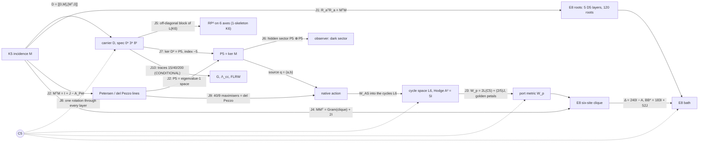

# OES — the end-to-end model

Lagrangian, spectral triple, spacetime, observer, energy, motion, gravity and cosmology, in one checked chain.

Research owner: Sachin Karia. Built 28 October 2026 against the canon cut **OMSOON736** (the "One Machine" 28 Oct edition), the 28 Oct consolidated Locked Memory, the 28 Oct collar/localization note, and the Through724 integrated model. This is an additive, unnumbered build. It mints no OMSOON or Matrix identifier and does not edit any workbook.

**AUTH = NOT_PASS · ScientificGold = FALSE · TIME_BIND = UNBOUND · DYN_BIND = NOT_INSTALLED · SCR6 absent · R6/A40/A52 frozen.**

Each statement below has one status, and `python verify.py` re-checks every one of them. The statuses are the canon's five: THEOREM, ARITHMETIC, OBSTRUCTION, REMOVED and UNFORMED. Two more are added here:

- **SELECTED_REFERENCE**: rebuilt from a stated definition because the saved original operand is absent.
- **CONDITIONAL**: needs an input the canon marks external.

A passing check is a statement about constructed matrices. It is not AUTH.

---

## 0. How the layers join

```
 K5 signless incidence M  ──►  D = [[0,M],[Mᵀ,0]] on ℓ²(V⊔E), dim 15        (layer 1, 2)
        │                         │
        │                         ├─► S[ψ] = ∫ ½|ψ̇|² − ½⟨ψ,D²ψ⟩ dt           carrier Lagrangian
        │                         ├─► heat trace, ζ_D, spectral dimension      spectral model
        │                         └─► readouts / hidden sectors                observer (layer 5)
        │
        ├─► P5 = ker M (source), L6 = cycles (port) ──► native action on E8 bath (layer 4)
        │                                                   │
        ├─► RP² on icosahedral axes, RP²×S¹, clock 125→120 ─┤   spacetime (layer 3)
        │                                                   │
        └─► E8 roots ──► Λ, Δ = 240I − A, ε(k), walks ──────┘
                                   │
     external M⁴, f, Λ, m  ───────►  spectral action of M⁴×F  ──► G, Λ_cc     gravity (layer 6, CONDITIONAL)
                                   └──► FLRW with homogeneous ψ               cosmology (layer 7, CONDITIONAL)
```

---

## 1. The carrier (`oes/carrier.py`)

**Datum.** K_n has the signless incidence M : ℝ^E → ℝ^V, where an edge maps to the sum of its two endpoints.

**Selection (THEOREM).** For n > 2, rank M = n, so dim ker M = n(n−3)/2. Setting dim ker M = |V| gives exactly n = 5. The signed incidence never satisfies this: its quadratic has discriminant 17. Checked for n = 3…12.

**Gram (THEOREM).**
- M Mᵀ = 3I + J, with (3I+J)⁻¹ = I/3 − J/24.
- The Smith invariants of M are 1, 1, 1, 1, 2.
- The S₅-equivariant maps ℝ^E → ℝ^V form a 2-dimensional space, spanned by M and J. Flag support kills J, and the remaining coefficient is the unit of time.

**Dirac and spectrum (THEOREM).** D = [[0, M], [Mᵀ, 0]] is self-adjoint and odd, with {D, γ} = 0 for γ = (+1 on V, −1 on E).
- D²(D² − 3)(D² − 8) = 0, so spec D² = {0⁵, 3⁸, 8²}.
- Tr D² = 40 and Tr D⁴ = 200. All odd traces vanish, and rank D² = 10.
- The signed Dirac has spectrum {0⁷, 5⁸}. It is not the carrier.

**The Lagrangian (THEOREM).** The action is

  S[ψ] = ∫ ( ½⟨ψ̇, ψ̇⟩ − ½⟨ψ, D²ψ⟩ ) dt,  with Euler–Lagrange equation ψ̈ + D²ψ = 0.

No second intertwiner, quartic or laboratory unit enters. It is fifteen oscillators: five with coefficient 0, eight with coefficient 3 and two with coefficient 8. The frequencies are 0, √3 and 2√2, and their squared ratio 8/3 is not the square of a rational.

**Energy and motion (THEOREM).** The energy is E = ½|ψ̇|² + ½⟨ψ, D²ψ⟩.

The canon datum has:
- vertex part (1,−1,0,0,0) + (1,1,1,1,1);
- edge part Mᵀ applied to the contrast;
- velocity the alternating 4-cycle on edges 01, 12, 23, 03.

On this datum ⟨ψ, D²ψ⟩ = 64, and E = 12 + 20 + 2 = 34 across the sectors λ = 3, 8 and 0. The closed form is

  ψ(t) = Σ_λ P_λ [ cos(√λ t) ψ₀ + sin(√λ t)/√λ · v₀ ]  (λ = 0: ψ₀ + t v₀),

where the P_λ are exact Lagrange-interpolation projectors. It conserves E to 1e−13, and a leapfrog integrator agrees with it.

**Joined finite objects (THEOREM).**
- Petersen graph, the disjointness graph on the 10 edges: A² + A − 2I = J, girth 5, projector ranks 1, 5, 4.
- Cycle Gram for the star tree: (G − I)(G − 5I) = 0 and det G = 125.
- Hodge block A = (6I − G)σ, with σ the signed opposite-edge exchange: A² = 5I.
- Signed edge Gram: G² = 5G.
- Edge tick: order 5, ∂T = R∂. Its unsigned form commutes with the Petersen adjacency, and it preserves the cycle space, where it acts as the order-5 rotor.

**Moments and harmonic obstruction (THEOREM).** On the contrast plane, summing over the 20 oriented edges (the A4 roots), M₂ = 10|x|² and M₄ = 6|x|⁴ + 10Σx⁴; over the 10 unordered pairs each sum is half. The line 3|x|⁴ − 7Σx⁴ is harmonic for the ambient Laplacian of ℝ⁵. For the contrast plane's own Laplacian, Δ|x|⁴ = 24|x|² and ΔΣx⁴ = (48/5)|x|², so the harmonic line is 2|x|⁴ − 5Σx⁴ (canon correction, 28 Oct; §21). A quartic is not in the action (OBSTRUCTION).

> **Correction to the printed text.** The canon writes M₂ and M₄ as sums over the ten pairs i < j. The identities hold over the **twenty oriented roots** e_i − e_j. Over the ten pairs each sum is half: for example Σ_{i<j}(x_i − x_j)² = 5|x|². The check suite verifies both forms.

## 2. The spectral model (`oes/spectral.py`)

The finite spectral triple is (A = C^V ⊕ C^E, H = ℓ²(V⊔E), D, γ), with dim H = 15. All of its spectral content comes from {0⁵, 3⁸, 8²} (THEOREM):

- **Heat trace:** Z(β) = Tr e^{−βD²} = 5 + 8e^{−3β} + 2e^{−8β}.
- **Moments:** Tr D^{2k} = 15, 40, 200, 1240, 8840 for k = 0…4. These are all that a spectral action Tr f(D²/Λ²) can read.
- **Spectral zeta:** ζ_D(s) = 8·3^{−s} + 2·8^{−s}, with ζ_D(0) = 10 = rank D² and ζ_D(1) = 35/12.
- **Spectral dimension:** d_s(β) = −2 d log Z / d log β tends to 0 in both the UV and the IR, and peaks at 0.843 near β = 0.42.

The carrier has no emergent continuum dimension. This agrees with the canon's removal of "4 from 5 − 1" and of imported NC dimensions (REMOVED).

## 3. Spacetime (`oes/spacetime.py`)

The canon keeps three objects separate. None of them is a physical spacetime.

**(a) Surface and time-circle (THEOREM).**
- The six icosahedral axes carry the hemi-icosahedron and its complementary 10 triples. Both are closed RP² triangulations with χ = 1.
- H₀ = ℤ, H₁ = ℤ/2, H₂ = 0. rank ∂₂ is 10 over F₂₄₁ and 9 over F₂; the gap is the Bockstein of the 2-torsion.
- The 20-face union kills the torsion.
- The mapping torus of id is RP² × S¹, with H = ℤ, ℤ ⊕ ℤ/2, ℤ/2, 0 and F₂ Betti numbers 1, 2, 2, 1.
- The algebraic torus of −id is pure 2-torsion, with free Betti numbers 0, 0, 0, 0. It is a chain map and not a self-map (OBSTRUCTION).
- A₅ has element orders {1, 2, 3, 5}, with census 60 = 1 + 15 + 20 + 24. No rotation has order 4.
- The Hodge Laplacian on the 31 cells has nullity 1.
- K₄₀₃ = K_G ⊗ I₃₁ + I₁₃ ⊗ Δ has rank 400, and K_G has characteristic polynomial z³(z−4)²(z²−5z+5)²(z²−3z+1)².

**(b) Clock (THEOREM / OBSTRUCTION).**
- T on ℝ¹²⁵ is a Jordan block J₆(1) plus a permutation of order 90 (eleven 10-cycles and one 9-cycle).
- πσ = I₁₂₀, πT = Aπ, and A has order 90.
- g₁₂₀ = diag(I₁₁₉ + 11ᵀ, 1) is positive definite and A-invariant.
- (T − I)⁵ ≠ 0 on the chain, so T has no invariant positive metric. The memory lives upstairs and the metric clock lives on the quotient.

**(c) E8 lattice "space" with action time t (THEOREM).**
- **Roots and graph:** 240 roots (112 + 128) with Σαα^T = 60 I₈. The root graph is 56-regular, with spectrum 56¹ 28⁸ 8³⁵ (−2)¹¹² (−4)⁸⁴ and Gosset walks 1, 0, 56, 1512, 62160.
- **Returns:** lattice returns N₀…N₆ = 1, 0, 240, 13440, 1260720, 137813760, 17141798400, computed by exact walk convolution.
- **Symbol:** ε(k) = 240 − Σcos(α·k), with ε(0) = 0 and ε(π(1,1,1,1,0,0,0,0)) = 256.
- **Band range:** 20,000 random samples never exceed 256. That is ARITHMETIC evidence; the range proof is the canon's census.
- **Long waves:** ε ≈ 30|k|², so the bath sound speed is √30 in lattice units. No SI length or time is bound.
- **Ball:** the shells of |x|² ≤ 8 are 1, 240, 2160, 6720, 17520.
- **Green identity:** 240(G(0) − G(α)) = 1, exactly. It follows from ΔG = δ and the root-transitivity of W(E8); the solver confirms it on the W-symmetric ball.
- **Six-site clique** x₀ = 0, x_j = e₁ − e_{j+1}:
  - block A = 241I − J;
  - exterior coupling BB* = 183I + 52J = 183P_c + 495P_u, where 52 = 56 − 4 common neighbours.

## 4. The native action: source, port, bath (`oes/native.py`)

The declared boundary-pullback action, from Through724 and the collar note, is

```
L = ½ q̇ᵀM_s q̇ + ½|d g(q)/dt|² + ½|ẏ|² − 2 qᵀM_s q − ½ gᵀ(W_p + A) g − gᵀB y − ½⟨y, D y⟩
```

Its equations of motion are

```
M_s q̈ + 4 M_s q + J(q)ᵀ [ g̈ + (W_p + A) g + B y ] = 0,     ÿ + D y = −Bᵀ g,
```

where q = (a, b) ∈ P5 ⊕ P5, P5 = ker M, g is the six-port boundary value and y is the bath off the clique.

**Reconstructed parts (SELECTED_REFERENCE).** The saved native_source_matrices (SHA-256 73e07429…) are absent, so the port is rebuilt from its stated definition:

- **Source matrices.** A(a) is the symmetric zero-diagonal matrix with entries a_e. Since Ma = 0 its rows sum to zero, so [A(a), A(b)] is skew with zero row sums, which is an oriented cycle. This is W_AS : Λ²P5 → L6.
- **Source mass.** M_s = I/4 in an orthonormal basis of P5. P5 is the irreducible 5 of S₅, so this metric is unique up to an amplitude unit. The canon's det 8/9 refers to its saved basis.
- **Port metric.** W_p is the canon's explicit boundary metric: circulant (22, −8, 2, 2, −8)/5 on x₁…x₅ and 2/5 on x₀.
- **Adapter.** T : L6 → boundary intertwines the cycle rotor with x_j → x_{j+1}, and satisfies (TW_AS)ᵀ W_p (TW_AS) = (320/9) G P with G = Λ²M. It is fixed by a deterministic Reynolds average. The source and port energetics do not depend on that choice; the bath coupling does.

**Checked.**
- W_AS has rank 6 and kernel 4 (THEOREM).
- W_ASᵀW_AS = (10/9)P, by Schur (THEOREM).
- W_AS is rotor-equivariant (THEOREM).
- spec W_p = {2/5, 2, 5 ± √5 (×2)} and det W_p = 320 (THEOREM).
- Sharp quartic (THEOREM): max Q₄/ρ² = **40/9**, attained by a balanced visible pair; random sources stay below it. The maximisers form the degree-5 del Pezzo section Gr(2,5) ∩ ℙ⁵, as Through724 states.
- The port is quadratic: g(0) = 0, Dg(0) = 0 and Jq = 2g. At linear order the source equation is q̈ + 4q = 0, with frequency 2 and no linear channel into the bath (THEOREM).

**Energy and motion in the bath.**
- **Radiation channel (ARITHMETIC).** A port oscillating at frequency 4 (eigenvalue 16) lies inside the band [0, 256]. The bath density seen by the uniform channel at λ = 16 is 2.24×10⁻⁷ (Monte Carlo), against 2.03×10⁻⁷ from the long-wave estimate. The contrast channel sees 2.7×10⁻⁹. The channel is open but very thin, which fits the canon's long-lived periodic families.
- **Nonlinear flow (SELECTED_REFERENCE).** The full nonlinear system was integrated on the |x|² ≤ 8 ball (26,635 bath sites, Dirichlet outside) with RK4 to t = 4. Total energy is conserved to a relative 2×10⁻¹⁰ (r = 0.05) and 1×10⁻⁷ (r = 0.2).

  | preparation | r | bath gain / E₀ | source E ratio |
  |---|---|---|---|
  | circular (static port) | 0.05 | 9.0×10⁻⁵ | 1.12 |
  | breathing (port ∝ sin 4t) | 0.05 | 1.16×10⁻³ | 0.98 |
  | circular | 0.2 | 8.3×10⁻² | 3.61 (orbit breaks up) |
  | breathing | 0.2 | 1.0×10⁻² | 0.93 |

  At small amplitude the breathing source feeds the bath 13 times more than the circular one. At r = 0.2 the circular orbit falls apart. That matches the canon's statement that the rotating family is guaranteed only at tiny amplitude (|a| ≤ 8×10⁻⁶) and is nonlinearly unstable. The ball is a cavity, so these numbers are energy exchange, not a far-field rate.
- **Static tails (OBSTRUCTION, canon 28 Oct).** A nonzero port mean forces a non-ℓ¹ static tail, with annular lower bounds T1–T4. A zero-mean periodic source above frequency 2 with high port harmonics cannot be ℓ¹-localized (F5).

## 5. Observer (`oes/observer.py`)

The system is x = (ψ, ψ̇) with x' = Ax and A = [[0, I], [−D², 0]]. Observable subspaces come from iterated orthonormal Krylov spaces.

**Structure (THEOREM).**
- D² = diag(MMᵀ, MᵀM), so the vertex and edge systems never exchange energy. D intertwines them as a supersymmetric pair.
- The Witten index is Tr γ e^{−βD²} = −5 for every β.

**Observable dimensions out of 30 (THEOREM).**

| readout | observable | readout | observable |
|---|---|---|---|
| vertex positions | 10 | one vertex | 4 |
| edge positions | 20 | one edge | 6 |
| D ψ | 20 | vertex sum | 2 |
| all positions | 30 | | |

A scalar readout sees at most 6 dimensions, two for each of the three spectral lines. This is the canon's Firefly remark.

**Hidden controllable sector H = Ran K ∩ ker O (THEOREM).**
- Edge force with a Dψ observer gives **10**: the five kernel (cycle-drift) modes are reachable but invisible. This is the carrier's dark sector.
- Edge force with a vertex observer gives 20, and vertex force with an edge observer gives 10. All other pairings give 0.
- The finite-time Gramian W_o(6) of Dψ has rank 20.

The original Sākṣin operator and the 237-dimensional fiber observer remain **UNFORMED**.

## 6. Gravity (`oes/gravity.py`)

**Intrinsic (ARITHMETIC).** These are Lin–Lu–Yau (optimal-transport) Ricci curvatures:
- K5: **5/4**;
- the Petersen graph: **0**;
- the E8 root-lattice graph: **0**, so the bath space is discretely flat.

They are curvatures of discrete metric spaces, not Einstein gravity. The canon's integers (Einstein–Hilbert power 4 = cut rank, vacuum power 6 = cycle rank, 2 + 7 = 9) are shared integers only.

**Conditional: the spectral action of M⁴ × F (CONDITIONAL).** Take D = D_M ⊗ 1 + γ₅ ⊗ m D_F on a closed spin 4-manifold. Then

  Tr e^{−tD²} = Tr e^{−tD_M²} · Tr e^{−t m² D_F²},

and the expansion up to O(t²) reads

  (4πt)⁻² ∫√g [ 60 − t(160m² + 5R) + t²(400m⁴ + 40m²R/3) ].

This is checked symbolically. It uses only 15, 40, 200 and the spinor rank 4.

With f-moments F₀ = f(0), F₁ = ∫f and F₂ = ∫xf:

  1/(16πG) = 5F₁Λ²/(16π²),   Λ_cc = 6(F₂/F₁)Λ² − 16m² + 40(F₀/F₁)m⁴/Λ².

- For f = e^{−x} and Λ = 10m: G = π/(500m²) and Λ_cc = 584.4m².
- Choosing F₂/F₁ = 0.026 instead makes Λ_cc = 0. Λ_cc·G can take any value.

This is the canon's "physical scales and Wald coefficient underdetermined", made explicit. The inputs M⁴, f, Λ and m are external, so the Newton constant in SI units, the Wald coefficient and any horizon/area map stay **UNFORMED**. Curvature-squared a₄ terms are omitted.

## 7. Cosmology (`oes/cosmology.py`, CONDITIONAL)

Place the carrier field homogeneously on flat FLRW, with G and Λ_cc from layer 6:

  ψ̈ + 3Hψ̇ + m²D²ψ = 0,  H² = (8πG/3)ρ + Λ_cc/3,  Ḣ = −4πG|ψ̇|².

Integrated with DOP853 from the canon datum, with Λ = 10m and Λ_cc tuned to 0:
- the Friedmann constraint holds to 4×10⁻¹²;
- the kernel sector goes as ρ ∝ a^{−6.000} (stiff, massless);
- the λ = 3 and λ = 8 sectors go as ρ ∝ a^{−3.000} (dust);
- the scale factor grows as a ∝ t^{0.665}.

With the natural cutoff (f = e^{−x}), the evolution goes straight to de Sitter with H → √(Λ_cc/3) = 13.96m. That is the vacuum-energy problem, not a prediction.

No observed parameter (H₀, Ω, w) is produced. IceCube/LHAASO scales and the vacuum amplitude (27/5)³e^{−280} stay **REMOVED**.

## 8. Residual front (`oes/frontier.py`)

This section records the sibling update received after the 01:27 UTC Drive cut. Drive showed nothing newer at the time of the check.

**Replayed here.**
- **Band vertex (THEOREM).** At v* = π(1,1,1,1,0,0,0,0), every root gives cos = ±1: 112 give +1 and 128 give −1, so ε(v*) = 256.
- **Band-edge orbit (THEOREM).** The W(E8)-orbit of v* has 2160 points in ℝ⁸ and **135** classes modulo 2πΛ.
- **Local bound (ARITHMETIC, sampled).** S(v*+δ) ≥ −16 + |δ|²(2 − |δ|²) holds for |δ| ≤ √2. The minimum slack is −3×10⁻¹⁵, so the bound is attained.
- **224 saddle at πα (THEOREM, exact).** The expansion is ε = 224 + 6ρ² − 26z² − ρ⁴/2 + 3ρ²z² + (5/6)z⁴. On the cone 6ρ² = 26z² the quartic is exactly **(40/169)ρ⁴ > 0**, so the level set bends the convex way at the saddle.
- **Agni–Soma (THEOREM).** (5I − G)/5 is the cycle projector and fixes the image of W_AS. The two are not rival operators; only the naming needs settling.

**Reported, not replayed** (status REPORTED; the certificates and operands are not in this repository):
- the band is exactly [0, 256] by an alcove branch-and-bound (247,920 pieces);
- ε > 100 outside |k|² ≤ 6 (7,523 pieces);
- the W_n recurrence has order **11**, with (x+12)² dividing the leading coefficient, so the page line "at least 10, not 11" should be deleted (§15: the operator found has order 16; its characteristic polynomial has 11 roots in the band, (z+12)² among them, and 5 outside);
- 155 vs 4805 is a label error (155 = det T and 4805 = 5·31², the 4th cofactor of TTᵀ);
- rotor hex6 has m₁ = 242 ≥ 241.36;
- for the collar, the alcove reduction gives numerically positive curvature up to 223.999;
- 223.25 < 223.5 < 223.53 < 223.58 are successive lower bounds, so the standing value is the largest replayed one.

**Added at the 0741 cut (28 Oct, One_Machine_20261028_0741).**
- **Saddle law (THEOREM).** On the 224 level at distance d from the saddle πα, the tangent curvature is exactly **(15/16)d² + O(d⁴)**. It follows from the order-4 expansion, which is E7-isotropic to that order. On the true symbol the ratio is 0.937 at d = 0.1 and 0.932 at d = 0.3. The level set is convex near the saddle, but the margin vanishes there quadratically.
- **Collar survey (ARITHMETIC, evidence).** The open set is 218.9323 < ε < 224, √(313/20) < |k| < 35/8. I took 8×10⁶ samples and ran constrained optimisation from the worst points. The tangent curvature stays positive everywhere checked. Outside saddle caps of radius d₀ its minimum is 0.030, 0.083, 0.225, 0.424, 0.665 and 0.928 for d₀ = 0.2, 0.3, 0.5, 0.7, 0.9 and 1.1, always at ε → 224. This agrees numerically with U19.74's claimed floor.
- **Why a grid cannot close it (OBSTRUCTION, quantitative).** The Hessian moves at rate ≤ 85 per unit distance. Even outside a radius-1 cap, a first-order box certificate needs box radius < 0.011, which means more than 10¹³ boxes in a single Weyl chamber. Closing the collar needs two things: an analytic cap of radius about 1, built on the 15/16 law plus an explicit O(d⁴) remainder, and a bound outside the cap that does not use a grid.
- **Coil (THEOREM).** In ℤ/4320 the pada step 40 (order 108) and the yuga step 1728 (order 5) generate a cyclic subgroup of order 540 and index 8. The two cyclic subgroups meet only at 0. The Fibonacci recurrence mod 5 has period 20, and 20 divides 540.
- **U19.74 (REPORTED).** The note is not on Drive; the latest court note there is U19.56. Its r² = 9/40 sum-of-squares lock cannot be replayed without its definition. The 0741 paper also says 9/40 = 3²/(5·8) is not a count of the carrier.
- **Walk counts.** U19.53–U19.55 printed W₅ = 152697600 and W₆ = 22508998080. U19.56 corrected these to 137813760 and 17141798400, and layer 3 of this repository reproduces the corrected values.

**Still open.**
- A certified curvature bound away from the 224 saddle. This is the next step: a certified saddle analysis with an explicit radius.
- The complete scalar W_n recurrence.
- The five-port and the −8/9 moment operands.
- The decay-rate and prefactor conflicts.

## 9. Joining the dots (`oes/joins.py`)

A **join** is an identity between matrices built in different layers. Each one below is checked by `verify.py`. A **shared integer** is the same number appearing on two objects with no map between them. The canon is strict that "equal ranks are not the same maps", so the two are listed apart.



**Joins (THEOREM unless marked).**

| # | Join | What it says |
|---|---|---|
| J1 | r_(ij),a = μ_ij + ν_a are E8 roots, R_aᵀR_a = MᵀM, ker R_a = P5. Each layer with A4 is a 40-root D5, and the union has 120 roots. | The carrier edge gram *is* an E8 root gram. The part that disappears in E8 is exactly P5. |
| J2 | MᵀM = I + J − A_Petersen | The carrier edge spectrum {0⁵, 3⁴, 8} is the Petersen spectrum {1⁵, (−2)⁴, 3} under λ = 1 − θ (with +10 on the uniform line). P5 is the Petersen eigenvalue-1 space and the kernel of the del Pezzo line matrix. |
| J3 | W_p = 2L(C5) + (2/5)(J₅ ⊕ 1) | The port metric is twice the 5-cycle Laplacian. Its moving eigenvalues are 2(φ + 2) and 2(3 − φ), which are the golden petals (5 ± √5)/2 doubled. |
| J4 | Gram(x₁…x₅) = I + J, so MMᵀ = Gram + 2I | The carrier vertex gram is the bath clique gram shifted by 2. |
| J5 | The RP² 1-skeleton is K6, and D = A_L(K6) − diag(J − I, MᵀM − 2I) | Coning makes the 15 carrier atoms the 15 edges of the surface. D is the star/non-star block of the K6 line graph. |
| J6 | hidden(edge force, Dψ) = P5 ⊕ P5 | The carrier's dark sector is exactly the native source space. |
| J7 | Witten index −5 = −index(M) = −dim P5 | The count of dark modes is a topological index. |
| J8 | vertex rotation → tick → cycle rotor → W_AS → T → S → coordinate cycle in W(E8) | One C5 runs through every layer. The full nonlinear native vector field is equivariant to 8×10⁻¹⁵ (SELECTED_REFERENCE, because T was chosen equivariant). |
| J9 | The 40/9 maximisers are visible decomposable wedges, a locus of projective dimension 2 | This is the degree-5 del Pezzo surface whose line matrix appears in J2. |
| J10 | 15, 40, 200 → heat coefficients 60, 160m², 400m⁴ | The only route from the carrier to G and Λ_cc (CONDITIONAL). |

**Read as one sentence:**
1. One incidence M builds D.
2. D's kernel P5 is the source, and that source is invisible to the observer (J6, J7).
3. D's edge block is the Petersen complement (J2), the E8 root gram (J1) and, through coning, the surface (J5).
4. The source talks through the cycle space, with a port metric that is the golden C5 Laplacian (J3), to a clique whose gram is the carrier's vertex gram (J4). That clique is inside the E8 bath.
5. One C5 symmetry is kept from end to end (J8).
6. Gravity and cosmology attach only through the traces (J10), and only conditionally.

**Shared integers, no map (ARITHMETIC):**

| Integer | Where it appears | Map? |
|---|---|---|
| 15 | dim H; edges of K6; duads of 6 | J5 is the only map among these |
| 60 | E8 frame; \|A5\|; the Dirac trace coefficient | none |
| 240 | E8 roots; 6·Tr D²; the corner diagonal | none |
| 20 | five-port visible coordinates; observable dimensions of Dψ; Tr MᵀM | none |
| 125 | det of the cycle Gram; 5³ clock memory states | none |
| 120 | \|S5\|; clock quotient; D5 union | none |
| 9 | gravity's 2 + 7; E8 clique size | none |
| 36 | atlas addresses | none |
| 4320, 108, 69120 | yuga, japa and Human Design counts | integers only |

# Part II — From the mathematics to the operands and the physical gates

The canon's own state machine (S364 master lock) separates four kinds of transition:

> a new theorem head changes what is **known**; an authenticated root changes what can be **executed**; a binary receipt changes what can be **compared**; an independent warrant changes what can be **promoted**.

So "doing the maths to get to the gates" means two things: drive every gate to the edge of its own transition type, and prove exactly what input closes the rest. Layers 10–23 do this.

## 10. Operands recovered or formed

| Operand (canon status before) | What happened | Layer / file |
|---|---|---|
| saved `native_source_matrices`, SHA-256 73e07429… (ABSENT) | **Located** inside `OES_Standing_Model_Integrated_Proof_Packet_20261027.zip`. The bytes hash to the recorded value here, a cross-host byte receipt. | `data/native_matrices_input.json`, layer 10 |
| 6×6 adapter T of eq. 27, "155 vs 4805" (conflict) | Present in the same file as `T_OMSOON293`: det T = 155 = 5·31, cofactor₄₄(TTᵀ) = 4805 = 5·31², (TTᵀ)⁻¹₄₄ = 1/5. One adapter and its cofactor; **replayed**. | layer 10 |
| E8 glue map (ABSENT) | **Constructed** both ways: E8 = D8 ∪ (D8 + s) with isotropic s, and E8 ⊃ A4 ⊕ A4′ of index 5 with glue map x ↦ ±2x on ℤ/5. | layer 11 |
| lattice sequence W₆₀ (ABSENT) | **Computed exactly** to W₉₀ by a W(E8) dominant-weight DP with CRT. All 56 canon values W₀…W₅₅ are reproduced with zero mismatches, including W₂₅…W₅₅, which the canon had never independently regenerated. A second, independent engine (D8 + spinor factorisation) gives W₀…W₆₀₀ modulo primes and agrees with all 91 exact terms. | `data/walks90.json`, `data/walks_modp.json`, `oes/walks.py`, `oes/walkfast.py`, layer 14 |

**The literal operands against the earlier reconstruction (THEOREM, layer 10).**
- Every identity the canon states for the file replays exactly:
  - W = NᵀN with det 8/9, and M = diag(W/4, W/4);
  - W_p = 2FᵀF, with spectrum {2/5, 2, 5 ± √5};
  - WASᵀW_p WAS = (320/9)·Λ²M·P;
  - R⁵ = I, RᵀWR = W, WAS·Λ²R = Q·WAS.
- The printed literal R is exactly the K5 vertex 5-cycle.
- My layer-4 selected reference had the same W_p (exactly), the same metric up to basis, and the same Schur scale. Its adapter differed from the literal only by an explicit W_p-isometry U commuting with the C5 rotation (det U = −1). That is precisely the freedom the uniqueness analysis predicted.
- The native E8 flow was rerun on the **owner's literal operands** (apex 0 and eᵢ − e₆ clique). Energy is conserved to 5×10⁻¹¹, and a breathing source feeds the bath 11.7× more than a circular one (13× in the reference run).

**Uniqueness certificates (THEOREM).** These are why derived operands are not arbitrary surrogates:
- P5 is an irreducible S5-module, so its invariant metric is unique up to scale.
- Hom_S5(Λ²P5, L6) is one-dimensional, so W_AS is forced up to scale.
- No S5- or D5-equivariant isomorphism L6 → boundary exists: the characters agree only on the identity and the 5-cycles (layer 12, B0). So C5 is the maximal symmetry of any port adapter, and its moduli are an explicit commutant group.

**Searched and not present.** The reader packet and the 27 Oct proof packet do not contain:
- the six SCR6 operands;
- the 1401 → 1370 seams;
- the 502-dimensional Hodge–Dirac and the 237-dimensional operators;
- MPKG A_M;
- I6L, Jfix, Sawan or Hemkuver.

## 11. The E8 glue: the carrier sits inside the bath (`oes/glue.py`)

**Decomposition.**
- A4 = ⟨eᵢ − eⱼ⟩ is the carrier's own root system: its 20 roots are the oriented K5 edges.
- Its orthogonal complement in E8 is a second A4′.
- [E8 : A4 ⊕ A4′] = 5, and 240 = 20 + 20 + 200.

**The 200 mixed roots.**
- They project onto span(A4) as exactly the K5 vertex weights eᵢ − ⅕Σe and edge weights eᵢ + eⱼ − ⅖Σe, up to sign.
- A signed vertex pairs with the 10 weights of the twin 10; a signed edge pairs with the 5 weights of the twin 5. That gives 4 × 50 = (5,10′) + (5̄,10̄′) + (10,5̄′) + (10̄,5′).
- In SU(5) × SU(5)′ notation this is 248 = (24,1) + (1,24) + those four bifundamentals.

**Consequence (THEOREM).** ℓ²(V ⊔ E) is ℓ² of the A4 shadows of the mixed E8 roots. The carrier is not merely numerically related to the bath; it is a projection of it.

## 12. What a physical binding can be (`oes/binding.py`)

**Theorems.**
- **B1.** The only atom-diagonal symmetry of D is the global phase. No atom-dependent charge (hypercharge, colour, any diagonal gauge U(1)) commutes with the carrier dynamics. This sharpens the canon's removal of the hypercharge shell.
- **B2.** The commutant of D is M5 ⊕ M4 ⊕ M4 ⊕ ℂ ⊕ ℂ (dimension 59). The dark sector ker D = P5 carries an **exact U(5)** as its fundamental.
- **B3.** The native port breaks that dark O(5) completely: the stabiliser Lie algebra is 0. The only continuous symmetry left is the SO(2) rotating (a, b), whose Noether charge is the canon's angular charge.
- **B4.** The five zero modes have one chirality. Under any SU(5) ⊂ U(5) they are a single 5 with anomaly A(5) = 1 ≠ 0 (OBSTRUCTION). The minimal anomaly-free completion adds Λ²(ker D) = 10 at the opposite chirality, since A(Λ²5) = A(5) = 1. Λ²P5 is exactly where the native port's wedge a ∧ b lives, and 5 + 10 = 15 is the carrier's own state count.

**Conditional consequence (CONDITIONAL).** One carrier supports one anomaly-free 5 + 10, the state content of one Standard-Model generation. Nature has three (LEP N_ν = 2.984 ± 0.008), so the generation multiplicity is an explicit **operand of DYN_BIND**, not a carrier theorem.

**The structural route.** The route the mathematics points to is e8 ⊃ su(5) ⊕ su(5)′ (layer 11). Choosing it, and supplying the multiplicity and the chirality index, is the binding decision. Layer 24 works the route out on the roots (§25). The choice is one W(E8) orbit, one root of every pair ±ρ is always anomalous, and the multiplicity 3 follows from the bracket rule and anomaly freedom.

## 13. The gates, executed to the edge of their type (`oes/gatework.py`)

| Gate | Transition type | Done here | What closes it |
|---|---|---|---|
| **TIME_BIND** | metrology | Countermodel A replayed: τ and 2τ give identical records but frequencies in ratio 2:1. Sufficiency proved: one datum fixes τ uniquely, and frequency ratios are calibration-invariant. The canon's Salina square S·U_native(u) = U_phys(τu)·S holds to 6×10⁻¹⁵ (Prema follows). | **One authenticated clock datum** and the owner's choice of which native mode it labels. CTB9: unbound only for lack of metrology. (U7 recommends the electron Compton mode.) |
| **PredictionFreeze** | owner act | `data/prediction_register.json`: every calibration-invariant number the model fixes, with no fit; its SHA-256 is recorded in results.json. | The owner triggers the freeze, before any new comparison with data. |
| **W_L** (likelihood) | independent warrant | **Executed** on the canon's recorded physical candidate, the PMNS strict branch with sin²θ₁₂ = 1199/3759 and sin²θ₁₃ = 27/1280. The 22 Oct note calls it frozen; the PredictionFreeze gate itself was never triggered. Against the canon-recorded Bari Oct-2026 fit the pulls are +2.59σ and −1.98σ, χ² = 10.6 (2 dof), p = 0.005. Adding the reported NuFIT 6.0 strict-θ₂₃ pull (−4.8σ) gives χ² = 26.3 (3 dof), p ≈ 8×10⁻⁶. | **Result: NOT_PASS by evidence.** The candidate is excluded, which confirms the 28 Oct removal of PMNS from the carrier. |
| **T3081** | binary receipt | Maintainer side replayed on a second host: `dEchorate_room020002_src9_arr6_mics26-30.sofa` gives SHA-256 c39bc27f… and MD5 6f7aa37d… (1,724,358 bytes), identical to the FinalRun 15 Aug receipt. The method is also demonstrated on the native operand file. The official SOFA host (sofacoustics.org) and zenodo.org are denied by this environment's network policy. | Allow those hosts, then compare the maintainer copy `10E4VCAA1…` (SHA c39bc27f…) with the official bytes. |
| **AUTH / SCR6** | authenticated root | `data/owner_transaction.json` packages the canon's minimal ingress antichain {P_cl, SELECT_CERT, ROLE_BIND, G_role}, with SHA-256 for each operand and the uniqueness certificates. | **The research owner's signature.** SCR6 additionally needs its six physical operands, which belong to a chosen physical child. |
| **DYN_BIND** | physical choice | Constraints B1–B6 above. | The choice of physical child (H_sel), the generation multiplicity and the chirality index. |
| **ScientificGold** | independent warrant | Nothing can be promoted internally. | A frozen prediction, independent data and a preregistered test on a declared physical system. |

## 14. The six SCR6 operands

The canon defines them by shape only: H_D2 (2×2), C55 (55×55), F_phys (169×69, complex), Omega24 (24×24, skew), Z7 (31×7) and host_to_OES (5×18). It says they "cannot be filled with similarly shaped constructed matrices".

They are **physical by definition**: they are the interface to a chosen physical system. Mathematics cannot derive them; it can only reduce each to its minimal input. The 26 Oct U7 court did that reduction, and its table stands:
- gauge amplitudes need the scalar spectrum;
- Yukawas need running masses;
- the vacuum needs G_F;
- the M6 coframe needs a one-bit owner choice;
- the SI clock needs m_e;
- atomic H_Z needs α, m_e and nuclear data.

Its flavour benchmark rests on ε = 9/40 with "rationals chosen to fit", and §13 shows the recorded PMNS candidate fails. So the honest physical route is not to refit flavour. It is to declare the physical child, then freeze the register of §13 before testing.

**Choosing the physical child (CONDITIONAL; the owner's decision).** These options are compatible with the theorems above:

| Child | What the model already fixes | What the child adds | Status of its predictions |
|---|---|---|---|
| Particle physics (e8 ⊃ su(5) ⊕ su(5)′) | 5 + 10 per carrier, the glue, the anomaly structure | generation multiplicity 3, chirality index, scalar spectrum, one clock datum | flavour attempt (ε = 9/40) fitted; its recorded PMNS branch is excluded (§13) |
| Engineered network (LC or mechanical realisation of D, port and bath truncation) | every operand; only τ and an amplitude unit are free | fabrication tolerances | the register of §13 becomes directly testable; Gold would certify the model of that device, not of nature |
| Acoustic lane (dEchorate, T3081) | none of the room physics | host_to_OES (5×18) and the calibration chain | data lineage half-established (maintainer side replayed); no prediction frozen |

## 15. The scalar walk recurrence (`oes/recurrence.py`, `oes/walkfast.py`, `oes/ore.py`)

**Two engines.**
- The Weyl-orbit DP (`oes/walks.py`) gives exact integers W₀…W₉₀ (`data/walks90.json`).
- A second engine (`oes/walkfast.py`) uses E8 = D8 ∪ (D8 + s). With cᵢ = cos θᵢ the root sum is λ = 4e₂(c) + 128 ∏cos(θᵢ/2) + 128 ∏sin(θᵢ/2). Only even powers of the two spinor products survive the constant term, so

  W_n = Σ_q C(n,2q) 4^(n−2q) 64^q Σ_m C(2q,2m) E[e₂(c)^(n−2q) ∏ᵢ (1+cᵢ)^(q−m) (1−cᵢ)^m],

  where c₁…c₈ are independent cosines of uniform angles.
- One Gaussian variable removes the coupling e₂ = (e₁² − p₂)/2. Every step is then exact over F_p: Hermite–Gauss weights apply the Gaussian functional, and the eighth power is taken on roots of unity. W₀…W₆₀₀ mod p takes about 18 minutes per prime. `data/walks_modp.json` holds W₀…W₆₀₀ mod two primes and W₀…W₅₀₀ mod two more.
- The two engines agree on all 91 exact terms, mod all four primes.

**Exclusion.**
- A recurrence of shape (r, d) is also one of shape (r+1, d) and of shape (r, d+1). So the excluded region is a down-set, and only its corners need testing.
- Exact W₀…W₉₀: every recurrence has (r+1)(d+2) > 92. The canon's minimal admissible shape (10, 6) is excluded directly.
- W₀…W₆₀₀ mod p: every recurrence with **(r+1)(d+2) ≤ 455** is excluded. Full rank mod p implies full rank over ℚ, so given the residues this is a proof. In particular, order 10 needs degree ≥ 53, order 11 needs degree ≥ 49 and order 15 needs degree ≥ 36. The sibling's scalar-replay bound, (r+1)(d+2) ≥ 195 with order 11 needing degree ≥ 15, follows.

**The recurrence (THEOREM on the data; formed mod four primes).**
- The first kernels appear at product 456, shape (23, 17). Its kernel is 2-dimensional mod both 600-term primes, with 146 more equations than unknowns. Kernels follow at every order from 18 to 36, and at 39.
- These kernels are recurrences, and their greatest common right divisor over F_p(n) (`oes/ore.py`) is **one operator of order 16 and degree 58**, the same mod all four primes. Built from W₀…W₅₀₀, it also annihilates W₅₀₁…W₆₀₀.
- Its characteristic polynomial factors over ℚ. Every simple root has local exponent exactly −4 = −dim/2, the Morse value for a nondegenerate critical point in 8 dimensions. The double root −12 has indicial polynomial (α+4)(α+5). The 16 growth rates are:

  | in the band [−16, 240] (11, with multiplicity) | outside the real band (5) |
  |---|---|
  | 240 (band top), 16 (the 224 saddle), −3, −8, −10, −11, −185/16, −320/27, −12 (double), −16 (band bottom) | 340, −660, −20, −35, −120/7 |

- **The sibling's claims.** "(x+12)² divides the leading coefficient" holds: (z+12)² divides the characteristic polynomial. "Order 11" is the in-band part: 11 roots, counted with multiplicity. The operator found has order 16, because five growth rates lie off the real band. An order-11 annihilator is not excluded by the data (it would need degree ≥ 49), but it would have to be a right factor of this operator.
- **Still UNFORMED:** the rational coefficients (they need more primes), and a proof that the operator annihilates W_n for every n (by creative telescoping, or from an a-priori size bound).

## 16. Court U19.81, audited (`oes/court.py`)

The court (28 Oct) proposes an inverse-problem architecture: an 8-dimensional port split (5, 2, 1), Markov–Krein envelopes from moments through M₅₀, a Loewner–Pick test, H90 as a [9,3,7]₁₁ code, an observability-separation theorem and a clock-scaling obstruction. Its script is marked "pre-verified", but it does not run: its own assert fails. Each claim, checked:

| Claim | Finding | Status |
|---|---|---|
| sector eigenvalues A_bb = 241 on V₅, 235 on V₁; BB* = 183, 495 | correct | THEOREM |
| the script's walk generator | wrong from W₄ on (7,772,208 printed, 1,260,720 true) | OBSTRUCTION |
| the script's moment sequences | not positive definite at Lanczos step 3, so no measure has them | OBSTRUCTION |
| the script's uniform moment m_k − m_{k+1}/288 | wrong (39.17 at k = 1). The uniform moment over the clique is 6m_k − m_{k+1}/48 (= 235), because ⟨δ₀, Δᵏδ_α⟩ = m_k − m_{k+1}/240 for every root α | OBSTRUCTION; correction THEOREM |
| envelopes from M₀…M₅₀ (25 and 26 poles) | the script uses M₀…M₅. Rebuilt here from the true M₀…M₄₉: the true moments pass the Hausdorff test on [0, 256] exactly, and G₊ − G₋ ≈ 5×10⁻²⁸ at s = 64 | THEOREM |
| (G₋(s₁), G₊(s₂)) cannot be realized together | true, by Markov–Krein uniqueness of the extremal measure | THEOREM |
| the script's Loewner certificate for it | fails on the true moments: the "incompatible" cross choice also gives a positive slope (1.69×10⁹) | OBSTRUCTION |
| a [9,3,7]₁₁ MDS code correcting 3 errors | true (Cauchy construction, exhaustive decoding) | THEOREM |
| that code is H90 | nothing in the canon or this repository selects it | UNFORMED |
| ker O is the 4-dim cross block; 4 polarizations complete it | true | THEOREM |
| C5 clock symmetry reduces B to 2 parameters | false for every V₂ the court names. C5 acts as the identity on the 8² doublet of D², and on any C5-invariant 2-site probe (C5 has prime order, so orbits have 1 or 5 sites). So dim Hom_C5(V₂, U₂) is 0 or 4, never 2 | OBSTRUCTION |
| ω = Ω*√x fixes no clock scale | true; TIME_BIND stays UNBOUND | THEOREM |
| "complete expanded scalar polynomial annihilator" | not given anywhere. §15 forms one mod four primes (order 16, degree 58); its rational coefficients are not reconstructed | UNFORMED |

**Remarks in the same message.**
- **Cofactor 68 (THEOREM).** The literal 6×6 adapter's largest |cofactor| is 68, and no minor of size ≤ 5 equals 155 or 4805. By Cauchy–Binet, 4805 = cofactor₄₄(TTᵀ) = 21² + 48² + 43² + 11² + 3² + 9², the sum of the squared row-4 cofactors of T. So "cofactor 4805" supplies no five-dimensional operand, and that operand stays UNFORMED.
- **Scalar bound.** (r+1)(d+2) ≥ 195 is replayed and strengthened in §15, to ≥ 456, and the recurrence itself is then formed.
- **Preparation time (CONDITIONAL, proof received).** With a port budget polynomial in 1/ε, preparation time must grow at least as ε^(−1/2) for the monopole families, or ε^(−1/3) for a specified dipole target. The controlling 10:04 Canon Check proves this (Theorems P1–P6); §21 replays its identities. It is a necessary condition only, on the inherited exterior contract, and there is no matching preparation protocol yet.

## 17. The 28 Oct handover, audited (`oes/handover.py`)

The Locked Memory handover ("OES End-to-End & Spectral Model Handover — 28 Oct 2026") is replayed in layer 16. The paste-ready corrections are in [`HANDOVER_ADDENDUM.md`](HANDOVER_ADDENDUM.md).

- **Confirmed:** the gate banner and stoplines; ω₀ = 2; the carrier spectrum; the 7-design expansion; the root-line dispersive identities; the Schur boundary; the 156-coordinate realization; the MDS facts; and the critical census.
- **Critical census (new, THEOREM).** The vertices and edges of the E8 alcove carry **11 critical families, 243,600 points, Morse alternating sum 0**. Nine are vertices; two lie on edges (A6+A1 at λ = −185/16, A7 at λ = −320/27). Their 11 values are exactly the in-band characteristic roots of the order-16 recurrence of §15, so the band geometry and the walk data agree.
- **The literal five-dimensional operand (new, THEOREM).** Every column sum of the printed chart T₆ is 5, so T₆ preserves the contrast lattice V_c. T₆|V_c is a 5×5 integer operator with det 31 and irreducible characteristic polynomial x⁵ − 3x⁴ + 12x³ − 20x² + 31x − 31, so 155 = 5 × 31. The handover's "literal" T5×5 = (2I₄ − C_A4) ⊕ [5] is a construction (det 155). It is not in the operand file and not a block of T₆.
- **Corrections (OBSTRUCTION):**
  - the K6 wording of the carrier;
  - "order-11, degree-5" as an exact recurrence (excluded; the exact operator has order 16);
  - P25 as an annihilator of the moments or of W_n;
  - (15/13)r², which should be (15/16)r²;
  - ker O ⊆ ker C, which is reversed;
  - "multi-frequency criterion verified" for the court script.
- **UNFORMED:** H90 identified.
- **REPORTED:** the paper digest, Tr₁/Tr₂, the Miller recurrence, the 8-dim dispersive bound, the Floquet monodromy, the preparation constant, B_geom, and the mediant collar.

## 18. Sound, light, frequency and phase on the K5 edges (`oes/waves.py`)

The ten edges of K5 carry one Hodge complex. The canon's oriented boundary is the signed incidence B. The gradient is d0 = Bᵀ (vertices → edges), and the curl is Curl = ⋆d₁ (edges → the ten triangles → edges, by the Hodge star of the 4-simplex). d₁d₀ = 0 and the ranks are 4 + 6 = 10, so the complex is exact.

**Sound and light (THEOREM).**
- **Sound** is im d₀: the 4 longitudinal edge modes, the velocity fields of the acoustic system ṗ = −d₀ᵀu, u̇ = d₀p. Its operator is BBᵀ = 5I − J = ½Σ_{α∈A4} ααᵀ, the long-wave Hessian of the carrier's own root lattice.
- **Light** is ker d₀ᵀ: the 6 transverse edge modes. This is the cycle space L6, which is the native port space. Curl is symmetric, with Curl² = d₁ᵀd₁ and eigenvalues ±√5 (3 each) on light and 0 on sound. In the canon's fundamental-cycle basis, Curl on the cycles is exactly −A, where A = (6I − G)σ is the Hodge block of layer 1. The canon already had the light operator.
- **One frequency.** d₀d₀ᵀ + Curl² = 5·I₁₀, so sound and light are isochronous at ω = √5. The carrier's vertex frequencies are the complements: MMᵀ + BBᵀ = 8I, so ω²_carrier + ω²_sound = 8 on every vertex mode (8 + 0 uniform, 3 + 5 contrast).

**Phase (THEOREM).**
- The order-5 edge tick fixes both sectors. Sound carries the C5 phases ±72° and ±144°, and none at 0 (trace −1).
- The two curl eigenspaces are **helicities**. Odd permutations swap them and even ones keep them.
- Under the rotation group A5, the helicities are the two **icosahedral 3-dim irreps** and sound is the A5 **4**. Curl = −√5 carries the 72° class (5-cycle character φ), and Curl = +√5 carries the 144° class (character 1 − φ). Each also has one phase-0 mode.
- **Selection rules.** No S5- or A5-equivariant map takes sound to light. The C5 clock allows exactly 4 real phase-matched parameters. A 72° sound mode can only become light of the matching helicity, and the two phase-0 light modes stay dark to sound.
- **Resonant conversion (CONDITIONAL).** Because the sectors are isochronous, any C5-equivariant coupling converts a sound mode completely (fraction 0.99999) into its matched helicity. The other helicity and the phase-0 modes stay at 10⁻¹⁶. The coupling itself is not a canon operand.
- **Two C5 actions.** The carrier's edge operator MᵀM commutes with the unsigned tick and not with the signed one. Matter and sound/light carry two different C5 actions on the same ten edges.

**Through the native chain (THEOREM).**
- The literal port (source wedges → light, via `Fedge_native_inverse`) is S5-equivariant and drives each helicity with rank 3. Its 4-dimensional kernel is the A5 4, the same type as sound: the port cannot emit sound directly.
- A source at frequency 2 drives light only at frequencies 0 and 4. A circular source gives pure frequency 4 with doubled phase 2φ.
- The bath's sound speed² on the carrier's 4-plane is 30 = 5 (the A4 roots) + 0 (A4′) + 25 (the 200 mixed roots of layer 11), and it is isotropic.
- The band has no critical value in (0, 224), so the port frequency (ε = 16) radiates into its smooth acoustic part. There k ≈ 0.7404, with phase and group velocities 0.986 and 0.959 of √30 (ARITHMETIC; the directions differ only at order k⁸).

**Frequency ladder (native units).** 0 (dark) < √3 (carrier contrast) < 2 (source) < √5 (K5 sound = light) < 2√2 (carrier uniform) < 4 (port) < √224 (bath saddle) < 16 (band top).

**Physical sound and light (CONDITIONAL).** "Sound" and "light" name the longitudinal and transverse sectors. Binding them to physical fields needs DYN_BIND, and absolute frequencies need TIME_BIND. The calibration-invariant content is the ratios:
- light/sound = 1;
- carrier² + sound² = 8;
- port/source = 2;
- (bath/K5 speed)² = 6.

## 19. The 14:16 snapshot, rebuilt (`oes/snapshot.py`)

The sibling snapshot (`one-machine-20261028.pdf`, `oes-model-20261028.zip`, `STATUS_20261028.md`, Drive, 14:16 UTC) adds the cube, the 24-step readout, two Hankel matrices, the Spanda action on the 31 subsets, the frequency squares on the 4320-circle, and the Agni–clock–doubling chain. Its TypeScript audits mostly compare typed constants. Layer 18 recomputes each item from matrices, and settles three items the snapshot left open.

**Settled here (THEOREM).**
- **Density on the nine-torus.** The nine positive critical energies 224, 243, 248, 250, 251, 4025/16, 6800/27, 252, 256 (the two families at 252 share one) have the distinct square-free parts 14, 3, 62, 10, 251, 161, 51, 7, 1. By Besicovitch, their square roots are linearly independent over ℚ, so by Kronecker the flow of the nine bath frequencies is dense on T⁹.
- **The Hessians.** All eleven critical families are recomputed. sign det H = (−1)^index, and count · i^index/√|det H| reproduces every coherent coefficient printed in the snapshot paper. The determinants are 60⁸ at the maximum, 3⁸ for A8, 2¹⁶ for A7+A1 and D8, and 5⁸ for A4+A4.
- **Walk asymptotics from the 7-design alone.** log(1 − ε/240) = −s/8 − s²/640 − s³/23040 with s = |k|², and Laplace's method gives

  W_n = (16/π⁴)·240ⁿ·n⁻⁴·(1 − 2/n + (23/15)/n² + O(n⁻³)).

  The exact W₅₀…W₉₀ follow it. The residual ((R_n − 1 + 2/n)n² − 23/15) falls from −0.0069 at n = 50 to −0.0038 at n = 90.

**Replayed from matrices.**
- Agni = 5I − G is the light operator: Agni = Curl² = d₁ᵀd₁, G = d₀d₀ᵀ is the sound operator, and Agni + G = 5I (layer 17).
- The edge doubling T (10×20) has TTᵀ = 2I, every row is null for the pair signature, and rank BT = 4. All of this is immediate.
- The five-port site block (SELECTED_REFERENCE) has:
  - moments 0, 0, 0, 1/3, 0, −8/9, 0, 55/27 and recurrence H_{k+4} + (8/3)H_{k+2} + H_k = 0;
  - controllability determinant −1/3 and observability determinant −1/27;
  - Hankel determinant 1/81 (6561 once cleared by 27);
  - frequencies² (4 ± √7)/3.
- The cube:
  - Laplacian spectrum 0, 2³, 4³, 6;
  - middle operator L(6I − L) with M² = 8M and rank 6;
  - the reader pair sees ranks 2 then 4; four of the six third readers reach 6;
  - decoder det −1, with noise gains 46 and 66.
- Spanda on the 31 subsets: 7 fixed, 24 moved, traces 31, 7, and trace-Hankel determinant 912. On the K5 edges the same double transposition is even: it keeps both helicities, with traces 0 on sound and −1 on each helicity.
- The 4320-circle: the day has order 24 and the pada order 108; they meet in the order-12 step; the order-5 rotor misses the day. The squares 3, 4, 5, 8, 16 divide 4320, and no bath energy does.

**Corrections (OBSTRUCTION).**
- (I + S)/2 is a Markov projector of rank **19** (7 fixed subsets plus 12 symmetrized pairs), not 7.
- The snapshot paper's front table still says "the recurrence order is 11". The operator of §15 has order 16; 11 is the degree of its in-band characteristic part.

## 20. The integrated spine, rebuilt (`oes/spine.py`)

The sibling's integrated build (`one-machine-20261028-integrated.pdf`, `oes-integrated-20261028.zip`, `INTEGRATED_20261028.md`, Drive, 15:31 UTC) puts the readings of the 4320-circle on one spine:

> The Coxeter number 30 cuts 4320 into 144. Six of those steps make 864. Five of those close the circle. … Every one of the 4320 elements sits in the tower 36 × 12 × 2 × 5 = 4320. … The path stops where 7 does not divide 4320, the pada step 40 is not in the order-10 subgroup, the Krishna lift is not a sum of 4 and 5, Prema's stage index 13 is not her width 2.

In the sibling model these are integer comparisons (the Krishna stop is `4 + 5 !== 4`). Its paper says that "no stored map sends a yuga tick to a lattice vector or a Morse point". Layer 19 checks every circle statement with one lemma. It then builds the map that the paper says is missing: the E8 Coxeter element, whose order is the 30 the spine starts from.

**One lemma (THEOREM).** Z/4320 has exactly one subgroup ⟨d⟩ for each of its 48 divisors d, of order 4320/d. ⟨b⟩ ⊆ ⟨a⟩ iff gcd(a, 4320) | gcd(b, 4320), meets are lcms and joins are gcds. All 28 circle statements of the integrated build hold under this rule. A name such as sun, moon, pada or Prema is a reading of a step; the step decides every check.

**Corrections (OBSTRUCTION).**
- DOTS_LATTICE calls the meet of the pada and the cycle "36, the atlas". ⟨40⟩ ∩ ⟨6⟩ = ⟨120⟩ has *order* 36 (the moon); the atlas ⟨36⟩ has order 120. The paper itself says "The order 36 is not the atlas".
- "Meet at order 2, whose only element is 2160": the subgroup is {0, 2160}.
- "360000 is not a step": 360000 ≡ 1440 (mod 4320), so the W₀ scalar reduces to the sun step.
- "Siri and Shay, both 4 … Their sum 5 has order 864": Siri + Shay = 8 (Rughnath, order 540). The 5 is Prema + Sai.
- The doubling residues 1, 2, 4, 8, 7, 5 have orders 4320, 2160, 1080, 540, 4320, 864. The paper lists the last two swapped.
- "Rank 8 times the mark sum 30 recovers the 120 positive roots": 8 × 30 = 240 is all the roots; the positive roots are 8 × 30 / 2. (The model code has the /2.)

**The spine refined (THEOREM).**
- The Coxeter subgroup ⟨144⟩ (order 30) lies between the order-10 subgroup ⟨432⟩ and the atlas ⟨36⟩. So the tower is 36 × 4 × 3 × 2 × 5, and the address x = d₀ + 36d₁ + 144d₂ + 432d₃ + 864d₄ is a bijection on all 4320 elements. The integrated tower 36 × 12 × 2 × 5 skips the subgroup the spine starts from.
- There are 504 = 9!/(5! 3! 1!) maximal chains of subgroups, and exactly 6 contain the whole spine.
- The Coxeter step is the sum of the named prime-order steps: 864 + 1440 + 2160 ≡ 144 (mod 4320), i.e. tick + sun + half-turn.
- The pada lies on no chain with the tick (5 and 108 are incomparable). Pada + tick = ⟨8⟩, the coil of §8, an internal direct sum C₁₀₈ ⊕ C₅ (OBSTRUCTION).

**The Coxeter clock (THEOREM).**
- c = s₁s₂⋯s₈ in W(E8) has order 30, c¹⁵ = −I, and characteristic polynomial Φ₃₀ = x⁸ + x⁷ − x⁵ − x⁴ − x³ + x + 1.
- Its exponents are the units mod 30: 1, 7, 11, 13, 17, 19, 23, 29. They sum to 120 (the positive roots), and the degrees m + 1 multiply to |W(E8)|. So 7 is an exponent of E8.
- c permutes the 240 roots in 8 free orbits of 30. It therefore commutes with the bath walk operator and preserves the band λ. It is a symmetry of the existing action, not a new term.
- SELECTED_REFERENCE: 144 ↦ c, one of the φ(30) = 8 isomorphisms ⟨144⟩ → ⟨c⟩. No homomorphism from the whole circle extends it, since φ(27) = 18 > 8 means no element of GL₈(ℤ) has order divisible by 27 (OBSTRUCTION).

**Fixed momenta and Morse points (THEOREM).**
- c^k fixes |det(c^k − I)| Bloch momenta: 25 for the order-5 powers (the tick), 81 for the order-3 powers (the sun), 256 for c¹⁵ (the half-turn 2160), and only the origin for the other 22.
- A fixed momentum of an element without eigenvalue 1 is a critical point of the band, because the gradient there is fixed by that element.
- The tick fixes the origin and 24 points of A4+A4 (ε = 250, index 4).
- The sun fixes the origin and 80 points of E6+A2 (ε = 243, index 2).
- The half-turn fixes all 256 half-periods: the origin, the 120 points of E7+A1 (ε = 224) and the 135 of D8 (ε = 256).
- The fixed groups are (ℤ/5)², (ℤ/3)⁴ and (ℤ/2)⁸.

**Two carriers (THEOREM).**
- A conjugate c′ = wcw⁻¹ satisfies c′⁶ = r r′ exactly. Here r is the K5 vertex rotation, acting on the 20 oriented K5 edges of the carrier's A4 (§11), and r′ is a Coxeter element of the twin A4′. **The tick turns two carriers.**
- In standard coordinates, c′ = M/2 with M a signed 0–1 matrix having four nonzeros per row.
- The sun c′¹⁰ turns four triangles (A2⁴, index 9), and the half-turn flips eight edges (A1⁸, index 16). For p = 2, 3, 5, the order-p Coxeter element rotates 8/(p−1) copies of K_p and fixes p^{8/(p−1)} momenta.
- c′ = (−I)·c′¹⁰·c′⁶, matching 144 = 2160 + 1440 + 864.
- The yuga segments act as 1728 ↦ (rr′)², 864 ↦ rr′, 1296 ↦ −(rr′)⁴ and 432 ↦ −(rr′)³.

**Where 7 enters (THEOREM).**
- The normalizer of ⟨c′⟩ has order 240 = 30 × 8. Every exponent is realized by conjugation, and the centralizer is ⟨c′⟩.
- No element of order 24 commutes with c′, and the order-24 elements that normalize it turn it by 7 or 13 = 7⁻¹.
- The day clock d (order 24, characteristic polynomial Φ₂₄) agrees with the Coxeter clock on the circle's common subgroup ⟨720⟩ (d⁴ = c′⁵) and satisfies d c′ d⁻¹ = c′⁷.
- The circle's atlas 36 = 180 − 144 has order 120, but on the bath d c′⁻¹ has order 24. The 7 at which the sibling's path stops is the exponent through which the day acts on the Coxeter clock.
- The order-20 clock ⟨216⟩ normalizes it with the twist 11. No element of order 18 normalizes it.
- On the circle itself, x ↦ 7x is an automorphism of order 36, and there is no element of order 7.

**What can act on the bath (THEOREM, OBSTRUCTION).**
- A subgroup of the circle acts faithfully on the bath lattice exactly when its order is one of 1, 2, 3, 4, 5, 6, 8, 9, 10, 12, 15, 18, 20, 24, 30. Each of these is realized by an explicit element of W(E8).
- The exclusions:
  - the degree bound leaves only 16, 36, 40 and 60 above these;
  - 16 falls by Sylow inside W(D8);
  - 36 falls because its fourth power lies in an E6 whose complement A2 has no automorphism of order 4;
  - 40 and 60 fall because their power lies in an A4. All 5,806,080 ordered A4 chains are one orbit, and Aut(A4) has no element of order 8 or 12.
- The maximal clocks are ⟨144⟩ (30), the day ⟨180⟩ (24), ⟨216⟩ (20) and ⟨240⟩ (18).
- The spine acts on the bath up to the Coxeter subgroup and stops at the atlas. The moon (36), nakshatra (27), pada (108) and atlas (120) subgroups cannot act at all.

**Arithmetic and reported.**
- ARITHMETIC: 69120 = |W(E8)|/|W(A6×A1)|, the A6+A1 family, and also the Human Design count. Exactly three families are whole numbers of circles: A6+A1 (16), A7 (4) and A7+A1 (2). The 29 non-identity Coxeter powers fix 540 momenta in all.
- REPORTED: the Krishna lift and Prema's stage index, whose typed operands are not in this repository.
- UNFORMED: the epoch, birth time and ayanamsha.

## 21. The latest canon, synchronized (`oes/canon_sync.py`)

Before building further, layer 20 reads the canon as of 16:30 UTC on 28 Oct, reads it again at 16:49, and reconciles this model with it.

**Canon position.** The Quick Access workbook was updated at 15:05 UTC, with a source cutoff of 14:59:48. In it, OMSOON736 and the 10:04 Canon Check stay controlling. This repository's 14:37 build is listed as a SELECTED REFERENCE, and its replay as SOURCE-REPORTED EXECUTION. Layers 19–20, the sibling's later builds and the separate "major upgrade" model all arrived after the cutoff.

**One correction to this model (now in layer 1).** 3|x|⁴ − 7Σx⁴ is harmonic only for the ambient Laplacian of ℝ⁵. The contrast plane's own harmonic quartic is 2|x|⁴ − 5Σx⁴, as the canon now states.

**A canon claim proved (THEOREM).** The 12:32 update says "maximum group speed exactly √30". It holds as a supremum. |∇ε|² ≤ 120ε everywhere, because

|u·∇ε|² = |Σ (u·α) 2 sin(α·k/2) cos(α·k/2)|² ≤ Σ(u·α)² · 4Σ sin²(α·k/2) ≤ 60 · 2ε,

using the frame Σαα^T = 60I. So |∇√ε| ≤ √30. The bound is approached as k → 0 and never attained. On 20,000 random momenta the ratio |∇ε|²/(120ε) stays below 0.71.

**The controlling Canon Check.**
- *Theorem P1/P2 (preparation).* The identities are replayed:
  - the Bernstein-ellipse identity 128 + 64(w + w⁻¹) = 64(v + v⁻¹)², with |Im √E| = 16 sinh(η/2)|sin φ|;
  - ‖C‖² = 495 from C*C = 183P_c + 495P_u;
  - the optimum η* = 2 arcosh(d/8T), with exponent 2√(d² − 64T²) − 2d·arcosh(d/8T), strictly convex in η.

  The horizon laws ε^(−1/2) (monopole) and ε^(−1/3) (dipole) stay CONDITIONAL on the inherited exterior contract, which layers 3–4 confirm.
- *Theorem S1.* (r+1)(d+2) ≥ 195, r ≥ 11, and "r = 11 needs d ≥ 15", together with its whole table, follow from layer 14. Layer 14 excludes every shape with (r+1)(d+2) ≤ 455, so r = 11 needs d ≥ 36. The order-16, degree-58 operator has product 1020.

**The sibling's notes of 15:57–16:18 (THEOREM unless marked).**
- The following hold:
  - the CRT idempotents 3105 = 23·135, 2080 = 13·160 and 3456 = 4·864: their squares, zero products and sum 1;
  - the primary split, including 144 = 2160 + 1440 + 864, this repository's §20 splitting, which the sibling adopted;
  - the 234/522 joins, the orbit indices 5, 4, 20, 40, 720, the address 1234, and the C30240 register.
- **Correction (OBSTRUCTION).** "The five added channels are the step 5, which generates the tick" and "the step 25 generates the tick subgroup, order 864" are wrong. ⟨5⟩ = ⟨25⟩ is the subgroup of *order* 864, of index 5. The tick ⟨864⟩ has order 5. The step 5 is dual to the tick.
- **NORMALIZE refined.** In W(E8), the day clock and the Coxeter clock generate a group of order exactly 120, with d⁴ = c′⁵ and d c′ d⁻¹ = c′⁷. The abstract semidirect product C₃₀ ⋊ C₂₄ of order 720 cannot embed, because the normalizer of ⟨c′⟩ has order 240.

**The sibling's notes of 16:31–16:43, read at 16:49.** SPINE_CORRECTIONS takes over the six circle corrections of §20, and so does the sibling paper of 16:43. The 16:47 consolidation (CURRENT_20261028_2046) restates these notes, and its paper's text is identical to the 16:43 paper. COXETER_POWERS, ATLAS_FACTOR and SUN_MOON add circle statements. All of them hold (THEOREM):
- c^k for the steps 144, 432, 720, 864, 1440, 1728 and 2160 cycles the 240 roots as 8 × 30, 24 × 10, 40 × 6, 48 × 5, 80 × 3, 48 × 5 and 120 × 2, and fixes no root;
- the refined tower is 1, 4, 12, 24 and 120 atlases. The identity 12 + 24 = 36 is the same statement as 432 + 864 = 36²;
- twelve moons make the sun. The sun is c¹⁰ and pure of order 3. The moon is no Coxeter power, its primary parts are 1080 + 3360 + 0, and it meets the atlas in the signs.

Further results:
- **The fixed momenta, which the notes leave unreplayed (THEOREM).** Fixing no root is not the same as fixing no momentum.
    - On the Brillouin torus, c^k fixes |det(c^k − I)| = Φₙ(1)^(8/φ(n)) points, where n = 30/gcd(k, 30). This holds for every k.
    - The count is 1 at orders 30, 15, 10 and 6, 25 at order 5, 81 at order 3, and 256 at order 2. It is nontrivial exactly when n is a prime power.
    - These are the 25/81/256 Morse points of §20.
- **The commuting clocks (THEOREM).** SPINE_CORRECTIONS says "the circle still makes the day and Coxeter clocks commute".
    - On the circle this is true: the two generate the atlas, of order 120.
    - On the bath it fails. No element of W(E8) of order 24 commutes with c′, because the centralizer of c′ is ⟨c′⟩, and no element has order 120.
    - A realized day clock must therefore twist the Coxeter clock. §20 shows that it twists by 7.
- **Shared integers (ARITHMETIC).** These are equal integers only; no map joins them.
    - The cycle counts 24, 40, 48, 80 and 120 are the day order, the pada step, the number of subgroups, the order of 162 and the atlas order.
    - The sun is 40 atlases, the pada step. The half-turn is 60 atlases, the frame constant.
    - The squared stiffness ratio 8/3 is Coxeter cycles over the sun's cycle length.
- **What remains in the 16:43 paper.**
    - One remnant (OBSTRUCTION). Its circle-subgroup theorem still says "360000 is not a step", while its own spine theorem says 360000 reduces to 1440.
    - The harmonic statement is still doubled. §13 calls 3|p|⁴ − 7Σp⁴ the harmonic line on the contrast plane, computed with the ambient Laplacian. The moment theorem calls 2s₂² − 5s₄ invariant-harmonic and 3s₂² − 7s₄ not. Each is right for its own Laplacian.

**The separate model replayed (THEOREM).** This is "Finite Spectral Dynamics with Complete Observation and Exact Cyclic Addresses" (finite-spectral-model-major-upgrade-20261028). Its claims are rebuilt here from its definitions:
- Five fixed channels are necessary and sufficient. The identities are RH = I₁₅, P₀ = I − 11K/24 + K²/24, D⁺ = (11D − D³)/24 and HᵀWH = K + P₀.
- Of the 252 five-edge sensor designs, 162 are complete and 90 have rank 4. Every complete design has det 1/162. 72 are optimal: their spectrum is (λ − ½)(λ² − λ + 1/9)², with minimum eigenvalue (3 − √5)/6, attained for example by {01, 02, 03, 12, 14}. The other 90 have spectrum (λ − 1)(λ − ⅓)²(λ² − (5/6)λ + 1/18).
- The 25-coordinate flag geometry:
  - E: ℂ¹⁵ → ℂ²⁵ is an isometry with DE = ED;
  - spec D² = {0¹⁵, 3⁸, 8²};
  - the real structure and grading relations and the first-order condition hold;
  - the intersection form has det −48.
- The vertex distance is exactly √(8/7). By convexity and the symmetries of the problem, an optimal a is s(e_p − e_q), and ‖[D, π(e_p − e_q)]‖² = 7/2.
- The collocated transfer functions G_V = (z²+7)/((z²+3)(z²+8)) and G_E = 1/(2z²) + 2/(5(z²+3)) + 1/(10(z²+8)) follow from the spectral projectors.

**Recorded, not replayed (REPORTED).**
- The 12:32 claims that remain SOURCE-CLAIMED in the canon: convexity through E = 224 and a matching t^(−9/4) upper bound.
- The separate model's 17,914 checks.
- COURT_CORRECTION (403/25 versus 402/25; 328320 versus 293760) is arithmetic and holds.

## 22. The ledger, unified (`oes/ledger.py`)

At 18:20 UTC the canon and the sibling's newest build were read again:

- the Quick Access sheet 00_FULL_RECONCILIATION_20261028 (review cutoff 17:19:41), in which OMSOON736 stays controlling, no Matrix ID is new and every frozen gate is kept;
- the sibling's CANON_READ (17:06), which adopts the corrections of §21;
- the sibling's full edition and FULL_UPDATE (18:17), with forty join notes from 17:01–18:17.

The full edition notes twice that "the order-24 element was not constructed". Layer 21 replays every join of that ledger and puts the result in one table, [`docs/LEDGER.md`](LEDGER.md). The paper is `docs/paper/one-machine-20261028-unified.md`.

**The tick bit (THEOREM).** For every x, the tick 864 = 2⁵·3³ lies in ⟨x⟩ iff 5 ∤ x, iff 3456·x ≢ 0 (mod 4320). So:

- 24 of the 48 subgroups hold the tick;
- each subgroup holds all five tick levels or only 0;
- every width prime to 5 satisfies width × index = 864;
- 16 of those 24 have order divisible by 20;
- the bit is not additive: 2 and 3 hold the tick, and 5 does not.

The ledger's 129 tick sentences, from 35 joins (energy, golden, observer loop, mirrors, phase, charge, spin, heat, monopole, field, Einstein, two 36s, sign tensor, Om, karma, japa, mantra, bubbles, horizon, above and below, and the 17:01–18:01 notes), are this bit. The check covers their step counts and indices and 38 stated subgroup orders. The numbers riding on the bit are counts (ARITHMETIC).

**One group for every clock (THEOREM).** All of these sit in the normalizer of ⟨c′⟩ in W(E8), of order 240:

- **The tick is a commutator.** d c′ d⁻¹ c′⁻¹ = c′⁶ = r r′. The twist by 7 and the two-carrier tick are one fact. This is the tick of the Coxeter clock in W(E8). It equals the circle element 864 only through the embedding c′ᵏ ↦ 144k of ⟨c′⟩ alone, and that embedding does not extend to the day–Coxeter group (§23).
- **The day–Coxeter group** G = ⟨c′, d⟩ has order 120. Its centre is ⟨c′⁵⟩, the shared ⟨720⟩. Its derived group is the tick, and its abelianization is cyclic of order 24, generated by d. The day doubles the tick: d (r r′) d⁻¹ = (r r′)².
- **Five day clocks.** G has five conjugates of ⟨d⟩. The tick rotates them (x ↦ x + 1), the day doubles them (x ↦ 2x, pentagon to pentagram), and the centre fixes them. So G/Z(G) is the affine group AGL(1,5): the ledger's "twenty affine maps" and its "the doubling does not commute with the rotation".
- **The golden clock.** The 24 elements of order 20 all have twist 11, and v with v² = c′³ has v⁴ = the tick. The same law holds for ⟨216⟩ on the circle and for B = [[1,1],[1,0]] mod 5, where B has order 20 and B⁴ is unipotent. The affine 20 is not cyclic.
- **Mirrors.** The circle's x ↦ −x is realized by the 30 elements with twist −1. Each inverts the clock and the tick. Ten of them are involutions that keep the carrier: five act on it as the pentagon reflection, which fixes three atoms, and five as its negative. On the fifteen atoms the graph reflection keeps D², and the involution i ↦ 14 − i does not.
- **Carrier exchange.** The stabilizer of {A4, A4′} in W(E8) has 57,600 elements. The 28,800 that keep both act on the glue Z/5 by ±1. The 28,800 that exchange them act by ±2 and have orders 4, 8, 12 or 20. **No involution exchanges the carrier and its twin.** The day's quarter d⁶ is one exchange, with (d⁶)² = −I.
- **Explicit elements.** `data/clocks.json` holds the clock, the tick, r, r′, the day (order 24), the golden clock and the mirror, as 4 × elements of W(E8) in standard coordinates. Every relation is checked again from the file alone. `ports/ts/ledgerJoins.ts` carries them into the sibling's app.

**Physical names.**

- **Energy (THEOREM).** The checked datum has quadratic form 64 = 40 + 6 + 18. Its energy is 34 = 20 (uniform) + 3 (vertex contrast) + 9 (edge image) + 2 (cycle). E_V = 23 and E_E = 11 are conserved separately, because D² is block diagonal (§5). The ledger's stored 12 + 20 + 2 groups these pieces by spectral sector; §23 puts the three splits in one table.
- **Entanglement (CONDITIONAL).** Under canonical quantization the oscillating modes evolve as U_V ⊗ U_E, so the carrier cannot entangle vertices with edges.
- **Spin counts (THEOREM).** The 112 integer roots are D8, and the 128 half-integer roots are one W(D8)-orbit, so 248 = so(16) + 128. [W(E8) : W(D8)] = 135 is the D8 family of the critical census, and the half-turn's 256 fixed momenta are 1 + 120 + 135.
- **Field (OBSTRUCTION).** q̈ + 4q = 0 has frequency 2, but 4 ∉ spec D², so the source is not a carrier mode.
- **SMEAR_JOIN (THEOREM).** The 81-cell 4-cube has Laplacian spectrum 0, 2, 4, 6, 8 with multiplicities 1, 8, 24, 32, 16, and trace 432.
- **Not formed (UNFORMED).** Source infinity, foam, the double slit, a Bell count, the photoelectric effect, a work function, electron, photon, proton, Compton and Bohr lengths, and 19 Standard-Model parameters. No operand is stored, and the action has no dimensionful constant.

## 23. Counts, graphs and moments (`oes/counts.py`)

At 19:21 UTC Drive was checked again. Two sources were new:

- the sibling's 28 notes of 18:32–19:21, each with a paper edition (LEVEL_TICK through MOMENT_BIT);
- the canon sheet 00_CURRENT_20261028_1910 (continuation 3, review cutoff 19:10:16). OMSOON736 stays controlling and every frozen gate is kept. The sheet records this repository's 21 layers, 412 checks and 31 tests as source-reported, and still lists the order-16 coefficients as missing.

Layer 22 replays both. Its rows are in [`docs/LEDGER.md`](LEDGER.md), after the rows of layer 21.

**Counts on the bit (THEOREM).** Most of the notes read one more stored integer on the bit of §22. The table `CLAIMS` holds 1843 such readings from 242 notes: 223 from the 19:21 batch, 103 from the 19:57 batch, 26 from 20:12, 46 from 20:25, 14 from 20:33, 74 from 21:05, 219 from 21:36, 93 from 22:08, 181 from 23:03, 212 from 23:44, 128 from 00:15, 83 from the 00:35 relay, 85 from 00:51, 196 from 01:54, 136 from 02:52 and 24 from 02:55 (§24). Each one is checked together with what the note states about it: an order, a subgroup, a step count, a residue, or a first landing. The first landing is the least k for which kx is a nonzero tick level. None fails.

- Twelve of the fifteen stages (Mālinī 1 … Pratyabhijñā 14) meet the tick, and 0, 5 and 10 do not. Their landings match SANSKRIT_DEEP and EVERY_WORD.
- Buddhi (2) and Pratyabhijñā (14) generate one subgroup and take 432 steps each, but land on 864 and 1728.
- The sums and products riding on the bit are counts (ARITHMETIC). That includes the family quotient 3n² + n + 1, which is 31 only at n = 3.

**Graphs (THEOREM).**

- **K5.** Cut rank 4 and cycle rank 6. The signless kernel on the edges has dimension 5, and it is the zero-mode space of D². The blocks of D² are M Mᵀ = 3I + J and MᵀM. The six star-tree cycles have Gram determinant 125, which is the spanning-tree count. K5 has fifteen 4-cycles.
- **Petersen.** It is the disjointness graph of the ten edges, with degree 3 and 15 edges. (A − 3)(A − 1)(A + 2) = 0, and its exact projectors are orthogonal, have ranks 1, 5 and 4, and add to I.
- **Pentagon and pentagram.** C5² = 2I + pentagram. The doubling (order 4, 0 fixed, 1 → 2 → 4 → 3) carries the pentagon onto the pentagram, and with the rotation it generates the 20 affine maps. Doubling mod 6 is not a permutation.
- **Companions.** The breath companions of 3 and 8 square to −3I and −8I. Their determinants are 3 and 8, so no power is I. The golden companion B has infinite order over ℤ (its powers are Fibonacci matrices) and order 20 mod 5. The hourglass on thirteen points is an involution with ranks 7 + 6.

**The root graph and the moments (THEOREM).**

- **Root walks.** The closed walks at every root are 1, 0, 56, 1512 and 62160. They come from the A² row 56, 27, 12, 1, 0 at inner products 2, 1, 0, −1, −2. The frame identity is Σ ααᵀ = 60 I₈.
- **MOMENT_BIT, replayed.** The sibling read seven reported moments on the bit and said they were not replayed. Their source is the Locked Memory moment notes of 24–25 October. They are ⟨p, Δⁿp⟩ for the alternating hexagon port: the six roots of an A2 with signs + − + − + −, on the infinite E8 lattice, with Δ = 240 − Σ of the root translations.
  - Computed here exactly from the 240 roots, they are 1, 242, 58691, 14259954, 3470101592, 845582723240, 206295748792515.
  - The next one is new: μ₇ = 50383499822338790.
  - §8 records a "rotor hex6" with these properties (m₁ = 242, Hankel determinants positive) but without its operand. This port supplies one.
  - The variance is 127 and the central third moment is −4736. The Jacobi stiffness is K_R = [[242, 127], [127, 25998]], and the Hankel determinants are 1, 127, 15930273, 3540294987045875.
- **Square and octagon ports.** The canon's square port m₀…m₇ (4, 968, 234808, …, 202013532870796200) and the octagon's 58713, 14274162 and 3476302936 are replayed. square = (hexagon + octagon)/2 holds at every order. The reason: the three ports' difference distributions are proportional on the shells 0, roots, norm 4, norm 6 and twice a root, and each shell is one Weyl orbit (240, 2160, 6720, 240). The identity is checked directly through n = 6.
- **The deep hole.** The root-walk note's deep hole is the band vertex v* = π(1,1,1,1,0,0,0,0) of §8, where Δ's symbol is 256, so 256 ∈ spec Δ. The bound sup spec Δ = 256 stays reported. Two sources report it: the alcove branch-and-bound of §8 and the root-walk note of 25 Oct.

**The order-120 clock.**

- **Element orders (THEOREM).** They are 1:1, 2:1, 3:2, 4:10, 5:4, 6:2, 8:20, 10:4, 12:20, 15:8, 24:40 and 30:8. Its only involution is the central −I = c′¹⁵, and it has four elements of order 5.
- **ICOSA's Hurwitz value (OBSTRUCTION).** The value 6 = 120·(−2) + 60 + 90 + 96 is 2g − 2 for signature (2, 4, 5), so g = 4. S5 realizes it: all 120 of its (2, 4, 5) pairs generate it. The stored clock has no (2, 4, 5) generating pair, so it does not realize that surface. Its 24 is 120/5, not a count of five-cycles.

**Three sharper statements (THEOREM).**

- **The commutator and 864.** The canon notes that a commutator is not the circle element 864 without a map. The clock has exactly 24 homomorphisms to the circle. Every one kills c′⁶ = [d, c′] and sends c′ into ⟨720⟩. The Coxeter clock alone embeds by c′ᵏ ↦ 144uk (u a unit mod 30), which sends c′⁶ to a nonzero tick (864 for u = 1). None of these embeddings extends to the clock.
- **The energy table.** The canon notes that equal totals do not make equal decompositions. The three splits are one conserved table, by block and D² sector:

  | | sector 0 | sector 3 | sector 8 | total |
  |---|---:|---:|---:|---:|
  | vertex | 0 | 3 | 20 | 23 |
  | edge | 2 | 9 | 0 | 11 |
  | total | 2 | 12 | 20 | 34 |

  The rows are the model's 23 + 11, the columns are the stored 2 + 12 + 20, and the nonzero cells are 20 + 3 + 9 + 2. Every cell is conserved, because each projector commutes with D².
- **Lagrange is not an action.** FOUR_NAMES says the carrier involution does not act on the order-15 clock. By Lagrange it cannot lie in that clock, but it does act on it, by x ↦ −x.
- **More from FOUR_NAMES.**
  - In ℤ/120, any elements of orders 3 and 5 generate ⟨8⟩.
  - Residues mod 108 and mod 160 fix one point of the circle (lcm 4320), and 27 × 3 ≡ 1 (mod 40).
  - The pada subgroup ⟨40⟩ misses the tick.
  - The stage reflection k ↦ 14 − k fixes only Jīva and does not keep the bit.
  - √3 and 2√2 have no common rational return.

**Recorded, not replayed (REPORTED).** These objects of the sibling build are not stored here:
- the permutations on the fifteen indices;
- the readers on the 24-cycle and their rank law;
- the Hodge degrees 31 and 41;
- the heat spectrum 0, 3, 6, 3 ± √5;
- the opposite-edge block and the graded clock of order 10;
- the 12 × 12 sense stiffness, and the acoustic and optical matrices;
- the J7 and atlas row counts;
- MOMENT_BIT's Hankel minimum of 24, its probes and its cutoff 7.

**Not formed (UNFORMED).** The notes say these are absent, and nothing here forms them:
- Yukawa blocks, and a hypercharge from the action;
- taste, smell and touch matrices;
- an icosahedral adjacency (the root graph has degree 56);
- a swastika, hexagram, yinyang or diamond intertwiner;
- a tesseract;
- a qubit.

**The 19:57 check.** Thirteen more sibling notes (19:22–19:54) and the separate model's status and paper (19:43–19:47) were new. The Quick Access sheet (19:44) only points to continuation 3. Layer 22 gained nine checks:

- **The six-site moment chain (THEOREM).** MOMENT_CHAIN quotes three blocks: 241I − J, 183I + 52J and 35366I + 8134J. The canon's root-walk note lists the last as unidentified. They are the block Stieltjes data of the six-site port on six mutually adjacent lattice points (an A5 root simplex):
  - M₁ = 241I − J;
  - M₂ − M₁² = 183I + 52J;
  - M₃ − 2M₁M₂ + M₁³ = 35366I + 8134J.

  Their contrast and uniform eigenvalues are (241, 235), (183, 495) and (35366, 84170). This is the six-site analogue of the hexagon's K_R entry 25998. Along the way, Δⁿδ₀ has support 1, 241, 9361, 131041. So 9361 = 1 + 240 + 2160 + 6720 + 240 counts the lattice points within two root steps. That is the same integer as the AllMaps row count, not the same object.
- **The oriented operator (THEOREM).** NCG_LAG's oriented operator squared has spectrum 0⁷, 5⁸, with kernel 1 + 6. It shares the multiplicity 8 with D², but not the eigenvalue.
- **Beats (THEOREM).** The separate model reports squared beat frequencies 11 ± 4√6. They are (2√2 ± √3)², the beats of the carrier's two oscillating sectors, and the roots of x² − 22x + 25. Neither is in spec D².
- **Golden family and Agni–Soma (THEOREM).** B² = B + I, det B = −1, and B⁷ = [[21, 13], [13, 8]]. Agni and Soma are one projector, P = I − BᵀB/5 of rank 6 (§8). It kills the cut, and BᵀB = 5(I − P) is the "return scaled by 5".
- **SEVEN_ONE, corrected (THEOREM).** Of the seven mirror pairs k, 14 − k, three are split by the bit (0–14, 4–10, 5–9) and four are not (1–13, 2–12, 3–11, 6–8). The note says three are not split, and names two.
- **The order-120 clock** is not cyclic: its largest element order is 30. So the separate model's correction, that the tick is the 24th power of a generator of C120, concerns a cyclic 120, not this clock.
- **Arithmetic (ARITHMETIC).** The observer returns, the widths, the wings 21 + 77, the collar witness 1609/100, the Cabibbo seeds 27/640, 243/64000 and 3443/9600, and H60's products and determinant 3/10.
- **Recorded, not replayed (REPORTED).**
  - The separate model's 489 presentations, 30,875 validation instances and 623-file clean replay.
  - Its OM–mirror intertwiner and five-reader blind line.
  - The sibling's two curvatures of rank 4, its braid defect, the six golden petals, the Majorana block and the arXiv seed √(3/2) − 1.

**The 20:12 update.** The sibling's message and its notes BREATH_ALL, PETERSEN_GRAM and PETERSEN_PROJ (20:06–20:10) were replayed in four more checks:

- **The Petersen projectors are the carrier's (THEOREM).** The rebuilt adjacency satisfies A² + A − 2I = J. The projectors are J/10, (4I + 2A − J)/6 and (5I − 5A + J)/15. They have denominators 10, 6 and 15 and traces 1, 5 and 4, and they add to I over 30. On the K5 edges MᵀM = J + I − A, so these are the carrier's own edge projectors:
  - J/10 projects onto sector 8;
  - (4I + 2A − J)/6 = I − Mᵀ(MMᵀ)⁻¹M projects onto the five zero modes;
  - (5I − 5A + J)/15 projects onto sector 3.

  The reason is that MᵀM − 2I is the line graph of K5 and the Petersen graph is its complement, so A = J + I − MᵀM. Then A commutes with the edge stiffness: A = 3P₈ + P₀ − 2P₃, while MᵀM = 8P₈ + 3P₃. As a symmetry of the edge motion, A is a scalar on each sector, so the charge it conserves is a combination of the sector energies already in the energy table.

  The denominators are the gap products 2·5, 2·3 and 3·5 of the spectrum 3, 1, −2. Only the middle one avoids the spread 5 = 3 − (−2), which is why only 6 meets the tick. The Gram determinant 648 = 8·3⁴ is det(MMᵀ) = det(3I + J), the carrier's vertex block.
- **The Hodge 5 (THEOREM).** PETERSEN_PROJ writes the Hodge square as "A² = 5I", but the Petersen adjacency has A² = J + 2I − A. The 5 belongs to the Hodge block on the cycles (§18): (5I − BᵀB)/5 is the rank-6 cycle projector.
- **Every breath, sharpened (THEOREM).** The 32 faces of the five-simplex cancel, and the companion of 0 is nilpotent, so that mode drifts. The note concludes correctly that the breaths of 3 and 8 share no period, but its reason ("8 is not a multiple of 3") is not the criterion. Two squared frequencies share a period exactly when their ratio is the square of a rational: 8/3 is not, while 9/4 is, although 9 is not a multiple of 4.
- **Counts.** 26 more readings (352 from 43 notes) and their arithmetic hold.

**The 20:25 update.** The sibling's message and its notes PAULI_178, PAULI_CIRCLE, TICK_DEEP and CHAIN_ENERGY (20:20–20:23) were replayed in four more checks:

- **The Pauli generator is the bath (THEOREM).** PAULI_178's saved generator acts on real 16 × 16 matrices by L(M) = 240M + 16Mᵀ − 16 (tr M) I. Its eigenvalues are 0, 224 and 256, on the identity, the 120 antisymmetric Paulis and the 135 symmetric traceless Paulis (1 + 120 + 135 = 256). The sibling built no map to the model. Here is one:
  - eight antisymmetric real 4-qubit Paulis anticommute exactly along the E8 Dynkin diagram;
  - their products give a bijection φ from Λ/2Λ, the 256 half-periods of the bath, onto the Paulis up to sign, which preserves the mod-2 quadratic form;
  - L φ(x) = ε(πx) φ(x) for every half-period x, where ε is the bath band function.

  So L is the bath Laplacian on its 256 half-period modes. Its eigenvalue 0 is the origin. Its 224 is the band at the 120 E7+A1 saddles, which is the canon's 224 saddle value (§8). Its 256 is the band top at the 135 D8 points. These are the half-turn's 1 + 120 + 135 fixed momenta of §22, and a symmetric reader never sees the 120 antisymmetric directions.
- **Mass and energy (THEOREM).** CHAIN_ENERGY's "stored mass determinant" 216 is det(3W) for the source metric W = NᵀN of §10. 3W is an integer matrix and det W = 8/9 = 216/3⁵. It is the same integer as the golden step, and no mass scale is selected (TIME_BIND is unbound). The note's "the cycle adds the frequency 2" is a different 2: it is the kinetic energy ½|v₀|² of the datum's velocity, a zero-stiffness 4-cycle in ker M. The potential energy 32, half the quadratic form 64, sits in sectors 3 and 8 (12 + 20).
- **Counts.** The one tick in six counts (432·2 = 288·3 = 108·8 = 27·32 = 72·12 = 4·216 = 864), the phase weights (160 = 5·32, 492 ~ 12), and TICK_DEEP's subgroup ⟨32⟩ of order 135 inside ⟨8⟩ (index 4) hold. That is 398 readings from 47 notes in all.

**The 20:33 check.** Two items were new: the sibling's MASS_KERNEL (20:31), and the separate model's revised status and paper (20:28). Three more checks:

- **MASS_KERNEL** adopts the energy split of §23: 2 is kinetic (the 4-cycle in ker M) and 32 is potential (20 + 12). It also records the Pauli map as not replayed in its own build, so it does not yet treat L as the bath Laplacian.
- **The Pauli map, written out (THEOREM).** So that the map can be replayed without this repository's code, `data/pauli_half_periods.json` lists:
  - the four real Paulis (Y = XZ);
  - the eight Dynkin words IIIY, IIXY, IIYX, IYZI, XIXY, ZXXY, IZXY, IXXY (α₁…α₈, Bourbaki order);
  - for each of the 256 half-periods x = Σ cᵢαᵢ, its word and its band value ε(πx).

  Layer 22 checks every relation again from the file alone. `ports/ts/pauliBath.ts` replays the map in the sibling's TypeScript app (six rows, residual 0).
- **The separate model's revised status (REPORTED, with agreements).** It now has Petersen = J + I − MᵀM with the same three projectors. It also has the six-site A = 241I − J and C*C = 183P_c + 495P_u, which is §23's M₂ − M₁² in projector form. It keeps the canon's two-dimensional dark plane apart from the rank-5 kernel, and so does this text: "dark" and "zero modes" here mean ker M = P5, as in §5 and §12. Its 33,003 validation instances and 693-file clean replay are recorded, not rerun.
- **Counts.** MASS_KERNEL's 14 readings hold (412 from 48 notes).

**The 21:05 check.** The sibling posted 15 notes between 20:34 and 21:03, from GOLDEN_FREQ to FAMILY_129. They gave ten more checks:

- **The rotor plane (THEOREM).** On the carrier's oriented edges, the C5 rotation fixes exactly one plane, and that plane lies in the cycle space. It is spanned by the oriented pentagon and pentagram (Gram 5I). The vertex doubling turns it a quarter: pentagon → pentagram → −pentagon, with square −I. This is KARMA_K2's plane and OM_ROTOR's pair of signed ports. On the lattice, the rotor pair (both directions of the near and far roots of five coordinates) has Gram 10I, and the coordinate doubling, a Weyl element, turns it the same way. The source derivative is a different operator: its companion squares to −4I.
- **The tick doubling is not only a shadow (THEOREM).** OM_ROTOR notes that x ↦ 2x is two-to-one on the circle. On the five tick levels, however, it equals x ↦ 7x. That map is a bijection of the whole circle and the day's twist d c′ d⁻¹ = c′⁷ (§22). So the rotor law t ↦ t² is the restriction of an invertible map.
- **The bath's spectrum (THEOREM).** PAULI_BLIND objects that "the continuous bath is a different spectrum". The 240 roots fall into 120 classes mod 2Λ. Each half-period character χ_x(v) = (−1)^{x·v} is a 2Λ-periodic eigenfunction of Δ with eigenvalue ε(πx), checked at the origin and its 240 neighbours. So the 256 modes form an invariant subspace of all functions on Λ: the bath folded to Λ/2Λ, not a subspace of ℓ². Their eigenvalues 0, 224 and 256 are band values inside [0, 256]. The Pauli identification of the 20:25 update stands.
- **Rotor chain (THEOREM).** t − I on ℤ⁵ has Smith form (1, 1, 1, 1, 0), so there is no torsion, and on the sum-zero lattice its cokernel is ℤ/5. The shell tuple (1, −2, 0, 2, −1) is the hexagon port's difference distribution on the five Weyl shells. The octagon reads (1, −2, 2, −2, 1) and the square (1, −2, 1, 0, 0). Each sums to 0, the squared total charge, and 2·square = hexagon + octagon holds shell by shell. One sentence of the note is corrected: the flash step 180 meets only 0, but its order 24 meets every tick.
- **Two Laplacians and the line graph (THEOREM).**
  - B Bᵀ = 5I − J;
  - signless + ordinary = 8I, and half their difference is J − I;
  - the vertex eigenvalues of the pair are 0, 3, 5 and 8;
  - the line graph MᵀM − 2I = 6P₈ + P₃ − 2P₀;
  - Petersen + line = J − I, with eigenvalues 9, −1 and −1.
- **Arithmetic (ARITHMETIC).** The golden frequencies φ, φ⁻¹ and the clock trace 24, the flash landings, the Kuramoto rates, the 36-address sense paths, B⁶, the K2 torus counts, and FAMILY_129's power sums and Schur numerators. At that check, 486 readings from 63 notes held.
- **Not replayed (REPORTED).** GOLDEN_FREQ's clock stiffness, TELESCOPE's six saved arrows, KARMA_K2's rank-5 reading, FAMILY_129's selector beyond its toy block, and KURAMOTO's named conditions.

**The 21:36 check.** The sibling posted 19 notes between 21:09 and 21:38, from DARK_SPLIT to CRT_CLOCK. The separate model revised its status (21:05) and posted a verification receipt (21:07). They gave ten more checks and 219 more readings on the bit:

- **The datum's cycle (THEOREM).** The canon datum's velocity is the alternating 4-cycle: +1, −1, +1, −1 around 0–1–2–3, with vertex 4 silent. It lies in ker M and has |v₀|² = 4.
  - DARK_SPLIT says the ½ in the kinetic 2 "was not derived from a Hamiltonian". It is derived. The Legendre transform of the carrier Lagrangian, H = p·v − L with p = ∂L/∂v = v, is ½|v|² + ½ψᵀD²ψ, so the zero-mode sector holds 2 of the conserved 34.
  - The weights alternate with period 2, and a group map from ℤ/2 to the circle lands in {0, 2160}, which meets the tick only at 0. So TICK_TOCK's "tick = 864, tock = 1728" (both of order 5) names another pair.
  - The involution 0 ↔ 3, 1 ↔ 2 fixes the cycle. It swaps the +1 edges 01 and 23 and fixes the −1 edges 12 and 03.
- **AC and DC (THEOREM).** The cycle has mean 0 and constant power 1. The constant port 1, 1, 1, 1 has sum 4 and mean 1; AC_DC wrote mean 4. The second difference −1, 2, −1 has a power ripple (squares 1, 4, 1).
  - The source equation q̈ + 4q = 0 has no constant solution but 0. On the unit orbit, v² + 4q² = 4 and the energy is 2. Energy and frequency agree only because ω²/2 = ω has the roots 0 and 2.
  - W0_DEEP's four-bit reversal is the same involution 0 ↔ 3, 1 ↔ 2, acting on subsets. Its eight fixed masks are the unions of the orbits {0, 3}, {1, 2} and {4}.
- **Spanda (THEOREM).** On the six cycles, R⁵ = I and G = R − R⁴ has rank 4. Its characteristic polynomial is x²(x⁴ + 5x² + 5), the quartic is irreducible, and G(G⁴ + 5G² + 5I) = 0. On the ten edges, R has (x⁵ − 1)² and G has x²(x⁴ + 5x² + 5)².
  - The sum I + R + R² + R³ + R⁴ equals G⁴ + 5G² + 5I, as SPANDA_ALL says. It is five times the kernel projector, not the projector; the average is the projector.
  - SPANDA_ALL sets the involution 0 ↔ 3, 1 ↔ 2 apart from G and leaves w₀ R w₀ = R⁻¹ unreplayed. That involution is the reflection i ↦ 3 − i of the pentagon, the square of the 4-cycle i ↦ 2i + 1, and it is a w₀: S R S = R⁻¹ and S G S = −G, with S = −I on the kernel plane.
  - The moving variance 183 = 240 − 56 − 1 has a reading. 56 is the number of common neighbours of two adjacent lattice sites, and it enters M₂ − M₁² off the diagonal.
- **One splitting (THEOREM).** The clock notes become one statement, 4320 = 32 × 27 × 5 (CRT_CLOCK).
  - A nonzero x meets the tick exactly when x mod 5 ≠ 0.
  - The time clock ⟨864⟩ is the residues whose first two coordinates are 0. The ticks 0, 864, 1728, 2592 and 3456 have time coordinates 0, 4, 3, 2, 1; CRT_CLOCK wrote 0, 4, 3, 1, 2.
  - The observer clock ⟨1080⟩ is 0, 1080, 2160, 3240, with coordinates (0, 0, 0), (24, 0, 0), (16, 0, 0) and (8, 0, 0).
  - 7x = 2x exactly on the ticks. ×16 fixes every tick, and on the observer clock ×7 = ×3.
  - The two clocks meet only in 0. Together they generate ⟨216⟩, of order 20, not the whole circle as TORSION_JOIN says. BOTH_CLOCKS has it right: k·216 is on the time clock iff 4 | k, and on the observer clock iff 5 | k.
  - ×15 maps the circle onto ⟨15⟩ (288 points). It lands on the observer clock exactly on the multiples of the grain 72. TORSION_JOIN's "only on the torsion of order dividing 4" therefore holds for multiples of 72; OBSERVER_DOTS's own 15 × 12 = 180 lands off it.
  - A chart address 40p is never a nonzero tick. It is on the observer clock exactly when 27 | p (pada 27 gives 1080). The nine reported padas avoid both clocks, but the factor 40 alone does not keep an address off the observer clock.
  - The misses, with 0, are the subgroup ⟨5⟩ of order 864. Sums of misses miss, and sums of meets need not meet (6 + 9 = 15). Two subgroups meet on a tick iff both do, as SIX_AGREE says; this is checked for every pair.
  - MATRIKA_WALK says matching orders produce no intertwiner of the rotor with the tick. One exists. With the time coordinate κ(x) = 4x mod 5 (κ(864) = 1), Φ(v)(x) = v_κ(x) carries the vertex rotor to translation by 864, injectively. Two read-outs do the same for the edge rotor, and so for the six cycles.
- **Five names (THEOREM).** Of Buddhi 2, Jiva 7, Karma 8, Japa 10 and Mantra 11, only Japa misses, and Jiva is the middle of the fifteen stages. The tick split 21 × 40 + 24 is eight times the japa split 21 × 5 + 3. FIVE_NAMES leaves open whether a 30-step average vanishes on the rotor. It does not: it is the rank-2 projector, because 5 divides 30. It is 0 for the E8 Coxeter element, which fixes no vector.
- **The Pauli generator, as an operator (THEOREM).** SIBLING_CUT calls the identification of the 20:25 update "a containment of three numbers" and notes that square-summability was not tested. Both points are now checks.
  - The bath on the 2Λ-periodic functions is a 256 × 256 integer matrix on the cosets of 2Λ. The Walsh–Hadamard matrix (−1)^⟨x,v⟩ squares to 256I, because det(Cartan) = 1. It conjugates that matrix to diag ε(πx), which is L in the Pauli basis.
  - The transpose sign of φ(x) is (−1)^(x·x/2), the E8 quadratic form mod 2. So the 120 antisymmetric products are the 120 root classes.
  - Every character has |χ| = 1 at every lattice point, so no half-period mode is in ℓ². Over the ball of norm ≤ 4 its squared norm is the point count 1 + 240 + 2160 = 2401.
- **GKSL (THEOREM).** The separate model reports a GKSL realization of −L by the 120 antisymmetric Paulis. It is replayed: Σ_A A X Aᵀ = 8 tr(X) I − 8 Xᵀ, so −L(X) = 2 Σ_A (A X Aᵀ − X), with L(I) = 0 and tr L(X) = 0. The semigroup parameter is not a bound time (TIME_BIND stays UNBOUND). The app audit `pauliBath.ts` gains this row and the transpose-sign row.
- **The day's twist (THEOREM).** SIBLING_CUT says the conjugation that makes 7 the day's twist "was not replayed as a matrix". It is a matrix check: d c′ d⁻¹ = c′⁷ holds on the integer matrices of `data/clocks.json`, rechecked from the file alone (layer 21), and in the app audits `coxeterSpine.ts` and `ledgerJoins.ts`.
- **Arithmetic (ARITHMETIC).** The six-site split 183P_c + 495P_u, the AC/DC sums, the calendar units (pada 40, tithi 144, nakshatra 160, sun 1440, moon step 120), the yuga blocks 1728, 1296, 864 and 432 and their sixths, the fifteen-fold landings, the six ways and their agreements, the frame and the moment. CHARTS_YUGA's address tower 69120 → 17280 → 4320 has two steps of 4; it wrote 16 and 4. At that check, 705 readings from 82 notes held.
- **Recorded, not rerun (REPORTED).** The separate model's 33,083 validation instances in 23 receipts, its fresh build of 720 exact outputs from 80 Python files and 2,385 inputs, and its archive (37,017,392 bytes, 3,379 payloads, SHA-256 b5199a90…). The archive was not downloaded, and nothing from it was executed. Not replayed: TICK_TOCK's stored return signs (0, +1, −1, +2), SPANDA_ALL's stored signed reversal and its 131, CHARTS_YUGA's Human Design gates, and the orientation identity K³ = −3K (no K is stored here). The chart padas are used only as reported integers.

## 24. All dots joined (`oes/dots.py`)

At 22:08 UTC the request was to join all the dots. Layer 23 does it in one diagram.

- **A dot** is an object the model builds: a space with its operator, a lattice, a group, a circle or a port.
- **A join** is a map between two dots. It is built and checked against the property that makes it that kind of map: an intertwiner, a homomorphism, an embedding or an isometry.
- **An obstruction** is a proof that a claimed map does not exist.
- **A shared integer** joins nothing. Integers that two dots share stay readings (§22–23).

The diagram has 60 dots and 166 joins: 161 maps (149 THEOREM, 8 SELECTED_REFERENCE, 4 CONDITIONAL) and five obstructions. No two maps hold it together: every dot except the product geometry and FLRW lies on at least three maps, and removing any two maps leaves the diagram connected, except that it can cut off those two conditional dots (see *Every pair of levels, and no two maps* below). Every dot sits on one of six levels, from the integers up to physics, and every pair of levels is joined directly (see *Every level* below). It is drawn in [`docs/DOTS.md`](DOTS.md), and a test keeps the drawing current. Leave out the obstructions and the joins that hold connect every dot, so the diagram is one piece. The check can fail: without its one map, the calibration is cut off.

**New joins (THEOREM).**

- **The K5 incidences are root systems.**
  - The columns of the signed incidence B are a positive system of A4 (e_j − e_i, i < j). Together with the signless M, they list the twenty positive roots of D5.
  - B Bᵀ = 5I − J and B Bᵀ + M Mᵀ = 8I are the Coxeter identities Σ α αᵀ = h P, with h(A4) = 20/4 = 5 and h(D5) = 40/5 = 8.
  - So M Mᵀ = h(D5) I − h(A4) P = 3I + J, and the carrier's spectrum {0, 3, 8} is {0, h(D5) − h(A4), h(D5)}.
  - The five zero modes are the linear relations among the ten roots e_i + e_j.
- **Petersen.** MᵀM is the Gram matrix of the roots e_i + e_j. The Petersen graph is their orthogonality graph, and also that of the A4 roots in B. The line graph is |⟨α_e, α_f⟩| = 1.
- **The edges are Λ²ℝ⁵.**
  - B is contraction with u = (1, 1, 1, 1, 1).
  - The cycles are Λ²H for the sum-zero hyperplane H (dimension 6), and the cuts are u ∧ H (dimension 4).
  - A vertex permutation acts on the oriented edges by its second compound.
  - The rotor plane is spanned by the invariant area forms of the two rotation planes (72° and 144°) of the pentagon rotation on H.
- **The source and its port.**
  - The native source q = (a, b) lives on ker M ⊕ ker M.
  - Its port W_AS takes a ∧ b to the oriented K5 cycle [A(a), A(b)], with rank 6 and kernel 4. This is CLOSURE_46's split of the exterior square.
  - A change of pair scales the bivector by its determinant, and the decomposable bivectors form a cone of dimension 7 = 10 − 3.
  - The source is not a carrier mode, because 4 ∉ spec D². That join is the obstruction.
- **The triangle port.** The alternating hexagon of MOMENT_BIT, which the canon calls its selected six-port, is the oriented triangle 0 → 1 → 2 → 0 of K5 lifted to its A4 roots: +1 on each oriented edge and −1 on its reverse.
  - The triangle is a cycle, so the port has charge 0 and dipole 0.
  - Its Fourier transform is −8i sin(x/2) sin(y/2) sin(z/2) with x + y + z = 0. So it vanishes to third order, with cubic moment 6xyz.
  - With the frame Σ ρρᵀ = 60I the band is ε = 30|k|² + O(|k|⁴), and the Isserlis sum gives E[(xyz)²] = 12σ⁶.
  - So ⟨p, e^{−tΔ}p⟩/|p|² = t⁻⁷/(22394880000000 π⁴) · (1 + O(1/t)). This derives, from K5, the canon's "selected triangle-cycle heat decays as t⁻⁷ with scalar coefficient 1/(22394880000000 π⁴)".
- **The six-site port is K5 coned off.** Its six sites are the origin and the lifted vertices e_i + e_5. Its fifteen bonds are the ten K5 edges (A4 roots) and five spokes e_i + e_5.
- **A4 + A4′ and the tick's momenta.**
  - L0 = A4 ⊕ A4′ has index 5 in E8, and the 240 roots fall into its cosets as 40, 50, 50, 50, 50.
  - The bath folded to E8/L0 = ℤ/5 has spectrum 0, 250⁴. This is the canon's L0 row.
  - The tick g = r r′ has 25 fixed momenta. The bath is 0 at one of them and 250 at the other 24, and the five characters of E8/L0 are among them.
- **One tick.**
  - r acts on the carrier's five coordinates as the vertex rotation i ↦ i + 1, and g = c′⁶ = r r′ agrees with it on A4.
  - k·144 ↦ c′^k maps the Coxeter subgroup ⟨144⟩ onto ⟨c′⟩ and sends 864 to g (SELECTED_REFERENCE). The time coordinate 4x mod 5 sends 864 to the same rotation.
  - The day–Coxeter group acts on its day clocks as AGL(1,5), and all twenty affine maps of the vertices commute with D².
- **The primary split.** 3105 + 2080 + 3456 = 1 splits the circle into three clocks:
  - a 2-clock ⟨135⟩ of order 32, which holds the observer clock;
  - a 27-clock ⟨160⟩, the nakshatra;
  - the time clock ⟨864⟩.

  Doubling kills the 2-part (its generator at the fifth doubling), has order 4 on the time clock and 18 on the 27-clock. After 36 doublings the odd parts return.
- **The atlas.** The address x mod 36 maps the circle onto ℤ/36 with kernel the seam ⟨36⟩. Doubling contracts it 36 → 18 → 9 onto a seam, a 2-cycle {12, 24} and a 6-cycle 4 → 8 → 16 → 32 → 28 → 20. The golden companion has order 20 mod 5, 24 mod 36 and 720 mod 4320.
- **The four-cube.** The canon's h81 is the 81-cell complex of the four-cube, with 16, 32, 24, 8 and 1 cells.
  - Its Hodge spectrum is 0, 2⁸, 4²⁴, 6³², 8¹⁶.
  - The Hodge homotopy h = dᵀΔ⁺ has dh + hd = I − P0, h² = 0, rank 40 and norm 1/√2.
  - Its vertices are the basis states of four qubits, so its graph Laplacian 4 − Σ X_i lies in the Pauli algebra.
  - Adjacent vertices have effective resistance 15/32 (CLOSURE_46).
- **Hodge 70.** Λ⁴ℝ⁸ splits 35 + 35 under the Hodge star. A Weyl reflection swaps the halves, and the clocks, of determinant 1, keep them.
- The joins of layers 1–22 are reused as they stand: the Petersen projectors, the rotor plane, the datum, the Pauli quotient with its GKSL form, the two clocks, the circle maps and the readings.

**The 22:08 notes.** Between 21:40 and 22:08 the sibling posted eight notes, a receipt (JOINED_RECEIPT) and a paper (one-machine-20261028-unify, seventeen checks). The notes are PRIMARY_SPLIT, DOUBLING_PARTS, AIR_801, ATLAS_801, GOLDEN_ATLAS, ATLAS_CYCLE, CLOSURE_46 and JOIN_CLOSURE.
- Their 93 readings are in §23's table. All hold.
- AIR_801's matrix [[108, 801], [106, 901]] has determinant 12402. Mod 5 it is a Singer cycle, of order 24 in GL(2,5) and 6 in PGL(2,5), as the note says.

Four statements are corrected:
- **An atlas address does not meet or miss the tick.** 1 and 145 share address 1, and 1 meets while 145 misses. Every address holds 96 residues that meet and 24 that miss. The "28 and 8" of GOLDEN_ATLAS, ATLAS_801 and ATLAS_CYCLE count the integers 0–35.
- **Address 18 reaches the seam in one contraction, not two** (GOLDEN_ATLAS, ATLAS_CYCLE).
- **Address 16 does move under contraction**, around the 6-cycle. It stays among the nine (GOLDEN_ATLAS).
- **Thirty-six atlas steps, 36 × 36 = 1296, meet the tick.** The count that misses is the atlas order 120 (ATLAS_801).

**The hub's replay task.** The canon's coordination hub (21:46) suggests task OES-C01 for Claude: replay the reported 21-layer, 412-check branch at a pinned commit.
- At commit f41b278 (19:07 UTC), `python verify.py` gives 412 checks in 147 s, and every check passes: THEOREM 268, OBSTRUCTION 40, ARITHMETIC 31, CONDITIONAL 17, UNFORMED 17, SELECTED_REFERENCE 8 and REMOVED 2 (383 hold), plus 29 REPORTED records.
- `pytest` passes 31 tests, and the TypeScript audits end with residual 0.
- This is what the canon's status sheet reports, with no discrepancy.
- At a296575 (22:06 UTC) the same replay gives 472 checks and 42 tests.

The logs and a handover are in [`docs/hub/OES-C01/`](hub/OES-C01/). They have not been filed to the hub's Drive inbox.

**The 22:31 items.** The sibling's joined paper (22:20, fifteen checks) adopts the 21:36 corrections: the time coordinates 0, 4, 3, 2, 1, the two clocks generating 20 points, ×15 landing on the observer clock exactly on multiples of 72, and the power sum as five times a projector. It still gives atlas addresses a tick bit ("28 meet and 8 miss"; "only 20 on the six-cycle misses"); as at 22:08, an address carries none (20 and 56 share address 20, and 56 meets). The Locked Memory synthesis of 29 October (22:31) was read and not edited. Five more joins (THEOREM):
- **K6 and the carrier.** The carrier's 15 atoms are the 15 bonds of K6 = K5 coned off: vertex i is the spoke i5 and edge ij is ij. In that order the line graph of K6 is [[J − I, M], [Mᵀ, MᵀM − 2I]], so D = [[0, M], [Mᵀ, 0]] is its spoke–rim block. The Kneser graph KG(6,2) on the same atoms restricts to the Petersen graph on the rim. This is the synthesis's "15-edge K6 carrier" made a map.
- **The paired response.** With the cyclic orientation of K5 (i → i + 1, i → i + 2), the stacked [M; B] has rank 9. Its one-dimensional kernel is the near edges minus the far edges, which is the C5-fixed line of ker M. With the order orientation i < j the same stack has rank 7. This replays the synthesis's "K5-P9" response of rank 9 with a residual line.
- **The band expansion.** The 240 roots are a spherical 7-design (Σ (k·ρ)² = 60|k|², Σ (k·ρ)⁴ = 36|k|⁴, Σ (k·ρ)⁶ = 30|k|⁶) and not an 8-design. So ε(k) = 30|k|² − (3/2)|k|⁴ + (1/24)|k|⁶ + O(|k|⁸), as the synthesis states. The leading term is the one the triangle port's heat uses.
- **Walks.** The bath's closed walks W_n (1, 0, 240, 13440, …) and its return moments E_n = ⟨δ₀, Δⁿ δ₀⟩ (1, 240, 57840, …), their binomial transform, join the bath to the moments.

Also from these items:
- **An obstruction.** The synthesis reports an operator L11(n, E_n) of order 11 and degree 5 with 72 coefficients. It is not a recurrence for W_n or for E_n: both 80 × 72 shape matrices from n ≤ 90 have full column rank 72 mod p, and (11 + 1)(5 + 2) = 84 is below even the canon's standing bound of 85 (§15). A control sequence, C(2n, n), drops to rank 17 in the same test.
- **Replayed:** the joined paper's orbit list. The symmetric square of the 801 matrix mod 5 splits the 31 points of PG(2,5) as 1 + 3 + 3 + 6 + 6 + 6 + 6. Its arithmetic also holds: 16 × 60 = 10 × 96 = 7 × 70 + 5 × 94 = 960, the 45-point product of order 30, and the A4 Coxeter determinants det(I − C) = 5 and det(2I − C) = 31.
- **Recorded, not replayed:** the synthesis's collar positivity up to E = 224 by "mediant monotonicity". The collar stays open here until that argument is supplied. Also recorded: its dispersive constant 73/20, the Wronskian–Dyson monodromy, the Legendre–Rodrigues preparation constant, the SGC5 compression and the 199 P/N rows.

**The 23:03 items.** The sibling posted eighteen notes between 22:08 and 23:03, a status note and a paper, one-machine-20261029-canon (22:45, seventeen checks). The 22:08 check missed three of the notes, PAULI_CYCLE, CORRECTIONS_47 and MORE_DOTS, and they are read here. The others are SIBLING_540, CANON_JOIN, CANON_CYCLE, COIL_DEEP, GOLDEN_HELIX, NAKSHATRA_MAP, GOLDEN_SYM, RELEASE_H_RECEIPT, DEEP_H, MPKG_L4, LEVEL_DOTS, ADDRESS_TICK, BUILT_DOTS, GOLDEN_PARENT and GOLDEN_MOVE. The hub's release I (cutoff 22:42) came with a review request, REVIEW_CONFLICTS_20261029_I, and a status table, CURRENT_STATUS.
- Their 181 readings are in §23's table. All hold.
- CORRECTIONS_47 (22:12) adopts the 21:36 corrections. ADDRESS_TICK (22:58) adopts the 22:08 one and proves it in one line: 36 ≡ 1 (mod 5), so every address carries all five time coordinates.

Three dots (the coil, S5 and PGL(2,5)) and ten joins, nine maps and one obstruction, are new:
- **The coil.** The tick 864, the observer 1080 and the nakshatra 160 generate ⟨8⟩, the 540 multiples of 8, of index 8. The smear step 184 = 23 × 8 generates the same subgroup. Inside the coil the tick misses exactly the pada subgroup ⟨40⟩ (108 points) and meets the other 432. The five cosets of ⟨40⟩ carry the time coordinates 0, 3, 1, 4, 2, and ×23 permutes the coil with order 36.
- **The nakshatra walk.** The 27 multiples of 160 are pure 27-part, and all of them miss the tick. The k-th has 27-coordinate 25k mod 27, and 25⁻¹ = 13 mod 27. On the atlas the walk 0, 16, 32, 12, 28, 8, 24, 4, 20 has period 9 and hits each stable address three times. Over the seam lie 0, the sun 1440 and 2880.
- **Address and time.** The circle maps onto ℤ/36 × ℤ/5 = ℤ/180, with inverse x = a + 36((t − a) mod 5). The tick bit is t ≠ 0, so it does not see the address.
- **The golden family.** Bⁿ = F_n B + F_{n−1} I for every integer n, with F_{−n} = (−1)^{n+1} F_n. The trace is the Lucas number L_n, and L_n mod 5 runs 2, 1, 3, 4, so no trace of a golden power misses the tick. F_k mod 5 vanishes exactly when 5 | k, which is exactly when the k-th golden point 216k misses. GOLDEN_MOVE checked this through k = 40; here it holds for every k. The returns 6, 20, 12, 72, 48 and 24 (mod 4, 5, 8, 27, 32 and 36) are replayed.
- **Which S5.** In S6 the permutations of K6 that keep D are exactly the 120 that fix the cone point.
  - For them the atoms and the bonds are one S5-set: transpositions have character 7 on both and double transpositions 3.
  - The transitive S5 = PGL(2,5), acting on the projective line over F5, has one orbit on the bonds and character 3 on all 25 involutions. So it is a different S5-module, and its join to the carrier is an OBSTRUCTION.
  - The two S5s meet in F20 = AGL(1,5), which contains the C5.
  - This answers the hub's review point that C5 agreement does not prove an S5 identification. The carrier is identified with the cone S5, and the identification holds for all 120 of its permutations.
- **MPKG's block.** A 6 × 6 block with B⁵ = I and traces 1, 1, 1, 1 has the eigenvalue 1 twice and each primitive fifth root once. So it is similar over ℚ to the C5 rotation of the cone's six sites.
  - Four copies have trace 4 and return at 5 to an identity of trace 24.
  - Doubling sends the levels 0, 6, 12, 18 to 0, 12, 24, 0, and the stored [[−1, 4], [6, 1]] squares to 25I.
  - The operand MPKG A_M itself stays unformed (§26).

Also from these items:
- **Two corrections.** The shift T by 24 on the atlas does not commute with doubling, as MORE_DOTS had said: D T = T² D = T⁻¹ D, and D² T = T D². The hub's own atlas verifier agrees. DEEP_H's "⟨39⟩ has the sun's order, 1440" is also corrected: ⟨39⟩ = ⟨3⟩ has 1440 points, which is the sun's step, and the sun 1440 itself has order 3.
- **The address bit, again.** CANON_CYCLE, COIL_DEEP, GOLDEN_HELIX, NAKSHATRA_MAP, DEEP_H, LEVEL_DOTS and the 22:45 paper still say an address meets or misses. Their own steps correct this: 155 misses at address 11, where 11 meets; 160 misses at address 16, where 16 meets; 138 meets at address 30, where 30 misses. ADDRESS_TICK, posted later, withdraws those sentences.
- **Computed, which MORE_DOTS left open.** The 31-point permutation P31 of the 801 matrix's symmetric square has characteristic polynomial (x − 1)(x³ − 1)²(x⁶ − 1)⁴, order 6 and rank(P31 − I) = 24. The rank bound 29 in the hub's status belongs to a different clock, of order 30 on ℤ/31. It stays CONDITIONAL on a characteristic that is supplied but not stored here.
- **Replayed:**
  - The four-cube's 81 cells are the words of length 4 in {0, 1, ∗}. Its Hodge multiplicities 1, 8, 24, 32, 16 are the face counts read backwards: 2k has multiplicity C(4, k)2^k, the number of (4 − k)-cells.
  - A4 and D5 have Cartan determinants 5 and 4.
  - CANON_JOIN's 155² = 24025 holds for any T with det 155, such as (2I − C) ⊕ [5]. The canon's T6 itself was not opened.
  - The helix of GOLDEN_HELIX and "doubling = ×7" both rest on 5x = 0, which holds exactly at the five tick points.
- **Recorded, not rerun (REPORTED).** The separate model's release H (22:41): its certificate's 5247252 bytes match the Drive copy, but its SHA-256 was not recomputed and nothing in it was run. Also recorded: the hub's R15 and F20 rows, whose operators are not stored here.

**The 23:44 items.** The sibling posted 29 notes between 23:05 and 23:43, from GOLDEN_EVERYWHERE to DOUBLE_SPLIT. The hub's integrator published release J (cutoff 23:08), and the separate model posted an IJ update with its receipt (23:30).
- Their 212 readings are in §23's table. All hold.
- Release J adopts the address correction and the 2-part correction below. It lists four open conflicts: the literal recurrence certificate, the collar near 224, the uniform dispersion proof and the K5/K6 carrier identification. This repository holds evidence on the first (§15, and the L11 exclusion above) and the last (the cone S5 above).

Two dots (the grain and the vortex) and four joins are new:
- **The grain.** The multiples of 72 are the golden orbit ⟨216⟩ times the sun ⟨1440⟩, a direct product of 20 × 3 = 60 points, of index 9 in the coil; 72 = 1512 + 2880. The clocks read it factor by factor: time reads the golden index k mod 5, the 2-clock 24k mod 32, and the 27-clock only the sun coordinate (9j mod 27). Doubling doubles the golden index and inverts the sun. The other half of the seam, 36 + grain, has 2-coordinates 4, 12, 20, 28 and falls into the grain in one doubling. The golden orbit itself is the ticks plus the observer (index 4a + 5b), and its twelve mixed positions all meet the tick.
- **The vortex.** ℤ/9 is read off the address, because 9 | 36. Doubling runs through its six units 2, 4, 8, 7, 5, 1, and the whole seam sits at 0. ℤ/27 → ℤ/9 has kernel {0, 9, 18}, the sun's 27-coordinates, so the vortex is the 27-clock without the sun. The 216 loops of 20 (the cosets of ⟨216⟩) fall into 9 layers of 24.

Also from these items:
- **The shift law.** SHIFT_LAW states D T_s = T_s² D for every shift s, and so doubling inverts exactly the shifts with 3s = 0: the sun's 0, 1440, 2880 on the circle, 0, 9, 18 on the 27-clock, and 0, 12, 24 on the atlas. The last is the 23:03 correction of MORE_DOTS. Doubling keeps the tick bit.
- **The golden family, for every n.** F(2n) = F(n)L(n); B² returns after 3, 10, 6, 36, 24, 12; karma's K = [[0, 1], [−4, 0]] has K² = −4I and [K, Bⁿ] = F_n[K, B], so det[K, Bⁿ] = −29F_n². The notes checked these to n = 16 and n = 10; they follow from the parent rule. The convergents of x ↦ 1 + 1/x are the golden children's first rows, with 21 · 8 − 13² = −1.
- **Doubling splits.** It dies on the 2-part after five steps and has order 36 = lcm(4, 18) on the odd part ℤ/135. On the atlas its period is 6, so the atlas modulus 36 and the circle's doubling period 36 are one integer, not one cycle.
- **Three corrections.**
  - GOLDEN_EVERYWHERE calls 3456 the 2-part of 216. It is the time part, and 1080 is the 2-part. The hub's release J agrees.
  - ALL_RANKS calls its clock tower a chain. It is one only down to the golden orbit: the ticks (index 4) and the observer (index 5) are two subgroups of the golden orbit meeting in 0, and the sun lies in the grain, not in the observer clock.
  - Order and step are dual: a divisor d of 4320 has order 4320/d. So 3 has order 1440 while the sun 1440 has order 3, and 27 has order 160 while the nakshatra 160 has order 27. VORTEX_JOIN, VORTEX_LIFT and SOUND_LIGHT name the dual step.
- **GOLDEN_REST, sharpened.** Over ℤ, B¹⁰ = [[89, 55], [55, 34]] has infinite order. Mod 5, where B has order 20 like 216, B¹⁰ = −I has order 2, like 2160.
- **Replayed arithmetic.** The syntheme catalogue of six points is 6 + 15 + 15 = 36, computed. p₁(ℂP⁴) = c₁² − 2c₂ = 25 − 20 = 5. On the bass fiber, 7 × 4 + 4 × 2 + 2 = 38, and the losses 1 − λ² at λ = 1/9, −1/3, 2/3, 0 are 80/81, 8/9, 5/9, 1. The coefficient λ − 1/9 equals the loss only at 2/3.
- **Recorded, not rerun (REPORTED).** The separate model's IJ update: its 637057 bytes match Drive, and nothing in it was run. BassForge's view and retraction are unformable in the canon (GB-018), and the 38-fiber's 117 checks are not stored here. SHAPE_091's witness is not stored here either.

**The 00:15 items.** The sibling posted 21 notes between 23:46 and 00:14, from LAYER_23 to TWO_AGREE, with a TypeScript check, unifyLevels.ts, which was read as text and not run. The separate model posted a relations overlay with its receipt (23:50), and a new Locked Memory synthesis, "Cross-Parent Compatibility & All-Sibling Model Upgrade" (00:06), was read and not edited.
- Their 128 readings are in §23's table. All hold.
- The sibling's LAYER_23 note reads this layer's 23:03 joins and agrees with them: the coil, the Lucas traces, the sun's order 3 against ⟨39⟩ of size 1440, and the characters 7 and 3. It adds that doubling does not invert the tick on the circle, since the tick has order 5. The shift law says the same.
- The relations receipt lists five source corrections. Two of them (the clock chain, and the 36-cycle) match the 23:44 corrections here. The other three are replayed now: doubling moves the seam's points while keeping their vortex coordinate 0 (216 → 432); the orbit lengths of doubling on ℤ/135 are 1, 2, 4, 6, 12, 18 and 36; and [K, B⁵] = [[25, −5], [−20, −25]] has determinant −725, divisible by 25, while its entries are divisible only by 5. The sibling's CORRECTIONS note (00:00) adopts all five.

One dot (the miss set) and three joins are new:
- **Ticks and misses.** The circle is the direct sum of the five ticks ⟨864⟩ and the 864 misses ⟨5⟩. A point misses exactly when its tick part (3456x, the time idempotent) is 0. The golden step is 3456 + 1080, and 864 copies of any point land on the pure tick with the opposite coordinate. Two doublings and 864 copies agree exactly on the golden orbit. In each of the 216 golden loops the four misses form one observer coset, and the observer and the whole nakshatra clock lie in the miss set.
- **Doubling on the clocks.** Doubling cycles the four nonzero ticks (one doubling squares a tick, two invert it) and kills the observer: 1080 and 3240 fall to 2160, then to 0. On the nakshatra clock it has cycles 18 + 6 + 2 + 1: the 6-cycle runs through 480, and the 2-cycle is the sun's swap 1440 ↔ 2880. The nakshatra clock meets each of the coil's 27 golden cosets once, and doubling has the same cycles there. On the golden orbit, doubling sorts the indices by the tick bit: those prime to 5 end in the tick cycle and the rest end at 0.

Also from these items:
- **Towers.** On the circle the tower of threes freezes at 27 (3³, 3²⁷ and 3^(3²⁷) are all 27), the tower of twos at 736 = 32 × 23 (2¹⁶ and 2⁶⁵⁵³⁶), and the tower of fives at 245 (5³¹²⁵ and 5^(5³¹²⁵)). This bullet first said, after POWER_TOWER, that the fives do not freeze; that was checked one step deep and was wrong (the 00:51 items). Mod 12 all three freeze at once, at 3, 4 and 5, which sum to the stage element 12 (order 360, index 12, and 72 × 12 = 864).
- **Modules 8–11, where the formulas are stated.**
  - The two-tick T12 = [[0, B6], [−B6, 2B6]] factors as (B6 ⊕ B6)U, with U = [[0, I], [−I, 2I]] unipotent and U ≠ I, and the two factors commute. So T12 is not semisimple, has infinite order and keeps no positive-definite form. This is the synthesis's NO-JOIN with the 5-cycle, and it holds for any B6.
  - The curvature of A = (x dy − y dx)/(1 + x² + y²) is 2 dx dy/(1 + x² + y²)².
  - The stride reader gives 2, 121, 241 and 12 at the strides 1, 120, 240 and 241.
  - The formal period lcm(240, 241) = 57840 = 240² + 240 is also the bath's second return moment. It meets the circle in 240, and its lcm with the circle is 241 × 4320.
  - JOIN_MODULES says no map between the 5-cycle and the time clock is stored. Layer 22 builds one, κ(x) = 4x mod 5, and it is a checked join.
- **An obstruction.** The synthesis lists an "N = 25 Stieltjes–Jacobi annihilator on W0..W50". The 26 × 26 Hankel determinant of W_0..W_50 is positive, so the walk counts satisfy no order-25 linear relation on that window. What 51 moments always give is a depth-25 Jacobi fit, which reproduces them by construction and predicts nothing. The synthesis also repeats the order-11 operator, which the exclusion above already rules out, and the collar through 224, which stays open.
- **Recorded, not rerun (REPORTED).** The relations overlay archive (197642 bytes) was not opened or run. Modules 8–11's two-channel matrices, Bargmann projectors, Hankel realization and [9, 3, 7] code over F₁₁ need operands that are not stored here.

**The 00:35 relay.** The user relayed the sibling's message on its 29 October paper, ONE_MACHINE_29 (00:20; the typeset source one-machine-29.typ was not opened). It came with the notes CLOSURE_092, LAYER23B, LEVELS, OBS_SUN, a second GRAIN_SPLIT (00:19), FRAME_WALKS and DEEP_COURT (00:16–00:29). The paper's carrier equation is unchanged, and so is this repository's.
- Their 83 readings are in §23's table. All hold.
- LAYER23B reads the 23:44 joins of this layer and agrees with them: the grain, the shift law, 216 = 3456 + 1080 with 3456 the time part, the golden identities, B¹⁰ = −I mod 5, and order against step.

One dot (the eight-root frame) and two joins are new:
- **The eight-root frame.** The roots −e₁ − e₂, …, −e₁ − e₈ and −½(1, …, 1) have pairwise inner product 1.
  - Their Gram is I + J, with (I + J)(9I − J) = 9I. Their coordinates have determinant 3, so they span a sublattice of index 3, generated modulo it by (−5/2, −1/2, …, −1/2), of squared length 8.
  - No ninth root meets all eight: the only vector with all eight products 1 has squared length 8/9.
  - With the origin they are a maximal 9-clique of the lattice graph. Six times the dual basis is the integer matrix 6R − 2q.
  - Each six-point face has 235 outside neighbours per point and 52 per pair, so its coupling Gram is the six-port's 183I + 52J.
  - On five of the roots the Gram is I + J, while the carrier's vertex Gram is HHᵀ = 3I + J = (I + J) + 2I. The two agree off the diagonal and are not the same operator.

Also from these items:
- **The grain, split twice.** It is the five ticks times the twelve multiples of 360, and those twelve are the observer times the sun: the unique subgroups of orders 4 and 3 in the miss set. All twelve miss, so a grain point's time coordinate is its tick's.
- **The symbol and the root graph.**
  - The bath's symbol is Σ cos(α·θ) = 2[(Σ cos θ_k)² − Σ cos² θ_k] + 128[Π cos(θ_k/2) + Π sin(θ_k/2)], the D8 roots plus the half-spin orbit. It is 240 at 0 and −16 at π(1, 1, 1, 1, 0, 0, 0, 0), so the dispersion reaches 0 and 256.
  - The 240-vertex root graph has spectrum 56, 28⁸, 8³⁵, (−2)¹¹², (−4)⁸⁴, which reproduces its closed walks 1, 0, 56, 1512, 62160. The separate script's eigenvalue list, of trace −240, does not; FRAME_WALKS noticed this.
  - This repository's text had said W_n counts walks on "the root graph". It counts walks on the lattice, each step a root, and the wording is now fixed.
- **The collar witness.** The witness (28, 28, 6, 2, 1, 0, 0, 0)/10 has squared length 1609/100 and dispersion 220.635, inside (220.2460, 223.25). The endpoints themselves are not re-certified, and the collar stays open.
- **Protection (CLOSURE_092).**
  - A protected line cannot also be the coupling: X commutes with the line's projector diag(1, 0) exactly when its off-diagonal entry is 0. One mediator of squared length 5 corrects a doublet only by a rank-1 block.
  - For K₁ = diag(0, 1, 3) and K₂ = J, the commutator map on 3 × 3 Hermitian matrices has rank 8, and 9 with a trace anchor. The anchored Gram determinant, in the natural Hermitian coordinates, is 176173056, as the note says.
  - The written six-port channels satisfy (1440 − 5z)G_c − zG_u = 6, with g₀ cancelling.
  - The port metric has eigenvalues 2/5, 2, 5 ± √5 (twice each), as the paper states.
- **Coordinates.** 216 has tick–miss coordinates (4, 216) but residues 1 mod 5 and 216 mod 864. The point with residues (4, 216) is 1944 = 9 × 216 (DEEP_COURT).
- **Two corrections.**
  - The paper's chart classes: 95, 98 and 101 are one class mod 3, not mod 30, where they are 5, 8 and 11. FRAME_WALKS noticed that the script's mod-30 test passes without testing anything.
  - LEVELS: the field prime 241 is prime to 4320, and it is 240 = 241 − 1 that meets the circle in 240.
- **Not replayed.** The paper's σ interval (231.7438, 231.7439), which needs the return probability; its rational Gauss–Manin matrix, which it says is missing; and the collar endpoints.

**The 00:51 items.** The sibling posted ten notes between 00:36 and 00:51. FOUR_ITEMS, REPAIR_AUDIT, PASS2 and MASTER_LEDGER audit the scripts of its 29 October paper. DEEP36_LOOP, JOIN_ALL, CYCLE_TICK, CUT_TICK, TOWERS and FROZEN_CLOCKS join the edge tick and the towers to the clocks. The separate model posted a splits update with its receipt (00:49) and a checkpoint (00:51), which was not read. No dot or join is new.
- Their 85 readings are in §23's table. All hold.
- **The edge tick.** The vertex 5-cycle acts on the ten edges by its second compound.
  - Its characteristic polynomial is (x − 1)²Φ₅ on the six cycles (trace 1), Φ₅ on the four cuts (trace −1) and (x − 1)²Φ₅² on all ten edges (trace 0). Here Φ₅ = x⁴ + x³ + x² + x + 1, with Φ₅(2) = 31 and Φ₅(1) = 5.
  - The factor (x − 1)² is the rotor plane: the tick fixes exactly the plane of the near and far pentagons.
  - On the cuts it has the time clock's polynomial. That is the join κ(x) = 4x mod 5 again, as CUT_TICK and TOWERS now say.
  - The signed edge Gram BᵀB squares to 5BᵀB, with spectrum 5⁴0⁶. The star tree's six fundamental triangles have cycle Gram 1³5³, of determinant 125.
- **The six-port moments.** W(E8) is transitive on the roots, so every root α gives the same ⟨δ₀, Δᵏδ_α⟩ = F_k. Summing over the 240 roots gives F_k = E_k − E_{k+1}/240.
  - The block E_k I + F_k(J − I) then has contrast moments E_{k+1}/240 = 1, 241, 58264 (variance 183) and uniform moments 6E_k − 5E_{k+1}/240 = 1, 235, 55720 (variance 495). These are the blocks 241I − J and 183I + 52J.
  - Without the factor 6 the uniform line gives −965, as FOUR_ITEMS found and REPAIR_AUDIT traced. Both need only W₀..W₃ = 1, 0, 240, 13440.
- **The script audits, replayed.**
  - The companion C of Φ₅ has det(2I − C) = 31 and det(I − C) = 5, so T6 = (2I − C) ⊕ [5] has determinant 155 and Gram determinant 24025. Then 4805 = 24025/5 = 31 × 155. It is not a minor of T6 or of its Gram.
  - The two collar fractions are different exact numbers. (15/13)(1/25) = 3/65, while on the cone δ² = (3/13)r² a Euclidean square 1/25 gives a transverse square 13/400, and (15/13)(13/400) = 3/80.
  - The ten critical values sum to 74557/432 (185/16 + 320/27 = 10115/432). So 432R(x) has x⁹ coefficient −74557, and R(x)(x + 12) has −69373.
  - At the collar witness the gradient has length 24.927, and the tangent Hessian of the level set is positive, with least eigenvalue 6.986. The script's 5.0708 is not reproduced. The endpoints stay uncertified, and the collar stays open.
  - The port metric's eigenvalues sum to 112/5 and multiply to 320. The roots are 112 integer and 128 half-integer, and (2, 0, …, 0) meets exactly the fourteen roots e₁ ± e_j.
  - The carrier D² has trace 40 and square trace 200, so the paper's 9/40 is 9 over the carrier trace. The sum-of-squares identity does not put it in the action.
  - The paper's energies 3985/16 and 6784/27 are misprints. The critical census gives 240 + 185/16 = 4025/16 = (5/4)² × 161 and 240 + 320/27 = 6800/27 = (20/9)² × 51, so the paper's factorizations are right and two of its energies are wrong. DEEP36_LOOP kept the misprints and changed the square-free parts to 3985 and 318. This text first repeated that, and said the torus was not certified. It is: layer 18 locates the nine energies, and their square-free parts 14, 3, 62, 10, 251, 161, 51, 7, 1 are distinct, so the flow is dense on T⁹.
  - On the circle, 216 = 6 × 36 has order 20, the golden companion's period mod 5. The address step 36 and seven of them, 252, have order 120; the step 120 has order 36, and 720 has order 6. Since 4320 ≡ 1 mod 7, there is no element of order 7.
- **The towers, corrected.** The tower of fives freezes at 245 from height 3.
  - POWER_TOWER said it does not. At 00:15 this repository repeated that after checking only 5⁵ = 3125 and 5³¹²⁵ = 245. TOWERS and the separate model's splits receipt caught it.
  - FROZEN_CLOCKS adds that each frozen value is 0 on its own clock: 736 generates the 135 points that are 0 on the 2-clock, 27 the 160 that are 0 on the 27-clock, and 245 the 864 misses.
- **The splits receipt's other corrections, replayed.**
  - There are 216 golden loops in all, so SPINE_29's "other 216" is 215.
  - Two doublings and 864 copies agree on the 20 points of the golden orbit, so 4300 points disagree in all, the point 1 among them (TWO_AGREE).
  - Doubling brings a golden point of index prime to 5 into the tick cycle after two doublings. One doubling misses the cycle exactly for the odd indices (LEVELS).
- **Recorded, not rerun (REPORTED).** The splits update archive (413793 bytes; 90 new check groups and 47 review groups) was not opened or run.

**Every level (01:30).** The request was to join all dots at every level. Eleven layers had no dot. Twelve dots and 27 joins bring them in, and every dot now sits on one of six levels.

| level | what lives there | dots |
|---|---|---|
| 1. number | the circle and its clocks | 10 |
| 2. symmetry | groups, their actions and modules | 7 |
| 3. combinatorics | graphs, complexes and the cube | 8 (with the 4-simplex, 01:54) |
| 4. lattice | roots, lattices and tori | 10 (with the root graph, 01:54) |
| 5. operator | spaces with operators, ports and moments | 13 |
| 6. physics | geometry, readout, waves, binding and the conditional cosmos | 7 |

- **The checks.**
  - Every layer, 1 to 23, has a dot.
  - Each level is joined inside: its dots form one component.
  - Each level is joined to the next, by 5, 2, 3, 8 and 5 joins going up.
  - The whole is one diagram.
- **What holds unconditionally.** THEOREM joins alone connect 51 of the 53 dots. The product geometry and FLRW attach only through the two CONDITIONAL joins, the heat coefficients of M4 × F (J10) and the Friedmann flow. That is the canon's position: gravity and cosmology need inputs from outside.
- **The new dots and joins.**
  - **The spectral triple** (layer 2). Its D is odd for the grading and squares to the carrier. ker D² = ker M on the edges, with Witten index −5 (J7).
  - **The readout** (layer 5) is the triple's D² in first-order form: A² = −(D² ⊕ D²). Its hidden controllable sector is ker M ⊕ ker M, the native source's space (J6).
  - **The product geometry and FLRW** (layers 6 and 7, CONDITIONAL).
    - For any closed spin 4-manifold the heat coefficients are 4 Tr D⁰ = 60, −(4 Tr D² m² + Tr D⁰ R/3) and 2 Tr D⁴ m⁴ + Tr D² m² R/3.
    - With G and Λ_cc from them, the Friedmann constraint holds along the flow.
    - The kernel sector, which holds the datum's 2, scales exactly as a⁻⁶.
  - **The literal operands** (layer 10) give the reconstructed port up to U, a W_p-isometry commuting with the C5 rotation.
  - **The binding** (layer 12): the commutant of D (dimension 59) and the anomaly-free 5 + 10, whose 10 is Λ² ker D, where the port lives.
  - **The calibration** (layer 13). t = τu intertwines the native and physical flows (the Salina and Prema courts vanish). From the circle it carries an obstruction: τ and 2τ give identical records, so no internal number, the circle's ticks included, binds physical time.
  - **The spectral measures** (layer 15). The sector moments M₀..M₅₀ pass the Hausdorff test on [0, 256], so they are moments of measures, each with 25 Gauss nodes in the band.
  - **The critical census** (layer 16): 11 families, 243600 points, Morse sum 0, whose values are the in-band roots of the W_n recurrence. New here: the tick's 25 fixed momenta are critical points, the minimum and 24 points of the A4 + A4 family at ε = 250 (index 4).
  - **Sound and light** (layer 17).
    - d0 = Bᵀ makes sound the cuts and light the cycles, and Curl = *d1 splits light into the helicities ±√5.
    - On the cycles Curl is −A, the carrier's Hodge block.
    - B Bᵀ is half the A4 frame, and M Mᵀ + B Bᵀ = 8I.
  - **The nine-torus** (layer 18). The nine positive critical energies have distinct square-free parts, so the flow of their square roots is dense on T⁹.
  - **The surface** (layer 3, J5). Its 1-skeleton is K6, as before. New here:
    - On the projective line over F5, the hemi-icosahedron and its complement are the two PSL(2,5)-orbits of triangles, and PGL(2,5) swaps them.
    - At infinity their links are the pentagram and the pentagon, the rotor plane's far and near cycles.
    - So the surface's symmetry is the transitive A5 inside PGL(2,5), not the cone point's S5 that the carrier carries.
  - **The four-cube and the cuts.** New here: the sixteen vertices of the four-cube are the sixteen cuts of K5 over F2. A cube edge adds one vertex star, and the antipode is the fifth star. The four qubits are the four independent cuts.
  - **The golden clock** (SELECTED_REFERENCE). B mod 5 and the clock v of W(E8) are both cyclic of order 20, and B⁴ ↦ v⁴ = the tick.
- **Not joined.**
  - The memory clock of layer 3: its 120-state quotient has order 90, and it shares only integers with the circle and the cycle Gram. (Joined at 08:48 by a selection: one circle step is one memory step.)
  - The [9, 3, 7] code over F₁₁ of layer 15: nothing identifies it with H90.

**The 01:54 items.** The sibling posted about thirty notes between 00:53 and 01:54, from SPECTRA to ORTHOGONAL_126, with a unified spine (SPINE_20261029, 01:19, superseding a 01:08 edition; its PDF was not opened) and `tick_projectors_20261029.json`. The separate model posted a unified build with its receipt (01:25–01:28; only the receipt was read). The hub issued release K (cutoff 01:06) with the Google Doc "OES CANON K — All Dots Joined" (01:49), and the canon integrator saved four workbook copies (3715 and 3670 sheets, every prior cell kept, no gate changed).
- Their 196 readings are in §23's table, which now holds 1683 readings from 212 notes. All hold.
- The sibling's HEMI_ICOSAHEDRON (01:37) and FIXED_CYCLES (01:42) state independently what this layer joined at 01:30: the two PSL(2,5)-orbits of triangles with links the pentagon and the pentagram, and the tick's fixed cycles. Its CHECKPOINT_0051 reviews this repository's 00:51 checkpoint and agrees.

Two dots and six joins are new:
- **The root graph** (lattice level).
  - Around each root the other 239 lie at inner products 1, 0, −1, −2 in classes 56, 126, 56, 1. The neighbour counts between classes are constant, with the intersection matrix of ROOT_SPECTRUM, so the root graph is a four-class association scheme with eigenvalues 56, 28, 8, −2, −4.
  - The Gram of the roots, 2I + A − M − 2P, is 60 times the projector onto the eigenvalue-28 space (GRAM_28). That space is the coordinate space, which the eight frame roots span.
  - The ordered pair sums r + s fall in classes (squared length, count, multiplicity) (0, 1, 240), (2, 240, 56), (4, 2160, 14), (6, 6720, 2) and (8, 240, 1). So W₃ = tr A² = 240 × 56 and W₄ = 1260720, the sum of the squared multiplicities (Canon K).
  - The 126 roots orthogonal to a root are the E7 roots, with frame 36P = 2h(E7)P and h(E7) = 126/7 = 18. ORTHOGONAL_126's 4320/240 = 18 is the same integer, not the reason.
  - MASTER_LEDGER's power sums now replay: SPECTRA gives the separate script's list as 56, 8³⁵, (−4)⁸⁴, (−2)¹²⁰. Its trace is −240 and its power sums over 240 are 1, −1, 30, 780, 41672. It put the eight coordinate directions on −2.
- **The 4-simplex** (combinatorics level).
  - Its boundaries from edges, triangles, tetrahedra and the body have ranks 4, 6, 4, 1, and each composition is zero. So the triangles fill the cycles, and the only homology is the point.
  - The signed rotation commutes with every boundary. Its polynomial is (x − 1)Φ₅ on vertices and tetrahedra, (x − 1)²Φ₅² on edges and triangles, and x − 1 on the body: every grade is copies of the five-clock's regular representation (ALL_GRADES, FIVE_CLOCK_COPIES).
  - The 63 nonempty subsets of a five-cycle and an anchor make 15 orbits. A subset's polynomial is divisible by Φ₅ only for the empty and the full set (SUPPORT15, SUPPORT_FACES).
- **The golden companion on the edges.** On the eight golden directions, −(T + T⁻¹) satisfies X² = X + I, so B ↦ −(T + T⁻¹) represents the golden companion there. Φ₅ = (x² + φx + 1)(x² + (1 − φ)x + 1), and its linear coefficients are the eigenvalues of B. The fixed space is spanned by the oriented pentagon and pentagram, which are orthogonal with squared length 5. Each golden space is two cycle directions and two cut directions (TICK_SPLIT, GOLDEN_EIGENSPACES, GOLDEN_MATCH; the sibling's JSON vectors are this repository's oriented cycles).

Also from these items:
- **The frame's faces.** The frame's index vector meets the roots in classes 8, 28, 56, 56, 56, 28, 8 (INDEX_VECTOR). Each six-point face has six common neighbours, which form a triangular prism: the frame's other three points, three outside points that complete the face to a second 9-clique, and a perfect matching between them. So "three extensions" (SIBLING_AGREEMENT) holds for each clique, and every face lies in exactly two maximal cliques.
- **Canon K's carry clock.** j = a + 36b adds with the carry ⌊(a + a′)/36⌋. The extension of ℤ/36 by ⟨36⟩ does not split, because ℤ/36 × ℤ/120 has largest order 360. The moon 120 has order 36, but its image 12 has order 3; the sun 1440 maps to 0. A cycle readout's unseen part is the cut space, which the tick keeps, so the visible quotient carries its own step (Canon K's descent criterion; OBSERVABLE).
- **Replayed from the separate model's receipt.**
  - c(ℂP⁴) = (1 + u)⁵ with u⁵ = 0, so the formal sixth coefficient vanishes, and p₁ = 5u².
  - A rank-9 map is excluded only into a parallelizable target, such as the Hermitian 3 × 3 matrices.
  - The full edge polynomial is 0 at 1 and 961 at 2; Φ₅ gives the 5 and the 31.
- **Replayed from the hub's review.** Three rank-one projections have |Tr P₁P₂P₃| ≤ 1 < |1 + i|. The six-cycle's t⁶ − 1 is not (t⁵ − 1)(t − 1). Over ℚ, B¹⁹ = 4181B + 2584I is not B⁻¹ = B − I, while mod 5 it is.
- **Three corrections back to the sibling.**
  - GOLDEN_GRAVITY says no subgroup of order 120, 60, 30 or 10 contains a nonzero tick. On the circle they are ⟨36⟩, ⟨72⟩, ⟨144⟩ and ⟨432⟩, and each contains the ticks, since 5 divides its order (864 = 2 × 432).
  - CUMULANT_183 reads the 4 in 183 + 6 × (56 − 4) = 495 as the cut rank. Two adjacent sites of a face have 56 common neighbours, and four of them are the face's other sites, so 52 lie outside. The 4 is those four sites.
  - HESSIAN_RECOMPUTE says the 256 subset products of 3, 7, 14, 10, 62, 51, 161, 251 are distinct and square-free. Their square-free parts are distinct (the exponent matrix is invertible over F₂), which is what independence needs, but 196 of the products are not square-free (7 × 14 = 98 = 2 × 7²). The sibling now uses the census's parts 161 and 51.
- **Recorded (REPORTED).** The separate model's unified build (43752185 bytes; 104 new check groups) was not opened or run. Release K's 71 "Grand All Dots" assertions and its evidence packages, which contain a Python verifier, were not downloaded or run.

**No dot on a single join (02:20).** The request was again to join all dots. The diagram was connected, but eight dots (GKSL, the stages, Hodge 70, the nine-torus, the literal operands, the spectral measures, the calibration and FLRW) hung by a single join, and nine joins were bridges. Each of those dots now has a second checked map, and a new check confirms that removing any one map leaves the diagram connected. Two more objects become dots: AIR_801's matrix (symmetry level) and the projective plane PG(2,5) (combinatorics level).
- **The second maps.**
  - **The half-periods are critical points.** The 256 half-periods are exactly the census's critical points of types E8 (1), E7 + A1 (120) and D8 (135), whole orbits. So the GKSL rates 0, 224 and 256, with multiplicities 1, 120 and 135, are census data.
  - **The stages land.** Each stage prime to 5 lands first on a nonzero tick level (864, 1728 or 2592), and the stages 0, 5 and 10 never land.
  - **Hodge 70 from the lattice.** Λ⁴ of the lattice's space is 70-dimensional, and the Hodge star splits it into halves of 35.
  - **The torus and the calibration.** A calibration divides the nine frequencies together, so the flow's orbit on T⁹ is calibration-invariant. No two of the nine frequencies have a rational ratio, so no calibration makes the bath periodic: the bath supplies no clock.
  - **The owner's file.** The operand file lists the edges in the carrier's order, and its H_signless and boundary_oriented are the carrier's M and B.
  - **The measures and the band.** The spectral measures live on [0, 256], from the census's minimum (type E8) to its maximum (type D8), with every Gauss node inside.
  - **Waves and the calibration.** A calibration divides every native frequency by τ. Light/sound = 1, port/source = 2, band top/source = 8 and carrier² + sound² = 8 stay as they are, and stand in the prediction register.
  - **The stiff sector** (CONDITIONAL). With the checked datum as its initial value, the FLRW kernel sector holds the datum's 2 and scales exactly as a⁻⁶.
- **The 801 matrix and the plane.**
  - Mod 5, AIR_801's matrix is [[3, 1], [1, 1]], of determinant 2, a non-square. In PGL(2,5) it lies outside PSL(2,5), has order 6 and turns the projective line in one 6-cycle. So it swaps the hemi-icosahedron and its complement.
  - PG(2,5) has 31 points. The Veronese map v ↦ v² puts the projective line, the six axes, on its conic. The 15 exterior points (on two tangents) are the pairs of axes, the surface's 15 edges. The 10 interior points (on no tangent) are the faces of either triangulation: for each inscribed triangle, the lines from each vertex to the meeting point of the other two tangents are concurrent at an interior point, and a face and its complementary face share that point.
  - PGL(2,5) acts on the plane through the symmetric square, keeps the conic, and is transitive on the conic, the exterior points and the interior points.
  - The matrix's symmetric square splits the 31 points as conic 6, exterior 3 + 6 + 6 and interior 1 + 3 + 6. That is the joined paper's 1 + 3 + 3 + 6 + 6 + 6 + 6, now placed in the plane.

**The 02:52 items.** The sibling posted 29 notes between 01:57 and 02:49, from SPECTRUM_AND_ATLAS to TRIPLET, with its spine audit `spine29.ts` (the 02:28 edition, 24 rows) and its view `Spine29.tsx`, read as text and not run; their 02:09 editions are superseded and were not read. The hub revised the Canon K doc (02:37), posted the observer completion `OES_All_Dots_Canon_Completion_20261029.md` (02:37), and issued releases K+ADDENDUM2 and K+ADDENDUM3 (intake cutoffs 02:31 and 02:41; the scientific cutoff stays 01:06) with three claim files. The evidence and verifier zips were not downloaded or run.
- Their 136 readings are in §23's table, which now holds 1819 readings from 240 notes. All hold.
- The sibling's CHECK_0154 (02:23) reviews this repository's 01:54 check. Its three corrections hold: the subgroups' ticks, the square-free parts, and 36 × 120 not split. Its "no clique of nine roots" is about the root graph, and it agrees with the 9-clique here, which contains the origin (see below).

One dot and four joins between old dots are new, and the dot brings five joins of its own:
- **The five-site charges** (physics level). Q = Y + T3 = diag(−1/3, −1/3, −1/3, 1, 0), with Y = (−1/3, −1/3, −1/3, 1/2, 1/2) and T3 = (0, 0, 0, 1/2, −1/2), are the charges of the hypercharge shell that the canon removed. They become a dot so that what holds and what fails about them is on the diagram.
  - On the sites (THEOREM): Q is kept by the 3! = 6 permutations of its three −1/3 sites and Y by 12. The 5-cycle keeps neither, so the tick does not preserve the charge (TRIPLET).
  - On the faces of the 4-simplex (THEOREM): q(S) = Σ_{i∈S} Q_i has Σq² = 16/3 = 2^(5−3) · 4/3 on the even faces and on the odd ones (CHARGE_SHELL). The 16 even faces Λ⁰ + Λ² + Λ⁴ carry one generation's charges: 0, 0, ±1, and ±1/3 and ±2/3 three times each.
  - With the binding (THEOREM): the cubic sums over the 5 and over Λ²5 are equal, 5/36 for Y and 8/9 for Q, which is A(Λ²5) = A(5) of B4. So on B4's anomaly-free 5 + 10, at opposite chiralities, the hypercharge anomaly cancels. On the zero modes alone it is 5/36.
  - With the dark modes (SELECTED_REFERENCE): through an identification of the five zero modes with the sites, Y acts on ker D inside B2's exact dark U(5) and commutes with D.
  - With the carrier (OBSTRUCTION): on the atoms no charge but the global phase commutes with D (B1).
  - Arithmetic: ΣQ² = 4/3 = 5/6 + 1/2 (HYPERCHARGE), and ΣT3²/ΣQ² = 3/8 and ΣY²/ΣT3² = 5/3, the SU(5) normalizations. They are identities of these charges, not a measured angle. 3Q has eigenvalues −1, −1, −1, 3, 0 (KERNEL), and 5/6 = 1 − 1/6 (CUT) is also the diagonal of the six-site contrast projector: one number, several objects.
- **The tick's momenta meet the golden companion.** New here: at the tick's 24 fixed momenta of type A4 + A4, X = −(1/5) Σ r rᵀ cos(2π r·x) satisfies X² = X + I exactly in ℚ(√5). So the band's Hessian there is −5 times a golden companion, with eigenvalues −5φ and 5/φ four times each and determinant 5⁸ = (−25)⁴, ENERGY_250's value. At the 25th momentum, the minimum, the Hessian is the frame 60I.
- **The port is twice the pentagon Laplacian.** The port metric is W_p = [2/5] ⊕ (4I + (2/5)J − 2(R + R⁻¹)) (PORT_FORMULA), that is 2L_C5 + (2/5)J plus the corner. Its characteristic polynomial is (x − 2/5)(x − 2)(x² − 10x + 20)², so its golden pair 5 ∓ √5 multiplies to 20, the order of the golden step 216 (GOLDEN_PORT). On the contrast, X = −(R + R⁻¹) satisfies X² = X + I, and the block is 4I + 2X, with eigenvalues 4 + 2φ and 6 − 2φ. The canon's values (5 ± √5)/10, each twice (CANON_BOARD), are the spectrum of the pentagon Laplacian's pseudo-inverse. Their power sums are 4, 2, 6/5, 4/5, 14/25 and then 2/5, the corner as a number, and tr L⁺ = 2 gives the pentagon's Kirchhoff index 10.
- **The joint observer.** The hub's observer completion joins the source to the readout. The wedge (a, b) ↦ a ∧ b has derivative rank 7, and its fibre is the SL(2) frame. The probes a₁, a₂, b₁ complete it to rank 10, and on the chart a₁w₁₂ ≠ 0 the explicit inverse b₂ = (w₁₂ + a₂b₁)/a₁, aᵢ = (a₂w₁ᵢ − a₁w₂ᵢ)/w₁₂, bᵢ = (b₂w₁ᵢ − b₁w₂ᵢ)/w₁₂ rebuilds the pair exactly (53 rational trials). Every wedge meets the Plücker relation and e₁∧e₂ + e₃∧e₄ does not, so the rank-7 locus is a cone, not a linear 7-space (the anti-alias court).
- **The sideband lift.** The address A = j mod 36 and the residues mod 32, 27 and 5 (with checksums mod 4 and 9) rebuild the tick: t = 105t₈ + 40t₃ + 96t₅ mod 120 and j = A + 36t, for all 4320 ticks, each fibre's 120 = 8 × 3 × 5 states once. Over residue sensors with moduli dividing 4320, one sensor beside the address must read j itself, two need a largest alphabet of 135, and three one of 32 (5, 27, 32). This joins the atlas back to the circle.

Also from these items:
- **The 160 × 27 clock** (WALKS_CLOCK, LEVELS_160, SUN_MOON_ORDERS). j = 2241(j mod 160) + 2080(j mod 27), where 2241 = 3105 + 3456 is the 2-part plus the time part (and 3⁸ mod 4320). 2241 is 1 mod 5 and 2080 is 0, so the tick bit is read on the 160-clock, and the 27-clock is blind to it. The moon has orders 4 and 9 on the two clocks, the sun is fixed on the 160-clock, and the moon's square 14400 is the sun mod 4320.
- **Canon K's W₅ and W₆.** The ordered pair sums of the roots take 9361 values and the triple sums 131041 (total 240³). Every root is a triple sum in 5253 ways and a quadruple sum in 574224, so W₅ = 240 × 574224 and W₆ = Σc₃², layer 3's returns N₅ and N₆. Orders five and six are new for the sibling, not here.
- **The six-site torsion** (SEVEN_PAIRS, TORSION_FIVE, INVERSE_TWO). 35366G₀ − 183G₁ = 350510J. The stacked blocks have Smith form diag(1, 1, 1, 1, 1, 5): their rows span the vectors whose coordinate sum is divisible by 5, so a mask clears the 5 exactly when 5 does not divide its size (57 masks; the six of size 5 do not). Mod 5 the blocks are 3I + 2J and I − J, and 2 inverts the first on the contrasts. The 5 is the 5 in 240: the uniform moments are E_k mod 5, and E₁, E₂, E₃ are multiples of 240.
- **The census's stabilizers** (CENSUS_STABILIZERS, ENERGY_250). Every family's orbit times the Weyl group of its type is |W(E8)|. The nine vertex types are the extended E8 diagram with one node deleted, and the edge types A6 + A1 and A7 have rank 7. The class at 250 is A4 + A4, with stabilizer 120² = 10 × 1440; the class at 251 is A5 + A2 + A1, with stabilizer 8640 = 10 × 864; A7 has orbit |W(E8)|/8! = 17280 and A8 stabilizer 9!.
- **The frame's two cliques** (CHECK_0154). In the root graph the eight frame roots are a maximal clique: nine roots with pairwise products 1 would have Gram I + J of size 9, rank 9 > 8. A face of six frame roots has three common neighbours, the other two and one root orthogonal to both, so not a triangle. In the lattice graph the origin and the frame are a 9-clique, and all 84 of its six-point faces, not only the 56 through the origin, are prisms, each in exactly two maximal 9-cliques. The two statements are about two graphs, and both hold.
- **The rotor firewall and the Bargmann repair** (Canon K). The intertwiners X C₆ = (C₅ ⊕ I₁) X form a 2-dimensional space, and every nonzero one has rank 1. Raw dyads of (1, 0), (1, 1), (1, i) give trace 1 + i; normalized, (1 + i)/4, of phase π/4. The three are the +1 eigenvectors of σ_z, σ_x, σ_y, and π/4 is half the solid angle π/2 of the octant their Bloch vectors span.
- **Operator identities** (SEVEN_PAIRS). With off-diagonals 1/4, −1/2, 1/4 at −1, 0, 1, the weights' moments of order 0 and 1 commute with diag(1, −1), and [diag(1, −1), M₂] = [[0, 1], [−1, 0]]. With LE = I and P = EL, the compression defect L A (I − P) B E is L A B E − (L A E)(L B E), and the lift U ↦ EUL + (I − EL) multiplies correctly and fixes I − EL.
- **One correction back to the sibling.** CENSUS_CUBE and ENERGY_250 leave open whether the tick's 25 fixed momenta sit at energy 250. Twenty-four do; the 25th is the minimum, at 0.
- **Arithmetic.** The moon is 12 in the atlas, of order 3, and the sun is 0 there. The circle's subgroups of orders 120, 60, 30 and 10 hold 96, 48, 24 and 8 points with a nonzero tick part. INTEGRATION's "older determinant" 176173056 = 2¹²·3⁶·59 is rebuilt in this layer, as the anchored commutator court's Gram determinant (CLOSURE_092); it is not the port's 320.
- **Not joined.** The board's fine-structure digits (BOARD_A, CANON_BOARD, ALPHA_JOIN) are UNFORMED here. The thirteen written digits 0.0072973525664 invert to 312500000000/2280422677, about 137.036, not 137; (5/137) = −1, and the canon removed α = 1/137. ALPHA_JOIN's c = 1/(128πα) comes out at 0.3407805726 from the digits and 0.3407805727 from 137.035999177, both inputs put in by hand. No e, ħ, c, electron mass or length is stored, and nothing here forms α or r₂. SEVEN_PAIRS's decoder D₄C₄ = I₃ needs operands not stored here.

**The 02:55 items.** Two more notes came: HALFPERIOD (02:53) and TRACES (02:55), with the hub's `00_START_HERE.txt` revised for K+ADDENDUM3 (02:52; the hourly canon run was disabled after it). Their 24 readings are in §23's table, which now holds 1843 readings from 242 notes. All hold.
- **The half-periods by length.** The 256 classes of the lattice mod twice itself have shortest lengths 0, 2 and 4 on 1, 120 and 135 classes, and at a shortest vector v the band at v/2 is 0, 224 and 256. HALFPERIOD did not recompute the stabilizer names; they are this layer's (02:20): E8, E7 + A1 and D8.
- **224 is a certified critical value** (a correction to HALFPERIOD, which says it is not). At x = r₀/2 every r·x lies in ℤ/2, so the gradient Σ sin(2π r·x) r vanishes exactly. 128 roots (E7 + A1) are integral on x and 112 half-integral, so ε = 240 − (128 − 112) = 224. The Hessian Σ r rᵀ cos(2π r·x) = 2(36P′ + 4P) − 60I = 12P′ − 52P, with P the projector on r₀ and P′ = I − P, has index 1 and is nondegenerate: this is the E7 + A1 saddle. The canon's collar near 224 is a different question and stays open.
- **The traces** (TRACES). On the 16 even faces the hypercharge squares sum to 10/3, the weak squares to 2 and the cross term to 0, so the charge squares give 16/3. Six copies are 20, 12 and 32, and the ratio 2/(16/3) = 3/8 is the one on the 5. TRACES says, as §24 does, that the traces fix no coupling. Also replayed: B Bᵀ = 5I − J for all 1024 orientations; the moments of 240 − A are 1, 240, 57840, 13983360; with ε = 30|k|² the density of states in eight dimensions is E³/(1536 π⁴ 30⁴) for dk/(2π)⁸; the circle has φ(4320) = 1152 generators; and modules 8–11's area form 2 dx dy/(1 + r²)² integrates to 2π, so its curvature integral over 2π is 1, the qubit's Chern number. Its Pachner defects and the index −12k are not replayed.

**Every pair of levels, and no two maps (08:48).** The request was again to join all dots. Four pairs of levels had no direct map: number–lattice, number–operator, number–physics and symmetry–physics. Twenty dots lay on only two maps, and 23 pairs of maps could cut the diagram. Twenty-seven joins and one dot close all of it. Every pair of the six levels is now joined directly. No two maps hold the diagram together: every dot except the product geometry and FLRW lies on at least three maps, and removing any two maps leaves the diagram connected, except that it can cut off those two conditional dots. Both checks can fail, and the tests drop joins to show it.
- **The time clock** acts through the tick g = r r′, which the time clock's 864 reaches by κ and the carrier rotations.
  - On the half-periods (number–lattice): g is integral of order 5, and det(g − I) = 25 is odd, so mod 2Λ it fixes only the zero half-period. It turns the other 255 in 51 five-cycles and keeps the band on each: 24 cycles of type E7 + A1 (ε 224) and 27 of type D8 (ε 256).
  - On the Paulis (number–operator): L is diagonal on the 256 Pauli labels with the band values, constant on each tick orbit, so e^{−tL} commutes with the tick.
  - On sound and light (number–physics): the edge tick commutes with d₀ and Curl. On each helicity it fixes one line (the rotor plane gives one line to each) and turns a golden plane, by 144° on +√5 and 72° on −√5. Its traces there are 1 − φ and φ.
  - On the four-cube: the vertex rotation moves the cuts mod 2 linearly, and Φ₅ is irreducible over F₂. So the cuts are F₁₆, and the tick is a primitive fifth root of unity there: it fixes the origin and turns the other fifteen vertices in three 5-cycles.
- **Light's other symmetries** (symmetry–physics). Curl² = 5 on light, so X = (I + Curl)/2 satisfies X² = X + I there: the golden companion acts on light, as φ on +√5 and 1 − φ on −√5. The affine map x ↦ ax + b multiplies Curl by the Legendre symbol (a/5): the rotations and the reflection keep the helicities, and the doubling exchanges them.
- **The two S5's.** S6 acting on its six synthematic totals is an outer automorphism: it sends a transposition to a product of three. It carries the cone's S5 onto a transitive S5 conjugate to PGL(2,5), which is why the two give different carrier modules. S5 is W(A4), since the reflections in e_i − e_j are the transpositions. Each reflection moves the weights of 5 + Λ²5 as it moves the carrier's atoms, commuting with D, so S5 is the Weyl group of the binding's 5 + 10 (B5).
- **The Hodge star mod 2.** For four-element sets S, T of coordinates, e_S ≡ e_T mod 2Λ exactly when T is S or its complement. So the Hodge star is the deck involution of S ↦ [e_S], whose 35 images are half-periods of type D8.
- **Third maps elsewhere.**
  - AIR_801's matrix maps the hemi-icosahedron's faces onto its complement's.
  - The grain maps onto the time clock by x ↦ 3456x, with kernel ⟨360⟩, and the miss set is the kernel of that map on the circle. The stages that never land are the stages in the miss set. x ↦ x mod 9 maps the circle onto the vortex.
  - The doubling turns the rotor plane by a quarter. The triangle port's triangle is the boundary of the simplex's face 012.
  - Also joined directly: the half-periods to the census, L0 to the tick momenta (the five characters of E8/L0), the owner's operands to the six-site port, the spectral measures to the six-port, Petersen to D5, the observer clock to the coil, and the nine-torus to the bath.
- **The memory clock** (layer 3) becomes a dot on the number level. Its order-90 quotient A is stepped by the circle through k ↦ A^k, a homomorphism because 90 divides 4320. This is a selection: one circle step is one memory step. On its 9-cycle A^k moves by k mod 9, and on each 10-cycle by k mod 10, so it reads the vortex and the time coordinate. THEOREM joins alone now reach every dot except the product geometry, FLRW and the memory clock.
- **Still not joined:** the [9, 3, 7] code over F₁₁ (nothing identifies it with H90), air, the board's fine-structure digits, and the objects whose operands are not stored here.

**The root assignment (09:00).** Layer 24's result (§25) becomes the dot "root assignment" on the physics level, with seven THEOREM joins:
- from A4 + A4′, the branching;
- from E8, the second moment (60 I, so the band starts 30|k|², and T3 : Q is 3 : 8 in square sums);
- from the charges, Q = Y + T3 on all 240 roots;
- from K5's edges, the 10 of matter;
- from the affine group, J, which doubles the grade in E8/L0;
- from S5, the colour triples;
- from the six-site port, whose roots are the 5 at the twin duad opposite the generation triangle.

The join from the binding is CONDITIONAL: three generations, given the orientation and the bracket rule. An obstruction runs back to the binding: one root of every pair ±ρ is always anomalous. The Yukawa sizes are listed as not joined (UNFORMED).

**The 08:35–09:28 items (Drive check 09:02).** The sibling posted twenty notes, four archives from the separate model with their receipts, and new KD staging workbooks. The notes' integers replay from the 240 roots and `data/walks90.json`, and five of them become joins.
- **Shells** (root graph → bath). The 240² ordered sums of two roots fill 9361 points in five shells: the origin 240 times, the 240 roots 56 times each, 2160 vectors of square 4 fourteen times, 6720 of square 6 twice and the 240 doubles once, with 6720 = 240 × 56/2 and 2160 = 240 × 126/14. The walks of length 0 to 4 between two roots depend only on their inner product, which is checked against all 240 partners. They are (1, 0, 240, 13440, 1260720), (0, 1, 56, 5253, 574224), (0, 0, 14, 1848, 253512), (0, 0, 2, 600, 107508) and (0, 0, 1, 168, 43936) at inner products 2, 1, 0, −1 and −2. The matching entries of Δ⁴ are 3389062320, −40411056, 3317832, 222708 and 228256. A root is a sum of three, four and six roots in W₄/240 = 5253, W₅/240 = 574224 and W₇/240 = 9734696160 ways.
- **The walks are the port** (walks → six-site port).
  - The couplings 241 = 240 + 1, 183 = 240 − 56 − 1, 235 = 240 − 5 and 495 = 183 + 6(56 − 4) are walk moments.
  - One correction goes back to DEGREE. In G₀ = XᵀX (§25) the 4 counts the clique's other sites next to two sites, and the 6 is the number of sites. The cut rank and the cycle count of K5 are the same integers, not the same counts.
  - Regressing the energy on the innovation leaves eigenvalues 55487966/183 and 131183830/99, both positive (LEAK), so the six channels are a compression at the second step too.
  - The contrast and corner moments have the stated nonzero Hankel windows 355722345463331, 2865679183195625 and 2825534000633635065824 (RANK, SEVENTH).
  - Every Hankel determinant of both sector measures through size 11 is positive. So the six sites' Krylov space grows by exactly 6 at every order through 10, which MEMORY lists as not established. It does so at every order, because the bath's spectral measures are absolutely continuous (Bloch theory); that is an argument, not a finite check.
- **Two order-5 actions** (W(E8) clocks → half-periods). The coordinate five-cycle alone fixes 16 half-periods (the origin, 10 at 224 and 5 at 256) and turns the other 240 in 48 band-keeping five-cycles (TICK). The tick g = r r′ = c′⁶ fixes only the origin (COXETER, and §24's 08:48 item).
- **The filled simplex** (simplex → cycles). It has boundary ranks 4, 6, 4, 1 and interior Laplacians 5I, so the six cycles of K5 bound triangles. On the edges K = I + 2(T + T⁻¹) is 5 on the rotor plane and ±√5 elsewhere; on the eight moving edges K² = 5, with trace 0 and determinant 625 (HELICITY).
- **The charge on the edges** (charges → K5 edges). Y = (5/6)ω₂({3, 4}) is 5/6 of the weak duad's 10-weight and is §25's hypercharge; T3 is half an A4 root (CHARGE_WEIGHT). Over the 20 ordered weak pairs, the outer products of Y, T3 and Q average (5/24)P, (1/8)P and (1/3)P. The charge's minimum-norm lift BᵀQ/5 has square 4/15 and lies in the cuts, so a cycle readout sees no charge. With edge weights 2 and 3 the Laplacian's polynomial is t(t² − 25t + 155)²; its 155 shares an integer with the 155 block and is not a map to it (MARKS).
- **Infrared, corrected.** 1536 = 256 × 3 × 2 comes from (2π)⁸ and the unit 8-ball, and densities cE³, cE⁴, cE⁵ have heat tails 6c t⁻⁴, 24c t⁻⁵, 120c t⁻⁶. The edge tick's fixed plane is spanned by the oriented pentagon and pentagram, both of square 5, not 5 and 6. In the lexicographic orientation their sums are 3 and 1, so the plane holds 2 of the all-ones vector's square, not 17/10. In the cyclic orientation the tick is a plain permutation that fixes the all-ones vector, and the value is exactly 10. The eight square-free parts of the critical energies below 256 have full rank over F₂ (MOMENTS).
- **The port, worded.** CRITICAL reads "twice the pentagon Laplacian plus 2/5" as a scalar. The port is W_p = [2/5] ⊕ (2L_C5 + (2/5)J): (2/5)J on the five sites, with the corner 2/5. The code always checked this, and the prose now says it. CRITICAL also adopts the 224 saddle and the 24 + 1 tick momenta.
- **GLUE** lists the classes as (5, 10), (10, 5̄), (10̄, 5), (5̄, 10̄), in the twin's own orientation, with frames (10, 10), (10, 15), (15, 10), (15, 10), (10, 15) and the 30 in lattice units. That is §25's decomposition with the twin's 5 renamed.
- **Arithmetic only.** MEMORY's stated fixed block has means 239 and 241 and variances 171 and 371, and its golden variances exceed 171 because 277² > 5 × 31². The block itself is not stored here.
- **Recorded (REPORTED).** None of the following was downloaded, run or opened:
  - the separate model's archives and receipts: completion (1509168 bytes, 105 checks) with its audit, critical port (489177 bytes, 93 checks), connected model (864739 bytes, 52 check groups) and glue-helicity (202251 bytes, 56 check groups);
  - the KD staging workbooks, the reconciled canon workbooks (modified 08:45) and `MODEL_UPDATE_CHECKPOINT.json` (09:13). The connected-model receipt marks KD as in progress, not admitted as canon head.

  Not replayed, for want of operands: the reader rank 86, the trace 20416532280 and the stated tail prefactors. The collar witness was replayed at 10:07 (below).

**The 09:43–10:07 items (Drive check 10:07).** Eight more notes came: SHELLS, SCRIPT, LEDGER, LEDGER48, ATLAS, SYMBOL and two editions of MODEL. They correct their own ledger lines: 1 + 255/5 = 52 orbits (51 five-cycles and the origin), and 171 = 271 − 100. Three things replay here.
- **The coordinate classes.** Twice the sum of the first five coordinates, mod 5, splits the roots 40, 50, 50, 50, 50, with (integer, spinor) counts (32, 8), (10, 40), (30, 20), (30, 20), (10, 40). That class is twice §25's grade in E8/L0, which is the glue's doubling and J's action. The roots with zeros on the last three coordinates are D5's 40, of which A4 is the 20 with opposite signs (SCRIPT). A4′ is 12 integer roots on the last three coordinates and 8 spinors.
- **The angles.** The inner products with a fixed root are 2, 1, 0, −1, −2 on 1, 56, 126, 56 and 1 roots, the multiplicities of the five walk rows.
- **The collar witness** (SYMBOL). At x = (28, 28, 6, 2, 1, 0, 0, 0)/10:
  - the integer roots give Σ cos = 2[(Σ cos x_i)² − Σ cos² x_i] = 15.8548946233, and the spinors give 128(Π cos(x_i/2) + Π sin(x_i/2)) = 3.5105736454, so ε = 220.6345317313;
  - the gradient vanishes on the last three axes, which carry the Hessian eigenvalue 12.54149 three times;
  - the least eigenvalue on the tangent hyperplane is 6.985582 by the projector and by a Householder basis. It is positive, and it is computed, not a closed form. The old 2.999935 was wrong.

The notes repeat INFRARED's 17/10, which stays corrected (2 in the lexicographic orientation, 10 in the cyclic one). The 10:07 MODEL's 4320 = 36 × 120 = 15 × 36 × 8, 864 = 24 × 36 and 9361 = 260 × 36 + 1 are shared integers, kept as arithmetic. The trace 20416532280 stays out.

**Recorded (REPORTED).**
- The separate model's update overlay (21:46), joined model (22:02) and checkpoint (22:04) were not downloaded or rerun. The joined model reports 158 check groups, 12 review groups, 80 matrices and 63 typed relationships, with SHA-256 b0c17731….
- The canon's coordination release OES_COORD_20261029 adds one sheet to each workbook, keeps every prior cell and changes no gate.
- Not joined: the canon's SMEAR operands and the source-to-cube bridge (no operand is stored for either), and an air operator (UNFORMED). AIR_801's 31-point orbit list, listed here at 22:08, was rebuilt at 22:31 through the symmetric square.

## 25. The particle assignment on E8's roots (`oes/assignment.py`)

At 09:00 UTC the request was to work out the mathematics of assigning physical particles to E8's roots. Layer 12 named the route e8 ⊃ su(5) ⊕ su(5)′ and left three things to DYN_BIND: the route itself, the generation multiplicity and the chirality. This layer works the route out on the 240 roots. It gives every root its Standard-Model quantum numbers and says what the roots force, what is chosen and what is ruled out. DYN_BIND stays NOT_INSTALLED, and nothing here enters the carrier Lagrangian. The table of all 240 roots is [`data/e8_assignment.json`](../data/e8_assignment.json), and a test keeps it current.

**The two factors (THEOREM).**
- The carrier's A4 (the roots e_i − e_j, i, j < 5) is taken as the GUT factor SU(5), and its orthogonal complement A4′ as the family factor SU(5)′.
- The carrier's sites are e_a − u and its duads e_a + e_b − 2u, with u = (1, 1, 1, 1, 1; 0, 0, 0)/5.
- The twin's sites are μ₀ = 2u and μ_i = −u/2 + s_i/2 on the last three coordinates, with s = (1, 1, −1), (1, −1, 1), (−1, 1, 1), (−1, −1, −1). They sum to 0, with |μ_i|² = 4/5 and μ_i·μ_j = −1/5. Their differences are the 20 roots of A4′, and the twin's duads are μ_i + μ_j.
- Every root is a pair (carrier part, twin part). There are 20 carrier roots (24, 1) and 20 twin roots (1, 24). The mixed roots are 50 pairs (duad, site′) = (10, 5), 50 pairs (−site, duad′) = (5̄, 10), and their negatives (10̄, 5̄) and (5, 10̄). Each pair occurs exactly once.
- So K5's sites and duads are the weights on both sides. (10, 5) is the carrier's ten duads times the twin's five sites, and (5̄, 10) is the carrier's five sites times the twin's ten duads. This is layer 11's decomposition, with the twin's 5 renamed by its outer automorphism: layer 11's (10, 5̄′) is (10, 5) here.

**Moments (THEOREM).**
- Over A4 + A4′ the second moment Σρρᵀ is 10 I.
- The weight covariances are Σμμᵀ = P′ over the 5 and Σλλᵀ = 3P over the 10. So (10, 5) and (10̄, 5̄) each give 5 × 3P + 10 P′ = 15P + 10P′, and (5̄, 10) and (5, 10̄) each give 10P + 15P′. Here P and P′ project onto the two factors.
- Each mixed class is anisotropic, but (10, 5) + (5̄, 10) is 25 I, and the 240 roots give 10 I + 2 × 25 I = 60 I.
- So the band ε(k) = Σ(1 − cos ρ·k) starts at ½Σ(ρ·k)² = 30|k|², the native dispersion coefficient.

**The Standard Model on the carrier factor.** The selection (SELECTED_REFERENCE) is colour sites 0, 1, 2 and weak sites 3, 4, with T3 = (e₃ − e₄)/2 and Y = −(e₀ + e₁ + e₂)/3 + (e₃ + e₄)/2. Its free choices are the factor, the colour triple and the orientation. Then (THEOREM):
- Y is, up to scale, the only Cartan element of the carrier that commutes with SU(3) × SU(2), and Q(e^c) = 1 fixes the scale.
- Every root has a colour weight, T3, Y and Q = T3 + Y:

| class | at each | roots |
|---|---|---|
| (10, 5) | twin site (5) | u and d (3 colours each), u^c (3), e^c |
| (5̄, 10) | twin duad (10) | d^c (3), e, ν |
| (10̄, 5̄) and (5, 10̄) | | the antiparticles |
| (24, 1) | | 6 gluon roots, W±, 12 leptoquark roots X and Y (Y = −5/6, Q = −4/3 and −1/3, and their conjugates) |
| (1, 24) | | 20 family roots, the only roots with no Standard-Model charge |

- The hypercharges and charges are the Standard Model's: u (1/6, 2/3), d (1/6, −1/3), u^c (−2/3, −2/3), e^c (1, 1), d^c (1/3, 1/3), e (−1/2, −1), ν (−1/2, 0).
- Charge quantization holds on all 240 roots: Q minus each colour coordinate is an integer. So singlets and octets have integer charge, triplets 2/3 and antitriplets 1/3 mod 1. This is the ℤ6 of the Standard Model.
- The second moment gives Σ(T3·ρ)² : Σ(Q·ρ)² = 60|T3|² : 60|Q|² = 3 : 8, over all 240 roots and over each mixed class. This is the GUT trace ratio, and it fixes no coupling.
- B1 still holds: no atom-diagonal charge commutes with the carrier's D. The charges act on the roots, not on the carrier's atoms.

**The choices are one Weyl orbit (THEOREM).**
- J (site_a ↦ μ_a, μ_a ↦ −site_a) is orthogonal and permutes the 240 roots, so it lies in W(E8), the automorphism group of the E8 root system. J² = −1. With the other sign (μ_a ↦ +site_a) the roots are not kept.
- J swaps the factors and carries (10, 5) → (5̄, 10) → (10̄, 5̄) → (5, 10̄) → (10, 5). That multiplies the grade in E8/L0 = ℤ/5 by 2, the glue's doubling.
- Of the sign changes of the two factors, only (1, 1) and (−1, −1) keep the roots. So the normalizer of A4 + A4′ is (W(A4) × W(A4′)) ⋊ ⟨J⟩, of order 4 × 120² = 57600. It acts on the four mixed classes through the four units of ℤ/5.
- The ten colour triples are one orbit of S5 = W(A4), which fixes every twin weight.
- So the factor, the orientation and the colour triple are unique up to W(E8), and so is the whole table. And −1 ∈ W(E8) exchanges every particle with its antiparticle: the 248 is real, and no W(E8)-invariant rule makes the spectrum chiral. Compare Distler and Garibaldi (arXiv:0905.2658), who show that embedding gravity and the Standard Model in a form of E8 cannot give three chiral generations.

**Chirality (OBSTRUCTION).**
- Take one root of each pair ±ρ, as whole multiplets: per twin site the 10 or the 10̄, per twin duad the 5̄ or the 5. There are 2¹⁵ = 32768 such choices.
- The SU(5) anomaly is Σε − Ση, five signs minus ten. It is odd every time, from −15 to 15, and never 0.
- Every such choice also carries 5 × 3 + 10 = 25 SU(2) doublets, an odd number, so it has Witten's global anomaly. No chiral assignment that uses every mixed pair once is consistent.
- An anomaly-free set of 10's at twin sites S and 5̄'s at twin duads D needs |S| = |D|. There are C(15, 5) = 3003 such sets (THEOREM), so the roots alone do not fix the number of generations.

**Three generations (CONDITIONAL).**
- Two roots of (10, 5) sum to a root exactly when their twin sites differ and their carrier duads are disjoint. The sum is then the root of (5̄, 10) at the twin duad of the two sites, and every root of (5̄, 10) arises this way. Two roots at one twin site never sum to a root (THEOREM).
- So the 5̄'s are exactly the brackets of the 10's when D is the set of duads of S. Call this the bracket rule. With it, anomaly freedom says |S| = C(|S|, 2), which forces |S| = 3: a triangle of K5′ (THEOREM). The ten triangles are one S5-orbit, and a triangle's stabilizer S3 × S2 is the family symmetry the selection leaves.
- The triangle {0, 1, 2} gives 45 roots: u, d, u^c and e^c at each of its sites, and d^c, e and ν on each of its edges. These are the 45 Weyl fermions of three generations, without right-handed neutrinos. Each 10 pairs with the 5̄ on the opposite edge.
- On these 45 roots every perturbative anomaly vanishes (SU(3)³, SU(3)²Y, SU(2)²Y, Y³ and the gravitational Y), and their 12 doublets are an even number.
- The six-site port's five roots e_a + e₅ are the 5 at −(μ₃ + μ₄). Their twin duad {3, 4} is the one disjoint from the triangle.
- The count 3 rests on two inputs the roots do not supply: the orientation and the bracket rule. So B6 is sharpened, not discharged.

**Couplings are root triangles.**
- For roots α ≠ ±β, α + β is a root exactly when α·β = −1. So a cubic coupling of three root fields, which comes from the bracket [E_α, E_β] ∝ E_{α+β}, needs α + β + γ = 0 (THEOREM).
- On the triangle, 10_i 5̄_jk reaches a 5̄ root (the down-type Higgs H_d) exactly when i ∉ {j, k}. That always happens at the twin duad {3, 4}, with 20 root triangles for each of the three pairs. So the down-quark and charged-lepton pattern is the permutation that sends each vertex to its opposite edge (THEOREM).
- 10_i 10_j reaches a 5 root (the up-type Higgs H_u) exactly when i ≠ j, at −(μ_i + μ_j), with 30 root triangles for each ordered pair (THEOREM).
- No root triangle couples two 10's at the same twin site (OBSTRUCTION). So the GUT top coupling 10₃10₃5_H has no root realization. A symmetric matrix with zero diagonal has rank one only if it is 0, so no up-type coupling matrix on these roots has rank one. A rank-one top Yukawa needs two twin weights identified, and no root fact supplies that. F-theory models make the identification by a monodromy of the twin weights; see for example Heckman, Tavanfar and Vafa (arXiv:0906.0581).
- The roots fix which couplings can be nonzero, not their sizes (UNFORMED). No Yukawa block is formed, and masses and mixings stay with the canon's removed constants.

**The six-site port, the K5 → E8 reference port (THEOREM).**
- Its memory variance M₂ − M₁² = XᵀX, with X = (1 − P)ΔP, counts the bath points next to two sites: 240 − 5 = 235 on the diagonal and 56 − 4 = 52 off it. So it is 183 I + 52 J, layer 22's block.
- Its eigenvalues 183 (five times) and 495 are positive, so X has no kernel. Every visible state leaks into the bath at the first step, and the six channels cannot evolve on their own.
- The brackets of the triangle's 10's with its 5̄'s are exactly the port's five roots.

## 26. What stays open

**Unformed operands** (`oes/gates.py`; physical or historical, not derivable):
- the six SCR6 operands;
- the original 31 seam rows and the physical 1401 → 1370 sector;
- the 502-dimensional Hodge–Dirac and the 237-dimensional observer;
- MPKG A_M;
- the 4944- and 5048-dimensional transitions;
- the R1/025/250/Jfix/Sawan/Hemkuver ports;
- the historical Agni/Soma/Suraj and the original Sākṣin;
- I6L;
- the Wald coefficient;
- the physical child H_sel;
- the missing five-dimensional operand ("cofactor 4805" does not supply it, §16).

**Recovered in this build:** the native source matrices, the 155/4805 adapter, the E8 glue map, W₉₀ exactly, W₆₀₀ modulo primes, and the W_n recurrence modulo four primes (order 16, degree 58).

**Formed in this build (SELECTED_REFERENCE, with THEOREM properties):** an action of the circle's Coxeter subgroup ⟨144⟩ on the bath through the E8 Coxeter element, whose tick is two K5 carrier rotations and whose fixed momenta are Morse points (§20). It is the largest part of the circle that can act on the bath; the atlas, moon, nakshatra and pada cannot. Its normalizer (order 240) carries the day, the golden clock and the mirror, and the tick is the commutator of the day and the Coxeter clock (§22). Also formed: the Standard-Model table of the 240 roots under A4 + A4′ (§25), unique up to W(E8), with three generations conditional on the bracket rule.

**Open mathematics:**
- the convexity collar inside (223.58, 224), now reduced to a certified bound away from the 224 saddle (with margin law 15/16·d²);
- the rational coefficients of the order-16 W_n recurrence, and a proof that it holds for every n;
- a preparation protocol matching the ε^(−1/2) and ε^(−1/3) lower bounds (proved in the Canon Check);
- a matching dispersive upper bound;
- maximal branch continuation.

**Owner decisions that would move gates:**
1. sign the transaction (AUTH);
2. name the physical child (DYN_BIND, SCR6);
3. supply one clock datum (TIME_BIND);
4. trigger the freeze (PredictionFreeze);
5. allow sofacoustics.org and zenodo.org (T3081).

## Sources read (Google Drive)

- `00 — OES CANON QUICK ACCESS — CURRENT` (1KZcWbz9cPalear_Ix-cqviNdJziYAw2jOuiH75pcIug)
- `one-machine-20261028-images.pdf` (1YUMCzBlkVw00gG3SnSO1zpH2DXNxArH-), the latest edition of OMSOON736
- `LOCKED_MEMORY_END_TO_END_2026-10-28.md` (1JUsXfoA-qEiieLeYvYy0r7kXjl_6XtgC)
- `LOCKED_MEMORY_OES_CONSOLIDATED_20261028.txt` (1NKSDKdMj5bEC2Dy6r2tSPWrX_uIE8Fq-)
- `OES_736_Collar_Localization_Proof_20261028.txt` (1hqOpJkdwL6unoO7SJmnTHbJp4fzJZ2Qu)
- `OES_All_Dots_Through724_Integrated_Model_20261027.txt` (1BiKs2qxqc1DD7T8fMegjJH01S3PVOF9U): the native action, Appendix A, and D5/del Pezzo
- `One_Machine_20261028_0741.typ` (1mhK9MDOiHVM_a14ItGk3IDRp84pnevr9) and `_model.zip` (12AhKsdq-KtyTUs6N9L7y15bMm5O71RKj): the coil of order 540 and the U19.74 note
- `OES Remaining Mathematical Frontiers — Proofs and Executed Courts — 2026-10-28` (1y1vP2TPAsYP8p_bUe_D_AIi9h1h57Bnou0U-Enzy8-s): the precise open collar set
- `OES_Standing_Model_Integrated_Proof_Packet_20261027.zip` (1ukVZgOnirGVQ1CJslWLmeyKj8ZAVIiGJ, SHA-256 f579e5f9…): the literal native operands, canon W₀…W₅₅, the U7 physical-operand court and the selection reconciliation
- `LOCKED_CANON_ADDENDUM_OMNOW_SCALE_TIME_TIMEBIND…_2026-09-23` (14LStBynVoEqDogWD8YEHhAeE7q2KBgLW): the Salina and Prema courts
- `OES_OM_EK_SACH_S364_…_SCR6_OPERAND_ABSENCE_MASTER_LOCK` (13NJ0DlCTjmHfLcmIds-mRZ9SEiqaReTv): the SCR6 transaction and the four transition types
- `LOCKED MEMORY — TO OMLIKELY1` (1PFlPL4wcK57LKGvDMReG-mInbyoinHH1urIN3-XkiHw): the SCR6 shapes and the Bari PMNS pulls
- `LOCKED_MEMORY_OES_OMTOOM7_…_TIMEBIND_2026-10-19` (1zjJVDyinGUG5oRawJULNZhQm_3-_7H1o): CTB2/CTB3/CTB9
- the dEchorate T3081 court (17_BHvmFJiemYFg5gzgwSYEayZ5p_tU5-i8Qk4tX8egc)
- `one-machine-20261028.pdf`, `oes-model-20261028.zip`, `STATUS_20261028.md` (One Machine 20261028 folder, 14:16 UTC): the snapshot of §19
- `one-machine-20261028-integrated.pdf` (1GytpvBmTEertpkl8WSR7cWUW0EATjI5V), `oes-integrated-20261028.zip` (1RVahq2D-Z2-o8ntfS-1pbzL-d4hSk70w) and `INTEGRATED_20261028.md` (14GahFXr4Qu3rbzt-l6u_te5O2wE-FDAz), with the notes ALL_4320, SIDEREAL_DOTS, SEGMENT_NAMES, YUGA_LATTICE, DOTS_LATTICE, ALL_DOTS and PREMA_SALINA (15:12–15:31 UTC): the integrated spine of §20
- `00 — OES CANON QUICK ACCESS — CURRENT`, sheets 00_POST_OM736_SOURCE_DELTA_1028, 00_CURRENT_OM736_28OCT_SYNC and 00_CURRENT_OM736_AUDIT_1028 (updated 15:05 UTC), `OES_Canon_Check_and_Open_Items_20261028.txt` (1glnnehS0DdUtgMbuQvw1W2zkSvHmB6QS, the controlling 10:04 Canon Check), `OES_CANON_UPDATE_20261028.txt` (1pVIMcs2JYwMNYyzsgN1iL4d6Qy5gCKG1, 12:32) and `COURT_CORRECTION_20261028.md` (1hzX_piGG1ghRnyq_1Dh48nHpv99wX1O2): the canon position of §21
- the sibling's notes CLOSURE_234, JOIN_234, MORE_DOTS, NORMALIZE, ORBIT, UPGRADE_JOIN, CRT_JOIN, IDEMPOTENTS, PRIMARY_SPLIT and CURRENT, with `one-machine-20261028-current.pdf` (15SXt3dvbOQ9z-yu04PnGgVPU3N9S21lY, 16:18), and the separate model `finite-spectral-model-major-upgrade-20261028.pdf` (1gEEaontXS0I9HWCwBsQdJExCSVlJ_xcg, SHA-256 0869e6af…, 16:07): §21
- the sibling's notes SPINE_CORRECTIONS (1JTVWtTwwzFsqFlwRLwVwcIgc0OiWn546), COXETER_POWERS (1wLHRLvSwKiXUjH5UwAGmea8JUdCeCoSS), ATLAS_FACTOR (1yVpWxmIdWSwIuK3MKuveMH-rJZU6Vrxd) and SUN_MOON (1mXN3YvX5Cr4elHVM9d_ipfewBx6n4dat), 16:31–16:43, with `one-machine-20261028-sun.pdf` (1gRY4ja60_mGdpnhZHzIbxvxgcL0Yu4hv, 16:43), and the 16:47 consolidation `CURRENT_20261028_2046.md` (16X9fB1FEUbUpiYCSOCllctIAIWx8OZmg) with `one-machine-20261028-2046.pdf` (1WOGfKAyTKKtD8UOi4ge96L23Zw0NEXti), whose text equals the 16:43 paper: the re-read of §21
- the sibling's full edition `one-machine-20261028-full.typ` (15m9a4MohMky-q6leb23CJLstmkqrWrQy) and `.pdf` (107U4SIduxAJHPvFK7cuLjpNWU3tuf6Ph), `FULL_UPDATE_20261028.md` (1v-uVlvf5jPAJeesXz2oV9xlks7iUXNgU), `CANON_READ_20261028.md` (1rp8CpJzNOWOGfEn1GFhvvqUzXHRCb_Ql) and the forty join notes of 17:01–18:17 UTC; the Quick Access sheet 00_FULL_RECONCILIATION_20261028 (review cutoff 17:19:41): §22
- the sibling's notes of 22:08–23:03 UTC (PAULI_CYCLE 1F3sH5hrEPPiu2GRsoUWluPz0BDViFVZg, CORRECTIONS_47 1RGR2jM_HHORtQuUPM0V6C28A8K2O54Sg, MORE_DOTS 1CaREsnvh1OFwgY5BZjwNgWPe54WTkSd-, SIBLING_540 1cQnUXPQdTbFAmDICC1PQ9arrZy16WSZL, CANON_JOIN 1NNe15uHruTT2UAuqidc6vC225tqcB_q7, STATUS_20261029 1ZI2kKGuNsxVvUWYJjkWuwU016FA9uQI2, CANON_CYCLE 1sLb6aC13eaeyybqTpV6ok2PyPwYFRqwY, COIL_DEEP 103P5Du54dSyzSUQsy8untNVQLtCl43ke, GOLDEN_HELIX 1zChTivvFrfGkb765FdYG3RqtJugGCh_h, NAKSHATRA_MAP 1x8YBzyMcIkCfSfDodCRApHdS1F9mikJs, GOLDEN_SYM 1nOybYGFpjwB3EY4mdNAQ-IRGmcW9Efd8, RELEASE_H_RECEIPT 1oU5tYVJ0whe-ExjGDpgH682Nbra0fz3C, DEEP_H 1wHo_MSyoihPKRtUjm42Rqu-I1YiEWyEP, MPKG_L4 1ESELo1EtXlAvXeMR6P_w9zH6G5MFgOia, LEVEL_DOTS 1s1yUgw5kmVKQu2jYVbEMdqDyVYFPCTn_, ADDRESS_TICK 1SjkLAr-dqTYxEkbhVJgBltczCQqHo2Zj, BUILT_DOTS 1WFiT31xuy9yDR6yKCGUDDCIgSfe4TCF1, GOLDEN_PARENT 1jz7uENOesqJElB_K9-0hr3Pbrzhh2Dku, GOLDEN_MOVE 12beGkgOKcn0NlFw7IbcnqabxqUkpmi_A) and paper `one-machine-20261029-canon.pdf` (1tVZq8VPLW5aAk4F7vWE2kNYkmTQUIBN-, 22:45); the separate model's `oes-model-H-verification-20261028.json` (1Foiq-1G8Ux6BmMjJOEmmsiwPpL9sFSKp), whose archive `oes-model-H-update-20261028.zip` (1zCqWvkTLIQ5nt8QhVaKaWfMfSzIf3U6y) was not downloaded; and the hub's release I: `00_START_HERE.txt` (113i16eUwO-QypxFUmnnZZ09It6xXAECO), `CURRENT_STATUS.csv` (1WZovXaLbw0t_7cirY20yKc1w11WHQmkx) and `REVIEW_CONFLICTS_20261029_I.txt` (1rkC-_qD2l5e035SSpNhWXmZoWfgw2V5Q): §24, the 23:03 items
- the sibling's 29 notes of 23:05–23:43 UTC in One Machine 20261028 (GOLDEN_EVERYWHERE 1woIfvoRiGxnUc9gf_918o-iFpc1nwWru through DOUBLE_SPLIT 18JJGnkF1Kb0NcberVbzwDWBjKIZJX9NE); the separate model's `oes-model-IJ-verification-20261028.json` (155CEwpcDEaeRIxl9FRnZwQpbZFRsIiDO), whose archive `oes-model-IJ-update-20261028.zip` (1OIJuoEnzxKNEL8XPhd15B-hWaaE1hnlq) was not downloaded; the hub's release J: `CURRENT_STATUS.csv`, `CURRENT_RELEASE.json` (1OcpAs7dEpHLWXifVsDdWyDVeXyCmx1QF) and the integrator's `CLAIM_CANON_20261028T230821Z.json` (1bUL6MKiG4_Sg0OvvjRWB3BBpOQDakzr9): §24, the 23:44 items
- the sibling's 21 notes of 23:46–00:14 UTC in One Machine 20261028 (LAYER_23 1maGQp_KfctMFrYM1o2_zEmSDzQkkoSUM through TWO_AGREE 1mohD1LM3TvKfU7FGZBQRAW34kQ4OTf00) and its `unifyLevels.ts` (1pIUo0B-T4SbZ17elpJdxLWDphcxEo3Wf, read as text); the separate model's `oes-model-relations-verification-20261028.json` (1BVXW4HcAkjpTBGnr28zVIqwdIdbbs40i), whose archive (1gbuvNjwtky5BTRf1zpCHlNGDIF1YXibZ) was not downloaded; the hub's `00 — OES AGENT FAST START — RELEASE J` (1wXqe3BbDJBC-6qDYKC9NS68ZQ9TXx77R5P5URNsI5Jg); and, read only, `LOCKED MEMORY — OES Cross-Parent Compatibility & All-Sibling Model Upgrade — 29 Oct 2026` (1NNwb3MjSM8jGH7PXtbPeumCjyA_HLBSKVlnv-es0PnY): §24, the 00:15 items
- relayed by the user at 00:35: the sibling's `ONE_MACHINE_29.md` (1EQqJlcXKqOTx4CSrWjJ_xofjFE-nFHVJ, 00:20; its source `one-machine-29.typ`, 1Xjs-MbN1SJHnwRIxj-wMR3v7Tg7SdL7I, not opened) and its notes CLOSURE_092 (1cF4DFGH9sS1OxdOmdKY438WAqj6hpTU9), LAYER23B (11YQ_3BLajqeam8PfHircl-grIGkg_X7A), LEVELS (15pwuy92okVOE1kroi_aUqzF5f4xVrq2Y), OBS_SUN (1-hVBE6IXFAmvH5jYJ4GApOL4H_N_mGHO), GRAIN_SPLIT (1nD1IqQneNfuAIBCMP0QBs4A8ua6tXW_y), FRAME_WALKS (1KcOKYsAAsiLvzdZoOeUC8jYNalXlo_xZ) and DEEP_COURT (1QpU7xRGxOK7dEngbVvDQdg3s5RUNYf9V): §24, the 00:35 relay
- the sibling's notes of 00:53–01:54 UTC in One Machine 20261028 (SPECTRA 1XAwbGqq-bpRsMxrbetQlW0lah4B-l0sS through ORTHOGONAL_126 1nKog02yNgbI_yI6HaGAsjf2PyzqUby2E), its `SPINE_20261029.md` (11IVa2lSEM5KvuWtfFjsMTUiXGGMSE431, 01:19) and `tick_projectors_20261029.json` (1TaXLpv8crWjDyexy4c8jDWLSyFBCeDTM); the separate model's `oes-unified-verification-20261029.json` (1DQeQPkAvhDcBvxt7ivKkymfgl8i2EALr), whose archive (1kCDYiwyyojn_6wPvmvYljIn5iyOY1z07) was not downloaded; and the hub's release K: `CURRENT_STATUS.csv`, `CURRENT_RELEASE.json`, `00_START_HERE.txt`, the canon claim (1reTu4JDVmPAKi_LwHKQmi7Z5WI4V0oOD) and `OES CANON K — All Dots Joined` (18KWbs2MegxS3fnUZk--GCp0E3qVVuDKM7_afaATNFw8): §24, the 01:54 items
- the sibling's 29 notes of 01:57–02:49 UTC in One Machine 20261028 (SPECTRUM_AND_ATLAS 1YbuvI-R5Jvg_LKPj-jr01qThouvXCj8Z through TRIPLET 1ytAA4-bW0wJE5RUeB_XEKCxUD4kE6vWH), with the 02:28 `spine29.ts` (1uukXRmY8FJd82BRuIoQsdtFJmTlt__OT) and `Spine29.tsx` (1dSbsIrGP6lOdTgBkvayor0LLaiyr9Vyl), read as text (the 02:09 editions were not read); the hub's `OES_All_Dots_Canon_Completion_20261029.md` (1KgWhZMEVArTIGBZeoVwFGwQeZNkZPvjb), the Canon K doc as revised at 02:37, releases K+ADDENDUM2 and K+ADDENDUM3 (`CURRENT_STATUS.csv`, `CURRENT_RELEASE.json`, `00_START_HERE.txt`) and the claims CLAIM_CANON_20261029T021345Z, T023124Z and T024136Z; the zips (16Q9SxQB7DUlNnbCRcrqi3Zn9XS9HL56n, 1bS_Ja-VF-0kJv39WyCG7QSJ7lE95QEyv, 1tOI5EqTBJ_06P17435bArm0iTgqUYZrp) were not downloaded: §24, the 02:52 items
- the sibling's eight notes of 09:43–10:07 UTC in One Machine 20261028 (SHELLS 1WBGx61o33IiFWqJPEgkJ8Cspnff6l0zQ, SCRIPT 1-wa_1vLL5tTplZtOOIUqqxS2m9lrJdJ5, LEDGER 1yxVwhehyb4JNQ8viA7vf45Dv_fjl7Pl6, LEDGER48 1yZfyQ5DHl10f8DjAskPINrmXP-zYnuHu, ATLAS 15rhRsswOIW7wfrd7Ke1lSPs31ltYP3jU, SYMBOL 12ecZPqloKbxBoAYd3q48l5m0f5eCH7vV, MODEL 1HkWHjBBNhF2o1pI-_3tLiBJG2tTdZxb7 and 1ACwNfG5Q5NUd9Ljy0VOANMZi2iXkobHg): §24, the 10:07 check
- the sibling's 20 notes of 08:35–09:28 UTC in One Machine 20261028 (CRITICAL 1QY0Dx74N1m3iOmVkYzF2sMm_e-tty0EB through INFRARED 1B3gudwedwe6jJkXTJ735zELeVnoLuMLT), with the receipts `oes-critical-port-verification-20261029.json`, `oes-completion-verification-20261029.json`, `oes-connected-model-verification-20261029.json` and `oes-glue-helicity-verification-20261029.json` (their archives not downloaded): §24, the 09:02 check
- the sibling's HALFPERIOD (1YgaSEdsL2EcgEuNt_fJqiZgHLPBoAuUy, 02:53) and TRACES (1KG79NO1jIip2XmawyEDep4U7_6cjMhfG, 02:55), and the hub's `00_START_HERE.txt` as revised at 02:52: §24, the 02:55 items
- the sibling's ten notes of 00:36–00:51 UTC (FOUR_ITEMS 1UALdBGa1fmMf380tN8gKYc45QcvTgSHq, REPAIR_AUDIT 1Mz8HJcAKKm92OSSlkPrBjUQCtwu-2cfK, PASS2 1CS0KL_n8wc6ftqgzpvv87Xo7dRuAYjX4, MASTER_LEDGER 1WA_Gqfmt-jIeM1p50XcQjanlTgsuvUZ0, DEEP36_LOOP 1OE9-xANl9y1FR3nmF3NTwF-XaWmCyVhO, JOIN_ALL 1bw9Sn8QkhYfHhMSQcbiY8xTykBMkndhh, CYCLE_TICK 1fRZ7dp0uJwgUn_X1YpopFXP5-ODa0zW3, CUT_TICK 1jwerFaBefCThI7HSzudaxKnASOsDdKZy, TOWERS 1UjZrWa0D4zPi8Skg-mEt9LmXmpqmVPOJ, FROZEN_CLOCKS 1fKQkHxvHgG6wJvRYumGnRRyLvRYJVMWS) and the separate model's `oes-model-splits-verification-20261029.json` (1_i5n5b_toSfO9w20_PdHPwAvcE7iUCCZ), whose archive `oes-model-splits-update-20261029.zip` (1H0AIT3075-4lzxjFQO-11ImjuvoWoYKL) was not downloaded: §24, the 00:51 items
- the sibling's `one-machine-20261029-joined.pdf` (1nLZF3UNJOKVMem3E6KRbM_0u-Dlp_QKJ) and `STATUS_20261029.md` (1wDfbE_QGVEfou4pErK0Bvo6RNouAP_Qp), 22:20 UTC, and, read only, `LOCKED MEMORY — OES Unified Sibling Synthesis & Triple-Verified Model — 29 Oct 2026` (1eHF1SSdG9WnZv8VaVfWsXUmxD9NyBxqX0A1NZUiPM3s, 22:31): §24, the 22:31 items
- the sibling's notes of 21:40–22:08 UTC (PRIMARY_SPLIT 1e5XpHtO2GLEpGtHtcz02m7-nXPGdntEo, DOUBLING_PARTS 1-353u8VmjHjpwA7rU0z--WTa4KlBsJaN, AIR_801 1aULgVPh3MutPy9q1zoX1C7iqpTSet8ix, ATLAS_801 1sJZ_WnqqieA0JWtkORiKoZoBK7qv7SZE, GOLDEN_ATLAS 1SlSn8IBHtafLFzmKBG3Gk_2MSSm9DVz2, ATLAS_CYCLE 167_9VRc36TqkBP-aF3FCXX2q0f1skHfb, CLOSURE_46 1Is1tI4uYA6vNh5tBj0Epew145DKH6vwW, JOINED_RECEIPT 1tao-cNxplciRK6jDrl4B3YBDUyevtS9C, JOIN_CLOSURE 1v5pV-5pDxJRQqlydtb6_qGDxFFgVGB2i) and paper `one-machine-20261028-unify.pdf` (1ao3iWN5RWtcnGkCETvS_jPaZ7SkbBNtW); the separate model's `oes-model-update-20261028-2145.zip` (1LWOIwF0q2_G6nli8hTfLQsUHNurvDMTy), `oes-joined-model-20261028.zip` (1PXFdXwJ831eaG996dxszjx_BTiwAbd-f), `oes-joined-model-verification-20261028.json` (1oyhlSC0jgURH8T_sYW7RT9U4mS9nFFMY) and `MODEL_UPDATE_CHECKPOINT.json` (1RyMS54i0arKrruWQRXjPi3505tTrpvz4), of which only the two JSON receipts were read; and the collaboration hub `00 OES COLLABORATION HUB` (1RY7F24Ps4US-yQXqqZFYdbSCdYyYeYa8): `00_START_HERE.txt`, `NOTE_TO_CLAUDE.txt`, `CURRENT_RELEASE.json`, `CURRENT_STATUS.csv` and `OPEN_TASKS.csv`: §24
- the sibling's 19 notes of 21:09–21:38 UTC in One Machine 20261028 (DARK_SPLIT 1TX6pqmcSJwfE2DC42WhrNObIUFlTjaTC through CRT_CLOCK 1xgzGLjIpq38VeQIt2VXUPSBAHlWVgF84), the separate model's revised `unified-spectral-machine-status-20261028.md` (21:05) and its verification receipt `unified-spectral-model-verification-20261028.json` (1HfQ6wxiMcaN5V2MBIzZ9SpeZu_dq31rT, 21:07); its archive `unified-spectral-machine-20261028.zip` (1IT-UoYGXlubKO9beC4L4-Q2UenAbJ5Rg) was not downloaded: §23, the 21:36 check
- the sibling's 15 notes of 20:34–21:03 UTC in One Machine 20261028 (GOLDEN_FREQ 11LXsqNIDURy81lct-gfJj59PrXM8p9Kf through FAMILY_129 1Es8lmRHRjkYDTCnGOKzBgVG7VqJSBYYj): §23, the 21:05 check
- the sibling's MASS_KERNEL (18lymp6JSyMThdNcNKRhtrgqIDVyZvrX7, 20:31 UTC) and the separate model's revised `unified-spectral-machine-status-20261028.md` and paper (20:28): §23, the 20:33 check
- the sibling's notes PAULI_178 (1fy7xvmXvaOAcM5RuRWlcSHgmqkqQ3f1h), PAULI_CIRCLE (1AEn71GCDTJpEmQb9isQXI3w17ritWHVf), TICK_DEEP (11swlQAFwQw52GeYoFDtl4IMuA5qnBpaA) and CHAIN_ENERGY (1-uXJrmo2dVA-_E1UoQD5pvZGtegJpv86), 20:20–20:23 UTC: §23, the 20:25 update
- the sibling's notes BREATH_ALL (1qdaJLGC2UfMIqMzYInGIY0cwFyEdePax), PETERSEN_GRAM (1cWZmvFRiPHmHgJ-Be3saaQ74Cwz-gTRG) and PETERSEN_PROJ (14sgfv0Q-iMywvsNTXwc9nVa5OmUhy4ZL), 20:06–20:10 UTC: §23, the 20:12 update
- the sibling's 13 notes of 19:22–19:54 UTC (MOMENT_CHAIN 1ndhkNWf-Gur8t1vMZ09g1FyZvBpyxyLf through H60_JOIN 1V5tDB2L9Z286hd4ItmRhLruBmcHzPgRY), the separate model's `unified-spectral-machine-status-20261028.md` (1fIjA7_42Gebq6JknT_xx1JIE8oIYUcOj) and `unified-spectral-machine-20261028.pdf` (1oquto6h1oduN5uo30K3svSANsSpbZ2PN), and the Quick Access sheet as of 19:44: §23, the 19:57 check
- the sibling's 28 notes of 18:32–19:21 UTC in One Machine 20261028 (LEVEL_TICK 1aZUPEJ0uAUpLoCPU3KpyDs-_So_b_Umb through MOMENT_BIT 1bSfrtrrkaDpiSo12sUCyRU-zdzDvra-C), each with a paper edition, and the canon workbook `OES_CANON_REPOSITORY_FULL_RECONCILED_20261028.xlsx` (1qU4VKdQjPTbK_pgWhY_oVRnqcOQgg7o4), sheet 00_CURRENT_20261028_1910 (continuation 3, review cutoff 19:10:16): §23
- read only, for the source of the reported moments: `LOCKED MEMORY — TO OMSOON4 — Full OES K5–E8–Stieltjes–Quantum Observer–F20–Deep36 Source-Graded Handover` (1x_6HVLg17zVtv789vRLlFYpVnNDTT08e29MNo7dZeOM), `… E8 ROOT WALK REPLAYED …` (1XmuGnPDySyQKNrETDYZJxoWpElPGI3LYBgVUAOfti4w) and `… TO OMSOON7 — Claude V168R …` (1CPAaYlykOvFvu0FcjIquUzDUI4VfptziZOFnXuG1CHI): §23
- Sibling handovers in OES › Locked Memory, OMSOON → OMSOON7, 22–25 Oct; titles and summaries only

The only claude.ai Code session visible from this environment is this one. Sibling *chats* are present only through the handover documents they saved to Drive.
