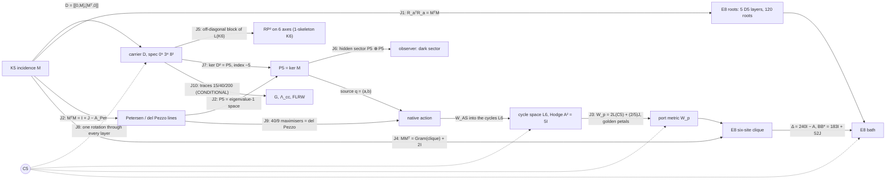

# OES — the end-to-end model

Lagrangian, spectral triple, spacetime, observer, energy, motion, gravity and cosmology, in one checked chain.

Research owner: Sachin Karia. Built 28 October 2026 against the canon cut **OMSOON736** (the "One Machine" 28 Oct edition), the 28 Oct consolidated Locked Memory, the 28 Oct collar/localization note, and the Through724 integrated model. This is an additive, unnumbered build. It mints no OMSOON or Matrix identifier and does not edit any workbook.

**AUTH = NOT_PASS · ScientificGold = FALSE · TIME_BIND = UNBOUND · DYN_BIND = NOT_INSTALLED · SCR6 absent · R6/A40/A52 frozen.**

Each statement below has one status, and `python verify.py` re-checks every one of them. The statuses are the canon's five: THEOREM, ARITHMETIC, OBSTRUCTION, REMOVED and UNFORMED. Two more are added here:

- **SELECTED_REFERENCE**: rebuilt from a stated definition because the saved original operand is absent.
- **CONDITIONAL**: needs an input the canon marks external.

A passing check is a statement about constructed matrices. It is not AUTH.

---

## 0. How the layers join

```
 K5 signless incidence M  ──►  D = [[0,M],[Mᵀ,0]] on ℓ²(V⊔E), dim 15        (layer 1, 2)
        │                         │
        │                         ├─► S[ψ] = ∫ ½|ψ̇|² − ½⟨ψ,D²ψ⟩ dt           carrier Lagrangian
        │                         ├─► heat trace, ζ_D, spectral dimension      spectral model
        │                         └─► readouts / hidden sectors                observer (layer 5)
        │
        ├─► P5 = ker M (source), L6 = cycles (port) ──► native action on E8 bath (layer 4)
        │                                                   │
        ├─► RP² on icosahedral axes, RP²×S¹, clock 125→120 ─┤   spacetime (layer 3)
        │                                                   │
        └─► E8 roots ──► Λ, Δ = 240I − A, ε(k), walks ──────┘
                                   │
     external M⁴, f, Λ, m  ───────►  spectral action of M⁴×F  ──► G, Λ_cc     gravity (layer 6, CONDITIONAL)
                                   └──► FLRW with homogeneous ψ               cosmology (layer 7, CONDITIONAL)
```

---

## 1. The carrier (`oes/carrier.py`)

**Datum.** K_n has the signless incidence M : ℝ^E → ℝ^V, where an edge maps to the sum of its two endpoints.

**Selection (THEOREM).** For n > 2, rank M = n, so dim ker M = n(n−3)/2. Setting dim ker M = |V| gives exactly n = 5. The signed incidence never satisfies this: its quadratic has discriminant 17. Checked for n = 3…12.

**Gram (THEOREM).**
- M Mᵀ = 3I + J, with (3I+J)⁻¹ = I/3 − J/24.
- The Smith invariants of M are 1, 1, 1, 1, 2.
- The S₅-equivariant maps ℝ^E → ℝ^V form a 2-dimensional space, spanned by M and J. Flag support kills J, and the remaining coefficient is the unit of time.

**Dirac and spectrum (THEOREM).** D = [[0, M], [Mᵀ, 0]] is self-adjoint and odd, with {D, γ} = 0 for γ = (+1 on V, −1 on E).
- D²(D² − 3)(D² − 8) = 0, so spec D² = {0⁵, 3⁸, 8²}.
- Tr D² = 40 and Tr D⁴ = 200. All odd traces vanish, and rank D² = 10.
- The signed Dirac has spectrum {0⁷, 5⁸}. It is not the carrier.

**The Lagrangian (THEOREM).** The action is

  S[ψ] = ∫ ( ½⟨ψ̇, ψ̇⟩ − ½⟨ψ, D²ψ⟩ ) dt,  with Euler–Lagrange equation ψ̈ + D²ψ = 0.

No second intertwiner, quartic or laboratory unit enters. It is fifteen oscillators: five with coefficient 0, eight with coefficient 3 and two with coefficient 8. The frequencies are 0, √3 and 2√2, and their squared ratio 8/3 is not the square of a rational.

**Energy and motion (THEOREM).** The energy is E = ½|ψ̇|² + ½⟨ψ, D²ψ⟩.

The canon datum has:
- vertex part (1,−1,0,0,0) + (1,1,1,1,1);
- edge part Mᵀ applied to the contrast;
- velocity the alternating 4-cycle on edges 01, 12, 23, 03.

On this datum ⟨ψ, D²ψ⟩ = 64, and E = 12 + 20 + 2 = 34 across the sectors λ = 3, 8 and 0. The closed form is

  ψ(t) = Σ_λ P_λ [ cos(√λ t) ψ₀ + sin(√λ t)/√λ · v₀ ]  (λ = 0: ψ₀ + t v₀),

where the P_λ are exact Lagrange-interpolation projectors. It conserves E to 1e−13, and a leapfrog integrator agrees with it.

**Joined finite objects (THEOREM).**
- Petersen graph, the disjointness graph on the 10 edges: A² + A − 2I = J, girth 5, projector ranks 1, 5, 4.
- Cycle Gram for the star tree: (G − I)(G − 5I) = 0 and det G = 125.
- Hodge block A = (6I − G)σ, with σ the signed opposite-edge exchange: A² = 5I.
- Signed edge Gram: G² = 5G.
- Edge tick: order 5, ∂T = R∂. Its unsigned form commutes with the Petersen adjacency, and it preserves the cycle space, where it acts as the order-5 rotor.

**Moments and harmonic obstruction (THEOREM).** On the contrast plane, M₂ = 10|x|² and M₄ = 6|x|⁴ + 10Σx⁴. The line 3|x|⁴ − 7Σx⁴ is harmonic. A quartic is not in the action (OBSTRUCTION).

> **Correction to the printed text.** The canon writes M₂ and M₄ as sums over the ten pairs i < j. The identities hold over the **twenty oriented roots** e_i − e_j. Over the ten pairs each sum is half: for example Σ_{i<j}(x_i − x_j)² = 5|x|². The check suite verifies both forms.

## 2. The spectral model (`oes/spectral.py`)

The finite spectral triple is (A = C^V ⊕ C^E, H = ℓ²(V⊔E), D, γ), with dim H = 15. All of its spectral content comes from {0⁵, 3⁸, 8²} (THEOREM):

- **Heat trace:** Z(β) = Tr e^{−βD²} = 5 + 8e^{−3β} + 2e^{−8β}.
- **Moments:** Tr D^{2k} = 15, 40, 200, 1240, 8840 for k = 0…4. These are all that a spectral action Tr f(D²/Λ²) can read.
- **Spectral zeta:** ζ_D(s) = 8·3^{−s} + 2·8^{−s}, with ζ_D(0) = 10 = rank D² and ζ_D(1) = 35/12.
- **Spectral dimension:** d_s(β) = −2 d log Z / d log β tends to 0 in both the UV and the IR, and peaks at 0.843 near β = 0.42.

The carrier has no emergent continuum dimension. This agrees with the canon's removal of "4 from 5 − 1" and of imported NC dimensions (REMOVED).

## 3. Spacetime (`oes/spacetime.py`)

The canon keeps three objects separate. None of them is a physical spacetime.

**(a) Surface and time-circle (THEOREM).**
- The six icosahedral axes carry the hemi-icosahedron and its complementary 10 triples. Both are closed RP² triangulations with χ = 1.
- H₀ = ℤ, H₁ = ℤ/2, H₂ = 0. rank ∂₂ is 10 over F₂₄₁ and 9 over F₂; the gap is the Bockstein of the 2-torsion.
- The 20-face union kills the torsion.
- The mapping torus of id is RP² × S¹, with H = ℤ, ℤ ⊕ ℤ/2, ℤ/2, 0 and F₂ Betti numbers 1, 2, 2, 1.
- The algebraic torus of −id is pure 2-torsion, with free Betti numbers 0, 0, 0, 0. It is a chain map and not a self-map (OBSTRUCTION).
- A₅ has element orders {1, 2, 3, 5}, with census 60 = 1 + 15 + 20 + 24. No rotation has order 4.
- The Hodge Laplacian on the 31 cells has nullity 1.
- K₄₀₃ = K_G ⊗ I₃₁ + I₁₃ ⊗ Δ has rank 400, and K_G has characteristic polynomial z³(z−4)²(z²−5z+5)²(z²−3z+1)².

**(b) Clock (THEOREM / OBSTRUCTION).**
- T on ℝ¹²⁵ is a Jordan block J₆(1) plus a permutation of order 90 (eleven 10-cycles and one 9-cycle).
- πσ = I₁₂₀, πT = Aπ, and A has order 90.
- g₁₂₀ = diag(I₁₁₉ + 11ᵀ, 1) is positive definite and A-invariant.
- (T − I)⁵ ≠ 0 on the chain, so T has no invariant positive metric. The memory lives upstairs and the metric clock lives on the quotient.

**(c) E8 lattice "space" with action time t (THEOREM).**
- **Roots and graph:** 240 roots (112 + 128) with Σαα^T = 60 I₈. The root graph is 56-regular, with spectrum 56¹ 28⁸ 8³⁵ (−2)¹¹² (−4)⁸⁴ and Gosset walks 1, 0, 56, 1512, 62160.
- **Returns:** lattice returns N₀…N₆ = 1, 0, 240, 13440, 1260720, 137813760, 17141798400, computed by exact walk convolution.
- **Symbol:** ε(k) = 240 − Σcos(α·k), with ε(0) = 0 and ε(π(1,1,1,1,0,0,0,0)) = 256.
- **Band range:** 20,000 random samples never exceed 256. That is ARITHMETIC evidence; the range proof is the canon's census.
- **Long waves:** ε ≈ 30|k|², so the bath sound speed is √30 in lattice units. No SI length or time is bound.
- **Ball:** the shells of |x|² ≤ 8 are 1, 240, 2160, 6720, 17520.
- **Green identity:** 240(G(0) − G(α)) = 1, exactly. It follows from ΔG = δ and the root-transitivity of W(E8); the solver confirms it on the W-symmetric ball.
- **Six-site clique** x₀ = 0, x_j = e₁ − e_{j+1}:
  - block A = 241I − J;
  - exterior coupling BB* = 183I + 52J = 183P_c + 495P_u, where 52 = 56 − 4 common neighbours.

## 4. The native action: source, port, bath (`oes/native.py`)

The declared boundary-pullback action, from Through724 and the collar note, is

```
L = ½ q̇ᵀM_s q̇ + ½|d g(q)/dt|² + ½|ẏ|² − 2 qᵀM_s q − ½ gᵀ(W_p + A) g − gᵀB y − ½⟨y, D y⟩
```

Its equations of motion are

```
M_s q̈ + 4 M_s q + J(q)ᵀ [ g̈ + (W_p + A) g + B y ] = 0,     ÿ + D y = −Bᵀ g,
```

where q = (a, b) ∈ P5 ⊕ P5, P5 = ker M, g is the six-port boundary value and y is the bath off the clique.

**Reconstructed parts (SELECTED_REFERENCE).** The saved native_source_matrices (SHA-256 73e07429…) are absent, so the port is rebuilt from its stated definition:

- **Source matrices.** A(a) is the symmetric zero-diagonal matrix with entries a_e. Since Ma = 0 its rows sum to zero, so [A(a), A(b)] is skew with zero row sums, which is an oriented cycle. This is W_AS : Λ²P5 → L6.
- **Source mass.** M_s = I/4 in an orthonormal basis of P5. P5 is the irreducible 5 of S₅, so this metric is unique up to an amplitude unit. The canon's det 8/9 refers to its saved basis.
- **Port metric.** W_p is the canon's explicit boundary metric: circulant (22, −8, 2, 2, −8)/5 on x₁…x₅ and 2/5 on x₀.
- **Adapter.** T : L6 → boundary intertwines the cycle rotor with x_j → x_{j+1}, and satisfies (TW_AS)ᵀ W_p (TW_AS) = (320/9) G P with G = Λ²M. It is fixed by a deterministic Reynolds average. The source and port energetics do not depend on that choice; the bath coupling does.

**Checked.**
- W_AS has rank 6 and kernel 4 (THEOREM).
- W_ASᵀW_AS = (10/9)P, by Schur (THEOREM).
- W_AS is rotor-equivariant (THEOREM).
- spec W_p = {2/5, 2, 5 ± √5 (×2)} and det W_p = 320 (THEOREM).
- Sharp quartic (THEOREM): max Q₄/ρ² = **40/9**, attained by a balanced visible pair; random sources stay below it. The maximisers form the degree-5 del Pezzo section Gr(2,5) ∩ ℙ⁵, as Through724 states.
- The port is quadratic: g(0) = 0, Dg(0) = 0 and Jq = 2g. At linear order the source equation is q̈ + 4q = 0, with frequency 2 and no linear channel into the bath (THEOREM).

**Energy and motion in the bath.**
- **Radiation channel (ARITHMETIC).** A port oscillating at frequency 4 (eigenvalue 16) lies inside the band [0, 256]. The bath density seen by the uniform channel at λ = 16 is 2.24×10⁻⁷ (Monte Carlo), against 2.03×10⁻⁷ from the long-wave estimate. The contrast channel sees 2.7×10⁻⁹. The channel is open but very thin, which fits the canon's long-lived periodic families.
- **Nonlinear flow (SELECTED_REFERENCE).** The full nonlinear system was integrated on the |x|² ≤ 8 ball (26,635 bath sites, Dirichlet outside) with RK4 to t = 4. Total energy is conserved to a relative 2×10⁻¹⁰ (r = 0.05) and 1×10⁻⁷ (r = 0.2).

  | preparation | r | bath gain / E₀ | source E ratio |
  |---|---|---|---|
  | circular (static port) | 0.05 | 9.0×10⁻⁵ | 1.12 |
  | breathing (port ∝ sin 4t) | 0.05 | 1.16×10⁻³ | 0.98 |
  | circular | 0.2 | 8.3×10⁻² | 3.61 (orbit breaks up) |
  | breathing | 0.2 | 1.0×10⁻² | 0.93 |

  At small amplitude the breathing source feeds the bath 13 times more than the circular one. At r = 0.2 the circular orbit falls apart. That matches the canon's statement that the rotating family is guaranteed only at tiny amplitude (|a| ≤ 8×10⁻⁶) and is nonlinearly unstable. The ball is a cavity, so these numbers are energy exchange, not a far-field rate.
- **Static tails (OBSTRUCTION, canon 28 Oct).** A nonzero port mean forces a non-ℓ¹ static tail, with annular lower bounds T1–T4. A zero-mean periodic source above frequency 2 with high port harmonics cannot be ℓ¹-localized (F5).

## 5. Observer (`oes/observer.py`)

The system is x = (ψ, ψ̇) with x' = Ax and A = [[0, I], [−D², 0]]. Observable subspaces come from iterated orthonormal Krylov spaces.

**Structure (THEOREM).**
- D² = diag(MMᵀ, MᵀM), so the vertex and edge systems never exchange energy. D intertwines them as a supersymmetric pair.
- The Witten index is Tr γ e^{−βD²} = −5 for every β.

**Observable dimensions out of 30 (THEOREM).**

| readout | observable | readout | observable |
|---|---|---|---|
| vertex positions | 10 | one vertex | 4 |
| edge positions | 20 | one edge | 6 |
| D ψ | 20 | vertex sum | 2 |
| all positions | 30 | | |

A scalar readout sees at most 6 dimensions, two for each of the three spectral lines. This is the canon's Firefly remark.

**Hidden controllable sector H = Ran K ∩ ker O (THEOREM).**
- Edge force with a Dψ observer gives **10**: the five kernel (cycle-drift) modes are reachable but invisible. This is the carrier's dark sector.
- Edge force with a vertex observer gives 20, and vertex force with an edge observer gives 10. All other pairings give 0.
- The finite-time Gramian W_o(6) of Dψ has rank 20.

The original Sākṣin operator and the 237-dimensional fiber observer remain **UNFORMED**.

## 6. Gravity (`oes/gravity.py`)

**Intrinsic (ARITHMETIC).** These are Lin–Lu–Yau (optimal-transport) Ricci curvatures:
- K5: **5/4**;
- the Petersen graph: **0**;
- the E8 root-lattice graph: **0**, so the bath space is discretely flat.

They are curvatures of discrete metric spaces, not Einstein gravity. The canon's integers (Einstein–Hilbert power 4 = cut rank, vacuum power 6 = cycle rank, 2 + 7 = 9) are shared integers only.

**Conditional: the spectral action of M⁴ × F (CONDITIONAL).** Take D = D_M ⊗ 1 + γ₅ ⊗ m D_F on a closed spin 4-manifold. Then

  Tr e^{−tD²} = Tr e^{−tD_M²} · Tr e^{−t m² D_F²},

and the expansion up to O(t²) reads

  (4πt)⁻² ∫√g [ 60 − t(160m² + 5R) + t²(400m⁴ + 40m²R/3) ].

This is checked symbolically. It uses only 15, 40, 200 and the spinor rank 4.

With f-moments F₀ = f(0), F₁ = ∫f and F₂ = ∫xf:

  1/(16πG) = 5F₁Λ²/(16π²),   Λ_cc = 6(F₂/F₁)Λ² − 16m² + 40(F₀/F₁)m⁴/Λ².

- For f = e^{−x} and Λ = 10m: G = π/(500m²) and Λ_cc = 584.4m².
- Choosing F₂/F₁ = 0.026 instead makes Λ_cc = 0. Λ_cc·G can take any value.

This is the canon's "physical scales and Wald coefficient underdetermined", made explicit. The inputs M⁴, f, Λ and m are external, so the Newton constant in SI units, the Wald coefficient and any horizon/area map stay **UNFORMED**. Curvature-squared a₄ terms are omitted.

## 7. Cosmology (`oes/cosmology.py`, CONDITIONAL)

Place the carrier field homogeneously on flat FLRW, with G and Λ_cc from layer 6:

  ψ̈ + 3Hψ̇ + m²D²ψ = 0,  H² = (8πG/3)ρ + Λ_cc/3,  Ḣ = −4πG|ψ̇|².

Integrated with DOP853 from the canon datum, with Λ = 10m and Λ_cc tuned to 0:
- the Friedmann constraint holds to 4×10⁻¹²;
- the kernel sector goes as ρ ∝ a^{−6.000} (stiff, massless);
- the λ = 3 and λ = 8 sectors go as ρ ∝ a^{−3.000} (dust);
- the scale factor grows as a ∝ t^{0.665}.

With the natural cutoff (f = e^{−x}), the evolution goes straight to de Sitter with H → √(Λ_cc/3) = 13.96m. That is the vacuum-energy problem, not a prediction.

No observed parameter (H₀, Ω, w) is produced. IceCube/LHAASO scales and the vacuum amplitude (27/5)³e^{−280} stay **REMOVED**.

## 8. Residual front (`oes/frontier.py`)

This section records the sibling update received after the 01:27 UTC Drive cut. Drive showed nothing newer at the time of the check.

**Replayed here.**
- **Band vertex (THEOREM).** At v* = π(1,1,1,1,0,0,0,0), every root gives cos = ±1: 112 give +1 and 128 give −1, so ε(v*) = 256.
- **Band-edge orbit (THEOREM).** The W(E8)-orbit of v* has 2160 points in ℝ⁸ and **135** classes modulo 2πΛ.
- **Local bound (ARITHMETIC, sampled).** S(v*+δ) ≥ −16 + |δ|²(2 − |δ|²) holds for |δ| ≤ √2. The minimum slack is −3×10⁻¹⁵, so the bound is attained.
- **224 saddle at πα (THEOREM, exact).** The expansion is ε = 224 + 6ρ² − 26z² − ρ⁴/2 + 3ρ²z² + (5/6)z⁴. On the cone 6ρ² = 26z² the quartic is exactly **(40/169)ρ⁴ > 0**, so the level set bends the convex way at the saddle.
- **Agni–Soma (THEOREM).** (5I − G)/5 is the cycle projector and fixes the image of W_AS. The two are not rival operators; only the naming needs settling.

**Reported, not replayed** (status REPORTED; the certificates and operands are not in this repository):
- the band is exactly [0, 256] by an alcove branch-and-bound (247,920 pieces);
- ε > 100 outside |k|² ≤ 6 (7,523 pieces);
- the W_n recurrence has order **11**, with (x+12)² dividing the leading coefficient, so the page line "at least 10, not 11" should be deleted;
- 155 vs 4805 is a label error (155 = det T and 4805 = 5·31², the 4th cofactor of TTᵀ);
- rotor hex6 has m₁ = 242 ≥ 241.36;
- for the collar, the alcove reduction gives numerically positive curvature up to 223.999;
- 223.25 < 223.5 < 223.53 < 223.58 are successive lower bounds, so the standing value is the largest replayed one.

**Still open.**
- A certified curvature bound away from the 224 saddle. This is the next step: a certified saddle analysis with an explicit radius.
- The complete scalar W_n recurrence.
- The five-port and the −8/9 moment operands.
- The decay-rate and prefactor conflicts.

## 9. Joining the dots (`oes/joins.py`)

A **join** is an identity between matrices built in different layers. Each one below is checked by `verify.py`. A **shared integer** is the same number appearing on two objects with no map between them. The canon is strict that "equal ranks are not the same maps", so the two are listed apart.



**Joins (THEOREM unless marked).**

| # | Join | What it says |
|---|---|---|
| J1 | r_(ij),a = μ_ij + ν_a are E8 roots, R_aᵀR_a = MᵀM, ker R_a = P5. Each layer with A4 is a 40-root D5, and the union has 120 roots. | The carrier edge gram *is* an E8 root gram. The part that disappears in E8 is exactly P5. |
| J2 | MᵀM = I + J − A_Petersen | The carrier edge spectrum {0⁵, 3⁴, 8} is the Petersen spectrum {1⁵, (−2)⁴, 3} under λ = 1 − θ (with +10 on the uniform line). P5 is the Petersen eigenvalue-1 space and the kernel of the del Pezzo line matrix. |
| J3 | W_p = 2L(C5) + (2/5)(J₅ ⊕ 1) | The port metric is twice the 5-cycle Laplacian. Its moving eigenvalues are 2(φ + 2) and 2(3 − φ), which are the golden petals (5 ± √5)/2 doubled. |
| J4 | Gram(x₁…x₅) = I + J, so MMᵀ = Gram + 2I | The carrier vertex gram is the bath clique gram shifted by 2. |
| J5 | The RP² 1-skeleton is K6, and D = A_L(K6) − diag(J − I, MᵀM − 2I) | Coning makes the 15 carrier atoms the 15 edges of the surface. D is the star/non-star block of the K6 line graph. |
| J6 | hidden(edge force, Dψ) = P5 ⊕ P5 | The carrier's dark sector is exactly the native source space. |
| J7 | Witten index −5 = −index(M) = −dim P5 | The count of dark modes is a topological index. |
| J8 | vertex rotation → tick → cycle rotor → W_AS → T → S → coordinate cycle in W(E8) | One C5 runs through every layer. The full nonlinear native vector field is equivariant to 8×10⁻¹⁵ (SELECTED_REFERENCE, because T was chosen equivariant). |
| J9 | The 40/9 maximisers are visible decomposable wedges, a locus of projective dimension 2 | This is the degree-5 del Pezzo surface whose line matrix appears in J2. |
| J10 | 15, 40, 200 → heat coefficients 60, 160m², 400m⁴ | The only route from the carrier to G and Λ_cc (CONDITIONAL). |

**Read as one sentence:**
1. One incidence M builds D.
2. D's kernel P5 is the source, and that source is invisible to the observer (J6, J7).
3. D's edge block is the Petersen complement (J2), the E8 root gram (J1) and, through coning, the surface (J5).
4. The source talks through the cycle space, with a port metric that is the golden C5 Laplacian (J3), to a clique whose gram is the carrier's vertex gram (J4). That clique is inside the E8 bath.
5. One C5 symmetry is kept from end to end (J8).
6. Gravity and cosmology attach only through the traces (J10), and only conditionally.

**Shared integers, no map (ARITHMETIC):**

| Integer | Where it appears | Map? |
|---|---|---|
| 15 | dim H; edges of K6; duads of 6 | J5 is the only map among these |
| 60 | E8 frame; \|A5\|; the Dirac trace coefficient | none |
| 240 | E8 roots; 6·Tr D²; the corner diagonal | none |
| 20 | five-port visible coordinates; observable dimensions of Dψ; Tr MᵀM | none |
| 125 | det of the cycle Gram; 5³ clock memory states | none |
| 120 | \|S5\|; clock quotient; D5 union | none |
| 9 | gravity's 2 + 7; E8 clique size | none |
| 36 | atlas addresses | none |
| 4320, 108, 69120 | yuga, japa and Human Design counts | integers only |

## 10. What stays open

Recorded in `oes/gates.py` and carried unchanged from the canon:

**Unformed operands:**
- the SCR6 operands;
- the original 31 seam rows;
- the 502-dimensional Hodge–Dirac and the 237-dimensional observer;
- the MPKG adapter and the E8 glue map;
- c₆₀;
- the 4944- and 5048-dimensional transitions;
- the R1/025/250/Jfix/Sawan/Hemkuver ports;
- the historical Agni/Soma/Suraj and the original Sākṣin;
- I6L;
- the Wald coefficient;
- the saved native source matrices;
- the 6×6 adapter T of eq. 27 (155 vs 4805 is reported as a label error and was not replayed here).

**Open mathematics:**
- the convexity collar inside (223.58, 224), now reduced to a certified bound away from the 224 saddle;
- a fixed-order scalar recurrence for W_n (reported order ≥ 11);
- a matching dispersive upper bound;
- maximal branch continuation.

**Physical selection:** any calibrated time (TIME_BIND), DYN_BIND, the gravitational normalisation and every laboratory record are external and absent.

## Sources read (Google Drive)

- `00 — OES CANON QUICK ACCESS — CURRENT` (1KZcWbz9cPalear_Ix-cqviNdJziYAw2jOuiH75pcIug)
- `one-machine-20261028-images.pdf` (1YUMCzBlkVw00gG3SnSO1zpH2DXNxArH-), the latest edition of OMSOON736
- `LOCKED_MEMORY_END_TO_END_2026-10-28.md` (1JUsXfoA-qEiieLeYvYy0r7kXjl_6XtgC)
- `LOCKED_MEMORY_OES_CONSOLIDATED_20261028.txt` (1NKSDKdMj5bEC2Dy6r2tSPWrX_uIE8Fq-)
- `OES_736_Collar_Localization_Proof_20261028.txt` (1hqOpJkdwL6unoO7SJmnTHbJp4fzJZ2Qu)
- `OES_All_Dots_Through724_Integrated_Model_20261027.txt` (1BiKs2qxqc1DD7T8fMegjJH01S3PVOF9U): the native action, Appendix A, and D5/del Pezzo
- Sibling handovers in OES › Locked Memory, OMSOON → OMSOON7, 22–25 Oct; titles and summaries only

The only claude.ai Code session visible from this environment is this one. Sibling *chats* are present only through the handover documents they saved to Drive.
