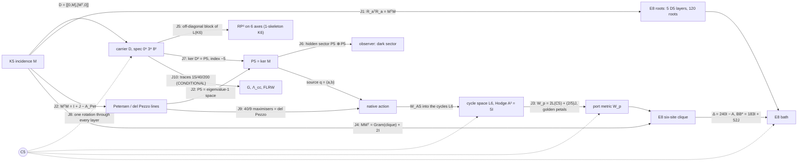

# OES — the end-to-end model

Lagrangian, spectral triple, spacetime, observer, energy, motion, gravity and cosmology, in one checked chain.

Research owner: Sachin Karia. Built 28 October 2026 against the canon cut **OMSOON736** (the "One Machine" 28 Oct edition), the 28 Oct consolidated Locked Memory, the 28 Oct collar/localization note, and the Through724 integrated model. This is an additive, unnumbered build. It mints no OMSOON or Matrix identifier and does not edit any workbook.

**AUTH = NOT_PASS · ScientificGold = FALSE · TIME_BIND = UNBOUND · DYN_BIND = NOT_INSTALLED · SCR6 absent · R6/A40/A52 frozen.**

Each statement below has one status, and `python verify.py` re-checks every one of them. The statuses are the canon's five: THEOREM, ARITHMETIC, OBSTRUCTION, REMOVED and UNFORMED. Two more are added here:

- **SELECTED_REFERENCE**: rebuilt from a stated definition because the saved original operand is absent.
- **CONDITIONAL**: needs an input the canon marks external.

A passing check is a statement about constructed matrices. It is not AUTH.

---

## 0. How the layers join

```
 K5 signless incidence M  ──►  D = [[0,M],[Mᵀ,0]] on ℓ²(V⊔E), dim 15        (layer 1, 2)
        │                         │
        │                         ├─► S[ψ] = ∫ ½|ψ̇|² − ½⟨ψ,D²ψ⟩ dt           carrier Lagrangian
        │                         ├─► heat trace, ζ_D, spectral dimension      spectral model
        │                         └─► readouts / hidden sectors                observer (layer 5)
        │
        ├─► P5 = ker M (source), L6 = cycles (port) ──► native action on E8 bath (layer 4)
        │                                                   │
        ├─► RP² on icosahedral axes, RP²×S¹, clock 125→120 ─┤   spacetime (layer 3)
        │                                                   │
        └─► E8 roots ──► Λ, Δ = 240I − A, ε(k), walks ──────┘
                                   │
     external M⁴, f, Λ, m  ───────►  spectral action of M⁴×F  ──► G, Λ_cc     gravity (layer 6, CONDITIONAL)
                                   └──► FLRW with homogeneous ψ               cosmology (layer 7, CONDITIONAL)
```

---

## 1. The carrier (`oes/carrier.py`)

**Datum.** K_n has the signless incidence M : ℝ^E → ℝ^V, where an edge maps to the sum of its two endpoints.

**Selection (THEOREM).** For n > 2, rank M = n, so dim ker M = n(n−3)/2. Setting dim ker M = |V| gives exactly n = 5. The signed incidence never satisfies this: its quadratic has discriminant 17. Checked for n = 3…12.

**Gram (THEOREM).**
- M Mᵀ = 3I + J, with (3I+J)⁻¹ = I/3 − J/24.
- The Smith invariants of M are 1, 1, 1, 1, 2.
- The S₅-equivariant maps ℝ^E → ℝ^V form a 2-dimensional space, spanned by M and J. Flag support kills J, and the remaining coefficient is the unit of time.

**Dirac and spectrum (THEOREM).** D = [[0, M], [Mᵀ, 0]] is self-adjoint and odd, with {D, γ} = 0 for γ = (+1 on V, −1 on E).
- D²(D² − 3)(D² − 8) = 0, so spec D² = {0⁵, 3⁸, 8²}.
- Tr D² = 40 and Tr D⁴ = 200. All odd traces vanish, and rank D² = 10.
- The signed Dirac has spectrum {0⁷, 5⁸}. It is not the carrier.

**The Lagrangian (THEOREM).** The action is

  S[ψ] = ∫ ( ½⟨ψ̇, ψ̇⟩ − ½⟨ψ, D²ψ⟩ ) dt,  with Euler–Lagrange equation ψ̈ + D²ψ = 0.

No second intertwiner, quartic or laboratory unit enters. It is fifteen oscillators: five with coefficient 0, eight with coefficient 3 and two with coefficient 8. The frequencies are 0, √3 and 2√2, and their squared ratio 8/3 is not the square of a rational.

**Energy and motion (THEOREM).** The energy is E = ½|ψ̇|² + ½⟨ψ, D²ψ⟩.

The canon datum has:
- vertex part (1,−1,0,0,0) + (1,1,1,1,1);
- edge part Mᵀ applied to the contrast;
- velocity the alternating 4-cycle on edges 01, 12, 23, 03.

On this datum ⟨ψ, D²ψ⟩ = 64, and E = 12 + 20 + 2 = 34 across the sectors λ = 3, 8 and 0. The closed form is

  ψ(t) = Σ_λ P_λ [ cos(√λ t) ψ₀ + sin(√λ t)/√λ · v₀ ]  (λ = 0: ψ₀ + t v₀),

where the P_λ are exact Lagrange-interpolation projectors. It conserves E to 1e−13, and a leapfrog integrator agrees with it.

**Joined finite objects (THEOREM).**
- Petersen graph, the disjointness graph on the 10 edges: A² + A − 2I = J, girth 5, projector ranks 1, 5, 4.
- Cycle Gram for the star tree: (G − I)(G − 5I) = 0 and det G = 125.
- Hodge block A = (6I − G)σ, with σ the signed opposite-edge exchange: A² = 5I.
- Signed edge Gram: G² = 5G.
- Edge tick: order 5, ∂T = R∂. Its unsigned form commutes with the Petersen adjacency, and it preserves the cycle space, where it acts as the order-5 rotor.

**Moments and harmonic obstruction (THEOREM).** On the contrast plane, summing over the 20 oriented edges (the A4 roots), M₂ = 10|x|² and M₄ = 6|x|⁴ + 10Σx⁴; over the 10 unordered pairs each sum is half. The line 3|x|⁴ − 7Σx⁴ is harmonic for the ambient Laplacian of ℝ⁵. For the contrast plane's own Laplacian, Δ|x|⁴ = 24|x|² and ΔΣx⁴ = (48/5)|x|², so the harmonic line is 2|x|⁴ − 5Σx⁴ (canon correction, 28 Oct; §21). A quartic is not in the action (OBSTRUCTION).

> **Correction to the printed text.** The canon writes M₂ and M₄ as sums over the ten pairs i < j. The identities hold over the **twenty oriented roots** e_i − e_j. Over the ten pairs each sum is half: for example Σ_{i<j}(x_i − x_j)² = 5|x|². The check suite verifies both forms.

## 2. The spectral model (`oes/spectral.py`)

The finite spectral triple is (A = C^V ⊕ C^E, H = ℓ²(V⊔E), D, γ), with dim H = 15. All of its spectral content comes from {0⁵, 3⁸, 8²} (THEOREM):

- **Heat trace:** Z(β) = Tr e^{−βD²} = 5 + 8e^{−3β} + 2e^{−8β}.
- **Moments:** Tr D^{2k} = 15, 40, 200, 1240, 8840 for k = 0…4. These are all that a spectral action Tr f(D²/Λ²) can read.
- **Spectral zeta:** ζ_D(s) = 8·3^{−s} + 2·8^{−s}, with ζ_D(0) = 10 = rank D² and ζ_D(1) = 35/12.
- **Spectral dimension:** d_s(β) = −2 d log Z / d log β tends to 0 in both the UV and the IR, and peaks at 0.843 near β = 0.42.

The carrier has no emergent continuum dimension. This agrees with the canon's removal of "4 from 5 − 1" and of imported NC dimensions (REMOVED).

## 3. Spacetime (`oes/spacetime.py`)

The canon keeps three objects separate. None of them is a physical spacetime.

**(a) Surface and time-circle (THEOREM).**
- The six icosahedral axes carry the hemi-icosahedron and its complementary 10 triples. Both are closed RP² triangulations with χ = 1.
- H₀ = ℤ, H₁ = ℤ/2, H₂ = 0. rank ∂₂ is 10 over F₂₄₁ and 9 over F₂; the gap is the Bockstein of the 2-torsion.
- The 20-face union kills the torsion.
- The mapping torus of id is RP² × S¹, with H = ℤ, ℤ ⊕ ℤ/2, ℤ/2, 0 and F₂ Betti numbers 1, 2, 2, 1.
- The algebraic torus of −id is pure 2-torsion, with free Betti numbers 0, 0, 0, 0. It is a chain map and not a self-map (OBSTRUCTION).
- A₅ has element orders {1, 2, 3, 5}, with census 60 = 1 + 15 + 20 + 24. No rotation has order 4.
- The Hodge Laplacian on the 31 cells has nullity 1.
- K₄₀₃ = K_G ⊗ I₃₁ + I₁₃ ⊗ Δ has rank 400, and K_G has characteristic polynomial z³(z−4)²(z²−5z+5)²(z²−3z+1)².

**(b) Clock (THEOREM / OBSTRUCTION).**
- T on ℝ¹²⁵ is a Jordan block J₆(1) plus a permutation of order 90 (eleven 10-cycles and one 9-cycle).
- πσ = I₁₂₀, πT = Aπ, and A has order 90.
- g₁₂₀ = diag(I₁₁₉ + 11ᵀ, 1) is positive definite and A-invariant.
- (T − I)⁵ ≠ 0 on the chain, so T has no invariant positive metric. The memory lives upstairs and the metric clock lives on the quotient.

**(c) E8 lattice "space" with action time t (THEOREM).**
- **Roots and graph:** 240 roots (112 + 128) with Σαα^T = 60 I₈. The root graph is 56-regular, with spectrum 56¹ 28⁸ 8³⁵ (−2)¹¹² (−4)⁸⁴ and Gosset walks 1, 0, 56, 1512, 62160.
- **Returns:** lattice returns N₀…N₆ = 1, 0, 240, 13440, 1260720, 137813760, 17141798400, computed by exact walk convolution.
- **Symbol:** ε(k) = 240 − Σcos(α·k), with ε(0) = 0 and ε(π(1,1,1,1,0,0,0,0)) = 256.
- **Band range:** 20,000 random samples never exceed 256. That is ARITHMETIC evidence; the range proof is the canon's census.
- **Long waves:** ε ≈ 30|k|², so the bath sound speed is √30 in lattice units. No SI length or time is bound.
- **Ball:** the shells of |x|² ≤ 8 are 1, 240, 2160, 6720, 17520.
- **Green identity:** 240(G(0) − G(α)) = 1, exactly. It follows from ΔG = δ and the root-transitivity of W(E8); the solver confirms it on the W-symmetric ball.
- **Six-site clique** x₀ = 0, x_j = e₁ − e_{j+1}:
  - block A = 241I − J;
  - exterior coupling BB* = 183I + 52J = 183P_c + 495P_u, where 52 = 56 − 4 common neighbours.

## 4. The native action: source, port, bath (`oes/native.py`)

The declared boundary-pullback action, from Through724 and the collar note, is

```
L = ½ q̇ᵀM_s q̇ + ½|d g(q)/dt|² + ½|ẏ|² − 2 qᵀM_s q − ½ gᵀ(W_p + A) g − gᵀB y − ½⟨y, D y⟩
```

Its equations of motion are

```
M_s q̈ + 4 M_s q + J(q)ᵀ [ g̈ + (W_p + A) g + B y ] = 0,     ÿ + D y = −Bᵀ g,
```

where q = (a, b) ∈ P5 ⊕ P5, P5 = ker M, g is the six-port boundary value and y is the bath off the clique.

**Reconstructed parts (SELECTED_REFERENCE).** The saved native_source_matrices (SHA-256 73e07429…) are absent, so the port is rebuilt from its stated definition:

- **Source matrices.** A(a) is the symmetric zero-diagonal matrix with entries a_e. Since Ma = 0 its rows sum to zero, so [A(a), A(b)] is skew with zero row sums, which is an oriented cycle. This is W_AS : Λ²P5 → L6.
- **Source mass.** M_s = I/4 in an orthonormal basis of P5. P5 is the irreducible 5 of S₅, so this metric is unique up to an amplitude unit. The canon's det 8/9 refers to its saved basis.
- **Port metric.** W_p is the canon's explicit boundary metric: circulant (22, −8, 2, 2, −8)/5 on x₁…x₅ and 2/5 on x₀.
- **Adapter.** T : L6 → boundary intertwines the cycle rotor with x_j → x_{j+1}, and satisfies (TW_AS)ᵀ W_p (TW_AS) = (320/9) G P with G = Λ²M. It is fixed by a deterministic Reynolds average. The source and port energetics do not depend on that choice; the bath coupling does.

**Checked.**
- W_AS has rank 6 and kernel 4 (THEOREM).
- W_ASᵀW_AS = (10/9)P, by Schur (THEOREM).
- W_AS is rotor-equivariant (THEOREM).
- spec W_p = {2/5, 2, 5 ± √5 (×2)} and det W_p = 320 (THEOREM).
- Sharp quartic (THEOREM): max Q₄/ρ² = **40/9**, attained by a balanced visible pair; random sources stay below it. The maximisers form the degree-5 del Pezzo section Gr(2,5) ∩ ℙ⁵, as Through724 states.
- The port is quadratic: g(0) = 0, Dg(0) = 0 and Jq = 2g. At linear order the source equation is q̈ + 4q = 0, with frequency 2 and no linear channel into the bath (THEOREM).

**Energy and motion in the bath.**
- **Radiation channel (ARITHMETIC).** A port oscillating at frequency 4 (eigenvalue 16) lies inside the band [0, 256]. The bath density seen by the uniform channel at λ = 16 is 2.24×10⁻⁷ (Monte Carlo), against 2.03×10⁻⁷ from the long-wave estimate. The contrast channel sees 2.7×10⁻⁹. The channel is open but very thin, which fits the canon's long-lived periodic families.
- **Nonlinear flow (SELECTED_REFERENCE).** The full nonlinear system was integrated on the |x|² ≤ 8 ball (26,635 bath sites, Dirichlet outside) with RK4 to t = 4. Total energy is conserved to a relative 2×10⁻¹⁰ (r = 0.05) and 1×10⁻⁷ (r = 0.2).

  | preparation | r | bath gain / E₀ | source E ratio |
  |---|---|---|---|
  | circular (static port) | 0.05 | 9.0×10⁻⁵ | 1.12 |
  | breathing (port ∝ sin 4t) | 0.05 | 1.16×10⁻³ | 0.98 |
  | circular | 0.2 | 8.3×10⁻² | 3.61 (orbit breaks up) |
  | breathing | 0.2 | 1.0×10⁻² | 0.93 |

  At small amplitude the breathing source feeds the bath 13 times more than the circular one. At r = 0.2 the circular orbit falls apart. That matches the canon's statement that the rotating family is guaranteed only at tiny amplitude (|a| ≤ 8×10⁻⁶) and is nonlinearly unstable. The ball is a cavity, so these numbers are energy exchange, not a far-field rate.
- **Static tails (OBSTRUCTION, canon 28 Oct).** A nonzero port mean forces a non-ℓ¹ static tail, with annular lower bounds T1–T4. A zero-mean periodic source above frequency 2 with high port harmonics cannot be ℓ¹-localized (F5).

## 5. Observer (`oes/observer.py`)

The system is x = (ψ, ψ̇) with x' = Ax and A = [[0, I], [−D², 0]]. Observable subspaces come from iterated orthonormal Krylov spaces.

**Structure (THEOREM).**
- D² = diag(MMᵀ, MᵀM), so the vertex and edge systems never exchange energy. D intertwines them as a supersymmetric pair.
- The Witten index is Tr γ e^{−βD²} = −5 for every β.

**Observable dimensions out of 30 (THEOREM).**

| readout | observable | readout | observable |
|---|---|---|---|
| vertex positions | 10 | one vertex | 4 |
| edge positions | 20 | one edge | 6 |
| D ψ | 20 | vertex sum | 2 |
| all positions | 30 | | |

A scalar readout sees at most 6 dimensions, two for each of the three spectral lines. This is the canon's Firefly remark.

**Hidden controllable sector H = Ran K ∩ ker O (THEOREM).**
- Edge force with a Dψ observer gives **10**: the five kernel (cycle-drift) modes are reachable but invisible. This is the carrier's dark sector.
- Edge force with a vertex observer gives 20, and vertex force with an edge observer gives 10. All other pairings give 0.
- The finite-time Gramian W_o(6) of Dψ has rank 20.

The original Sākṣin operator and the 237-dimensional fiber observer remain **UNFORMED**.

## 6. Gravity (`oes/gravity.py`)

**Intrinsic (ARITHMETIC).** These are Lin–Lu–Yau (optimal-transport) Ricci curvatures:
- K5: **5/4**;
- the Petersen graph: **0**;
- the E8 root-lattice graph: **0**, so the bath space is discretely flat.

They are curvatures of discrete metric spaces, not Einstein gravity. The canon's integers (Einstein–Hilbert power 4 = cut rank, vacuum power 6 = cycle rank, 2 + 7 = 9) are shared integers only.

**Conditional: the spectral action of M⁴ × F (CONDITIONAL).** Take D = D_M ⊗ 1 + γ₅ ⊗ m D_F on a closed spin 4-manifold. Then

  Tr e^{−tD²} = Tr e^{−tD_M²} · Tr e^{−t m² D_F²},

and the expansion up to O(t²) reads

  (4πt)⁻² ∫√g [ 60 − t(160m² + 5R) + t²(400m⁴ + 40m²R/3) ].

This is checked symbolically. It uses only 15, 40, 200 and the spinor rank 4.

With f-moments F₀ = f(0), F₁ = ∫f and F₂ = ∫xf:

  1/(16πG) = 5F₁Λ²/(16π²),   Λ_cc = 6(F₂/F₁)Λ² − 16m² + 40(F₀/F₁)m⁴/Λ².

- For f = e^{−x} and Λ = 10m: G = π/(500m²) and Λ_cc = 584.4m².
- Choosing F₂/F₁ = 0.026 instead makes Λ_cc = 0. Λ_cc·G can take any value.

This is the canon's "physical scales and Wald coefficient underdetermined", made explicit. The inputs M⁴, f, Λ and m are external, so the Newton constant in SI units, the Wald coefficient and any horizon/area map stay **UNFORMED**. Curvature-squared a₄ terms are omitted.

## 7. Cosmology (`oes/cosmology.py`, CONDITIONAL)

Place the carrier field homogeneously on flat FLRW, with G and Λ_cc from layer 6:

  ψ̈ + 3Hψ̇ + m²D²ψ = 0,  H² = (8πG/3)ρ + Λ_cc/3,  Ḣ = −4πG|ψ̇|².

Integrated with DOP853 from the canon datum, with Λ = 10m and Λ_cc tuned to 0:
- the Friedmann constraint holds to 4×10⁻¹²;
- the kernel sector goes as ρ ∝ a^{−6.000} (stiff, massless);
- the λ = 3 and λ = 8 sectors go as ρ ∝ a^{−3.000} (dust);
- the scale factor grows as a ∝ t^{0.665}.

With the natural cutoff (f = e^{−x}), the evolution goes straight to de Sitter with H → √(Λ_cc/3) = 13.96m. That is the vacuum-energy problem, not a prediction.

No observed parameter (H₀, Ω, w) is produced. IceCube/LHAASO scales and the vacuum amplitude (27/5)³e^{−280} stay **REMOVED**.

## 8. Residual front (`oes/frontier.py`)

This section records the sibling update received after the 01:27 UTC Drive cut. Drive showed nothing newer at the time of the check.

**Replayed here.**
- **Band vertex (THEOREM).** At v* = π(1,1,1,1,0,0,0,0), every root gives cos = ±1: 112 give +1 and 128 give −1, so ε(v*) = 256.
- **Band-edge orbit (THEOREM).** The W(E8)-orbit of v* has 2160 points in ℝ⁸ and **135** classes modulo 2πΛ.
- **Local bound (ARITHMETIC, sampled).** S(v*+δ) ≥ −16 + |δ|²(2 − |δ|²) holds for |δ| ≤ √2. The minimum slack is −3×10⁻¹⁵, so the bound is attained.
- **224 saddle at πα (THEOREM, exact).** The expansion is ε = 224 + 6ρ² − 26z² − ρ⁴/2 + 3ρ²z² + (5/6)z⁴. On the cone 6ρ² = 26z² the quartic is exactly **(40/169)ρ⁴ > 0**, so the level set bends the convex way at the saddle.
- **Agni–Soma (THEOREM).** (5I − G)/5 is the cycle projector and fixes the image of W_AS. The two are not rival operators; only the naming needs settling.
- **The band is exactly [0, 256] (THEOREM, `oes/band.py`, 29 Oct).** Σ_r cos(r·k) ≥ −16, so the adjoint character of E8 is at least −8 = −rank. The proof has four steps.
  - D8 + spinors: Λ = 4e₂(cos k) + 128(Π cos(kᵢ/2) + Π sin(kᵢ/2)), exactly, by Fourier coefficients.
  - The spinor signs are free, so Λ + 16 ≥ 8φ(x) with φ = 2 + e₂(x)/2 − Π√(1 + xᵢ) − Π√(1 − xᵢ) on [−1, 1]⁸. The inequality φ ≥ 0 is sharp exactly in dimension 8.
  - At a minimizer every free coordinate solves one monic cubic, (S − t)(1 − t²) − P₊(1 − t) + P₋(1 + t) = 0, so the coordinates take at most three values. Every minimizer lies in one of the partitions (6,1,1), (5,2,1), (4,3,1), (4,2,2), (3,3,2), with values cos 2a, cos 2b, cos 2g, where φ becomes a trigonometric polynomial in (a, b, g) ∈ [0, π/2]³.
  - Each of the five is certified by vectorized interval branch and bound with outward rounding (about 40,000 boxes each, under a second). Around each zero the interval Hessian is positive definite, and φ and its gradient vanish there exactly, so convexity closes the box.
  - So 256 is attained exactly on the 135 classes of the band-edge orbit (the half-periods of type D8), and spec Δ = [0, 256]. The alcove branch and bound reported below is confirmed by a different proof.
  - With it the Schur memory bound V/(s + 256) ≤ Σ(s) ≤ V/s is unconditional (§24, the 14:26 check).

**Reported, not replayed** (status REPORTED; the certificates and operands are not in this repository):
- the band is exactly [0, 256] by an alcove branch-and-bound (247,920 pieces);
- ε > 100 outside |k|² ≤ 6 (7,523 pieces);
- the W_n recurrence has order **11**, with (x+12)² dividing the leading coefficient, so the page line "at least 10, not 11" should be deleted (§15: the operator found has order 16; its characteristic polynomial has 11 roots in the band, (z+12)² among them, and 5 outside);
- 155 vs 4805 is a label error (155 = det T and 4805 = 5·31², the 4th cofactor of TTᵀ);
- rotor hex6 has m₁ = 242 ≥ 241.36;
- for the collar, the alcove reduction gives numerically positive curvature up to 223.999;
- 223.25 < 223.5 < 223.53 < 223.58 are successive lower bounds, so the standing value is the largest replayed one.

**Added at the 0741 cut (28 Oct, One_Machine_20261028_0741).**
- **Saddle law (THEOREM).** On the 224 level at distance d from the saddle πα, the tangent curvature is exactly **(15/16)d² + O(d⁴)**. It follows from the order-4 expansion, which is E7-isotropic to that order. On the true symbol the ratio is 0.937 at d = 0.1 and 0.932 at d = 0.3. The level set is convex near the saddle, but the margin vanishes there quadratically.
- **Collar survey (ARITHMETIC, evidence).** The open set is 218.9323 < ε < 224, √(313/20) < |k| < 35/8. I took 8×10⁶ samples and ran constrained optimisation from the worst points. The tangent curvature stays positive everywhere checked. Outside saddle caps of radius d₀ its minimum is 0.030, 0.083, 0.225, 0.424, 0.665 and 0.928 for d₀ = 0.2, 0.3, 0.5, 0.7, 0.9 and 1.1, always at ε → 224. This agrees numerically with U19.74's claimed floor.
- **Why a grid cannot close it (OBSTRUCTION, quantitative).** The Hessian moves at rate ≤ 85 per unit distance. Even outside a radius-1 cap, a first-order box certificate needs box radius < 0.011, which means more than 10¹³ boxes in a single Weyl chamber. Closing the collar needs two things: an analytic cap of radius about 1, built on the 15/16 law plus an explicit O(d⁴) remainder, and a bound outside the cap that does not use a grid.
- **Coil (THEOREM).** In ℤ/4320 the pada step 40 (order 108) and the yuga step 1728 (order 5) generate a cyclic subgroup of order 540 and index 8. The two cyclic subgroups meet only at 0. The Fibonacci recurrence mod 5 has period 20, and 20 divides 540.
- **U19.74 (REPORTED).** The note is not on Drive; the latest court note there is U19.56. Its r² = 9/40 sum-of-squares lock cannot be replayed without its definition. The 0741 paper also says 9/40 = 3²/(5·8) is not a count of the carrier.
- **Walk counts.** U19.53–U19.55 printed W₅ = 152697600 and W₆ = 22508998080. U19.56 corrected these to 137813760 and 17141798400, and layer 3 of this repository reproduces the corrected values.

**Still open.**
- A certified curvature bound away from the 224 saddle. This is the next step: a certified saddle analysis with an explicit radius.
- The complete scalar W_n recurrence.
- The five-port and the −8/9 moment operands.
- The decay-rate and prefactor conflicts.

## 9. Joining the dots (`oes/joins.py`)

A **join** is an identity between matrices built in different layers. Each one below is checked by `verify.py`. A **shared integer** is the same number appearing on two objects with no map between them. The canon is strict that "equal ranks are not the same maps", so the two are listed apart.



**Joins (THEOREM unless marked).**

| # | Join | What it says |
|---|---|---|
| J1 | r_(ij),a = μ_ij + ν_a are E8 roots, R_aᵀR_a = MᵀM, ker R_a = P5. Each layer with A4 is a 40-root D5, and the union has 120 roots. | The carrier edge gram *is* an E8 root gram. The part that disappears in E8 is exactly P5. |
| J2 | MᵀM = I + J − A_Petersen | The carrier edge spectrum {0⁵, 3⁴, 8} is the Petersen spectrum {1⁵, (−2)⁴, 3} under λ = 1 − θ (with +10 on the uniform line). P5 is the Petersen eigenvalue-1 space and the kernel of the del Pezzo line matrix. |
| J3 | W_p = 2L(C5) + (2/5)(J₅ ⊕ 1) | The port metric is twice the 5-cycle Laplacian. Its moving eigenvalues are 2(φ + 2) and 2(3 − φ), which are the golden petals (5 ± √5)/2 doubled. |
| J4 | Gram(x₁…x₅) = I + J, so MMᵀ = Gram + 2I | The carrier vertex gram is the bath clique gram shifted by 2. |
| J5 | The RP² 1-skeleton is K6, and D = A_L(K6) − diag(J − I, MᵀM − 2I) | Coning makes the 15 carrier atoms the 15 edges of the surface. D is the star/non-star block of the K6 line graph. |
| J6 | hidden(edge force, Dψ) = P5 ⊕ P5 | The carrier's dark sector is exactly the native source space. |
| J7 | Witten index −5 = −index(M) = −dim P5 | The count of dark modes is a topological index. |
| J8 | vertex rotation → tick → cycle rotor → W_AS → T → S → coordinate cycle in W(E8) | One C5 runs through every layer. The full nonlinear native vector field is equivariant to 8×10⁻¹⁵ (SELECTED_REFERENCE, because T was chosen equivariant). |
| J9 | The 40/9 maximisers are visible decomposable wedges, a locus of projective dimension 2 | This is the degree-5 del Pezzo surface whose line matrix appears in J2. |
| J10 | 15, 40, 200 → heat coefficients 60, 160m², 400m⁴ | The only route from the carrier to G and Λ_cc (CONDITIONAL). |

**Read as one sentence:**
1. One incidence M builds D.
2. D's kernel P5 is the source, and that source is invisible to the observer (J6, J7).
3. D's edge block is the Petersen complement (J2), the E8 root gram (J1) and, through coning, the surface (J5).
4. The source talks through the cycle space, with a port metric that is the golden C5 Laplacian (J3), to a clique whose gram is the carrier's vertex gram (J4). That clique is inside the E8 bath.
5. One C5 symmetry is kept from end to end (J8).
6. Gravity and cosmology attach only through the traces (J10), and only conditionally.

**Shared integers, no map (ARITHMETIC):**

| Integer | Where it appears | Map? |
|---|---|---|
| 15 | dim H; edges of K6; duads of 6 | J5 is the only map among these |
| 60 | E8 frame; \|A5\|; the Dirac trace coefficient | none |
| 240 | E8 roots; 6·Tr D²; the corner diagonal | none |
| 20 | five-port visible coordinates; observable dimensions of Dψ; Tr MᵀM | none |
| 125 | det of the cycle Gram; 5³ clock memory states | none |
| 120 | \|S5\|; clock quotient; D5 union | none |
| 9 | gravity's 2 + 7; E8 clique size | none |
| 36 | atlas addresses | none |
| 4320, 108, 69120 | yuga, japa and Human Design counts | integers only |

# Part II — From the mathematics to the operands and the physical gates

The canon's own state machine (S364 master lock) separates four kinds of transition:

> a new theorem head changes what is **known**; an authenticated root changes what can be **executed**; a binary receipt changes what can be **compared**; an independent warrant changes what can be **promoted**.

So "doing the maths to get to the gates" means two things: drive every gate to the edge of its own transition type, and prove exactly what input closes the rest. Layers 10–23 do this.

## 10. Operands recovered or formed

| Operand (canon status before) | What happened | Layer / file |
|---|---|---|
| saved `native_source_matrices`, SHA-256 73e07429… (ABSENT) | **Located** inside `OES_Standing_Model_Integrated_Proof_Packet_20261027.zip`. The bytes hash to the recorded value here, a cross-host byte receipt. | `data/native_matrices_input.json`, layer 10 |
| 6×6 adapter T of eq. 27, "155 vs 4805" (conflict) | Present in the same file as `T_OMSOON293`: det T = 155 = 5·31, cofactor₄₄(TTᵀ) = 4805 = 5·31², (TTᵀ)⁻¹₄₄ = 1/5. One adapter and its cofactor; **replayed**. | layer 10 |
| E8 glue map (ABSENT) | **Constructed** both ways: E8 = D8 ∪ (D8 + s) with isotropic s, and E8 ⊃ A4 ⊕ A4′ of index 5 with glue map x ↦ ±2x on ℤ/5. | layer 11 |
| lattice sequence W₆₀ (ABSENT) | **Computed exactly** to W₉₀ by a W(E8) dominant-weight DP with CRT. All 56 canon values W₀…W₅₅ are reproduced with zero mismatches, including W₂₅…W₅₅, which the canon had never independently regenerated. A second, independent engine (D8 + spinor factorisation) gives W₀…W₆₀₀ modulo primes and agrees with all 91 exact terms. | `data/walks90.json`, `data/walks_modp.json`, `oes/walks.py`, `oes/walkfast.py`, layer 14 |

**The literal operands against the earlier reconstruction (THEOREM, layer 10).**
- Every identity the canon states for the file replays exactly:
  - W = NᵀN with det 8/9, and M = diag(W/4, W/4);
  - W_p = 2FᵀF, with spectrum {2/5, 2, 5 ± √5};
  - WASᵀW_p WAS = (320/9)·Λ²M·P;
  - R⁵ = I, RᵀWR = W, WAS·Λ²R = Q·WAS.
- The printed literal R is exactly the K5 vertex 5-cycle.
- My layer-4 selected reference had the same W_p (exactly), the same metric up to basis, and the same Schur scale. Its adapter differed from the literal only by an explicit W_p-isometry U commuting with the C5 rotation (det U = −1). That is precisely the freedom the uniqueness analysis predicted.
- The native E8 flow was rerun on the **owner's literal operands** (apex 0 and eᵢ − e₆ clique). Energy is conserved to 5×10⁻¹¹, and a breathing source feeds the bath 11.7× more than a circular one (13× in the reference run).

**Uniqueness certificates (THEOREM).** These are why derived operands are not arbitrary surrogates:
- P5 is an irreducible S5-module, so its invariant metric is unique up to scale.
- Hom_S5(Λ²P5, L6) is one-dimensional, so W_AS is forced up to scale.
- No S5- or D5-equivariant isomorphism L6 → boundary exists: the characters agree only on the identity and the 5-cycles (layer 12, B0). So C5 is the maximal symmetry of any port adapter, and its moduli are an explicit commutant group.

**Searched and not present.** The reader packet and the 27 Oct proof packet do not contain:
- the six SCR6 operands;
- the 1401 → 1370 seams;
- the 502-dimensional Hodge–Dirac and the 237-dimensional operators;
- MPKG A_M;
- I6L, Jfix, Sawan or Hemkuver.

## 11. The E8 glue: the carrier sits inside the bath (`oes/glue.py`)

**Decomposition.**
- A4 = ⟨eᵢ − eⱼ⟩ is the carrier's own root system: its 20 roots are the oriented K5 edges.
- Its orthogonal complement in E8 is a second A4′.
- [E8 : A4 ⊕ A4′] = 5, and 240 = 20 + 20 + 200.

**The 200 mixed roots.**
- They project onto span(A4) as exactly the K5 vertex weights eᵢ − ⅕Σe and edge weights eᵢ + eⱼ − ⅖Σe, up to sign.
- A signed vertex pairs with the 10 weights of the twin 10; a signed edge pairs with the 5 weights of the twin 5. That gives 4 × 50 = (5,10′) + (5̄,10̄′) + (10,5̄′) + (10̄,5′).
- In SU(5) × SU(5)′ notation this is 248 = (24,1) + (1,24) + those four bifundamentals.

**Consequence (THEOREM).** ℓ²(V ⊔ E) is ℓ² of the A4 shadows of the mixed E8 roots. The carrier is not merely numerically related to the bath; it is a projection of it.

## 12. What a physical binding can be (`oes/binding.py`)

**Theorems.**
- **B1.** The only atom-diagonal symmetry of D is the global phase. No atom-dependent charge (hypercharge, colour, any diagonal gauge U(1)) commutes with the carrier dynamics. This sharpens the canon's removal of the hypercharge shell.
- **B2.** The commutant of D is M5 ⊕ M4 ⊕ M4 ⊕ ℂ ⊕ ℂ (dimension 59). The dark sector ker D = P5 carries an **exact U(5)** as its fundamental.
- **B3.** The native port breaks that dark O(5) completely: the stabiliser Lie algebra is 0. The only continuous symmetry left is the SO(2) rotating (a, b), whose Noether charge is the canon's angular charge.
- **B4.** The five zero modes have one chirality. Under any SU(5) ⊂ U(5) they are a single 5 with anomaly A(5) = 1 ≠ 0 (OBSTRUCTION). The minimal anomaly-free completion adds Λ²(ker D) = 10 at the opposite chirality, since A(Λ²5) = A(5) = 1. Λ²P5 is exactly where the native port's wedge a ∧ b lives, and 5 + 10 = 15 is the carrier's own state count.

**Conditional consequence (CONDITIONAL).** One carrier supports one anomaly-free 5 + 10, the state content of one Standard-Model generation. Nature has three (LEP N_ν = 2.984 ± 0.008), so the generation multiplicity is an explicit **operand of DYN_BIND**, not a carrier theorem.

**The structural route.** The route the mathematics points to is e8 ⊃ su(5) ⊕ su(5)′ (layer 11). Choosing it, and supplying the multiplicity and the chirality index, is the binding decision. Layer 24 works the route out on the roots (§25). The choice is one W(E8) orbit, one root of every pair ±ρ is always anomalous, and the multiplicity 3 follows from the bracket rule and anomaly freedom.

## 13. The gates, executed to the edge of their type (`oes/gatework.py`)

| Gate | Transition type | Done here | What closes it |
|---|---|---|---|
| **TIME_BIND** | metrology | Countermodel A replayed: τ and 2τ give identical records but frequencies in ratio 2:1. Sufficiency proved: one datum fixes τ uniquely, and frequency ratios are calibration-invariant. The canon's Salina square S·U_native(u) = U_phys(τu)·S holds to 6×10⁻¹⁵ (Prema follows). | **One authenticated clock datum** and the owner's choice of which native mode it labels. CTB9: unbound only for lack of metrology. (U7 recommends the electron Compton mode.) |
| **PredictionFreeze** | owner act | `data/prediction_register.json`: every calibration-invariant number the model fixes, with no fit; its SHA-256 is recorded in results.json. | The owner triggers the freeze, before any new comparison with data. |
| **W_L** (likelihood) | independent warrant | **Executed** on the canon's recorded physical candidate, the PMNS strict branch with sin²θ₁₂ = 1199/3759 and sin²θ₁₃ = 27/1280. The 22 Oct note calls it frozen; the PredictionFreeze gate itself was never triggered. Against the canon-recorded Bari Oct-2026 fit the pulls are +2.59σ and −1.98σ, χ² = 10.6 (2 dof), p = 0.005. Adding the reported NuFIT 6.0 strict-θ₂₃ pull (−4.8σ) gives χ² = 26.3 (3 dof), p ≈ 8×10⁻⁶. | **Result: NOT_PASS by evidence.** The candidate is excluded, which confirms the 28 Oct removal of PMNS from the carrier. |
| **T3081** | binary receipt | Maintainer side replayed on a second host: `dEchorate_room020002_src9_arr6_mics26-30.sofa` gives SHA-256 c39bc27f… and MD5 6f7aa37d… (1,724,358 bytes), identical to the FinalRun 15 Aug receipt. The method is also demonstrated on the native operand file. The official SOFA host (sofacoustics.org) and zenodo.org are denied by this environment's network policy. | Allow those hosts, then compare the maintainer copy `10E4VCAA1…` (SHA c39bc27f…) with the official bytes. |
| **AUTH / SCR6** | authenticated root | `data/owner_transaction.json` packages the canon's minimal ingress antichain {P_cl, SELECT_CERT, ROLE_BIND, G_role}, with SHA-256 for each operand and the uniqueness certificates. | **The research owner's signature.** SCR6 additionally needs its six physical operands, which belong to a chosen physical child. |
| **DYN_BIND** | physical choice | Constraints B1–B6 above. | The choice of physical child (H_sel), the generation multiplicity and the chirality index. |
| **ScientificGold** | independent warrant | Nothing can be promoted internally. | A frozen prediction, independent data and a preregistered test on a declared physical system. |

## 14. The six SCR6 operands

The canon defines them by shape only: H_D2 (2×2), C55 (55×55), F_phys (169×69, complex), Omega24 (24×24, skew), Z7 (31×7) and host_to_OES (5×18). It says they "cannot be filled with similarly shaped constructed matrices".

They are **physical by definition**: they are the interface to a chosen physical system. Mathematics cannot derive them; it can only reduce each to its minimal input. The 26 Oct U7 court did that reduction, and its table stands:
- gauge amplitudes need the scalar spectrum;
- Yukawas need running masses;
- the vacuum needs G_F;
- the M6 coframe needs a one-bit owner choice;
- the SI clock needs m_e;
- atomic H_Z needs α, m_e and nuclear data.

Its flavour benchmark rests on ε = 9/40 with "rationals chosen to fit", and §13 shows the recorded PMNS candidate fails. So the honest physical route is not to refit flavour. It is to declare the physical child, then freeze the register of §13 before testing.

**Choosing the physical child (CONDITIONAL; the owner's decision).** These options are compatible with the theorems above:

| Child | What the model already fixes | What the child adds | Status of its predictions |
|---|---|---|---|
| Particle physics (e8 ⊃ su(5) ⊕ su(5)′) | 5 + 10 per carrier, the glue, the anomaly structure | generation multiplicity 3, chirality index, scalar spectrum, one clock datum | flavour attempt (ε = 9/40) fitted; its recorded PMNS branch is excluded (§13) |
| Engineered network (LC or mechanical realisation of D, port and bath truncation) | every operand; only τ and an amplitude unit are free | fabrication tolerances | the register of §13 becomes directly testable; Gold would certify the model of that device, not of nature |
| Acoustic lane (dEchorate, T3081) | none of the room physics | host_to_OES (5×18) and the calibration chain | data lineage half-established (maintainer side replayed); no prediction frozen |

## 15. The scalar walk recurrence (`oes/recurrence.py`, `oes/walkfast.py`, `oes/ore.py`)

**Two engines.**
- The Weyl-orbit DP (`oes/walks.py`) gives exact integers W₀…W₉₀ (`data/walks90.json`).
- A second engine (`oes/walkfast.py`) uses E8 = D8 ∪ (D8 + s). With cᵢ = cos θᵢ the root sum is λ = 4e₂(c) + 128 ∏cos(θᵢ/2) + 128 ∏sin(θᵢ/2). Only even powers of the two spinor products survive the constant term, so

  W_n = Σ_q C(n,2q) 4^(n−2q) 64^q Σ_m C(2q,2m) E[e₂(c)^(n−2q) ∏ᵢ (1+cᵢ)^(q−m) (1−cᵢ)^m],

  where c₁…c₈ are independent cosines of uniform angles.
- One Gaussian variable removes the coupling e₂ = (e₁² − p₂)/2. Every step is then exact over F_p: Hermite–Gauss weights apply the Gaussian functional, and the eighth power is taken on roots of unity. W₀…W₆₀₀ mod p takes about 18 minutes per prime. `data/walks_modp.json` holds W₀…W₆₀₀ mod two primes and W₀…W₅₀₀ mod two more.
- The two engines agree on all 91 exact terms, mod all four primes.

**Exclusion.**
- A recurrence of shape (r, d) is also one of shape (r+1, d) and of shape (r, d+1). So the excluded region is a down-set, and only its corners need testing.
- Exact W₀…W₉₀: every recurrence has (r+1)(d+2) > 92. The canon's minimal admissible shape (10, 6) is excluded directly.
- W₀…W₆₀₀ mod p: every recurrence with **(r+1)(d+2) ≤ 455** is excluded. Full rank mod p implies full rank over ℚ, so given the residues this is a proof. In particular, order 10 needs degree ≥ 53, order 11 needs degree ≥ 49 and order 15 needs degree ≥ 36. The sibling's scalar-replay bound, (r+1)(d+2) ≥ 195 with order 11 needing degree ≥ 15, follows.

**The recurrence (THEOREM on the data; formed mod four primes).**
- The first kernels appear at product 456, shape (23, 17). Its kernel is 2-dimensional mod both 600-term primes, with 146 more equations than unknowns. Kernels follow at every order from 18 to 36, and at 39.
- These kernels are recurrences, and their greatest common right divisor over F_p(n) (`oes/ore.py`) is **one operator of order 16 and degree 58**, the same mod all four primes. Built from W₀…W₅₀₀, it also annihilates W₅₀₁…W₆₀₀.
- Its characteristic polynomial factors over ℚ. Every simple root has local exponent exactly −4 = −dim/2, the Morse value for a nondegenerate critical point in 8 dimensions. The double root −12 has indicial polynomial (α+4)(α+5). The 16 growth rates are:

  | in the band [−16, 240] (11, with multiplicity) | outside the real band (5) |
  |---|---|
  | 240 (band top), 16 (the 224 saddle), −3, −8, −10, −11, −185/16, −320/27, −12 (double), −16 (band bottom) | 340, −660, −20, −35, −120/7 |

- **The sibling's claims.** "(x+12)² divides the leading coefficient" holds: (z+12)² divides the characteristic polynomial. "Order 11" is the in-band part: 11 roots, counted with multiplicity. The operator found has order 16, because five growth rates lie off the real band. An order-11 annihilator is not excluded by the data (it would need degree ≥ 49), but it would have to be a right factor of this operator.
- **Lower orders, further out (REPORTED, computed outside the suite, 29 Oct).** `lower_order_scan` extends W_n mod 1769473 to n = 2999 with the operator itself and tests the largest shape each order allows. Every shape matrix has full column rank. So no recurrence of order 11, 12, 13, 14 or 15 exists up to degree 247, 228, 211, 197 or 184, and an order-11 annihilator, if any, has degree at least 248. This is conditional on the operator holding for every n; it takes about seven minutes per order and is not rerun by verify.
- **Still UNFORMED:** the rational coefficients (they need more primes), and a proof that the operator annihilates W_n for every n (by creative telescoping, or from an a-priori size bound).

## 16. Court U19.81, audited (`oes/court.py`)

The court (28 Oct) proposes an inverse-problem architecture: an 8-dimensional port split (5, 2, 1), Markov–Krein envelopes from moments through M₅₀, a Loewner–Pick test, H90 as a [9,3,7]₁₁ code, an observability-separation theorem and a clock-scaling obstruction. Its script is marked "pre-verified", but it does not run: its own assert fails. Each claim, checked:

| Claim | Finding | Status |
|---|---|---|
| sector eigenvalues A_bb = 241 on V₅, 235 on V₁; BB* = 183, 495 | correct | THEOREM |
| the script's walk generator | wrong from W₄ on (7,772,208 printed, 1,260,720 true) | OBSTRUCTION |
| the script's moment sequences | not positive definite at Lanczos step 3, so no measure has them | OBSTRUCTION |
| the script's uniform moment m_k − m_{k+1}/288 | wrong (39.17 at k = 1). The uniform moment over the clique is 6m_k − m_{k+1}/48 (= 235), because ⟨δ₀, Δᵏδ_α⟩ = m_k − m_{k+1}/240 for every root α | OBSTRUCTION; correction THEOREM |
| envelopes from M₀…M₅₀ (25 and 26 poles) | the script uses M₀…M₅. Rebuilt here from the true M₀…M₄₉: the true moments pass the Hausdorff test on [0, 256] exactly, and G₊ − G₋ ≈ 5×10⁻²⁸ at s = 64 | THEOREM |
| (G₋(s₁), G₊(s₂)) cannot be realized together | true, by Markov–Krein uniqueness of the extremal measure | THEOREM |
| the script's Loewner certificate for it | fails on the true moments: the "incompatible" cross choice also gives a positive slope (1.69×10⁹) | OBSTRUCTION |
| a [9,3,7]₁₁ MDS code correcting 3 errors | true (Cauchy construction, exhaustive decoding) | THEOREM |
| that code is H90 | nothing in the canon or this repository selects it | UNFORMED |
| ker O is the 4-dim cross block; 4 polarizations complete it | true | THEOREM |
| C5 clock symmetry reduces B to 2 parameters | false for every V₂ the court names. C5 acts as the identity on the 8² doublet of D², and on any C5-invariant 2-site probe (C5 has prime order, so orbits have 1 or 5 sites). So dim Hom_C5(V₂, U₂) is 0 or 4, never 2 | OBSTRUCTION |
| ω = Ω*√x fixes no clock scale | true; TIME_BIND stays UNBOUND | THEOREM |
| "complete expanded scalar polynomial annihilator" | not given anywhere. §15 forms one mod four primes (order 16, degree 58); its rational coefficients are not reconstructed | UNFORMED |

**Remarks in the same message.**
- **Cofactor 68 (THEOREM).** The literal 6×6 adapter's largest |cofactor| is 68, and no minor of size ≤ 5 equals 155 or 4805. By Cauchy–Binet, 4805 = cofactor₄₄(TTᵀ) = 21² + 48² + 43² + 11² + 3² + 9², the sum of the squared row-4 cofactors of T. So "cofactor 4805" supplies no five-dimensional operand, and that operand stays UNFORMED.
- **Scalar bound.** (r+1)(d+2) ≥ 195 is replayed and strengthened in §15, to ≥ 456, and the recurrence itself is then formed.
- **Preparation time (CONDITIONAL, proof received).** With a port budget polynomial in 1/ε, preparation time must grow at least as ε^(−1/2) for the monopole families, or ε^(−1/3) for a specified dipole target. The controlling 10:04 Canon Check proves this (Theorems P1–P6); §21 replays its identities. It is a necessary condition only, on the inherited exterior contract, and there is no matching preparation protocol yet.

## 17. The 28 Oct handover, audited (`oes/handover.py`)

The Locked Memory handover ("OES End-to-End & Spectral Model Handover — 28 Oct 2026") is replayed in layer 16. The paste-ready corrections are in [`HANDOVER_ADDENDUM.md`](HANDOVER_ADDENDUM.md).

- **Confirmed:** the gate banner and stoplines; ω₀ = 2; the carrier spectrum; the 7-design expansion; the root-line dispersive identities; the Schur boundary; the 156-coordinate realization; the MDS facts; and the critical census.
- **Critical census (new, THEOREM).** The vertices and edges of the E8 alcove carry **11 critical families, 243,600 points, Morse alternating sum 0**. Nine are vertices; two lie on edges (A6+A1 at λ = −185/16, A7 at λ = −320/27). Their 11 values are exactly the in-band characteristic roots of the order-16 recurrence of §15, so the band geometry and the walk data agree.
- **The literal five-dimensional operand (new, THEOREM).** Every column sum of the printed chart T₆ is 5, so T₆ preserves the contrast lattice V_c. T₆|V_c is a 5×5 integer operator with det 31 and irreducible characteristic polynomial x⁵ − 3x⁴ + 12x³ − 20x² + 31x − 31, so 155 = 5 × 31. The handover's "literal" T5×5 = (2I₄ − C_A4) ⊕ [5] is a construction (det 155). It is not in the operand file and not a block of T₆.
- **Corrections (OBSTRUCTION):**
  - the K6 wording of the carrier;
  - "order-11, degree-5" as an exact recurrence (excluded; the exact operator has order 16);
  - P25 as an annihilator of the moments or of W_n;
  - (15/13)r², which should be (15/16)r²;
  - ker O ⊆ ker C, which is reversed;
  - "multi-frequency criterion verified" for the court script.
- **UNFORMED:** H90 identified.
- **REPORTED:** the paper digest, Tr₁/Tr₂, the Miller recurrence, the 8-dim dispersive bound, the Floquet monodromy, the preparation constant, B_geom, and the mediant collar.

## 18. Sound, light, frequency and phase on the K5 edges (`oes/waves.py`)

The ten edges of K5 carry one Hodge complex. The canon's oriented boundary is the signed incidence B. The gradient is d0 = Bᵀ (vertices → edges), and the curl is Curl = ⋆d₁ (edges → the ten triangles → edges, by the Hodge star of the 4-simplex). d₁d₀ = 0 and the ranks are 4 + 6 = 10, so the complex is exact.

**Sound and light (THEOREM).**
- **Sound** is im d₀: the 4 longitudinal edge modes, the velocity fields of the acoustic system ṗ = −d₀ᵀu, u̇ = d₀p. Its operator is BBᵀ = 5I − J = ½Σ_{α∈A4} ααᵀ, the long-wave Hessian of the carrier's own root lattice.
- **Light** is ker d₀ᵀ: the 6 transverse edge modes. This is the cycle space L6, which is the native port space. Curl is symmetric, with Curl² = d₁ᵀd₁ and eigenvalues ±√5 (3 each) on light and 0 on sound. In the canon's fundamental-cycle basis, Curl on the cycles is exactly −A, where A = (6I − G)σ is the Hodge block of layer 1. The canon already had the light operator.
- **One frequency.** d₀d₀ᵀ + Curl² = 5·I₁₀, so sound and light are isochronous at ω = √5. The carrier's vertex frequencies are the complements: MMᵀ + BBᵀ = 8I, so ω²_carrier + ω²_sound = 8 on every vertex mode (8 + 0 uniform, 3 + 5 contrast).

**Phase (THEOREM).**
- The order-5 edge tick fixes both sectors. Sound carries the C5 phases ±72° and ±144°, and none at 0 (trace −1).
- The two curl eigenspaces are **helicities**. Odd permutations swap them and even ones keep them.
- Under the rotation group A5, the helicities are the two **icosahedral 3-dim irreps** and sound is the A5 **4**. Curl = −√5 carries the 72° class (5-cycle character φ), and Curl = +√5 carries the 144° class (character 1 − φ). Each also has one phase-0 mode.
- **Selection rules.** No S5- or A5-equivariant map takes sound to light. The C5 clock allows exactly 4 real phase-matched parameters. A 72° sound mode can only become light of the matching helicity, and the two phase-0 light modes stay dark to sound.
- **Resonant conversion (CONDITIONAL).** Because the sectors are isochronous, any C5-equivariant coupling converts a sound mode completely (fraction 0.99999) into its matched helicity. The other helicity and the phase-0 modes stay at 10⁻¹⁶. The coupling itself is not a canon operand.
- **Two C5 actions.** The carrier's edge operator MᵀM commutes with the unsigned tick and not with the signed one. Matter and sound/light carry two different C5 actions on the same ten edges.

**Through the native chain (THEOREM).**
- The literal port (source wedges → light, via `Fedge_native_inverse`) is S5-equivariant and drives each helicity with rank 3. Its 4-dimensional kernel is the A5 4, the same type as sound: the port cannot emit sound directly.
- A source at frequency 2 drives light only at frequencies 0 and 4. A circular source gives pure frequency 4 with doubled phase 2φ.
- The bath's sound speed² on the carrier's 4-plane is 30 = 5 (the A4 roots) + 0 (A4′) + 25 (the 200 mixed roots of layer 11), and it is isotropic.
- The band has no critical value in (0, 224), so the port frequency (ε = 16) radiates into its smooth acoustic part. There k ≈ 0.7404, with phase and group velocities 0.986 and 0.959 of √30 (ARITHMETIC; the directions differ only at order k⁸).

**Frequency ladder (native units).** 0 (dark) < √3 (carrier contrast) < 2 (source) < √5 (K5 sound = light) < 2√2 (carrier uniform) < 4 (port) < √224 (bath saddle) < 16 (band top).

**Physical sound and light (CONDITIONAL).** "Sound" and "light" name the longitudinal and transverse sectors. Binding them to physical fields needs DYN_BIND, and absolute frequencies need TIME_BIND. The calibration-invariant content is the ratios:
- light/sound = 1;
- carrier² + sound² = 8;
- port/source = 2;
- (bath/K5 speed)² = 6.

## 19. The 14:16 snapshot, rebuilt (`oes/snapshot.py`)

The sibling snapshot (`one-machine-20261028.pdf`, `oes-model-20261028.zip`, `STATUS_20261028.md`, Drive, 14:16 UTC) adds the cube, the 24-step readout, two Hankel matrices, the Spanda action on the 31 subsets, the frequency squares on the 4320-circle, and the Agni–clock–doubling chain. Its TypeScript audits mostly compare typed constants. Layer 18 recomputes each item from matrices, and settles three items the snapshot left open.

**Settled here (THEOREM).**
- **Density on the nine-torus.** The nine positive critical energies 224, 243, 248, 250, 251, 4025/16, 6800/27, 252, 256 (the two families at 252 share one) have the distinct square-free parts 14, 3, 62, 10, 251, 161, 51, 7, 1. By Besicovitch, their square roots are linearly independent over ℚ, so by Kronecker the flow of the nine bath frequencies is dense on T⁹.
- **The Hessians.** All eleven critical families are recomputed. sign det H = (−1)^index, and count · i^index/√|det H| reproduces every coherent coefficient printed in the snapshot paper. The determinants are 60⁸ at the maximum, 3⁸ for A8, 2¹⁶ for A7+A1 and D8, and 5⁸ for A4+A4.
- **Walk asymptotics from the 7-design alone.** log(1 − ε/240) = −s/8 − s²/640 − s³/23040 with s = |k|², and Laplace's method gives

  W_n = (16/π⁴)·240ⁿ·n⁻⁴·(1 − 2/n + (23/15)/n² + O(n⁻³)).

  The exact W₅₀…W₉₀ follow it. The residual ((R_n − 1 + 2/n)n² − 23/15) falls from −0.0069 at n = 50 to −0.0038 at n = 90.

**Replayed from matrices.**
- Agni = 5I − G is the light operator: Agni = Curl² = d₁ᵀd₁, G = d₀d₀ᵀ is the sound operator, and Agni + G = 5I (layer 17).
- The edge doubling T (10×20) has TTᵀ = 2I, every row is null for the pair signature, and rank BT = 4. All of this is immediate.
- The five-port site block (SELECTED_REFERENCE) has:
  - moments 0, 0, 0, 1/3, 0, −8/9, 0, 55/27 and recurrence H_{k+4} + (8/3)H_{k+2} + H_k = 0;
  - controllability determinant −1/3 and observability determinant −1/27;
  - Hankel determinant 1/81 (6561 once cleared by 27);
  - frequencies² (4 ± √7)/3.
- The cube:
  - Laplacian spectrum 0, 2³, 4³, 6;
  - middle operator L(6I − L) with M² = 8M and rank 6;
  - the reader pair sees ranks 2 then 4; four of the six third readers reach 6;
  - decoder det −1, with noise gains 46 and 66.
- Spanda on the 31 subsets: 7 fixed, 24 moved, traces 31, 7, and trace-Hankel determinant 912. On the K5 edges the same double transposition is even: it keeps both helicities, with traces 0 on sound and −1 on each helicity.
- The 4320-circle: the day has order 24 and the pada order 108; they meet in the order-12 step; the order-5 rotor misses the day. The squares 3, 4, 5, 8, 16 divide 4320, and no bath energy does.

**Corrections (OBSTRUCTION).**
- (I + S)/2 is a Markov projector of rank **19** (7 fixed subsets plus 12 symmetrized pairs), not 7.
- The snapshot paper's front table still says "the recurrence order is 11". The operator of §15 has order 16; 11 is the degree of its in-band characteristic part.

## 20. The integrated spine, rebuilt (`oes/spine.py`)

The sibling's integrated build (`one-machine-20261028-integrated.pdf`, `oes-integrated-20261028.zip`, `INTEGRATED_20261028.md`, Drive, 15:31 UTC) puts the readings of the 4320-circle on one spine:

> The Coxeter number 30 cuts 4320 into 144. Six of those steps make 864. Five of those close the circle. … Every one of the 4320 elements sits in the tower 36 × 12 × 2 × 5 = 4320. … The path stops where 7 does not divide 4320, the pada step 40 is not in the order-10 subgroup, the Krishna lift is not a sum of 4 and 5, Prema's stage index 13 is not her width 2.

In the sibling model these are integer comparisons (the Krishna stop is `4 + 5 !== 4`). Its paper says that "no stored map sends a yuga tick to a lattice vector or a Morse point". Layer 19 checks every circle statement with one lemma. It then builds the map that the paper says is missing: the E8 Coxeter element, whose order is the 30 the spine starts from.

**One lemma (THEOREM).** Z/4320 has exactly one subgroup ⟨d⟩ for each of its 48 divisors d, of order 4320/d. ⟨b⟩ ⊆ ⟨a⟩ iff gcd(a, 4320) | gcd(b, 4320), meets are lcms and joins are gcds. All 28 circle statements of the integrated build hold under this rule. A name such as sun, moon, pada or Prema is a reading of a step; the step decides every check.

**Corrections (OBSTRUCTION).**
- DOTS_LATTICE calls the meet of the pada and the cycle "36, the atlas". ⟨40⟩ ∩ ⟨6⟩ = ⟨120⟩ has *order* 36 (the moon); the atlas ⟨36⟩ has order 120. The paper itself says "The order 36 is not the atlas".
- "Meet at order 2, whose only element is 2160": the subgroup is {0, 2160}.
- "360000 is not a step": 360000 ≡ 1440 (mod 4320), so the W₀ scalar reduces to the sun step.
- "Siri and Shay, both 4 … Their sum 5 has order 864": Siri + Shay = 8 (Rughnath, order 540). The 5 is Prema + Sai.
- The doubling residues 1, 2, 4, 8, 7, 5 have orders 4320, 2160, 1080, 540, 4320, 864. The paper lists the last two swapped.
- "Rank 8 times the mark sum 30 recovers the 120 positive roots": 8 × 30 = 240 is all the roots; the positive roots are 8 × 30 / 2. (The model code has the /2.)

**The spine refined (THEOREM).**
- The Coxeter subgroup ⟨144⟩ (order 30) lies between the order-10 subgroup ⟨432⟩ and the atlas ⟨36⟩. So the tower is 36 × 4 × 3 × 2 × 5, and the address x = d₀ + 36d₁ + 144d₂ + 432d₃ + 864d₄ is a bijection on all 4320 elements. The integrated tower 36 × 12 × 2 × 5 skips the subgroup the spine starts from.
- There are 504 = 9!/(5! 3! 1!) maximal chains of subgroups, and exactly 6 contain the whole spine.
- The Coxeter step is the sum of the named prime-order steps: 864 + 1440 + 2160 ≡ 144 (mod 4320), i.e. tick + sun + half-turn.
- The pada lies on no chain with the tick (5 and 108 are incomparable). Pada + tick = ⟨8⟩, the coil of §8, an internal direct sum C₁₀₈ ⊕ C₅ (OBSTRUCTION).

**The Coxeter clock (THEOREM).**
- c = s₁s₂⋯s₈ in W(E8) has order 30, c¹⁵ = −I, and characteristic polynomial Φ₃₀ = x⁸ + x⁷ − x⁵ − x⁴ − x³ + x + 1.
- Its exponents are the units mod 30: 1, 7, 11, 13, 17, 19, 23, 29. They sum to 120 (the positive roots), and the degrees m + 1 multiply to |W(E8)|. So 7 is an exponent of E8.
- c permutes the 240 roots in 8 free orbits of 30. It therefore commutes with the bath walk operator and preserves the band λ. It is a symmetry of the existing action, not a new term.
- SELECTED_REFERENCE: 144 ↦ c, one of the φ(30) = 8 isomorphisms ⟨144⟩ → ⟨c⟩. No homomorphism from the whole circle extends it, since φ(27) = 18 > 8 means no element of GL₈(ℤ) has order divisible by 27 (OBSTRUCTION).

**Fixed momenta and Morse points (THEOREM).**
- c^k fixes |det(c^k − I)| Bloch momenta: 25 for the order-5 powers (the tick), 81 for the order-3 powers (the sun), 256 for c¹⁵ (the half-turn 2160), and only the origin for the other 22.
- A fixed momentum of an element without eigenvalue 1 is a critical point of the band, because the gradient there is fixed by that element.
- The tick fixes the origin and 24 points of A4+A4 (ε = 250, index 4).
- The sun fixes the origin and 80 points of E6+A2 (ε = 243, index 2).
- The half-turn fixes all 256 half-periods: the origin, the 120 points of E7+A1 (ε = 224) and the 135 of D8 (ε = 256).
- The fixed groups are (ℤ/5)², (ℤ/3)⁴ and (ℤ/2)⁸.

**Two carriers (THEOREM).**
- A conjugate c′ = wcw⁻¹ satisfies c′⁶ = r r′ exactly. Here r is the K5 vertex rotation, acting on the 20 oriented K5 edges of the carrier's A4 (§11), and r′ is a Coxeter element of the twin A4′. **The tick turns two carriers.**
- In standard coordinates, c′ = M/2 with M a signed 0–1 matrix having four nonzeros per row.
- The sun c′¹⁰ turns four triangles (A2⁴, index 9), and the half-turn flips eight edges (A1⁸, index 16). For p = 2, 3, 5, the order-p Coxeter element rotates 8/(p−1) copies of K_p and fixes p^{8/(p−1)} momenta.
- c′ = (−I)·c′¹⁰·c′⁶, matching 144 = 2160 + 1440 + 864.
- The yuga segments act as 1728 ↦ (rr′)², 864 ↦ rr′, 1296 ↦ −(rr′)⁴ and 432 ↦ −(rr′)³.

**Where 7 enters (THEOREM).**
- The normalizer of ⟨c′⟩ has order 240 = 30 × 8. Every exponent is realized by conjugation, and the centralizer is ⟨c′⟩.
- No element of order 24 commutes with c′, and the order-24 elements that normalize it turn it by 7 or 13 = 7⁻¹.
- The day clock d (order 24, characteristic polynomial Φ₂₄) agrees with the Coxeter clock on the circle's common subgroup ⟨720⟩ (d⁴ = c′⁵) and satisfies d c′ d⁻¹ = c′⁷.
- The circle's atlas 36 = 180 − 144 has order 120, but on the bath d c′⁻¹ has order 24. The 7 at which the sibling's path stops is the exponent through which the day acts on the Coxeter clock.
- The order-20 clock ⟨216⟩ normalizes it with the twist 11. No element of order 18 normalizes it.
- On the circle itself, x ↦ 7x is an automorphism of order 36, and there is no element of order 7.

**What can act on the bath (THEOREM, OBSTRUCTION).**
- A subgroup of the circle acts faithfully on the bath lattice exactly when its order is one of 1, 2, 3, 4, 5, 6, 8, 9, 10, 12, 15, 18, 20, 24, 30. Each of these is realized by an explicit element of W(E8).
- The exclusions:
  - the degree bound leaves only 16, 36, 40 and 60 above these;
  - 16 falls by Sylow inside W(D8);
  - 36 falls because its fourth power lies in an E6 whose complement A2 has no automorphism of order 4;
  - 40 and 60 fall because their power lies in an A4. All 5,806,080 ordered A4 chains are one orbit, and Aut(A4) has no element of order 8 or 12.
- The maximal clocks are ⟨144⟩ (30), the day ⟨180⟩ (24), ⟨216⟩ (20) and ⟨240⟩ (18).
- The spine acts on the bath up to the Coxeter subgroup and stops at the atlas. The moon (36), nakshatra (27), pada (108) and atlas (120) subgroups cannot act at all.

**Arithmetic and reported.**
- ARITHMETIC: 69120 = |W(E8)|/|W(A6×A1)|, the A6+A1 family, and also the Human Design count. Exactly three families are whole numbers of circles: A6+A1 (16), A7 (4) and A7+A1 (2). The 29 non-identity Coxeter powers fix 540 momenta in all.
- REPORTED: the Krishna lift and Prema's stage index, whose typed operands are not in this repository.
- UNFORMED: the epoch, birth time and ayanamsha.

## 21. The latest canon, synchronized (`oes/canon_sync.py`)

Before building further, layer 20 reads the canon as of 16:30 UTC on 28 Oct, reads it again at 16:49, and reconciles this model with it.

**Canon position.** The Quick Access workbook was updated at 15:05 UTC, with a source cutoff of 14:59:48. In it, OMSOON736 and the 10:04 Canon Check stay controlling. This repository's 14:37 build is listed as a SELECTED REFERENCE, and its replay as SOURCE-REPORTED EXECUTION. Layers 19–20, the sibling's later builds and the separate "major upgrade" model all arrived after the cutoff.

**One correction to this model (now in layer 1).** 3|x|⁴ − 7Σx⁴ is harmonic only for the ambient Laplacian of ℝ⁵. The contrast plane's own harmonic quartic is 2|x|⁴ − 5Σx⁴, as the canon now states.

**A canon claim proved (THEOREM).** The 12:32 update says "maximum group speed exactly √30". It holds as a supremum. |∇ε|² ≤ 120ε everywhere, because

|u·∇ε|² = |Σ (u·α) 2 sin(α·k/2) cos(α·k/2)|² ≤ Σ(u·α)² · 4Σ sin²(α·k/2) ≤ 60 · 2ε,

using the frame Σαα^T = 60I. So |∇√ε| ≤ √30. The bound is approached as k → 0 and never attained. On 20,000 random momenta the ratio |∇ε|²/(120ε) stays below 0.71.

**The controlling Canon Check.**
- *Theorem P1/P2 (preparation).* The identities are replayed:
  - the Bernstein-ellipse identity 128 + 64(w + w⁻¹) = 64(v + v⁻¹)², with |Im √E| = 16 sinh(η/2)|sin φ|;
  - ‖C‖² = 495 from C*C = 183P_c + 495P_u;
  - the optimum η* = 2 arcosh(d/8T), with exponent 2√(d² − 64T²) − 2d·arcosh(d/8T), strictly convex in η.

  The horizon laws ε^(−1/2) (monopole) and ε^(−1/3) (dipole) stay CONDITIONAL on the inherited exterior contract, which layers 3–4 confirm.
- *Theorem S1.* (r+1)(d+2) ≥ 195, r ≥ 11, and "r = 11 needs d ≥ 15", together with its whole table, follow from layer 14. Layer 14 excludes every shape with (r+1)(d+2) ≤ 455, so r = 11 needs d ≥ 36. The order-16, degree-58 operator has product 1020.

**The sibling's notes of 15:57–16:18 (THEOREM unless marked).**
- The following hold:
  - the CRT idempotents 3105 = 23·135, 2080 = 13·160 and 3456 = 4·864: their squares, zero products and sum 1;
  - the primary split, including 144 = 2160 + 1440 + 864, this repository's §20 splitting, which the sibling adopted;
  - the 234/522 joins, the orbit indices 5, 4, 20, 40, 720, the address 1234, and the C30240 register.
- **Correction (OBSTRUCTION).** "The five added channels are the step 5, which generates the tick" and "the step 25 generates the tick subgroup, order 864" are wrong. ⟨5⟩ = ⟨25⟩ is the subgroup of *order* 864, of index 5. The tick ⟨864⟩ has order 5. The step 5 is dual to the tick.
- **NORMALIZE refined.** In W(E8), the day clock and the Coxeter clock generate a group of order exactly 120, with d⁴ = c′⁵ and d c′ d⁻¹ = c′⁷. The abstract semidirect product C₃₀ ⋊ C₂₄ of order 720 cannot embed, because the normalizer of ⟨c′⟩ has order 240.

**The sibling's notes of 16:31–16:43, read at 16:49.** SPINE_CORRECTIONS takes over the six circle corrections of §20, and so does the sibling paper of 16:43. The 16:47 consolidation (CURRENT_20261028_2046) restates these notes, and its paper's text is identical to the 16:43 paper. COXETER_POWERS, ATLAS_FACTOR and SUN_MOON add circle statements. All of them hold (THEOREM):
- c^k for the steps 144, 432, 720, 864, 1440, 1728 and 2160 cycles the 240 roots as 8 × 30, 24 × 10, 40 × 6, 48 × 5, 80 × 3, 48 × 5 and 120 × 2, and fixes no root;
- the refined tower is 1, 4, 12, 24 and 120 atlases. The identity 12 + 24 = 36 is the same statement as 432 + 864 = 36²;
- twelve moons make the sun. The sun is c¹⁰ and pure of order 3. The moon is no Coxeter power, its primary parts are 1080 + 3360 + 0, and it meets the atlas in the signs.

Further results:
- **The fixed momenta, which the notes leave unreplayed (THEOREM).** Fixing no root is not the same as fixing no momentum.
    - On the Brillouin torus, c^k fixes |det(c^k − I)| = Φₙ(1)^(8/φ(n)) points, where n = 30/gcd(k, 30). This holds for every k.
    - The count is 1 at orders 30, 15, 10 and 6, 25 at order 5, 81 at order 3, and 256 at order 2. It is nontrivial exactly when n is a prime power.
    - These are the 25/81/256 Morse points of §20.
- **The commuting clocks (THEOREM).** SPINE_CORRECTIONS says "the circle still makes the day and Coxeter clocks commute".
    - On the circle this is true: the two generate the atlas, of order 120.
    - On the bath it fails. No element of W(E8) of order 24 commutes with c′, because the centralizer of c′ is ⟨c′⟩, and no element has order 120.
    - A realized day clock must therefore twist the Coxeter clock. §20 shows that it twists by 7.
- **Shared integers (ARITHMETIC).** These are equal integers only; no map joins them.
    - The cycle counts 24, 40, 48, 80 and 120 are the day order, the pada step, the number of subgroups, the order of 162 and the atlas order.
    - The sun is 40 atlases, the pada step. The half-turn is 60 atlases, the frame constant.
    - The squared stiffness ratio 8/3 is Coxeter cycles over the sun's cycle length.
- **What remains in the 16:43 paper.**
    - One remnant (OBSTRUCTION). Its circle-subgroup theorem still says "360000 is not a step", while its own spine theorem says 360000 reduces to 1440.
    - The harmonic statement is still doubled. §13 calls 3|p|⁴ − 7Σp⁴ the harmonic line on the contrast plane, computed with the ambient Laplacian. The moment theorem calls 2s₂² − 5s₄ invariant-harmonic and 3s₂² − 7s₄ not. Each is right for its own Laplacian.

**The separate model replayed (THEOREM).** This is "Finite Spectral Dynamics with Complete Observation and Exact Cyclic Addresses" (finite-spectral-model-major-upgrade-20261028). Its claims are rebuilt here from its definitions:
- Five fixed channels are necessary and sufficient. The identities are RH = I₁₅, P₀ = I − 11K/24 + K²/24, D⁺ = (11D − D³)/24 and HᵀWH = K + P₀.
- Of the 252 five-edge sensor designs, 162 are complete and 90 have rank 4. Every complete design has det 1/162. 72 are optimal: their spectrum is (λ − ½)(λ² − λ + 1/9)², with minimum eigenvalue (3 − √5)/6, attained for example by {01, 02, 03, 12, 14}. The other 90 have spectrum (λ − 1)(λ − ⅓)²(λ² − (5/6)λ + 1/18).
- The 25-coordinate flag geometry:
  - E: ℂ¹⁵ → ℂ²⁵ is an isometry with DE = ED;
  - spec D² = {0¹⁵, 3⁸, 8²};
  - the real structure and grading relations and the first-order condition hold;
  - the intersection form has det −48.
- The vertex distance is exactly √(8/7). By convexity and the symmetries of the problem, an optimal a is s(e_p − e_q), and ‖[D, π(e_p − e_q)]‖² = 7/2.
- The collocated transfer functions G_V = (z²+7)/((z²+3)(z²+8)) and G_E = 1/(2z²) + 2/(5(z²+3)) + 1/(10(z²+8)) follow from the spectral projectors.

**Recorded, not replayed (REPORTED).**
- The 12:32 claims that remain SOURCE-CLAIMED in the canon: convexity through E = 224 and a matching t^(−9/4) upper bound.
- The separate model's 17,914 checks.
- COURT_CORRECTION (403/25 versus 402/25; 328320 versus 293760) is arithmetic and holds.

## 22. The ledger, unified (`oes/ledger.py`)

At 18:20 UTC the canon and the sibling's newest build were read again:

- the Quick Access sheet 00_FULL_RECONCILIATION_20261028 (review cutoff 17:19:41), in which OMSOON736 stays controlling, no Matrix ID is new and every frozen gate is kept;
- the sibling's CANON_READ (17:06), which adopts the corrections of §21;
- the sibling's full edition and FULL_UPDATE (18:17), with forty join notes from 17:01–18:17.

The full edition notes twice that "the order-24 element was not constructed". Layer 21 replays every join of that ledger and puts the result in one table, [`docs/LEDGER.md`](LEDGER.md). The paper is `docs/paper/one-machine-20261028-unified.md`.

**The tick bit (THEOREM).** For every x, the tick 864 = 2⁵·3³ lies in ⟨x⟩ iff 5 ∤ x, iff 3456·x ≢ 0 (mod 4320). So:

- 24 of the 48 subgroups hold the tick;
- each subgroup holds all five tick levels or only 0;
- every width prime to 5 satisfies width × index = 864;
- 16 of those 24 have order divisible by 20;
- the bit is not additive: 2 and 3 hold the tick, and 5 does not.

The ledger's 129 tick sentences, from 35 joins (energy, golden, observer loop, mirrors, phase, charge, spin, heat, monopole, field, Einstein, two 36s, sign tensor, Om, karma, japa, mantra, bubbles, horizon, above and below, and the 17:01–18:01 notes), are this bit. The check covers their step counts and indices and 38 stated subgroup orders. The numbers riding on the bit are counts (ARITHMETIC).

**One group for every clock (THEOREM).** All of these sit in the normalizer of ⟨c′⟩ in W(E8), of order 240:

- **The tick is a commutator.** d c′ d⁻¹ c′⁻¹ = c′⁶ = r r′. The twist by 7 and the two-carrier tick are one fact. This is the tick of the Coxeter clock in W(E8). It equals the circle element 864 only through the embedding c′ᵏ ↦ 144k of ⟨c′⟩ alone, and that embedding does not extend to the day–Coxeter group (§23).
- **The day–Coxeter group** G = ⟨c′, d⟩ has order 120. Its centre is ⟨c′⁵⟩, the shared ⟨720⟩. Its derived group is the tick, and its abelianization is cyclic of order 24, generated by d. The day doubles the tick: d (r r′) d⁻¹ = (r r′)².
- **Five day clocks.** G has five conjugates of ⟨d⟩. The tick rotates them (x ↦ x + 1), the day doubles them (x ↦ 2x, pentagon to pentagram), and the centre fixes them. So G/Z(G) is the affine group AGL(1,5): the ledger's "twenty affine maps" and its "the doubling does not commute with the rotation".
- **The golden clock.** The 24 elements of order 20 all have twist 11, and v with v² = c′³ has v⁴ = the tick. The same law holds for ⟨216⟩ on the circle and for B = [[1,1],[1,0]] mod 5, where B has order 20 and B⁴ is unipotent. The affine 20 is not cyclic.
- **Mirrors.** The circle's x ↦ −x is realized by the 30 elements with twist −1. Each inverts the clock and the tick. Ten of them are involutions that keep the carrier: five act on it as the pentagon reflection, which fixes three atoms, and five as its negative. On the fifteen atoms the graph reflection keeps D², and the involution i ↦ 14 − i does not.
- **Carrier exchange.** The stabilizer of {A4, A4′} in W(E8) has 57,600 elements. The 28,800 that keep both act on the glue Z/5 by ±1. The 28,800 that exchange them act by ±2 and have orders 4, 8, 12 or 20. **No involution exchanges the carrier and its twin.** The day's quarter d⁶ is one exchange, with (d⁶)² = −I.
- **Explicit elements.** `data/clocks.json` holds the clock, the tick, r, r′, the day (order 24), the golden clock and the mirror, as 4 × elements of W(E8) in standard coordinates. Every relation is checked again from the file alone. `ports/ts/ledgerJoins.ts` carries them into the sibling's app.

**Physical names.**

- **Energy (THEOREM).** The checked datum has quadratic form 64 = 40 + 6 + 18. Its energy is 34 = 20 (uniform) + 3 (vertex contrast) + 9 (edge image) + 2 (cycle). E_V = 23 and E_E = 11 are conserved separately, because D² is block diagonal (§5). The ledger's stored 12 + 20 + 2 groups these pieces by spectral sector; §23 puts the three splits in one table.
- **Entanglement (CONDITIONAL).** Under canonical quantization the oscillating modes evolve as U_V ⊗ U_E, so the carrier cannot entangle vertices with edges.
- **Spin counts (THEOREM).** The 112 integer roots are D8, and the 128 half-integer roots are one W(D8)-orbit, so 248 = so(16) + 128. [W(E8) : W(D8)] = 135 is the D8 family of the critical census, and the half-turn's 256 fixed momenta are 1 + 120 + 135.
- **Field (OBSTRUCTION).** q̈ + 4q = 0 has frequency 2, but 4 ∉ spec D², so the source is not a carrier mode.
- **SMEAR_JOIN (THEOREM).** The 81-cell 4-cube has Laplacian spectrum 0, 2, 4, 6, 8 with multiplicities 1, 8, 24, 32, 16, and trace 432.
- **Not formed (UNFORMED).** Source infinity, foam, the double slit, a Bell count, the photoelectric effect, a work function, electron, photon, proton, Compton and Bohr lengths, and 19 Standard-Model parameters. No operand is stored, and the action has no dimensionful constant.

## 23. Counts, graphs and moments (`oes/counts.py`)

At 19:21 UTC Drive was checked again. Two sources were new:

- the sibling's 28 notes of 18:32–19:21, each with a paper edition (LEVEL_TICK through MOMENT_BIT);
- the canon sheet 00_CURRENT_20261028_1910 (continuation 3, review cutoff 19:10:16). OMSOON736 stays controlling and every frozen gate is kept. The sheet records this repository's 21 layers, 412 checks and 31 tests as source-reported, and still lists the order-16 coefficients as missing.

Layer 22 replays both. Its rows are in [`docs/LEDGER.md`](LEDGER.md), after the rows of layer 21.

**Counts on the bit (THEOREM).** Most of the notes read one more stored integer on the bit of §22. The table `CLAIMS` holds 1843 such readings from 242 notes: 223 from the 19:21 batch, 103 from the 19:57 batch, 26 from 20:12, 46 from 20:25, 14 from 20:33, 74 from 21:05, 219 from 21:36, 93 from 22:08, 181 from 23:03, 212 from 23:44, 128 from 00:15, 83 from the 00:35 relay, 85 from 00:51, 196 from 01:54, 136 from 02:52 and 24 from 02:55 (§24). Each one is checked together with what the note states about it: an order, a subgroup, a step count, a residue, or a first landing. The first landing is the least k for which kx is a nonzero tick level. None fails.

- Twelve of the fifteen stages (Mālinī 1 … Pratyabhijñā 14) meet the tick, and 0, 5 and 10 do not. Their landings match SANSKRIT_DEEP and EVERY_WORD.
- Buddhi (2) and Pratyabhijñā (14) generate one subgroup and take 432 steps each, but land on 864 and 1728.
- The sums and products riding on the bit are counts (ARITHMETIC). That includes the family quotient 3n² + n + 1, which is 31 only at n = 3.

**Graphs (THEOREM).**

- **K5.** Cut rank 4 and cycle rank 6. The signless kernel on the edges has dimension 5, and it is the zero-mode space of D². The blocks of D² are M Mᵀ = 3I + J and MᵀM. The six star-tree cycles have Gram determinant 125, which is the spanning-tree count. K5 has fifteen 4-cycles.
- **Petersen.** It is the disjointness graph of the ten edges, with degree 3 and 15 edges. (A − 3)(A − 1)(A + 2) = 0, and its exact projectors are orthogonal, have ranks 1, 5 and 4, and add to I.
- **Pentagon and pentagram.** C5² = 2I + pentagram. The doubling (order 4, 0 fixed, 1 → 2 → 4 → 3) carries the pentagon onto the pentagram, and with the rotation it generates the 20 affine maps. Doubling mod 6 is not a permutation.
- **Companions.** The breath companions of 3 and 8 square to −3I and −8I. Their determinants are 3 and 8, so no power is I. The golden companion B has infinite order over ℤ (its powers are Fibonacci matrices) and order 20 mod 5. The hourglass on thirteen points is an involution with ranks 7 + 6.

**The root graph and the moments (THEOREM).**

- **Root walks.** The closed walks at every root are 1, 0, 56, 1512 and 62160. They come from the A² row 56, 27, 12, 1, 0 at inner products 2, 1, 0, −1, −2. The frame identity is Σ ααᵀ = 60 I₈.
- **MOMENT_BIT, replayed.** The sibling read seven reported moments on the bit and said they were not replayed. Their source is the Locked Memory moment notes of 24–25 October. They are ⟨p, Δⁿp⟩ for the alternating hexagon port: the six roots of an A2 with signs + − + − + −, on the infinite E8 lattice, with Δ = 240 − Σ of the root translations.
  - Computed here exactly from the 240 roots, they are 1, 242, 58691, 14259954, 3470101592, 845582723240, 206295748792515.
  - The next one is new: μ₇ = 50383499822338790.
  - §8 records a "rotor hex6" with these properties (m₁ = 242, Hankel determinants positive) but without its operand. This port supplies one.
  - The variance is 127 and the central third moment is −4736. The Jacobi stiffness is K_R = [[242, 127], [127, 25998]], and the Hankel determinants are 1, 127, 15930273, 3540294987045875.
- **Square and octagon ports.** The canon's square port m₀…m₇ (4, 968, 234808, …, 202013532870796200) and the octagon's 58713, 14274162 and 3476302936 are replayed. square = (hexagon + octagon)/2 holds at every order. The reason: the three ports' difference distributions are proportional on the shells 0, roots, norm 4, norm 6 and twice a root, and each shell is one Weyl orbit (240, 2160, 6720, 240). The identity is checked directly through n = 6.
- **The deep hole.** The root-walk note's deep hole is the band vertex v* = π(1,1,1,1,0,0,0,0) of §8, where Δ's symbol is 256, so 256 ∈ spec Δ. The bound sup spec Δ = 256 stays reported. Two sources report it: the alcove branch-and-bound of §8 and the root-walk note of 25 Oct.

**The order-120 clock.**

- **Element orders (THEOREM).** They are 1:1, 2:1, 3:2, 4:10, 5:4, 6:2, 8:20, 10:4, 12:20, 15:8, 24:40 and 30:8. Its only involution is the central −I = c′¹⁵, and it has four elements of order 5.
- **ICOSA's Hurwitz value (OBSTRUCTION).** The value 6 = 120·(−2) + 60 + 90 + 96 is 2g − 2 for signature (2, 4, 5), so g = 4. S5 realizes it: all 120 of its (2, 4, 5) pairs generate it. The stored clock has no (2, 4, 5) generating pair, so it does not realize that surface. Its 24 is 120/5, not a count of five-cycles.

**Three sharper statements (THEOREM).**

- **The commutator and 864.** The canon notes that a commutator is not the circle element 864 without a map. The clock has exactly 24 homomorphisms to the circle. Every one kills c′⁶ = [d, c′] and sends c′ into ⟨720⟩. The Coxeter clock alone embeds by c′ᵏ ↦ 144uk (u a unit mod 30), which sends c′⁶ to a nonzero tick (864 for u = 1). None of these embeddings extends to the clock.
- **The energy table.** The canon notes that equal totals do not make equal decompositions. The three splits are one conserved table, by block and D² sector:

  | | sector 0 | sector 3 | sector 8 | total |
  |---|---:|---:|---:|---:|
  | vertex | 0 | 3 | 20 | 23 |
  | edge | 2 | 9 | 0 | 11 |
  | total | 2 | 12 | 20 | 34 |

  The rows are the model's 23 + 11, the columns are the stored 2 + 12 + 20, and the nonzero cells are 20 + 3 + 9 + 2. Every cell is conserved, because each projector commutes with D².
- **Lagrange is not an action.** FOUR_NAMES says the carrier involution does not act on the order-15 clock. By Lagrange it cannot lie in that clock, but it does act on it, by x ↦ −x.
- **More from FOUR_NAMES.**
  - In ℤ/120, any elements of orders 3 and 5 generate ⟨8⟩.
  - Residues mod 108 and mod 160 fix one point of the circle (lcm 4320), and 27 × 3 ≡ 1 (mod 40).
  - The pada subgroup ⟨40⟩ misses the tick.
  - The stage reflection k ↦ 14 − k fixes only Jīva and does not keep the bit.
  - √3 and 2√2 have no common rational return.

**Recorded, not replayed (REPORTED).** These objects of the sibling build are not stored here:
- the permutations on the fifteen indices;
- the readers on the 24-cycle and their rank law;
- the Hodge degrees 31 and 41;
- the heat spectrum 0, 3, 6, 3 ± √5;
- the opposite-edge block and the graded clock of order 10;
- the 12 × 12 sense stiffness, and the acoustic and optical matrices;
- the J7 and atlas row counts;
- MOMENT_BIT's Hankel minimum of 24, its probes and its cutoff 7.

**Not formed (UNFORMED).** The notes say these are absent, and nothing here forms them:
- Yukawa blocks, and a hypercharge from the action;
- taste, smell and touch matrices;
- an icosahedral adjacency (the root graph has degree 56);
- a swastika, hexagram, yinyang or diamond intertwiner;
- a tesseract;
- a qubit.

**The 19:57 check.** Thirteen more sibling notes (19:22–19:54) and the separate model's status and paper (19:43–19:47) were new. The Quick Access sheet (19:44) only points to continuation 3. Layer 22 gained nine checks:

- **The six-site moment chain (THEOREM).** MOMENT_CHAIN quotes three blocks: 241I − J, 183I + 52J and 35366I + 8134J. The canon's root-walk note lists the last as unidentified. They are the block Stieltjes data of the six-site port on six mutually adjacent lattice points (an A5 root simplex):
  - M₁ = 241I − J;
  - M₂ − M₁² = 183I + 52J;
  - M₃ − 2M₁M₂ + M₁³ = 35366I + 8134J.

  Their contrast and uniform eigenvalues are (241, 235), (183, 495) and (35366, 84170). This is the six-site analogue of the hexagon's K_R entry 25998. Along the way, Δⁿδ₀ has support 1, 241, 9361, 131041. So 9361 = 1 + 240 + 2160 + 6720 + 240 counts the lattice points within two root steps. That is the same integer as the AllMaps row count, not the same object.
- **The oriented operator (THEOREM).** NCG_LAG's oriented operator squared has spectrum 0⁷, 5⁸, with kernel 1 + 6. It shares the multiplicity 8 with D², but not the eigenvalue.
- **Beats (THEOREM).** The separate model reports squared beat frequencies 11 ± 4√6. They are (2√2 ± √3)², the beats of the carrier's two oscillating sectors, and the roots of x² − 22x + 25. Neither is in spec D².
- **Golden family and Agni–Soma (THEOREM).** B² = B + I, det B = −1, and B⁷ = [[21, 13], [13, 8]]. Agni and Soma are one projector, P = I − BᵀB/5 of rank 6 (§8). It kills the cut, and BᵀB = 5(I − P) is the "return scaled by 5".
- **SEVEN_ONE, corrected (THEOREM).** Of the seven mirror pairs k, 14 − k, three are split by the bit (0–14, 4–10, 5–9) and four are not (1–13, 2–12, 3–11, 6–8). The note says three are not split, and names two.
- **The order-120 clock** is not cyclic: its largest element order is 30. So the separate model's correction, that the tick is the 24th power of a generator of C120, concerns a cyclic 120, not this clock.
- **Arithmetic (ARITHMETIC).** The observer returns, the widths, the wings 21 + 77, the collar witness 1609/100, the Cabibbo seeds 27/640, 243/64000 and 3443/9600, and H60's products and determinant 3/10.
- **Recorded, not replayed (REPORTED).**
  - The separate model's 489 presentations, 30,875 validation instances and 623-file clean replay.
  - Its OM–mirror intertwiner and five-reader blind line.
  - The sibling's two curvatures of rank 4, its braid defect, the six golden petals, the Majorana block and the arXiv seed √(3/2) − 1.

**The 20:12 update.** The sibling's message and its notes BREATH_ALL, PETERSEN_GRAM and PETERSEN_PROJ (20:06–20:10) were replayed in four more checks:

- **The Petersen projectors are the carrier's (THEOREM).** The rebuilt adjacency satisfies A² + A − 2I = J. The projectors are J/10, (4I + 2A − J)/6 and (5I − 5A + J)/15. They have denominators 10, 6 and 15 and traces 1, 5 and 4, and they add to I over 30. On the K5 edges MᵀM = J + I − A, so these are the carrier's own edge projectors:
  - J/10 projects onto sector 8;
  - (4I + 2A − J)/6 = I − Mᵀ(MMᵀ)⁻¹M projects onto the five zero modes;
  - (5I − 5A + J)/15 projects onto sector 3.

  The reason is that MᵀM − 2I is the line graph of K5 and the Petersen graph is its complement, so A = J + I − MᵀM. Then A commutes with the edge stiffness: A = 3P₈ + P₀ − 2P₃, while MᵀM = 8P₈ + 3P₃. As a symmetry of the edge motion, A is a scalar on each sector, so the charge it conserves is a combination of the sector energies already in the energy table.

  The denominators are the gap products 2·5, 2·3 and 3·5 of the spectrum 3, 1, −2. Only the middle one avoids the spread 5 = 3 − (−2), which is why only 6 meets the tick. The Gram determinant 648 = 8·3⁴ is det(MMᵀ) = det(3I + J), the carrier's vertex block.
- **The Hodge 5 (THEOREM).** PETERSEN_PROJ writes the Hodge square as "A² = 5I", but the Petersen adjacency has A² = J + 2I − A. The 5 belongs to the Hodge block on the cycles (§18): (5I − BᵀB)/5 is the rank-6 cycle projector.
- **Every breath, sharpened (THEOREM).** The 32 faces of the five-simplex cancel, and the companion of 0 is nilpotent, so that mode drifts. The note concludes correctly that the breaths of 3 and 8 share no period, but its reason ("8 is not a multiple of 3") is not the criterion. Two squared frequencies share a period exactly when their ratio is the square of a rational: 8/3 is not, while 9/4 is, although 9 is not a multiple of 4.
- **Counts.** 26 more readings (352 from 43 notes) and their arithmetic hold.

**The 20:25 update.** The sibling's message and its notes PAULI_178, PAULI_CIRCLE, TICK_DEEP and CHAIN_ENERGY (20:20–20:23) were replayed in four more checks:

- **The Pauli generator is the bath (THEOREM).** PAULI_178's saved generator acts on real 16 × 16 matrices by L(M) = 240M + 16Mᵀ − 16 (tr M) I. Its eigenvalues are 0, 224 and 256, on the identity, the 120 antisymmetric Paulis and the 135 symmetric traceless Paulis (1 + 120 + 135 = 256). The sibling built no map to the model. Here is one:
  - eight antisymmetric real 4-qubit Paulis anticommute exactly along the E8 Dynkin diagram;
  - their products give a bijection φ from Λ/2Λ, the 256 half-periods of the bath, onto the Paulis up to sign, which preserves the mod-2 quadratic form;
  - L φ(x) = ε(πx) φ(x) for every half-period x, where ε is the bath band function.

  So L is the bath Laplacian on its 256 half-period modes. Its eigenvalue 0 is the origin. Its 224 is the band at the 120 E7+A1 saddles, which is the canon's 224 saddle value (§8). Its 256 is the band top at the 135 D8 points. These are the half-turn's 1 + 120 + 135 fixed momenta of §22, and a symmetric reader never sees the 120 antisymmetric directions.
- **Mass and energy (THEOREM).** CHAIN_ENERGY's "stored mass determinant" 216 is det(3W) for the source metric W = NᵀN of §10. 3W is an integer matrix and det W = 8/9 = 216/3⁵. It is the same integer as the golden step, and no mass scale is selected (TIME_BIND is unbound). The note's "the cycle adds the frequency 2" is a different 2: it is the kinetic energy ½|v₀|² of the datum's velocity, a zero-stiffness 4-cycle in ker M. The potential energy 32, half the quadratic form 64, sits in sectors 3 and 8 (12 + 20).
- **Counts.** The one tick in six counts (432·2 = 288·3 = 108·8 = 27·32 = 72·12 = 4·216 = 864), the phase weights (160 = 5·32, 492 ~ 12), and TICK_DEEP's subgroup ⟨32⟩ of order 135 inside ⟨8⟩ (index 4) hold. That is 398 readings from 47 notes in all.

**The 20:33 check.** Two items were new: the sibling's MASS_KERNEL (20:31), and the separate model's revised status and paper (20:28). Three more checks:

- **MASS_KERNEL** adopts the energy split of §23: 2 is kinetic (the 4-cycle in ker M) and 32 is potential (20 + 12). It also records the Pauli map as not replayed in its own build, so it does not yet treat L as the bath Laplacian.
- **The Pauli map, written out (THEOREM).** So that the map can be replayed without this repository's code, `data/pauli_half_periods.json` lists:
  - the four real Paulis (Y = XZ);
  - the eight Dynkin words IIIY, IIXY, IIYX, IYZI, XIXY, ZXXY, IZXY, IXXY (α₁…α₈, Bourbaki order);
  - for each of the 256 half-periods x = Σ cᵢαᵢ, its word and its band value ε(πx).

  Layer 22 checks every relation again from the file alone. `ports/ts/pauliBath.ts` replays the map in the sibling's TypeScript app (six rows, residual 0).
- **The separate model's revised status (REPORTED, with agreements).** It now has Petersen = J + I − MᵀM with the same three projectors. It also has the six-site A = 241I − J and C*C = 183P_c + 495P_u, which is §23's M₂ − M₁² in projector form. It keeps the canon's two-dimensional dark plane apart from the rank-5 kernel, and so does this text: "dark" and "zero modes" here mean ker M = P5, as in §5 and §12. Its 33,003 validation instances and 693-file clean replay are recorded, not rerun.
- **Counts.** MASS_KERNEL's 14 readings hold (412 from 48 notes).

**The 21:05 check.** The sibling posted 15 notes between 20:34 and 21:03, from GOLDEN_FREQ to FAMILY_129. They gave ten more checks:

- **The rotor plane (THEOREM).** On the carrier's oriented edges, the C5 rotation fixes exactly one plane, and that plane lies in the cycle space. It is spanned by the oriented pentagon and pentagram (Gram 5I). The vertex doubling turns it a quarter: pentagon → pentagram → −pentagon, with square −I. This is KARMA_K2's plane and OM_ROTOR's pair of signed ports. On the lattice, the rotor pair (both directions of the near and far roots of five coordinates) has Gram 10I, and the coordinate doubling, a Weyl element, turns it the same way. The source derivative is a different operator: its companion squares to −4I.
- **The tick doubling is not only a shadow (THEOREM).** OM_ROTOR notes that x ↦ 2x is two-to-one on the circle. On the five tick levels, however, it equals x ↦ 7x. That map is a bijection of the whole circle and the day's twist d c′ d⁻¹ = c′⁷ (§22). So the rotor law t ↦ t² is the restriction of an invertible map.
- **The bath's spectrum (THEOREM).** PAULI_BLIND objects that "the continuous bath is a different spectrum". The 240 roots fall into 120 classes mod 2Λ. Each half-period character χ_x(v) = (−1)^{x·v} is a 2Λ-periodic eigenfunction of Δ with eigenvalue ε(πx), checked at the origin and its 240 neighbours. So the 256 modes form an invariant subspace of all functions on Λ: the bath folded to Λ/2Λ, not a subspace of ℓ². Their eigenvalues 0, 224 and 256 are band values inside [0, 256]. The Pauli identification of the 20:25 update stands.
- **Rotor chain (THEOREM).** t − I on ℤ⁵ has Smith form (1, 1, 1, 1, 0), so there is no torsion, and on the sum-zero lattice its cokernel is ℤ/5. The shell tuple (1, −2, 0, 2, −1) is the hexagon port's difference distribution on the five Weyl shells. The octagon reads (1, −2, 2, −2, 1) and the square (1, −2, 1, 0, 0). Each sums to 0, the squared total charge, and 2·square = hexagon + octagon holds shell by shell. One sentence of the note is corrected: the flash step 180 meets only 0, but its order 24 meets every tick.
- **Two Laplacians and the line graph (THEOREM).**
  - B Bᵀ = 5I − J;
  - signless + ordinary = 8I, and half their difference is J − I;
  - the vertex eigenvalues of the pair are 0, 3, 5 and 8;
  - the line graph MᵀM − 2I = 6P₈ + P₃ − 2P₀;
  - Petersen + line = J − I, with eigenvalues 9, −1 and −1.
- **Arithmetic (ARITHMETIC).** The golden frequencies φ, φ⁻¹ and the clock trace 24, the flash landings, the Kuramoto rates, the 36-address sense paths, B⁶, the K2 torus counts, and FAMILY_129's power sums and Schur numerators. At that check, 486 readings from 63 notes held.
- **Not replayed (REPORTED).** GOLDEN_FREQ's clock stiffness, TELESCOPE's six saved arrows, KARMA_K2's rank-5 reading, FAMILY_129's selector beyond its toy block, and KURAMOTO's named conditions.

**The 21:36 check.** The sibling posted 19 notes between 21:09 and 21:38, from DARK_SPLIT to CRT_CLOCK. The separate model revised its status (21:05) and posted a verification receipt (21:07). They gave ten more checks and 219 more readings on the bit:

- **The datum's cycle (THEOREM).** The canon datum's velocity is the alternating 4-cycle: +1, −1, +1, −1 around 0–1–2–3, with vertex 4 silent. It lies in ker M and has |v₀|² = 4.
  - DARK_SPLIT says the ½ in the kinetic 2 "was not derived from a Hamiltonian". It is derived. The Legendre transform of the carrier Lagrangian, H = p·v − L with p = ∂L/∂v = v, is ½|v|² + ½ψᵀD²ψ, so the zero-mode sector holds 2 of the conserved 34.
  - The weights alternate with period 2, and a group map from ℤ/2 to the circle lands in {0, 2160}, which meets the tick only at 0. So TICK_TOCK's "tick = 864, tock = 1728" (both of order 5) names another pair.
  - The involution 0 ↔ 3, 1 ↔ 2 fixes the cycle. It swaps the +1 edges 01 and 23 and fixes the −1 edges 12 and 03.
- **AC and DC (THEOREM).** The cycle has mean 0 and constant power 1. The constant port 1, 1, 1, 1 has sum 4 and mean 1; AC_DC wrote mean 4. The second difference −1, 2, −1 has a power ripple (squares 1, 4, 1).
  - The source equation q̈ + 4q = 0 has no constant solution but 0. On the unit orbit, v² + 4q² = 4 and the energy is 2. Energy and frequency agree only because ω²/2 = ω has the roots 0 and 2.
  - W0_DEEP's four-bit reversal is the same involution 0 ↔ 3, 1 ↔ 2, acting on subsets. Its eight fixed masks are the unions of the orbits {0, 3}, {1, 2} and {4}.
- **Spanda (THEOREM).** On the six cycles, R⁵ = I and G = R − R⁴ has rank 4. Its characteristic polynomial is x²(x⁴ + 5x² + 5), the quartic is irreducible, and G(G⁴ + 5G² + 5I) = 0. On the ten edges, R has (x⁵ − 1)² and G has x²(x⁴ + 5x² + 5)².
  - The sum I + R + R² + R³ + R⁴ equals G⁴ + 5G² + 5I, as SPANDA_ALL says. It is five times the kernel projector, not the projector; the average is the projector.
  - SPANDA_ALL sets the involution 0 ↔ 3, 1 ↔ 2 apart from G and leaves w₀ R w₀ = R⁻¹ unreplayed. That involution is the reflection i ↦ 3 − i of the pentagon, the square of the 4-cycle i ↦ 2i + 1, and it is a w₀: S R S = R⁻¹ and S G S = −G, with S = −I on the kernel plane.
  - The moving variance 183 = 240 − 56 − 1 has a reading. 56 is the number of common neighbours of two adjacent lattice sites, and it enters M₂ − M₁² off the diagonal.
- **One splitting (THEOREM).** The clock notes become one statement, 4320 = 32 × 27 × 5 (CRT_CLOCK).
  - A nonzero x meets the tick exactly when x mod 5 ≠ 0.
  - The time clock ⟨864⟩ is the residues whose first two coordinates are 0. The ticks 0, 864, 1728, 2592 and 3456 have time coordinates 0, 4, 3, 2, 1; CRT_CLOCK wrote 0, 4, 3, 1, 2.
  - The observer clock ⟨1080⟩ is 0, 1080, 2160, 3240, with coordinates (0, 0, 0), (24, 0, 0), (16, 0, 0) and (8, 0, 0).
  - 7x = 2x exactly on the ticks. ×16 fixes every tick, and on the observer clock ×7 = ×3.
  - The two clocks meet only in 0. Together they generate ⟨216⟩, of order 20, not the whole circle as TORSION_JOIN says. BOTH_CLOCKS has it right: k·216 is on the time clock iff 4 | k, and on the observer clock iff 5 | k.
  - ×15 maps the circle onto ⟨15⟩ (288 points). It lands on the observer clock exactly on the multiples of the grain 72. TORSION_JOIN's "only on the torsion of order dividing 4" therefore holds for multiples of 72; OBSERVER_DOTS's own 15 × 12 = 180 lands off it.
  - A chart address 40p is never a nonzero tick. It is on the observer clock exactly when 27 | p (pada 27 gives 1080). The nine reported padas avoid both clocks, but the factor 40 alone does not keep an address off the observer clock.
  - The misses, with 0, are the subgroup ⟨5⟩ of order 864. Sums of misses miss, and sums of meets need not meet (6 + 9 = 15). Two subgroups meet on a tick iff both do, as SIX_AGREE says; this is checked for every pair.
  - MATRIKA_WALK says matching orders produce no intertwiner of the rotor with the tick. One exists. With the time coordinate κ(x) = 4x mod 5 (κ(864) = 1), Φ(v)(x) = v_κ(x) carries the vertex rotor to translation by 864, injectively. Two read-outs do the same for the edge rotor, and so for the six cycles.
- **Five names (THEOREM).** Of Buddhi 2, Jiva 7, Karma 8, Japa 10 and Mantra 11, only Japa misses, and Jiva is the middle of the fifteen stages. The tick split 21 × 40 + 24 is eight times the japa split 21 × 5 + 3. FIVE_NAMES leaves open whether a 30-step average vanishes on the rotor. It does not: it is the rank-2 projector, because 5 divides 30. It is 0 for the E8 Coxeter element, which fixes no vector.
- **The Pauli generator, as an operator (THEOREM).** SIBLING_CUT calls the identification of the 20:25 update "a containment of three numbers" and notes that square-summability was not tested. Both points are now checks.
  - The bath on the 2Λ-periodic functions is a 256 × 256 integer matrix on the cosets of 2Λ. The Walsh–Hadamard matrix (−1)^⟨x,v⟩ squares to 256I, because det(Cartan) = 1. It conjugates that matrix to diag ε(πx), which is L in the Pauli basis.
  - The transpose sign of φ(x) is (−1)^(x·x/2), the E8 quadratic form mod 2. So the 120 antisymmetric products are the 120 root classes.
  - Every character has |χ| = 1 at every lattice point, so no half-period mode is in ℓ². Over the ball of norm ≤ 4 its squared norm is the point count 1 + 240 + 2160 = 2401.
- **GKSL (THEOREM).** The separate model reports a GKSL realization of −L by the 120 antisymmetric Paulis. It is replayed: Σ_A A X Aᵀ = 8 tr(X) I − 8 Xᵀ, so −L(X) = 2 Σ_A (A X Aᵀ − X), with L(I) = 0 and tr L(X) = 0. The semigroup parameter is not a bound time (TIME_BIND stays UNBOUND). The app audit `pauliBath.ts` gains this row and the transpose-sign row.
- **The day's twist (THEOREM).** SIBLING_CUT says the conjugation that makes 7 the day's twist "was not replayed as a matrix". It is a matrix check: d c′ d⁻¹ = c′⁷ holds on the integer matrices of `data/clocks.json`, rechecked from the file alone (layer 21), and in the app audits `coxeterSpine.ts` and `ledgerJoins.ts`.
- **Arithmetic (ARITHMETIC).** The six-site split 183P_c + 495P_u, the AC/DC sums, the calendar units (pada 40, tithi 144, nakshatra 160, sun 1440, moon step 120), the yuga blocks 1728, 1296, 864 and 432 and their sixths, the fifteen-fold landings, the six ways and their agreements, the frame and the moment. CHARTS_YUGA's address tower 69120 → 17280 → 4320 has two steps of 4; it wrote 16 and 4. At that check, 705 readings from 82 notes held.
- **Recorded, not rerun (REPORTED).** The separate model's 33,083 validation instances in 23 receipts, its fresh build of 720 exact outputs from 80 Python files and 2,385 inputs, and its archive (37,017,392 bytes, 3,379 payloads, SHA-256 b5199a90…). The archive was not downloaded, and nothing from it was executed. Not replayed: TICK_TOCK's stored return signs (0, +1, −1, +2), SPANDA_ALL's stored signed reversal and its 131, CHARTS_YUGA's Human Design gates, and the orientation identity K³ = −3K (no K is stored here). The chart padas are used only as reported integers.

## 24. All dots joined (`oes/dots.py`)

At 22:08 UTC the request was to join all the dots. Layer 23 does it in one diagram.

- **A dot** is an object the model builds: a space with its operator, a lattice, a group, a circle or a port.
- **A join** is a map between two dots. It is built and checked against the property that makes it that kind of map: an intertwiner, a homomorphism, an embedding or an isometry.
- **An obstruction** is a proof that a claimed map does not exist.
- **A shared integer** joins nothing. Integers that two dots share stay readings (§22–23).

The diagram has 62 dots and 196 joins: 189 maps (176 THEOREM, 9 SELECTED_REFERENCE, 4 CONDITIONAL) and seven obstructions. No two maps hold it together: every dot except the product geometry and FLRW lies on at least three maps, and removing any two maps leaves the diagram connected, except that it can cut off those two conditional dots (see *Every pair of levels, and no two maps* below). The THEOREM maps alone are as robust: no one or two of them hold the THEOREM diagram together, and they join every pair of levels at least twice (see *THEOREM maps alone* below). Every dot sits on one of six levels, from the integers up to physics, and every pair of levels is joined directly (see *Every level* below). It is drawn in [`docs/DOTS.md`](DOTS.md), and a test keeps the drawing current. Leave out the obstructions and the joins that hold connect every dot, so the diagram is one piece. The check can fail: without its one map, the calibration is cut off.

**New joins (THEOREM).**

- **The K5 incidences are root systems.**
  - The columns of the signed incidence B are a positive system of A4 (e_j − e_i, i < j). Together with the signless M, they list the twenty positive roots of D5.
  - B Bᵀ = 5I − J and B Bᵀ + M Mᵀ = 8I are the Coxeter identities Σ α αᵀ = h P, with h(A4) = 20/4 = 5 and h(D5) = 40/5 = 8.
  - So M Mᵀ = h(D5) I − h(A4) P = 3I + J, and the carrier's spectrum {0, 3, 8} is {0, h(D5) − h(A4), h(D5)}.
  - The five zero modes are the linear relations among the ten roots e_i + e_j.
- **Petersen.** MᵀM is the Gram matrix of the roots e_i + e_j. The Petersen graph is their orthogonality graph, and also that of the A4 roots in B. The line graph is |⟨α_e, α_f⟩| = 1.
- **The edges are Λ²ℝ⁵.**
  - B is contraction with u = (1, 1, 1, 1, 1).
  - The cycles are Λ²H for the sum-zero hyperplane H (dimension 6), and the cuts are u ∧ H (dimension 4).
  - A vertex permutation acts on the oriented edges by its second compound.
  - The rotor plane is spanned by the invariant area forms of the two rotation planes (72° and 144°) of the pentagon rotation on H.
- **The source and its port.**
  - The native source q = (a, b) lives on ker M ⊕ ker M.
  - Its port W_AS takes a ∧ b to the oriented K5 cycle [A(a), A(b)], with rank 6 and kernel 4. This is CLOSURE_46's split of the exterior square.
  - A change of pair scales the bivector by its determinant, and the decomposable bivectors form a cone of dimension 7 = 10 − 3.
  - The source is not a carrier mode, because 4 ∉ spec D². That join is the obstruction.
- **The triangle port.** The alternating hexagon of MOMENT_BIT, which the canon calls its selected six-port, is the oriented triangle 0 → 1 → 2 → 0 of K5 lifted to its A4 roots: +1 on each oriented edge and −1 on its reverse.
  - The triangle is a cycle, so the port has charge 0 and dipole 0.
  - Its Fourier transform is −8i sin(x/2) sin(y/2) sin(z/2) with x + y + z = 0. So it vanishes to third order, with cubic moment 6xyz.
  - With the frame Σ ρρᵀ = 60I the band is ε = 30|k|² + O(|k|⁴), and the Isserlis sum gives E[(xyz)²] = 12σ⁶.
  - So ⟨p, e^{−tΔ}p⟩/|p|² = t⁻⁷/(22394880000000 π⁴) · (1 + O(1/t)). This derives, from K5, the canon's "selected triangle-cycle heat decays as t⁻⁷ with scalar coefficient 1/(22394880000000 π⁴)".
- **The six-site port is K5 coned off.** Its six sites are the origin and the lifted vertices e_i + e_5. Its fifteen bonds are the ten K5 edges (A4 roots) and five spokes e_i + e_5.
- **A4 + A4′ and the tick's momenta.**
  - L0 = A4 ⊕ A4′ has index 5 in E8, and the 240 roots fall into its cosets as 40, 50, 50, 50, 50.
  - The bath folded to E8/L0 = ℤ/5 has spectrum 0, 250⁴. This is the canon's L0 row.
  - The tick g = r r′ has 25 fixed momenta. The bath is 0 at one of them and 250 at the other 24, and the five characters of E8/L0 are among them.
- **One tick.**
  - r acts on the carrier's five coordinates as the vertex rotation i ↦ i + 1, and g = c′⁶ = r r′ agrees with it on A4.
  - k·144 ↦ c′^k maps the Coxeter subgroup ⟨144⟩ onto ⟨c′⟩ and sends 864 to g (SELECTED_REFERENCE). The time coordinate 4x mod 5 sends 864 to the same rotation.
  - The day–Coxeter group acts on its day clocks as AGL(1,5), and all twenty affine maps of the vertices commute with D².
- **The primary split.** 3105 + 2080 + 3456 = 1 splits the circle into three clocks:
  - a 2-clock ⟨135⟩ of order 32, which holds the observer clock;
  - a 27-clock ⟨160⟩, the nakshatra;
  - the time clock ⟨864⟩.

  Doubling kills the 2-part (its generator at the fifth doubling), has order 4 on the time clock and 18 on the 27-clock. After 36 doublings the odd parts return.
- **The atlas.** The address x mod 36 maps the circle onto ℤ/36 with kernel the seam ⟨36⟩. Doubling contracts it 36 → 18 → 9 onto a seam, a 2-cycle {12, 24} and a 6-cycle 4 → 8 → 16 → 32 → 28 → 20. The golden companion has order 20 mod 5, 24 mod 36 and 720 mod 4320.
- **The four-cube.** The canon's h81 is the 81-cell complex of the four-cube, with 16, 32, 24, 8 and 1 cells.
  - Its Hodge spectrum is 0, 2⁸, 4²⁴, 6³², 8¹⁶.
  - The Hodge homotopy h = dᵀΔ⁺ has dh + hd = I − P0, h² = 0, rank 40 and norm 1/√2.
  - Its vertices are the basis states of four qubits, so its graph Laplacian 4 − Σ X_i lies in the Pauli algebra.
  - Adjacent vertices have effective resistance 15/32 (CLOSURE_46).
- **Hodge 70.** Λ⁴ℝ⁸ splits 35 + 35 under the Hodge star. A Weyl reflection swaps the halves, and the clocks, of determinant 1, keep them.
- The joins of layers 1–22 are reused as they stand: the Petersen projectors, the rotor plane, the datum, the Pauli quotient with its GKSL form, the two clocks, the circle maps and the readings.

**The 22:08 notes.** Between 21:40 and 22:08 the sibling posted eight notes, a receipt (JOINED_RECEIPT) and a paper (one-machine-20261028-unify, seventeen checks). The notes are PRIMARY_SPLIT, DOUBLING_PARTS, AIR_801, ATLAS_801, GOLDEN_ATLAS, ATLAS_CYCLE, CLOSURE_46 and JOIN_CLOSURE.
- Their 93 readings are in §23's table. All hold.
- AIR_801's matrix [[108, 801], [106, 901]] has determinant 12402. Mod 5 it is a Singer cycle, of order 24 in GL(2,5) and 6 in PGL(2,5), as the note says.

Four statements are corrected:
- **An atlas address does not meet or miss the tick.** 1 and 145 share address 1, and 1 meets while 145 misses. Every address holds 96 residues that meet and 24 that miss. The "28 and 8" of GOLDEN_ATLAS, ATLAS_801 and ATLAS_CYCLE count the integers 0–35.
- **Address 18 reaches the seam in one contraction, not two** (GOLDEN_ATLAS, ATLAS_CYCLE).
- **Address 16 does move under contraction**, around the 6-cycle. It stays among the nine (GOLDEN_ATLAS).
- **Thirty-six atlas steps, 36 × 36 = 1296, meet the tick.** The count that misses is the atlas order 120 (ATLAS_801).

**The hub's replay task.** The canon's coordination hub (21:46) suggests task OES-C01 for Claude: replay the reported 21-layer, 412-check branch at a pinned commit.
- At commit f41b278 (19:07 UTC), `python verify.py` gives 412 checks in 147 s, and every check passes: THEOREM 268, OBSTRUCTION 40, ARITHMETIC 31, CONDITIONAL 17, UNFORMED 17, SELECTED_REFERENCE 8 and REMOVED 2 (383 hold), plus 29 REPORTED records.
- `pytest` passes 31 tests, and the TypeScript audits end with residual 0.
- This is what the canon's status sheet reports, with no discrepancy.
- At a296575 (22:06 UTC) the same replay gives 472 checks and 42 tests.

The logs and a handover are in [`docs/hub/OES-C01/`](hub/OES-C01/). They have not been filed to the hub's Drive inbox.

**The 22:31 items.** The sibling's joined paper (22:20, fifteen checks) adopts the 21:36 corrections: the time coordinates 0, 4, 3, 2, 1, the two clocks generating 20 points, ×15 landing on the observer clock exactly on multiples of 72, and the power sum as five times a projector. It still gives atlas addresses a tick bit ("28 meet and 8 miss"; "only 20 on the six-cycle misses"); as at 22:08, an address carries none (20 and 56 share address 20, and 56 meets). The Locked Memory synthesis of 29 October (22:31) was read and not edited. Five more joins (THEOREM):
- **K6 and the carrier.** The carrier's 15 atoms are the 15 bonds of K6 = K5 coned off: vertex i is the spoke i5 and edge ij is ij. In that order the line graph of K6 is [[J − I, M], [Mᵀ, MᵀM − 2I]], so D = [[0, M], [Mᵀ, 0]] is its spoke–rim block. The Kneser graph KG(6,2) on the same atoms restricts to the Petersen graph on the rim. This is the synthesis's "15-edge K6 carrier" made a map.
- **The paired response.** With the cyclic orientation of K5 (i → i + 1, i → i + 2), the stacked [M; B] has rank 9. Its one-dimensional kernel is the near edges minus the far edges, which is the C5-fixed line of ker M. With the order orientation i < j the same stack has rank 7. This replays the synthesis's "K5-P9" response of rank 9 with a residual line.
- **The band expansion.** The 240 roots are a spherical 7-design (Σ (k·ρ)² = 60|k|², Σ (k·ρ)⁴ = 36|k|⁴, Σ (k·ρ)⁶ = 30|k|⁶) and not an 8-design. So ε(k) = 30|k|² − (3/2)|k|⁴ + (1/24)|k|⁶ + O(|k|⁸), as the synthesis states. The leading term is the one the triangle port's heat uses.
- **Walks.** The bath's closed walks W_n (1, 0, 240, 13440, …) and its return moments E_n = ⟨δ₀, Δⁿ δ₀⟩ (1, 240, 57840, …), their binomial transform, join the bath to the moments.

Also from these items:
- **An obstruction.** The synthesis reports an operator L11(n, E_n) of order 11 and degree 5 with 72 coefficients. It is not a recurrence for W_n or for E_n: both 80 × 72 shape matrices from n ≤ 90 have full column rank 72 mod p, and (11 + 1)(5 + 2) = 84 is below even the canon's standing bound of 85 (§15). A control sequence, C(2n, n), drops to rank 17 in the same test.
- **Replayed:** the joined paper's orbit list. The symmetric square of the 801 matrix mod 5 splits the 31 points of PG(2,5) as 1 + 3 + 3 + 6 + 6 + 6 + 6. Its arithmetic also holds: 16 × 60 = 10 × 96 = 7 × 70 + 5 × 94 = 960, the 45-point product of order 30, and the A4 Coxeter determinants det(I − C) = 5 and det(2I − C) = 31.
- **Recorded, not replayed:** the synthesis's collar positivity up to E = 224 by "mediant monotonicity". The collar stays open here until that argument is supplied. Also recorded: its dispersive constant 73/20, the Wronskian–Dyson monodromy, the Legendre–Rodrigues preparation constant, the SGC5 compression and the 199 P/N rows.

**The 23:03 items.** The sibling posted eighteen notes between 22:08 and 23:03, a status note and a paper, one-machine-20261029-canon (22:45, seventeen checks). The 22:08 check missed three of the notes, PAULI_CYCLE, CORRECTIONS_47 and MORE_DOTS, and they are read here. The others are SIBLING_540, CANON_JOIN, CANON_CYCLE, COIL_DEEP, GOLDEN_HELIX, NAKSHATRA_MAP, GOLDEN_SYM, RELEASE_H_RECEIPT, DEEP_H, MPKG_L4, LEVEL_DOTS, ADDRESS_TICK, BUILT_DOTS, GOLDEN_PARENT and GOLDEN_MOVE. The hub's release I (cutoff 22:42) came with a review request, REVIEW_CONFLICTS_20261029_I, and a status table, CURRENT_STATUS.
- Their 181 readings are in §23's table. All hold.
- CORRECTIONS_47 (22:12) adopts the 21:36 corrections. ADDRESS_TICK (22:58) adopts the 22:08 one and proves it in one line: 36 ≡ 1 (mod 5), so every address carries all five time coordinates.

Three dots (the coil, S5 and PGL(2,5)) and ten joins, nine maps and one obstruction, are new:
- **The coil.** The tick 864, the observer 1080 and the nakshatra 160 generate ⟨8⟩, the 540 multiples of 8, of index 8. The smear step 184 = 23 × 8 generates the same subgroup. Inside the coil the tick misses exactly the pada subgroup ⟨40⟩ (108 points) and meets the other 432. The five cosets of ⟨40⟩ carry the time coordinates 0, 3, 1, 4, 2, and ×23 permutes the coil with order 36.
- **The nakshatra walk.** The 27 multiples of 160 are pure 27-part, and all of them miss the tick. The k-th has 27-coordinate 25k mod 27, and 25⁻¹ = 13 mod 27. On the atlas the walk 0, 16, 32, 12, 28, 8, 24, 4, 20 has period 9 and hits each stable address three times. Over the seam lie 0, the sun 1440 and 2880.
- **Address and time.** The circle maps onto ℤ/36 × ℤ/5 = ℤ/180, with inverse x = a + 36((t − a) mod 5). The tick bit is t ≠ 0, so it does not see the address.
- **The golden family.** Bⁿ = F_n B + F_{n−1} I for every integer n, with F_{−n} = (−1)^{n+1} F_n. The trace is the Lucas number L_n, and L_n mod 5 runs 2, 1, 3, 4, so no trace of a golden power misses the tick. F_k mod 5 vanishes exactly when 5 | k, which is exactly when the k-th golden point 216k misses. GOLDEN_MOVE checked this through k = 40; here it holds for every k. The returns 6, 20, 12, 72, 48 and 24 (mod 4, 5, 8, 27, 32 and 36) are replayed.
- **Which S5.** In S6 the permutations of K6 that keep D are exactly the 120 that fix the cone point.
  - For them the atoms and the bonds are one S5-set: transpositions have character 7 on both and double transpositions 3.
  - The transitive S5 = PGL(2,5), acting on the projective line over F5, has one orbit on the bonds and character 3 on all 25 involutions. So it is a different S5-module, and its join to the carrier is an OBSTRUCTION.
  - The two S5s meet in F20 = AGL(1,5), which contains the C5.
  - This answers the hub's review point that C5 agreement does not prove an S5 identification. The carrier is identified with the cone S5, and the identification holds for all 120 of its permutations.
- **MPKG's block.** A 6 × 6 block with B⁵ = I and traces 1, 1, 1, 1 has the eigenvalue 1 twice and each primitive fifth root once. So it is similar over ℚ to the C5 rotation of the cone's six sites.
  - Four copies have trace 4 and return at 5 to an identity of trace 24.
  - Doubling sends the levels 0, 6, 12, 18 to 0, 12, 24, 0, and the stored [[−1, 4], [6, 1]] squares to 25I.
  - The operand MPKG A_M itself stays unformed (§30).

Also from these items:
- **Two corrections.** The shift T by 24 on the atlas does not commute with doubling, as MORE_DOTS had said: D T = T² D = T⁻¹ D, and D² T = T D². The hub's own atlas verifier agrees. DEEP_H's "⟨39⟩ has the sun's order, 1440" is also corrected: ⟨39⟩ = ⟨3⟩ has 1440 points, which is the sun's step, and the sun 1440 itself has order 3.
- **The address bit, again.** CANON_CYCLE, COIL_DEEP, GOLDEN_HELIX, NAKSHATRA_MAP, DEEP_H, LEVEL_DOTS and the 22:45 paper still say an address meets or misses. Their own steps correct this: 155 misses at address 11, where 11 meets; 160 misses at address 16, where 16 meets; 138 meets at address 30, where 30 misses. ADDRESS_TICK, posted later, withdraws those sentences.
- **Computed, which MORE_DOTS left open.** The 31-point permutation P31 of the 801 matrix's symmetric square has characteristic polynomial (x − 1)(x³ − 1)²(x⁶ − 1)⁴, order 6 and rank(P31 − I) = 24. The rank bound 29 in the hub's status belongs to a different clock, of order 30 on ℤ/31. It stays CONDITIONAL on a characteristic that is supplied but not stored here.
- **Replayed:**
  - The four-cube's 81 cells are the words of length 4 in {0, 1, ∗}. Its Hodge multiplicities 1, 8, 24, 32, 16 are the face counts read backwards: 2k has multiplicity C(4, k)2^k, the number of (4 − k)-cells.
  - A4 and D5 have Cartan determinants 5 and 4.
  - CANON_JOIN's 155² = 24025 holds for any T with det 155, such as (2I − C) ⊕ [5]. The canon's T6 itself was not opened.
  - The helix of GOLDEN_HELIX and "doubling = ×7" both rest on 5x = 0, which holds exactly at the five tick points.
- **Recorded, not rerun (REPORTED).** The separate model's release H (22:41): its certificate's 5247252 bytes match the Drive copy, but its SHA-256 was not recomputed and nothing in it was run. Also recorded: the hub's R15 and F20 rows, whose operators are not stored here.

**The 23:44 items.** The sibling posted 29 notes between 23:05 and 23:43, from GOLDEN_EVERYWHERE to DOUBLE_SPLIT. The hub's integrator published release J (cutoff 23:08), and the separate model posted an IJ update with its receipt (23:30).
- Their 212 readings are in §23's table. All hold.
- Release J adopts the address correction and the 2-part correction below. It lists four open conflicts: the literal recurrence certificate, the collar near 224, the uniform dispersion proof and the K5/K6 carrier identification. This repository holds evidence on the first (§15, and the L11 exclusion above) and the last (the cone S5 above).

Two dots (the grain and the vortex) and four joins are new:
- **The grain.** The multiples of 72 are the golden orbit ⟨216⟩ times the sun ⟨1440⟩, a direct product of 20 × 3 = 60 points, of index 9 in the coil; 72 = 1512 + 2880. The clocks read it factor by factor: time reads the golden index k mod 5, the 2-clock 24k mod 32, and the 27-clock only the sun coordinate (9j mod 27). Doubling doubles the golden index and inverts the sun. The other half of the seam, 36 + grain, has 2-coordinates 4, 12, 20, 28 and falls into the grain in one doubling. The golden orbit itself is the ticks plus the observer (index 4a + 5b), and its twelve mixed positions all meet the tick.
- **The vortex.** ℤ/9 is read off the address, because 9 | 36. Doubling runs through its six units 2, 4, 8, 7, 5, 1, and the whole seam sits at 0. ℤ/27 → ℤ/9 has kernel {0, 9, 18}, the sun's 27-coordinates, so the vortex is the 27-clock without the sun. The 216 loops of 20 (the cosets of ⟨216⟩) fall into 9 layers of 24.

Also from these items:
- **The shift law.** SHIFT_LAW states D T_s = T_s² D for every shift s, and so doubling inverts exactly the shifts with 3s = 0: the sun's 0, 1440, 2880 on the circle, 0, 9, 18 on the 27-clock, and 0, 12, 24 on the atlas. The last is the 23:03 correction of MORE_DOTS. Doubling keeps the tick bit.
- **The golden family, for every n.** F(2n) = F(n)L(n); B² returns after 3, 10, 6, 36, 24, 12; karma's K = [[0, 1], [−4, 0]] has K² = −4I and [K, Bⁿ] = F_n[K, B], so det[K, Bⁿ] = −29F_n². The notes checked these to n = 16 and n = 10; they follow from the parent rule. The convergents of x ↦ 1 + 1/x are the golden children's first rows, with 21 · 8 − 13² = −1.
- **Doubling splits.** It dies on the 2-part after five steps and has order 36 = lcm(4, 18) on the odd part ℤ/135. On the atlas its period is 6, so the atlas modulus 36 and the circle's doubling period 36 are one integer, not one cycle.
- **Three corrections.**
  - GOLDEN_EVERYWHERE calls 3456 the 2-part of 216. It is the time part, and 1080 is the 2-part. The hub's release J agrees.
  - ALL_RANKS calls its clock tower a chain. It is one only down to the golden orbit: the ticks (index 4) and the observer (index 5) are two subgroups of the golden orbit meeting in 0, and the sun lies in the grain, not in the observer clock.
  - Order and step are dual: a divisor d of 4320 has order 4320/d. So 3 has order 1440 while the sun 1440 has order 3, and 27 has order 160 while the nakshatra 160 has order 27. VORTEX_JOIN, VORTEX_LIFT and SOUND_LIGHT name the dual step.
- **GOLDEN_REST, sharpened.** Over ℤ, B¹⁰ = [[89, 55], [55, 34]] has infinite order. Mod 5, where B has order 20 like 216, B¹⁰ = −I has order 2, like 2160.
- **Replayed arithmetic.** The syntheme catalogue of six points is 6 + 15 + 15 = 36, computed. p₁(ℂP⁴) = c₁² − 2c₂ = 25 − 20 = 5. On the bass fiber, 7 × 4 + 4 × 2 + 2 = 38, and the losses 1 − λ² at λ = 1/9, −1/3, 2/3, 0 are 80/81, 8/9, 5/9, 1. The coefficient λ − 1/9 equals the loss only at 2/3.
- **Recorded, not rerun (REPORTED).** The separate model's IJ update: its 637057 bytes match Drive, and nothing in it was run. BassForge's view and retraction are unformable in the canon (GB-018), and the 38-fiber's 117 checks are not stored here. SHAPE_091's witness is not stored here either.

**The 00:15 items.** The sibling posted 21 notes between 23:46 and 00:14, from LAYER_23 to TWO_AGREE, with a TypeScript check, unifyLevels.ts, which was read as text and not run. The separate model posted a relations overlay with its receipt (23:50), and a new Locked Memory synthesis, "Cross-Parent Compatibility & All-Sibling Model Upgrade" (00:06), was read and not edited.
- Their 128 readings are in §23's table. All hold.
- The sibling's LAYER_23 note reads this layer's 23:03 joins and agrees with them: the coil, the Lucas traces, the sun's order 3 against ⟨39⟩ of size 1440, and the characters 7 and 3. It adds that doubling does not invert the tick on the circle, since the tick has order 5. The shift law says the same.
- The relations receipt lists five source corrections. Two of them (the clock chain, and the 36-cycle) match the 23:44 corrections here. The other three are replayed now: doubling moves the seam's points while keeping their vortex coordinate 0 (216 → 432); the orbit lengths of doubling on ℤ/135 are 1, 2, 4, 6, 12, 18 and 36; and [K, B⁵] = [[25, −5], [−20, −25]] has determinant −725, divisible by 25, while its entries are divisible only by 5. The sibling's CORRECTIONS note (00:00) adopts all five.

One dot (the miss set) and three joins are new:
- **Ticks and misses.** The circle is the direct sum of the five ticks ⟨864⟩ and the 864 misses ⟨5⟩. A point misses exactly when its tick part (3456x, the time idempotent) is 0. The golden step is 3456 + 1080, and 864 copies of any point land on the pure tick with the opposite coordinate. Two doublings and 864 copies agree exactly on the golden orbit. In each of the 216 golden loops the four misses form one observer coset, and the observer and the whole nakshatra clock lie in the miss set.
- **Doubling on the clocks.** Doubling cycles the four nonzero ticks (one doubling squares a tick, two invert it) and kills the observer: 1080 and 3240 fall to 2160, then to 0. On the nakshatra clock it has cycles 18 + 6 + 2 + 1: the 6-cycle runs through 480, and the 2-cycle is the sun's swap 1440 ↔ 2880. The nakshatra clock meets each of the coil's 27 golden cosets once, and doubling has the same cycles there. On the golden orbit, doubling sorts the indices by the tick bit: those prime to 5 end in the tick cycle and the rest end at 0.

Also from these items:
- **Towers.** On the circle the tower of threes freezes at 27 (3³, 3²⁷ and 3^(3²⁷) are all 27), the tower of twos at 736 = 32 × 23 (2¹⁶ and 2⁶⁵⁵³⁶), and the tower of fives at 245 (5³¹²⁵ and 5^(5³¹²⁵)). This bullet first said, after POWER_TOWER, that the fives do not freeze; that was checked one step deep and was wrong (the 00:51 items). Mod 12 all three freeze at once, at 3, 4 and 5, which sum to the stage element 12 (order 360, index 12, and 72 × 12 = 864).
- **Modules 8–11, where the formulas are stated.**
  - The two-tick T12 = [[0, B6], [−B6, 2B6]] factors as (B6 ⊕ B6)U, with U = [[0, I], [−I, 2I]] unipotent and U ≠ I, and the two factors commute. So T12 is not semisimple, has infinite order and keeps no positive-definite form. This is the synthesis's NO-JOIN with the 5-cycle, and it holds for any B6.
  - The curvature of A = (x dy − y dx)/(1 + x² + y²) is 2 dx dy/(1 + x² + y²)².
  - The stride reader gives 2, 121, 241 and 12 at the strides 1, 120, 240 and 241.
  - The formal period lcm(240, 241) = 57840 = 240² + 240 is also the bath's second return moment. It meets the circle in 240, and its lcm with the circle is 241 × 4320.
  - JOIN_MODULES says no map between the 5-cycle and the time clock is stored. Layer 22 builds one, κ(x) = 4x mod 5, and it is a checked join.
- **An obstruction.** The synthesis lists an "N = 25 Stieltjes–Jacobi annihilator on W0..W50". The 26 × 26 Hankel determinant of W_0..W_50 is positive, so the walk counts satisfy no order-25 linear relation on that window. What 51 moments always give is a depth-25 Jacobi fit, which reproduces them by construction and predicts nothing. The synthesis also repeats the order-11 operator, which the exclusion above already rules out, and the collar through 224, which stays open.
- **Recorded, not rerun (REPORTED).** The relations overlay archive (197642 bytes) was not opened or run. Modules 8–11's two-channel matrices, Bargmann projectors, Hankel realization and [9, 3, 7] code over F₁₁ need operands that are not stored here.

**The 00:35 relay.** The user relayed the sibling's message on its 29 October paper, ONE_MACHINE_29 (00:20; the typeset source one-machine-29.typ was not opened). It came with the notes CLOSURE_092, LAYER23B, LEVELS, OBS_SUN, a second GRAIN_SPLIT (00:19), FRAME_WALKS and DEEP_COURT (00:16–00:29). The paper's carrier equation is unchanged, and so is this repository's.
- Their 83 readings are in §23's table. All hold.
- LAYER23B reads the 23:44 joins of this layer and agrees with them: the grain, the shift law, 216 = 3456 + 1080 with 3456 the time part, the golden identities, B¹⁰ = −I mod 5, and order against step.

One dot (the eight-root frame) and two joins are new:
- **The eight-root frame.** The roots −e₁ − e₂, …, −e₁ − e₈ and −½(1, …, 1) have pairwise inner product 1.
  - Their Gram is I + J, with (I + J)(9I − J) = 9I. Their coordinates have determinant 3, so they span a sublattice of index 3, generated modulo it by (−5/2, −1/2, …, −1/2), of squared length 8.
  - No ninth root meets all eight: the only vector with all eight products 1 has squared length 8/9.
  - With the origin they are a maximal 9-clique of the lattice graph. Six times the dual basis is the integer matrix 6R − 2q.
  - Each six-point face has 235 outside neighbours per point and 52 per pair, so its coupling Gram is the six-port's 183I + 52J.
  - On five of the roots the Gram is I + J, while the carrier's vertex Gram is HHᵀ = 3I + J = (I + J) + 2I. The two agree off the diagonal and are not the same operator.

Also from these items:
- **The grain, split twice.** It is the five ticks times the twelve multiples of 360, and those twelve are the observer times the sun: the unique subgroups of orders 4 and 3 in the miss set. All twelve miss, so a grain point's time coordinate is its tick's.
- **The symbol and the root graph.**
  - The bath's symbol is Σ cos(α·θ) = 2[(Σ cos θ_k)² − Σ cos² θ_k] + 128[Π cos(θ_k/2) + Π sin(θ_k/2)], the D8 roots plus the half-spin orbit. It is 240 at 0 and −16 at π(1, 1, 1, 1, 0, 0, 0, 0), so the dispersion reaches 0 and 256.
  - The 240-vertex root graph has spectrum 56, 28⁸, 8³⁵, (−2)¹¹², (−4)⁸⁴, which reproduces its closed walks 1, 0, 56, 1512, 62160. The separate script's eigenvalue list, of trace −240, does not; FRAME_WALKS noticed this.
  - This repository's text had said W_n counts walks on "the root graph". It counts walks on the lattice, each step a root, and the wording is now fixed.
- **The collar witness.** The witness (28, 28, 6, 2, 1, 0, 0, 0)/10 has squared length 1609/100 and dispersion 220.635, inside (220.2460, 223.25). The endpoints themselves are not re-certified, and the collar stays open.
- **Protection (CLOSURE_092).**
  - A protected line cannot also be the coupling: X commutes with the line's projector diag(1, 0) exactly when its off-diagonal entry is 0. One mediator of squared length 5 corrects a doublet only by a rank-1 block.
  - For K₁ = diag(0, 1, 3) and K₂ = J, the commutator map on 3 × 3 Hermitian matrices has rank 8, and 9 with a trace anchor. The anchored Gram determinant, in the natural Hermitian coordinates, is 176173056, as the note says.
  - The written six-port channels satisfy (1440 − 5z)G_c − zG_u = 6, with g₀ cancelling.
  - The port metric has eigenvalues 2/5, 2, 5 ± √5 (twice each), as the paper states.
- **Coordinates.** 216 has tick–miss coordinates (4, 216) but residues 1 mod 5 and 216 mod 864. The point with residues (4, 216) is 1944 = 9 × 216 (DEEP_COURT).
- **Two corrections.**
  - The paper's chart classes: 95, 98 and 101 are one class mod 3, not mod 30, where they are 5, 8 and 11. FRAME_WALKS noticed that the script's mod-30 test passes without testing anything.
  - LEVELS: the field prime 241 is prime to 4320, and it is 240 = 241 − 1 that meets the circle in 240.
- **Not replayed.** The paper's σ interval (231.7438, 231.7439), which needs the return probability; its rational Gauss–Manin matrix, which it says is missing; and the collar endpoints.

**The 00:51 items.** The sibling posted ten notes between 00:36 and 00:51. FOUR_ITEMS, REPAIR_AUDIT, PASS2 and MASTER_LEDGER audit the scripts of its 29 October paper. DEEP36_LOOP, JOIN_ALL, CYCLE_TICK, CUT_TICK, TOWERS and FROZEN_CLOCKS join the edge tick and the towers to the clocks. The separate model posted a splits update with its receipt (00:49) and a checkpoint (00:51), which was not read. No dot or join is new.
- Their 85 readings are in §23's table. All hold.
- **The edge tick.** The vertex 5-cycle acts on the ten edges by its second compound.
  - Its characteristic polynomial is (x − 1)²Φ₅ on the six cycles (trace 1), Φ₅ on the four cuts (trace −1) and (x − 1)²Φ₅² on all ten edges (trace 0). Here Φ₅ = x⁴ + x³ + x² + x + 1, with Φ₅(2) = 31 and Φ₅(1) = 5.
  - The factor (x − 1)² is the rotor plane: the tick fixes exactly the plane of the near and far pentagons.
  - On the cuts it has the time clock's polynomial. That is the join κ(x) = 4x mod 5 again, as CUT_TICK and TOWERS now say.
  - The signed edge Gram BᵀB squares to 5BᵀB, with spectrum 5⁴0⁶. The star tree's six fundamental triangles have cycle Gram 1³5³, of determinant 125.
- **The six-port moments.** W(E8) is transitive on the roots, so every root α gives the same ⟨δ₀, Δᵏδ_α⟩ = F_k. Summing over the 240 roots gives F_k = E_k − E_{k+1}/240.
  - The block E_k I + F_k(J − I) then has contrast moments E_{k+1}/240 = 1, 241, 58264 (variance 183) and uniform moments 6E_k − 5E_{k+1}/240 = 1, 235, 55720 (variance 495). These are the blocks 241I − J and 183I + 52J.
  - Without the factor 6 the uniform line gives −965, as FOUR_ITEMS found and REPAIR_AUDIT traced. Both need only W₀..W₃ = 1, 0, 240, 13440.
- **The script audits, replayed.**
  - The companion C of Φ₅ has det(2I − C) = 31 and det(I − C) = 5, so T6 = (2I − C) ⊕ [5] has determinant 155 and Gram determinant 24025. Then 4805 = 24025/5 = 31 × 155. It is not a minor of T6 or of its Gram.
  - The two collar fractions are different exact numbers. (15/13)(1/25) = 3/65, while on the cone δ² = (3/13)r² a Euclidean square 1/25 gives a transverse square 13/400, and (15/13)(13/400) = 3/80.
  - The ten critical values sum to 74557/432 (185/16 + 320/27 = 10115/432). So 432R(x) has x⁹ coefficient −74557, and R(x)(x + 12) has −69373.
  - At the collar witness the gradient has length 24.927, and the tangent Hessian of the level set is positive, with least eigenvalue 6.986. The script's 5.0708 is not reproduced. The endpoints stay uncertified, and the collar stays open.
  - The port metric's eigenvalues sum to 112/5 and multiply to 320. The roots are 112 integer and 128 half-integer, and (2, 0, …, 0) meets exactly the fourteen roots e₁ ± e_j.
  - The carrier D² has trace 40 and square trace 200, so the paper's 9/40 is 9 over the carrier trace. The sum-of-squares identity does not put it in the action.
  - The paper's energies 3985/16 and 6784/27 are misprints. The critical census gives 240 + 185/16 = 4025/16 = (5/4)² × 161 and 240 + 320/27 = 6800/27 = (20/9)² × 51, so the paper's factorizations are right and two of its energies are wrong. DEEP36_LOOP kept the misprints and changed the square-free parts to 3985 and 318. This text first repeated that, and said the torus was not certified. It is: layer 18 locates the nine energies, and their square-free parts 14, 3, 62, 10, 251, 161, 51, 7, 1 are distinct, so the flow is dense on T⁹.
  - On the circle, 216 = 6 × 36 has order 20, the golden companion's period mod 5. The address step 36 and seven of them, 252, have order 120; the step 120 has order 36, and 720 has order 6. Since 4320 ≡ 1 mod 7, there is no element of order 7.
- **The towers, corrected.** The tower of fives freezes at 245 from height 3.
  - POWER_TOWER said it does not. At 00:15 this repository repeated that after checking only 5⁵ = 3125 and 5³¹²⁵ = 245. TOWERS and the separate model's splits receipt caught it.
  - FROZEN_CLOCKS adds that each frozen value is 0 on its own clock: 736 generates the 135 points that are 0 on the 2-clock, 27 the 160 that are 0 on the 27-clock, and 245 the 864 misses.
- **The splits receipt's other corrections, replayed.**
  - There are 216 golden loops in all, so SPINE_29's "other 216" is 215.
  - Two doublings and 864 copies agree on the 20 points of the golden orbit, so 4300 points disagree in all, the point 1 among them (TWO_AGREE).
  - Doubling brings a golden point of index prime to 5 into the tick cycle after two doublings. One doubling misses the cycle exactly for the odd indices (LEVELS).
- **Recorded, not rerun (REPORTED).** The splits update archive (413793 bytes; 90 new check groups and 47 review groups) was not opened or run.

**Every level (01:30).** The request was to join all dots at every level. Eleven layers had no dot. Twelve dots and 27 joins bring them in, and every dot now sits on one of six levels.

| level | what lives there | dots |
|---|---|---|
| 1. number | the circle and its clocks | 10 |
| 2. symmetry | groups, their actions and modules | 7 |
| 3. combinatorics | graphs, complexes and the cube | 8 (with the 4-simplex, 01:54) |
| 4. lattice | roots, lattices and tori | 10 (with the root graph, 01:54) |
| 5. operator | spaces with operators, ports and moments | 13 |
| 6. physics | geometry, readout, waves, binding and the conditional cosmos | 7 |

- **The checks.**
  - Every layer, 1 to 23, has a dot.
  - Each level is joined inside: its dots form one component.
  - Each level is joined to the next, by 5, 2, 3, 8 and 5 joins going up.
  - The whole is one diagram.
- **What holds unconditionally.** THEOREM joins alone connect 51 of the 53 dots. The product geometry and FLRW attach only through the two CONDITIONAL joins, the heat coefficients of M4 × F (J10) and the Friedmann flow. That is the canon's position: gravity and cosmology need inputs from outside.
- **The new dots and joins.**
  - **The spectral triple** (layer 2). Its D is odd for the grading and squares to the carrier. ker D² = ker M on the edges, with Witten index −5 (J7).
  - **The readout** (layer 5) is the triple's D² in first-order form: A² = −(D² ⊕ D²). Its hidden controllable sector is ker M ⊕ ker M, the native source's space (J6).
  - **The product geometry and FLRW** (layers 6 and 7, CONDITIONAL).
    - For any closed spin 4-manifold the heat coefficients are 4 Tr D⁰ = 60, −(4 Tr D² m² + Tr D⁰ R/3) and 2 Tr D⁴ m⁴ + Tr D² m² R/3.
    - With G and Λ_cc from them, the Friedmann constraint holds along the flow.
    - The kernel sector, which holds the datum's 2, scales exactly as a⁻⁶.
  - **The literal operands** (layer 10) give the reconstructed port up to U, a W_p-isometry commuting with the C5 rotation.
  - **The binding** (layer 12): the commutant of D (dimension 59) and the anomaly-free 5 + 10, whose 10 is Λ² ker D, where the port lives.
  - **The calibration** (layer 13). t = τu intertwines the native and physical flows (the Salina and Prema courts vanish). From the circle it carries an obstruction: τ and 2τ give identical records, so no internal number, the circle's ticks included, binds physical time.
  - **The spectral measures** (layer 15). The sector moments M₀..M₅₀ pass the Hausdorff test on [0, 256], so they are moments of measures, each with 25 Gauss nodes in the band.
  - **The critical census** (layer 16): 11 families, 243600 points, Morse sum 0, whose values are the in-band roots of the W_n recurrence. New here: the tick's 25 fixed momenta are critical points, the minimum and 24 points of the A4 + A4 family at ε = 250 (index 4).
  - **Sound and light** (layer 17).
    - d0 = Bᵀ makes sound the cuts and light the cycles, and Curl = *d1 splits light into the helicities ±√5.
    - On the cycles Curl is −A, the carrier's Hodge block.
    - B Bᵀ is half the A4 frame, and M Mᵀ + B Bᵀ = 8I.
  - **The nine-torus** (layer 18). The nine positive critical energies have distinct square-free parts, so the flow of their square roots is dense on T⁹.
  - **The surface** (layer 3, J5). Its 1-skeleton is K6, as before. New here:
    - On the projective line over F5, the hemi-icosahedron and its complement are the two PSL(2,5)-orbits of triangles, and PGL(2,5) swaps them.
    - At infinity their links are the pentagram and the pentagon, the rotor plane's far and near cycles.
    - So the surface's symmetry is the transitive A5 inside PGL(2,5), not the cone point's S5 that the carrier carries.
  - **The four-cube and the cuts.** New here: the sixteen vertices of the four-cube are the sixteen cuts of K5 over F2. A cube edge adds one vertex star, and the antipode is the fifth star. The four qubits are the four independent cuts.
  - **The golden clock** (SELECTED_REFERENCE). B mod 5 and the clock v of W(E8) are both cyclic of order 20, and B⁴ ↦ v⁴ = the tick.
- **Not joined.**
  - The memory clock of layer 3: its 120-state quotient has order 90, and it shares only integers with the circle and the cycle Gram. (Joined at 08:48 by a selection: one circle step is one memory step.)
  - The [9, 3, 7] code over F₁₁ of layer 15: nothing identifies it with H90.

**The 01:54 items.** The sibling posted about thirty notes between 00:53 and 01:54, from SPECTRA to ORTHOGONAL_126, with a unified spine (SPINE_20261029, 01:19, superseding a 01:08 edition; its PDF was not opened) and `tick_projectors_20261029.json`. The separate model posted a unified build with its receipt (01:25–01:28; only the receipt was read). The hub issued release K (cutoff 01:06) with the Google Doc "OES CANON K — All Dots Joined" (01:49), and the canon integrator saved four workbook copies (3715 and 3670 sheets, every prior cell kept, no gate changed).
- Their 196 readings are in §23's table, which now holds 1683 readings from 212 notes. All hold.
- The sibling's HEMI_ICOSAHEDRON (01:37) and FIXED_CYCLES (01:42) state independently what this layer joined at 01:30: the two PSL(2,5)-orbits of triangles with links the pentagon and the pentagram, and the tick's fixed cycles. Its CHECKPOINT_0051 reviews this repository's 00:51 checkpoint and agrees.

Two dots and six joins are new:
- **The root graph** (lattice level).
  - Around each root the other 239 lie at inner products 1, 0, −1, −2 in classes 56, 126, 56, 1. The neighbour counts between classes are constant, with the intersection matrix of ROOT_SPECTRUM, so the root graph is a four-class association scheme with eigenvalues 56, 28, 8, −2, −4.
  - The Gram of the roots, 2I + A − M − 2P, is 60 times the projector onto the eigenvalue-28 space (GRAM_28). That space is the coordinate space, which the eight frame roots span.
  - The ordered pair sums r + s fall in classes (squared length, count, multiplicity) (0, 1, 240), (2, 240, 56), (4, 2160, 14), (6, 6720, 2) and (8, 240, 1). So W₃ = tr A² = 240 × 56 and W₄ = 1260720, the sum of the squared multiplicities (Canon K).
  - The 126 roots orthogonal to a root are the E7 roots, with frame 36P = 2h(E7)P and h(E7) = 126/7 = 18. ORTHOGONAL_126's 4320/240 = 18 is the same integer, not the reason.
  - MASTER_LEDGER's power sums now replay: SPECTRA gives the separate script's list as 56, 8³⁵, (−4)⁸⁴, (−2)¹²⁰. Its trace is −240 and its power sums over 240 are 1, −1, 30, 780, 41672. It put the eight coordinate directions on −2.
- **The 4-simplex** (combinatorics level).
  - Its boundaries from edges, triangles, tetrahedra and the body have ranks 4, 6, 4, 1, and each composition is zero. So the triangles fill the cycles, and the only homology is the point.
  - The signed rotation commutes with every boundary. Its polynomial is (x − 1)Φ₅ on vertices and tetrahedra, (x − 1)²Φ₅² on edges and triangles, and x − 1 on the body: every grade is copies of the five-clock's regular representation (ALL_GRADES, FIVE_CLOCK_COPIES).
  - The 63 nonempty subsets of a five-cycle and an anchor make 15 orbits. A subset's polynomial is divisible by Φ₅ only for the empty and the full set (SUPPORT15, SUPPORT_FACES).
- **The golden companion on the edges.** On the eight golden directions, −(T + T⁻¹) satisfies X² = X + I, so B ↦ −(T + T⁻¹) represents the golden companion there. Φ₅ = (x² + φx + 1)(x² + (1 − φ)x + 1), and its linear coefficients are the eigenvalues of B. The fixed space is spanned by the oriented pentagon and pentagram, which are orthogonal with squared length 5. Each golden space is two cycle directions and two cut directions (TICK_SPLIT, GOLDEN_EIGENSPACES, GOLDEN_MATCH; the sibling's JSON vectors are this repository's oriented cycles).

Also from these items:
- **The frame's faces.** The frame's index vector meets the roots in classes 8, 28, 56, 56, 56, 28, 8 (INDEX_VECTOR). Each six-point face has six common neighbours, which form a triangular prism: the frame's other three points, three outside points that complete the face to a second 9-clique, and a perfect matching between them. So "three extensions" (SIBLING_AGREEMENT) holds for each clique, and every face lies in exactly two maximal cliques.
- **Canon K's carry clock.** j = a + 36b adds with the carry ⌊(a + a′)/36⌋. The extension of ℤ/36 by ⟨36⟩ does not split, because ℤ/36 × ℤ/120 has largest order 360. The moon 120 has order 36, but its image 12 has order 3; the sun 1440 maps to 0. A cycle readout's unseen part is the cut space, which the tick keeps, so the visible quotient carries its own step (Canon K's descent criterion; OBSERVABLE).
- **Replayed from the separate model's receipt.**
  - c(ℂP⁴) = (1 + u)⁵ with u⁵ = 0, so the formal sixth coefficient vanishes, and p₁ = 5u².
  - A rank-9 map is excluded only into a parallelizable target, such as the Hermitian 3 × 3 matrices.
  - The full edge polynomial is 0 at 1 and 961 at 2; Φ₅ gives the 5 and the 31.
- **Replayed from the hub's review.** Three rank-one projections have |Tr P₁P₂P₃| ≤ 1 < |1 + i|. The six-cycle's t⁶ − 1 is not (t⁵ − 1)(t − 1). Over ℚ, B¹⁹ = 4181B + 2584I is not B⁻¹ = B − I, while mod 5 it is.
- **Three corrections back to the sibling.**
  - GOLDEN_GRAVITY says no subgroup of order 120, 60, 30 or 10 contains a nonzero tick. On the circle they are ⟨36⟩, ⟨72⟩, ⟨144⟩ and ⟨432⟩, and each contains the ticks, since 5 divides its order (864 = 2 × 432).
  - CUMULANT_183 reads the 4 in 183 + 6 × (56 − 4) = 495 as the cut rank. Two adjacent sites of a face have 56 common neighbours, and four of them are the face's other sites, so 52 lie outside. The 4 is those four sites.
  - HESSIAN_RECOMPUTE says the 256 subset products of 3, 7, 14, 10, 62, 51, 161, 251 are distinct and square-free. Their square-free parts are distinct (the exponent matrix is invertible over F₂), which is what independence needs, but 196 of the products are not square-free (7 × 14 = 98 = 2 × 7²). The sibling now uses the census's parts 161 and 51.
- **Recorded (REPORTED).** The separate model's unified build (43752185 bytes; 104 new check groups) was not opened or run. Release K's 71 "Grand All Dots" assertions and its evidence packages, which contain a Python verifier, were not downloaded or run.

**No dot on a single join (02:20).** The request was again to join all dots. The diagram was connected, but eight dots (GKSL, the stages, Hodge 70, the nine-torus, the literal operands, the spectral measures, the calibration and FLRW) hung by a single join, and nine joins were bridges. Each of those dots now has a second checked map, and a new check confirms that removing any one map leaves the diagram connected. Two more objects become dots: AIR_801's matrix (symmetry level) and the projective plane PG(2,5) (combinatorics level).
- **The second maps.**
  - **The half-periods are critical points.** The 256 half-periods are exactly the census's critical points of types E8 (1), E7 + A1 (120) and D8 (135), whole orbits. So the GKSL rates 0, 224 and 256, with multiplicities 1, 120 and 135, are census data.
  - **The stages land.** Each stage prime to 5 lands first on a nonzero tick level (864, 1728 or 2592), and the stages 0, 5 and 10 never land.
  - **Hodge 70 from the lattice.** Λ⁴ of the lattice's space is 70-dimensional, and the Hodge star splits it into halves of 35.
  - **The torus and the calibration.** A calibration divides the nine frequencies together, so the flow's orbit on T⁹ is calibration-invariant. No two of the nine frequencies have a rational ratio, so no calibration makes the bath periodic: the bath supplies no clock.
  - **The owner's file.** The operand file lists the edges in the carrier's order, and its H_signless and boundary_oriented are the carrier's M and B.
  - **The measures and the band.** The spectral measures live on [0, 256], from the census's minimum (type E8) to its maximum (type D8), with every Gauss node inside.
  - **Waves and the calibration.** A calibration divides every native frequency by τ. Light/sound = 1, port/source = 2, band top/source = 8 and carrier² + sound² = 8 stay as they are, and stand in the prediction register.
  - **The stiff sector** (CONDITIONAL). With the checked datum as its initial value, the FLRW kernel sector holds the datum's 2 and scales exactly as a⁻⁶.
- **The 801 matrix and the plane.**
  - Mod 5, AIR_801's matrix is [[3, 1], [1, 1]], of determinant 2, a non-square. In PGL(2,5) it lies outside PSL(2,5), has order 6 and turns the projective line in one 6-cycle. So it swaps the hemi-icosahedron and its complement.
  - PG(2,5) has 31 points. The Veronese map v ↦ v² puts the projective line, the six axes, on its conic. The 15 exterior points (on two tangents) are the pairs of axes, the surface's 15 edges. The 10 interior points (on no tangent) are the faces of either triangulation: for each inscribed triangle, the lines from each vertex to the meeting point of the other two tangents are concurrent at an interior point, and a face and its complementary face share that point.
  - PGL(2,5) acts on the plane through the symmetric square, keeps the conic, and is transitive on the conic, the exterior points and the interior points.
  - The matrix's symmetric square splits the 31 points as conic 6, exterior 3 + 6 + 6 and interior 1 + 3 + 6. That is the joined paper's 1 + 3 + 3 + 6 + 6 + 6 + 6, now placed in the plane.

**The 02:52 items.** The sibling posted 29 notes between 01:57 and 02:49, from SPECTRUM_AND_ATLAS to TRIPLET, with its spine audit `spine29.ts` (the 02:28 edition, 24 rows) and its view `Spine29.tsx`, read as text and not run; their 02:09 editions are superseded and were not read. The hub revised the Canon K doc (02:37), posted the observer completion `OES_All_Dots_Canon_Completion_20261029.md` (02:37), and issued releases K+ADDENDUM2 and K+ADDENDUM3 (intake cutoffs 02:31 and 02:41; the scientific cutoff stays 01:06) with three claim files. The evidence and verifier zips were not downloaded or run.
- Their 136 readings are in §23's table, which now holds 1819 readings from 240 notes. All hold.
- The sibling's CHECK_0154 (02:23) reviews this repository's 01:54 check. Its three corrections hold: the subgroups' ticks, the square-free parts, and 36 × 120 not split. Its "no clique of nine roots" is about the root graph, and it agrees with the 9-clique here, which contains the origin (see below).

One dot and four joins between old dots are new, and the dot brings five joins of its own:
- **The five-site charges** (physics level). Q = Y + T3 = diag(−1/3, −1/3, −1/3, 1, 0), with Y = (−1/3, −1/3, −1/3, 1/2, 1/2) and T3 = (0, 0, 0, 1/2, −1/2), are the charges of the hypercharge shell that the canon removed. They become a dot so that what holds and what fails about them is on the diagram.
  - On the sites (THEOREM): Q is kept by the 3! = 6 permutations of its three −1/3 sites and Y by 12. The 5-cycle keeps neither, so the tick does not preserve the charge (TRIPLET).
  - On the faces of the 4-simplex (THEOREM): q(S) = Σ_{i∈S} Q_i has Σq² = 16/3 = 2^(5−3) · 4/3 on the even faces and on the odd ones (CHARGE_SHELL). The 16 even faces Λ⁰ + Λ² + Λ⁴ carry one generation's charges: 0, 0, ±1, and ±1/3 and ±2/3 three times each.
  - With the binding (THEOREM): the cubic sums over the 5 and over Λ²5 are equal, 5/36 for Y and 8/9 for Q, which is A(Λ²5) = A(5) of B4. So on B4's anomaly-free 5 + 10, at opposite chiralities, the hypercharge anomaly cancels. On the zero modes alone it is 5/36.
  - With the dark modes (SELECTED_REFERENCE): through an identification of the five zero modes with the sites, Y acts on ker D inside B2's exact dark U(5) and commutes with D.
  - With the carrier (OBSTRUCTION): on the atoms no charge but the global phase commutes with D (B1).
  - Arithmetic: ΣQ² = 4/3 = 5/6 + 1/2 (HYPERCHARGE), and ΣT3²/ΣQ² = 3/8 and ΣY²/ΣT3² = 5/3, the SU(5) normalizations. They are identities of these charges, not a measured angle. 3Q has eigenvalues −1, −1, −1, 3, 0 (KERNEL), and 5/6 = 1 − 1/6 (CUT) is also the diagonal of the six-site contrast projector: one number, several objects.
- **The tick's momenta meet the golden companion.** New here: at the tick's 24 fixed momenta of type A4 + A4, X = −(1/5) Σ r rᵀ cos(2π r·x) satisfies X² = X + I exactly in ℚ(√5). So the band's Hessian there is −5 times a golden companion, with eigenvalues −5φ and 5/φ four times each and determinant 5⁸ = (−25)⁴, ENERGY_250's value. At the 25th momentum, the minimum, the Hessian is the frame 60I.
- **The port is twice the pentagon Laplacian.** The port metric is W_p = [2/5] ⊕ (4I + (2/5)J − 2(R + R⁻¹)) (PORT_FORMULA), that is 2L_C5 + (2/5)J plus the corner. Its characteristic polynomial is (x − 2/5)(x − 2)(x² − 10x + 20)², so its golden pair 5 ∓ √5 multiplies to 20, the order of the golden step 216 (GOLDEN_PORT). On the contrast, X = −(R + R⁻¹) satisfies X² = X + I, and the block is 4I + 2X, with eigenvalues 4 + 2φ and 6 − 2φ. The canon's values (5 ± √5)/10, each twice (CANON_BOARD), are the spectrum of the pentagon Laplacian's pseudo-inverse. Their power sums are 4, 2, 6/5, 4/5, 14/25 and then 2/5, the corner as a number, and tr L⁺ = 2 gives the pentagon's Kirchhoff index 10.
- **The joint observer.** The hub's observer completion joins the source to the readout. The wedge (a, b) ↦ a ∧ b has derivative rank 7, and its fibre is the SL(2) frame. The probes a₁, a₂, b₁ complete it to rank 10, and on the chart a₁w₁₂ ≠ 0 the explicit inverse b₂ = (w₁₂ + a₂b₁)/a₁, aᵢ = (a₂w₁ᵢ − a₁w₂ᵢ)/w₁₂, bᵢ = (b₂w₁ᵢ − b₁w₂ᵢ)/w₁₂ rebuilds the pair exactly (53 rational trials). Every wedge meets the Plücker relation and e₁∧e₂ + e₃∧e₄ does not, so the rank-7 locus is a cone, not a linear 7-space (the anti-alias court).
- **The sideband lift.** The address A = j mod 36 and the residues mod 32, 27 and 5 (with checksums mod 4 and 9) rebuild the tick: t = 105t₈ + 40t₃ + 96t₅ mod 120 and j = A + 36t, for all 4320 ticks, each fibre's 120 = 8 × 3 × 5 states once. Over residue sensors with moduli dividing 4320, one sensor beside the address must read j itself, two need a largest alphabet of 135, and three one of 32 (5, 27, 32). This joins the atlas back to the circle.

Also from these items:
- **The 160 × 27 clock** (WALKS_CLOCK, LEVELS_160, SUN_MOON_ORDERS). j = 2241(j mod 160) + 2080(j mod 27), where 2241 = 3105 + 3456 is the 2-part plus the time part (and 3⁸ mod 4320). 2241 is 1 mod 5 and 2080 is 0, so the tick bit is read on the 160-clock, and the 27-clock is blind to it. The moon has orders 4 and 9 on the two clocks, the sun is fixed on the 160-clock, and the moon's square 14400 is the sun mod 4320.
- **Canon K's W₅ and W₆.** The ordered pair sums of the roots take 9361 values and the triple sums 131041 (total 240³). Every root is a triple sum in 5253 ways and a quadruple sum in 574224, so W₅ = 240 × 574224 and W₆ = Σc₃², layer 3's returns N₅ and N₆. Orders five and six are new for the sibling, not here.
- **The six-site torsion** (SEVEN_PAIRS, TORSION_FIVE, INVERSE_TWO). 35366G₀ − 183G₁ = 350510J. The stacked blocks have Smith form diag(1, 1, 1, 1, 1, 5): their rows span the vectors whose coordinate sum is divisible by 5, so a mask clears the 5 exactly when 5 does not divide its size (57 masks; the six of size 5 do not). Mod 5 the blocks are 3I + 2J and I − J, and 2 inverts the first on the contrasts. The 5 is the 5 in 240: the uniform moments are E_k mod 5, and E₁, E₂, E₃ are multiples of 240.
- **The census's stabilizers** (CENSUS_STABILIZERS, ENERGY_250). Every family's orbit times the Weyl group of its type is |W(E8)|. The nine vertex types are the extended E8 diagram with one node deleted, and the edge types A6 + A1 and A7 have rank 7. The class at 250 is A4 + A4, with stabilizer 120² = 10 × 1440; the class at 251 is A5 + A2 + A1, with stabilizer 8640 = 10 × 864; A7 has orbit |W(E8)|/8! = 17280 and A8 stabilizer 9!.
- **The frame's two cliques** (CHECK_0154). In the root graph the eight frame roots are a maximal clique: nine roots with pairwise products 1 would have Gram I + J of size 9, rank 9 > 8. A face of six frame roots has three common neighbours, the other two and one root orthogonal to both, so not a triangle. In the lattice graph the origin and the frame are a 9-clique, and all 84 of its six-point faces, not only the 56 through the origin, are prisms, each in exactly two maximal 9-cliques. The two statements are about two graphs, and both hold.
- **The rotor firewall and the Bargmann repair** (Canon K). The intertwiners X C₆ = (C₅ ⊕ I₁) X form a 2-dimensional space, and every nonzero one has rank 1. Raw dyads of (1, 0), (1, 1), (1, i) give trace 1 + i; normalized, (1 + i)/4, of phase π/4. The three are the +1 eigenvectors of σ_z, σ_x, σ_y, and π/4 is half the solid angle π/2 of the octant their Bloch vectors span.
- **Operator identities** (SEVEN_PAIRS). With off-diagonals 1/4, −1/2, 1/4 at −1, 0, 1, the weights' moments of order 0 and 1 commute with diag(1, −1), and [diag(1, −1), M₂] = [[0, 1], [−1, 0]]. With LE = I and P = EL, the compression defect L A (I − P) B E is L A B E − (L A E)(L B E), and the lift U ↦ EUL + (I − EL) multiplies correctly and fixes I − EL.
- **One correction back to the sibling.** CENSUS_CUBE and ENERGY_250 leave open whether the tick's 25 fixed momenta sit at energy 250. Twenty-four do; the 25th is the minimum, at 0.
- **Arithmetic.** The moon is 12 in the atlas, of order 3, and the sun is 0 there. The circle's subgroups of orders 120, 60, 30 and 10 hold 96, 48, 24 and 8 points with a nonzero tick part. INTEGRATION's "older determinant" 176173056 = 2¹²·3⁶·59 is rebuilt in this layer, as the anchored commutator court's Gram determinant (CLOSURE_092); it is not the port's 320.
- **Not joined.** The board's fine-structure digits (BOARD_A, CANON_BOARD, ALPHA_JOIN) are UNFORMED here. The thirteen written digits 0.0072973525664 invert to 312500000000/2280422677, about 137.036, not 137; (5/137) = −1, and the canon removed α = 1/137. ALPHA_JOIN's c = 1/(128πα) comes out at 0.3407805726 from the digits and 0.3407805727 from 137.035999177, both inputs put in by hand. No e, ħ, c, electron mass or length is stored, and nothing here forms α or r₂. SEVEN_PAIRS's decoder D₄C₄ = I₃ needs operands not stored here.

**The 02:55 items.** Two more notes came: HALFPERIOD (02:53) and TRACES (02:55), with the hub's `00_START_HERE.txt` revised for K+ADDENDUM3 (02:52; the hourly canon run was disabled after it). Their 24 readings are in §23's table, which now holds 1843 readings from 242 notes. All hold.
- **The half-periods by length.** The 256 classes of the lattice mod twice itself have shortest lengths 0, 2 and 4 on 1, 120 and 135 classes, and at a shortest vector v the band at v/2 is 0, 224 and 256. HALFPERIOD did not recompute the stabilizer names; they are this layer's (02:20): E8, E7 + A1 and D8.
- **224 is a certified critical value** (a correction to HALFPERIOD, which says it is not). At x = r₀/2 every r·x lies in ℤ/2, so the gradient Σ sin(2π r·x) r vanishes exactly. 128 roots (E7 + A1) are integral on x and 112 half-integral, so ε = 240 − (128 − 112) = 224. The Hessian Σ r rᵀ cos(2π r·x) = 2(36P′ + 4P) − 60I = 12P′ − 52P, with P the projector on r₀ and P′ = I − P, has index 1 and is nondegenerate: this is the E7 + A1 saddle. The canon's collar near 224 is a different question and stays open.
- **The traces** (TRACES). On the 16 even faces the hypercharge squares sum to 10/3, the weak squares to 2 and the cross term to 0, so the charge squares give 16/3. Six copies are 20, 12 and 32, and the ratio 2/(16/3) = 3/8 is the one on the 5. TRACES says, as §24 does, that the traces fix no coupling. Also replayed: B Bᵀ = 5I − J for all 1024 orientations; the moments of 240 − A are 1, 240, 57840, 13983360; with ε = 30|k|² the density of states in eight dimensions is E³/(1536 π⁴ 30⁴) for dk/(2π)⁸; the circle has φ(4320) = 1152 generators; and modules 8–11's area form 2 dx dy/(1 + r²)² integrates to 2π, so its curvature integral over 2π is 1, the qubit's Chern number. Its Pachner defects and the index −12k are not replayed.

**Every pair of levels, and no two maps (08:48).** The request was again to join all dots. Four pairs of levels had no direct map: number–lattice, number–operator, number–physics and symmetry–physics. Twenty dots lay on only two maps, and 23 pairs of maps could cut the diagram. Twenty-seven joins and one dot close all of it. Every pair of the six levels is now joined directly. No two maps hold the diagram together: every dot except the product geometry and FLRW lies on at least three maps, and removing any two maps leaves the diagram connected, except that it can cut off those two conditional dots. Both checks can fail, and the tests drop joins to show it.
- **The time clock** acts through the tick g = r r′, which the time clock's 864 reaches by κ and the carrier rotations.
  - On the half-periods (number–lattice): g is integral of order 5, and det(g − I) = 25 is odd, so mod 2Λ it fixes only the zero half-period. It turns the other 255 in 51 five-cycles and keeps the band on each: 24 cycles of type E7 + A1 (ε 224) and 27 of type D8 (ε 256).
  - On the Paulis (number–operator): L is diagonal on the 256 Pauli labels with the band values, constant on each tick orbit, so e^{−tL} commutes with the tick.
  - On sound and light (number–physics): the edge tick commutes with d₀ and Curl. On each helicity it fixes one line (the rotor plane gives one line to each) and turns a golden plane, by 144° on +√5 and 72° on −√5. Its traces there are 1 − φ and φ.
  - On the four-cube: the vertex rotation moves the cuts mod 2 linearly, and Φ₅ is irreducible over F₂. So the cuts are F₁₆, and the tick is a primitive fifth root of unity there: it fixes the origin and turns the other fifteen vertices in three 5-cycles.
- **Light's other symmetries** (symmetry–physics). Curl² = 5 on light, so X = (I + Curl)/2 satisfies X² = X + I there: the golden companion acts on light, as φ on +√5 and 1 − φ on −√5. The affine map x ↦ ax + b multiplies Curl by the Legendre symbol (a/5): the rotations and the reflection keep the helicities, and the doubling exchanges them.
- **The two S5's.** S6 acting on its six synthematic totals is an outer automorphism: it sends a transposition to a product of three. It carries the cone's S5 onto a transitive S5 conjugate to PGL(2,5), which is why the two give different carrier modules. S5 is W(A4), since the reflections in e_i − e_j are the transpositions. Each reflection moves the weights of 5 + Λ²5 as it moves the carrier's atoms, commuting with D, so S5 is the Weyl group of the binding's 5 + 10 (B5).
- **The Hodge star mod 2.** For four-element sets S, T of coordinates, e_S ≡ e_T mod 2Λ exactly when T is S or its complement. So the Hodge star is the deck involution of S ↦ [e_S], whose 35 images are half-periods of type D8.
- **Third maps elsewhere.**
  - AIR_801's matrix maps the hemi-icosahedron's faces onto its complement's.
  - The grain maps onto the time clock by x ↦ 3456x, with kernel ⟨360⟩, and the miss set is the kernel of that map on the circle. The stages that never land are the stages in the miss set. x ↦ x mod 9 maps the circle onto the vortex.
  - The doubling turns the rotor plane by a quarter. The triangle port's triangle is the boundary of the simplex's face 012.
  - Also joined directly: the half-periods to the census, L0 to the tick momenta (the five characters of E8/L0), the owner's operands to the six-site port, the spectral measures to the six-port, Petersen to D5, the observer clock to the coil, and the nine-torus to the bath.
- **The memory clock** (layer 3) becomes a dot on the number level. Its order-90 quotient A is stepped by the circle through k ↦ A^k, a homomorphism because 90 divides 4320. This is a selection: one circle step is one memory step. On its 9-cycle A^k moves by k mod 9, and on each 10-cycle by k mod 10, so it reads the vortex and the time coordinate. THEOREM joins alone now reach every dot except the product geometry, FLRW and the memory clock.
- **Still not joined:** the [9, 3, 7] code over F₁₁ (nothing identifies it with H90), air, the board's fine-structure digits, and the objects whose operands are not stored here.

**The root assignment (09:00).** Layer 24's result (§25) becomes the dot "root assignment" on the physics level, with seven THEOREM joins:
- from A4 + A4′, the branching;
- from E8, the second moment (60 I, so the band starts 30|k|², and T3 : Q is 3 : 8 in square sums);
- from the charges, Q = Y + T3 on all 240 roots;
- from K5's edges, the 10 of matter;
- from the affine group, J, which doubles the grade in E8/L0;
- from S5, the colour triples;
- from the six-site port, whose roots are the 5 at the twin duad opposite the generation triangle.

The join from the binding is CONDITIONAL: three generations, given the orientation and the bracket rule. An obstruction runs back to the binding: one root of every pair ±ρ is always anomalous. The Yukawa sizes are listed as not joined (UNFORMED).

**The 08:35–09:28 items (Drive check 09:02).** The sibling posted twenty notes, four archives from the separate model with their receipts, and new KD staging workbooks. The notes' integers replay from the 240 roots and `data/walks90.json`, and five of them become joins.
- **Shells** (root graph → bath). The 240² ordered sums of two roots fill 9361 points in five shells: the origin 240 times, the 240 roots 56 times each, 2160 vectors of square 4 fourteen times, 6720 of square 6 twice and the 240 doubles once, with 6720 = 240 × 56/2 and 2160 = 240 × 126/14. The walks of length 0 to 4 between two roots depend only on their inner product, which is checked against all 240 partners. They are (1, 0, 240, 13440, 1260720), (0, 1, 56, 5253, 574224), (0, 0, 14, 1848, 253512), (0, 0, 2, 600, 107508) and (0, 0, 1, 168, 43936) at inner products 2, 1, 0, −1 and −2. The matching entries of Δ⁴ are 3389062320, −40411056, 3317832, 222708 and 228256. A root is a sum of three, four and six roots in W₄/240 = 5253, W₅/240 = 574224 and W₇/240 = 9734696160 ways.
- **The walks are the port** (walks → six-site port).
  - The couplings 241 = 240 + 1, 183 = 240 − 56 − 1, 235 = 240 − 5 and 495 = 183 + 6(56 − 4) are walk moments.
  - One correction goes back to DEGREE. In G₀ = XᵀX (§25) the 4 counts the clique's other sites next to two sites, and the 6 is the number of sites. The cut rank and the cycle count of K5 are the same integers, not the same counts.
  - Regressing the energy on the innovation leaves eigenvalues 55487966/183 and 131183830/99, both positive (LEAK), so the six channels are a compression at the second step too.
  - The contrast and corner moments have the stated nonzero Hankel windows 355722345463331, 2865679183195625 and 2825534000633635065824 (RANK, SEVENTH).
  - Every Hankel determinant of both sector measures through size 11 is positive. So the six sites' Krylov space grows by exactly 6 at every order through 10, which MEMORY lists as not established. It does so at every order: the 14:26 check (below) proves this for every family of ports on one root shell.
- **Two order-5 actions** (W(E8) clocks → half-periods). The coordinate five-cycle alone fixes 16 half-periods (the origin, 10 at 224 and 5 at 256) and turns the other 240 in 48 band-keeping five-cycles (TICK). The tick g = r r′ = c′⁶ fixes only the origin (COXETER, and §24's 08:48 item).
- **The filled simplex** (simplex → cycles). It has boundary ranks 4, 6, 4, 1 and interior Laplacians 5I, so the six cycles of K5 bound triangles. On the edges K = I + 2(T + T⁻¹) is 5 on the rotor plane and ±√5 elsewhere; on the eight moving edges K² = 5, with trace 0 and determinant 625 (HELICITY).
- **The charge on the edges** (charges → K5 edges). Y = (5/6)ω₂({3, 4}) is 5/6 of the weak duad's 10-weight and is §25's hypercharge; T3 is half an A4 root (CHARGE_WEIGHT). Over the 20 ordered weak pairs, the outer products of Y, T3 and Q average (5/24)P, (1/8)P and (1/3)P. The charge's minimum-norm lift BᵀQ/5 has square 4/15 and lies in the cuts, so a cycle readout sees no charge. With edge weights 2 and 3 the Laplacian's polynomial is t(t² − 25t + 155)²; its 155 shares an integer with the 155 block and is not a map to it (MARKS).
- **Infrared, corrected.** 1536 = 256 × 3 × 2 comes from (2π)⁸ and the unit 8-ball, and densities cE³, cE⁴, cE⁵ have heat tails 6c t⁻⁴, 24c t⁻⁵, 120c t⁻⁶. The edge tick's fixed plane is spanned by the oriented pentagon and pentagram, both of square 5, not 5 and 6. In the lexicographic orientation their sums are 3 and 1, so the plane holds 2 of the all-ones vector's square, not 17/10. In the cyclic orientation the tick is a plain permutation that fixes the all-ones vector, and the value is exactly 10. The eight square-free parts of the critical energies below 256 have full rank over F₂ (MOMENTS).
- **The port, worded.** CRITICAL reads "twice the pentagon Laplacian plus 2/5" as a scalar. The port is W_p = [2/5] ⊕ (2L_C5 + (2/5)J): (2/5)J on the five sites, with the corner 2/5. The code always checked this, and the prose now says it. CRITICAL also adopts the 224 saddle and the 24 + 1 tick momenta.
- **GLUE** lists the classes as (5, 10), (10, 5̄), (10̄, 5), (5̄, 10̄), in the twin's own orientation, with frames (10, 10), (10, 15), (15, 10), (15, 10), (10, 15) and the 30 in lattice units. That is §25's decomposition with the twin's 5 renamed.
- **Arithmetic only.** MEMORY's stated fixed block has means 239 and 241 and variances 171 and 371, and its golden variances exceed 171 because 277² > 5 × 31². The block itself is not stored here.
- **Recorded (REPORTED).** None of the following was downloaded, run or opened:
  - the separate model's archives and receipts: completion (1509168 bytes, 105 checks) with its audit, critical port (489177 bytes, 93 checks), connected model (864739 bytes, 52 check groups) and glue-helicity (202251 bytes, 56 check groups);
  - the KD staging workbooks, the reconciled canon workbooks (modified 08:45) and `MODEL_UPDATE_CHECKPOINT.json` (09:13). The connected-model receipt marks KD as in progress, not admitted as canon head.

  Not replayed, for want of operands: the reader rank 86 and the stated tail prefactors. The collar witness was replayed at 10:07 and the trace 20416532280 at 10:40 (below).

**The 09:43–10:07 items (Drive check 10:07).** Eight more notes came: SHELLS, SCRIPT, LEDGER, LEDGER48, ATLAS, SYMBOL and two editions of MODEL. They correct their own ledger lines: 1 + 255/5 = 52 orbits (51 five-cycles and the origin), and 171 = 271 − 100. Three things replay here.
- **The coordinate classes.** Twice the sum of the first five coordinates, mod 5, splits the roots 40, 50, 50, 50, 50, with (integer, spinor) counts (32, 8), (10, 40), (30, 20), (30, 20), (10, 40). That class is twice §25's grade in E8/L0, which is the glue's doubling and J's action. The roots with zeros on the last three coordinates are D5's 40, of which A4 is the 20 with opposite signs (SCRIPT). A4′ is 12 integer roots on the last three coordinates and 8 spinors.
- **The angles.** The inner products with a fixed root are 2, 1, 0, −1, −2 on 1, 56, 126, 56 and 1 roots, the multiplicities of the five walk rows.
- **The collar witness** (SYMBOL). At x = (28, 28, 6, 2, 1, 0, 0, 0)/10:
  - the integer roots give Σ cos = 2[(Σ cos x_i)² − Σ cos² x_i] = 15.8548946233, and the spinors give 128(Π cos(x_i/2) + Π sin(x_i/2)) = 3.5105736454, so ε = 220.6345317313;
  - the gradient vanishes on the last three axes, which carry the Hessian eigenvalue 12.54149 three times;
  - the least eigenvalue on the tangent hyperplane is 6.985582 by the projector and by a Householder basis. It is positive, and it is computed, not a closed form. The old 2.999935 was wrong.

The notes repeat INFRARED's 17/10, which stays corrected (2 in the lexicographic orientation, 10 in the cyclic one). The 10:07 MODEL's 4320 = 36 × 120 = 15 × 36 × 8, 864 = 24 × 36 and 9361 = 260 × 36 + 1 are shared integers, kept as arithmetic. The trace 20416532280 was outside those notes' chain.

**The Golden root-site port (Drive check 10:40).** The sibling's PLANE (10:17) adopts the fixed-plane correction: "the square is 2; 17/10 was a miscount", and 10 in the cyclic orientation. Fourteen editions of its MODEL (10:09–10:38) accumulate the chain. The hub's `OES_Unified_Model_20261029.txt` (10:33) builds a second port into the same bath, and it becomes the dot "Golden port" with three joins.
- **The port** (cycles → Golden port). F sends the five near edges i → i + 1 to the roots e_i − e_{i+1} and the five far edges i → i + 2 to the glue roots site_i − (μ_i + μ_{i+1}) of §25, a signed isometry onto ten distinct roots. So T_G = F P_cycle has T_G* T_G = P_cycle and T_G Bᵀ = 0.
- **Its moments** (Golden port → bath). The traces tr(P_cycle Fᵀ Hⁿ F) are 1442, 347900, 84180666 and 20416532280 for n = 1 to 4; the fourth is the trace the notes could not rebuild. The means are 239, 241 and 481/2 ∓ √5/10 (multiplicities 1, 1, 2, 2). The variances are 371, 171 and (1987 ∓ 31√5)/10. So MEMORY's stated block, with its floor 171, is this port's fixed channels, while the six-site port's floor is 183.
- **Two windows on one bath** (Golden port → six-site port). The hub's clique is six roots whose differences are all roots, a six-site port with layer 22's moments. It shares two sites with the Golden port, 14 in all. The cross map has rank 2 with squared singular values 4/5 and 2/5, the joint span is 12, and the joint Krylov ranks are 12, 24 and 36 through degree 2. The seventh walk gives the clique's 4 × 4 Hankel determinants 31566087163013649 and 1694632079790338625, positive, so each channel has a fourth frequency.
- **The 10:38 model, replayed.**
  - With the note's h = (2, 2, 2, −3, −3)/3 and Q = T3 + h/2, every charge is a multiple of 1/3, the traces of T3² and Q² are 30 and 80, and 56 roots have T3 = +1/2, 6 + 15 + 10 + 10 + 15 by class. The 25 of §25 counts one root of each pair, not all 240.
  - The cubic charges are 0, 40/9, −80/9, 80/9 and −40/9 on the five classes.
  - The 13440 = W₃ zero-sum root triples fall into class multisets 0+1+4 and 0+2+3 (3000 each), 1+1+3, 1+2+2, 2+4+4 and 3+3+4 (1800 each), and 0+0+0 (240).
  - The ten transpositions sum to 5I + J on the sites and to 5P_cut on the edges, so no map that treats the sites alike reaches the cycles. The fivefold map (each site to its outgoing edge, then the cycle part) has rank 4 on the trace-free sites, where charges live, misses the two fixed channels there, and has Gram (2I − A₂)/5 = (5I + T)/10 with T² = 5.
  - The clock orders hold, and the vector meeting the eight-root frame at product 1 has square 8/9, not a root.
- **Recorded (REPORTED).**
  - The separate model's spectral-kernel archive (882649 bytes, 70 new check groups) and its receipt, the updated checkpoint, and the hub's exact zip (462970 bytes) were not run.
  - The hub's synthesis also reports the Golden port's per-channel infrared densities and heat tails (computed at 11:12, below), a scope bound (a six-channel port and three readings cannot recover the ten-dimensional source pair, rank at most 9; §24's joint observer uses the full wedge), the conditional photon normalization Z = 32 c_SA, and the 36-tattva presentation as indexed maps.
  - The hub states the all-order Krylov growth by the same Bloch argument as the 09:02 item above. It is proved at 14:26.

**The marked charge map, the infrared channels and the fifteen words (Drive check 11:12).** The sibling's MODEL grew through five editions (10:42–11:19; the 11:04 and 11:19 editions were read). The hub's `OES_Unified_Model_20261029.txt` was revised at 11:09 and 11:18. Six joins and one dot follow, all THEOREM.
- **The marked charge map** (charges → Golden port).
  - A chosen fivefold order sends site i to its outgoing edge. The cycle part L = P_cycle N P_A4 has rank 4, commutes with the five-cycle and misses the two fixed cycles. Its Grams are LᵀL = (2I − A₂)/5 on the sites and LLᵀ = ((5I + K)/10) P_moving on the edges.
  - The twenty marks (1 at i, 0 at j, −1/3 elsewhere) have covariance P_A4/3.
  - A near mark (j = i + 1) puts (17 ± 5√5)/45 into the Golden channels K = ±√5, square 34/45. A far mark (j = i + 2) puts (13 ± √5)/45 there, square 26/45.
  - So the two responses decode the two Golden densities, with mixing determinant 32√5/675: ρ_φ + ρ_ψ = 15(5R_far − R_near)/16 and ρ_φ − ρ_ψ = 3√5(13R_near − 17R_far)/16. An error η in each response costs at most 45(1 + √5)η/16.
  - Both densities are nonnegative exactly when R_near/R_far lies in [(49 − 12√5)/41, (49 + 12√5)/41]. With equal densities, at low energy, the ratio is 17/13.
  - Averaged over S5 the map is 0, since Hom_S5(A4, cycles) = 0. Its square averages to P_cycle/3, and the marks' image covariance to P_cycle/9.
  - On the moving cycles LLᵀ/3 has inverse (3/2)(5I − K), and two fixed probes complete the whitened readings to P_cycle.
- **The twelve markings** (S5 → cycles). The 120 relabellings of the marked square take 12 values, ten times each, one per cyclic order up to reversal. The twelve sum to 4 P_cycle, so a cycle vector is a quarter of its twelve labelled readings. Of the 66 pairs:
  - 6 (a marking and its doubling) sum to a moving projector, with eigenvalues 1, 1, 1, 1;
  - 30 have eigenvalues 1/5, 1/5, 4/5, 4/5, 1, 1, so condition 5;
  - 30 have (3 ∓ √5)/5, 2/5, 2/5, (5 ∓ √5)/5, so condition 5 + 2√5.

  The twelve centred squares have rank 11, and of the 4095 equal-weight sums only the sum of all twelve is isotropic.
- **The infrared channels, computed** (Golden port → moments). E8's roots are a 7-design: Σ(ρ·k)^d = 60, 36, 30 times |k|^d for d = 2, 4, 6, checked monomial by monomial. So ε = 30u − 3u²/2 + u³/24 + O(u⁴) in every direction, with u = |k|², and the anisotropic degree-8 term enters the densities only at relative order E³.
  - The ten sites' response splits into four scalar channels at every energy: the distance kernels commute with the five-cycle and do not mix the plus and minus lines.
  - The plus line has monopole square 10 and no dipole. Every unit moving cycle has dipole square 1. The minus line has neither monopole nor dipole, and its quadrupole has tr Q² = 4.
  - In units of C = 1/(1536π⁴30⁴), the densities are 10E³(1 − E²/1080000) on plus, (E⁴/240)(1 + (1/100 ∓ √5/3000)E) on the Golden channels and E⁵/36000 on minus. The heat tails are 60t⁻⁴, t⁻⁵/10 and t⁻⁶/300.
  - So the near/far ratio is (17/13)(1 − 2E/5525), and the marked ensemble is (E⁴/360)(1 + 29E/3000).
  - The S5 twirl is (ρ_plus + ρ_minus + 2ρ_φ + 2ρ_ψ)/9 = (10/9)E³ + E⁴/540 + E⁵/48600, with heat tail (20/3)t⁻⁴(1 + 1/(150t) + 1/(2700t²)).
  - These are the hub's inherited coefficients. The sibling had not recomputed them; here they come from the root sites.
- **The fifteen words** (a new dot, "fifteen words"). The dihedral closure of 088, 086 and 980 under rotation C and reversal R has 15 words in orbits of 3, 6 and 6, with C³ = R² = I and RCR = C².
  - **The twisted duads** (fifteen words → surface). On Λ²R⁶, the oriented edges of K6, take c: i → i + 2 and r: i → −i with the reflection's sign twisted. They satisfy the same relations, and both modules have traces (15, 0, 1). The untwisted duads have reflection trace 3.
  - Rebuilt here with its own A and B: A sends 088 to the oriented triangle 0–2–4 and 980 to the six adjacent pairs, and B sends 086 into the triangle 1–3–5 and the diameters. Then AᵀA = I − P086, BᵀB = 2P086 and AᵀB = 0, both intertwine, and O = A + B/√2 is an exact equivariant isometry over Q(√2).
  - No rational isometry exists: the fixed spaces have Grams diag(3, 6, 6) and diag(3, 3, 6), and the ratio of determinants, 108/54 = 2, is not a rational square.
  - The integral T_Z = A + B has T_ZᵀT_Z = I + P086, determinant 8 and Smith form 1¹²2³, so index 8. No integral intertwiner is unimodular, because the mod-2 coinvariants have dimensions 3 and 4.
  - A six-cycle splits the 15 duads into 6 adjacent pairs, 6 at distance two and 3 diameters. The reflection keeps each, and c splits each six-orbit into even and odd triangles.
  - The digit rows 088, 880, 086 and 980 have Smith form 1, 2, 8 (index 16) and the primitive relation (3, 9, −4, −8).
- **The Coxeter five-cycle** (fifteen words → A4, and → golden companion). The words are 3 trivial + 2 sign + 5 standard, so they have room for J7's stated 1 + 3 std.
  - D3 on 1 + 3 std has commutant Q ⊕ M₃(Q). A rational C5 other than I needs Φ₅, irreducible of degree 4, in a block of dimension at least 4, so there is none.
  - The least extension with one is 9 = 1 + 4 std. There U9 = 1 ⊕ (I₂ ⊗ companion(Φ₅)) has U9⁵ = I and commutes with C9 = 1 ⊕ (C_std ⊗ I₄) and R9 = 1 ⊕ (R_std ⊗ I₄).
  - The companion is A4's Coxeter element, the five-cycle, on the simple roots e_i − e_{i+1}. On the eight moving directions −(U9 + U9⁻¹) satisfies X² = X + I, so the golden companion acts there.
- **The rest of the 10:42–11:19 model, replayed.**
  - The root graph's closed walks are 1, 0, 56, 1512, 62160 and 2872800 per root.
  - At the collar witness the 240 cosines sum to 19.3654682687, so the figure 220.6349198210 (from 19.3650801790) is off by 3.9 × 10⁻⁴ and wrong.
  - S5 has 1, 25, 20, 30, 24 and 20 elements of orders 1 to 6. So a map from the cyclic clock fibre Z/120 hits at most 6 of them, and Z/4320 is not Z/36 × Z/120, whose exponent is 360.
  - The clique and Golden ports' joint window has condition number 2 + √5, from the angle 4/5 alone.
  - On the moving cycles 2I + U + Uᵀ has eigenvalues (3 ± √5)/2. Its positive root S_φ obeys S_φ⁴ − 3S_φ² + I = 0, and K = 2S_φ² − 3I.
  - t and h + t have squares 1/2 and 4/3, so the frame gives traces 30 and 80, and the 3/8 is a ratio of lengths.
  - The circle's widths times 36 (72, 108, 144, 216, 252, 288 and 468, of orders 60, 40, 30, 20, 120, 15 and 120) and the hub's small counts are kept as arithmetic.
- **Recorded (REPORTED).**
  - The hub's observation chain needs the literal J7 matrix, which is in its receipts, not its text. That covers rank(H9) = 9 and rank([H9; L]) = 13, H13's kernel, the two coordinate anchors (determinant ±1) against two sums (±9), and the transported Return residues. So do its own T (determinant 6245535592857600), A and B.
  - The sibling's four labelled responses at weight 1/√5 (determinant −64√5/625) and their low-energy ratio 2/3 are not defined in the notes. The hub defines them at 11:58, and they are replayed at 11:44 (below).
  - Also recorded: the intertwiner count 2 × 72 × 5 = 720. The Schur bound V/(s + 256) ≤ Σ(s) ≤ V/s then rested on the stated band bound H ≤ 256; it is proved at 14:26.
  - The exact zip (518931 bytes) was not run.

**The Hodge star on the ports, and the root address (Drive check 11:44).** The sibling's MODEL grew through fourteen editions (11:36–12:07; the 12:07 edition was read). The hub's `OES_Unified_Model_20261029.txt` was revised at 11:58 and 12:04, and both were read. Nine joins follow: six THEOREM, one SELECTED_REFERENCE and two obstructions.
- **The parity contexts** (S5 → sound and light).
  - The hub's Hodge star J_H on the cycles, (J_H)_(ab,cd) = (1/√5) Σ_m ε_abcdm, is exactly layer 17's Curl divided by √5. It is symmetric with J_H² = P_cycle, its eigenprojectors (P_cycle ± J_H)/2 have rank 3, and every permutation acts on it through its sign.
  - A context is fixed by a D10, so there are 12, two over each of the six Sylow five-cycle groups, one even and one odd.
  - The six even contexts sum to S_even = 2P_cycle − (2/√5)J_H and the six odd ones to S_odd = 2P_cycle + (2/√5)J_H. So their difference is (4/5) Curl.
  - Each sextet has eigenvalues 2 ∓ 2/√5 three times, condition φ². S_even S_odd = (16/5) P_cycle, so on the cycles S_even⁻¹ = (5/16) S_odd.
  - J_H is −1 on the Golden doublet K = √5 and +1 on K = −√5, so K P_cycle = 5P_fix − √5 J_H P_moving. The doubling i → 2i is odd: it negates J_H, swaps the sextets and turns U into U².
  - Of the 66 context pairs, the 6 within one view sum to a projector, with overlap tr(C_iC_j) = 4/5. The 30 of opposite parity across views have overlap 12/25, and the 30 of equal parity 18/25.
- **The Hodge defect** (sound and light → Golden port).
  - The Golden port's fixed lines are f₊ = (n + f)/√2 (its monopole, mean 239, variance 371) and f₋ (mean 241, variance 171). On them J_H = (1/√5)[[−1, 2], [2, 1]].
  - For a response G = Σ g_a P_a, ‖[J_H, G]‖² = (8/5)(g₊ − g₋)². The means give 32/5 and the variances 64000. The Lorentz reference η = P_moving + J_H P_fix squares to P_cycle with signature (5, 1) and has the same defect.
  - The twelve contexts give four response signatures, with multiplicities 1, 1, 5, 5 and determinant −64√5/625. So four labelled responses recover the four channels, and g₊ − g₋ = (25/4)[R_D − R_C − (3/5)(R_A − R_B)].
  - Three summaries measure the defect: D = (R_even − R_odd) − (3/2)(13R_near − 17R_far) = (4/5)(g₊ − g₋), with error at most 46ε. For any positive response, R_even/R_odd lies in [φ⁻², φ²].
  - From the densities computed at 11:12, R_A and R_B start at E⁴/120 and R_C, R_D at (16/5)E³ and (24/5)E³. So R_C/R_D → 2/3, and the parity sums give R_even/R_odd → 3/2.
- **The Hodge-isotropic overlap** (sound and light → six-site port).
  - The joint Gram Q = [[I, C], [C*, I]] has eigenvalues 1 ± 2/√5, 1 ± √(2/5) and 1 eight times, so det 3/25 on its range and condition 9 + 4√5. The port map's condition is 2 + √5, tr(P_C P_G) = 6/5, and the squared chordal distance is 24/5.
  - Residualizing the clique, F = T_C − T_G C* has F*F = S = I − CC* (eigenvalues 1/5, 3/5, 1⁴) and F*T_G = 0. S⁻¹ = I + 4P₈ + (2/3)P₄ with rational projectors, and S^(−1/2) = I − P₈ − P₄ + √5 P₈ + (√15/3)P₄.
  - The clique's view of the Golden port is Hodge-isotropic: C J_H C* = 0 and ‖[J_H, C*C]‖² = 8/5. So for every orthogonal A, ‖AC − C J_H‖² = 12/5, and no portwise orthogonal extension of the star keeps the cross-Gram.
  - The mixed involution K(x, y) = (x, J_H y + (J_H − I)C*x) has K² = I and K*QK = Q, with a mixed term of rank 2. It still moves the Golden first moment by J M_G J − M_G, of square 32/5.
- **The Hodge repair** (sound and light → bath).
  - On the fixed plane E_H(G) = (1/5)[[3a + 2b, b − a], [b − a, 2a + 3b]], with ‖G − E_H(G)‖² = (2/5)(a − b)². The nearest diagonal replacement costs (a − b)²/2 instead.
  - Averaging after inversion is smaller: E_H(G⁻¹)⁻¹ = (5ab/(a² + 3ab + b²)) E_H(G), and the gap is a positive multiple of E_H(G), zero only when a = b. For the port a(s) − b(s) = 2/s² − 760/s³ + O(s⁻⁴), so ‖[J_H, G(s)]‖² = 32/(5s⁴) + O(s⁻⁵).
  - Two copies of the bath realize the averaged response at every s, through T̃ = (T; T J_H)/√2. The memory pays M_odd² = (4/5) P_fix.
  - The repaired fixed means are 240 ± 1/√5 and the variances 1359/5 ± 20√5. The floor (1987 − 31√5)/10 > 171 stays on the moving channels.
  - The Hodge lines mix the fixed channels with weights (1 ∓ 1/√5)/2, so both start at (5 ∓ √5)E³. The minus channel's E⁵ start is lost.
- **The six Sylow views** (fifteen words → S5).
  - c = (012) and r = (01)(34) act on the six Sylow five-cycle groups as c: i → i + 2 and r: i → −i on six points, after an explicit relabeling. So the words' twisted duads are duads of the Sylow views. r is even, so the twist is local to D3, not an S5 character.
  - As D3-modules the words are 3 + 2 sign + 5 std, the native V5 + E10 (unsigned edges) 5 + 2 sign + 4 std, and the oriented cycles 2 sign + 2 std.
  - So an equivariant map from the words to the native fifteen has rank at most 13, attained by a Reynolds average. J7's stated 1 + 3 std gives the bounds 5 and 4.
  - The auxiliary A4 ⊗ V2 carries G8 = companion(Φ₅) ⊗ I₂ and K8 with K8² = 5I, trace 0 and det 625. Mod 5, G8 − I has ranks 6, 4, 2, 0 while K8 has rank 4 and square 0: two different order-five groups.
- **No native Golden action** (fifteen words → carrier, OBSTRUCTION). D²'s eigenspaces 0, 3, 8 carry D3 multiplicities (1, 0, 2), (2, 2, 2), (2, 0, 0), all at most 2. So no rational operator of order five other than I commutes with both D² and the word D3.
- **The root address** (circle → E8, SELECTED_REFERENCE).
  - R_diag turns both A4's and R_first only the carrier's. They fix 0 and 20 roots, make 48 and 44 root five-cycles, and have det(R − I) = 25 and 0.
  - On the half-periods R_diag fixes only the origin (24 + 27 five-cycles, the tick's census). R_first fixes 16 and turns 22 + 26.
  - f(j) = R_diag^(2⌊j/48⌋) r_(j mod 48) meets every root 18 times through j mod 240, and f(j + 864) = R_diag f(j). It is a chosen encoder, and its unit step is not an isometry. The address j mod 36 with the phase takes 180 values, 24 frames each; with the root address it takes 720, 6 each.
- **The phase is not a glue class** (time → A4 + A4′, OBSTRUCTION). No permutation of the 240 roots advances every glue class by 1, since class 0 has 40 roots and the others 50.
- **The carrier's doubling** (AGL(1,5) → A4 + A4′).
  - The hub's coordinate bridge is layer 24's site and twin embedding. Its ten columns have Gram P_A4 + P_A4′, and the roots it produces are 112 integer and 128 half-integer vectors, with k_native = 2k_glue.
  - The doubling i → 2i of the carrier's sites, with the twin fixed, permutes the roots in 40 fixed, 10 two-cycles and 45 four-cycles. The 20 fixed beyond the twin copy lie in classes 2 and 3, are not a root system, and meet the twin in 240 nonzero products of 400.
  - Every mixed root meets the two copies in the patterns (6, 8, 6) and (4, 12, 4).
- **The rest of the 11:36–12:07 model, replayed.**
  - The yuga lengths 432, 864, 1296 and 1728 have residues 2, 4, 1 and 3 mod 5. The phase 4j mod 5 rises by 1 per tick.
  - Under the six-cycle the 15 synthemes fall in orbits of 1, 2, 3, 3 and 6, the single one being the diameters. The 6 totals fall in orbits of 1, 2 and 3.
  - The coordinate five-cycle fixes the second copy and makes 44 five-cycles of the rest. The signless and signed edge kernels meet in 3 dimensions (three 4-cycles), and with the pentagon and pentagram they span 5 cycle directions. The sixth is (−3, 1, 2, 0, −1, 0, −2, 1, −1, 3), of square 30.
  - The signless D² has trace moments 15, 40, 200, 1240, 8840 and 67480, with M_(n+2) = 11M_(n+1) − 24M_n from M₁ on, and projectors of ranks 5, 8 and 2.
- **Three corrections go back to the sibling.**
  - The parity sums differ by (4/5) Curl = (4/√5) J_H, not by J_H.
  - S_even = (16/5) S_odd⁻¹, not 5/16 of it. The hub makes the same correction.
  - The yuga doubling is a label action on residues, as the hub says. In Z/4320 the steps 432 and 864 have orders 10 and 5, and 2 × 1728 = 3456, not 1296.
- **Recorded (REPORTED).**
  - The hub's own Sylow enumeration (labels 3, 1, 2, 5, 0, 4) is not replayed; a relabeling is built here instead. The J7 rank witnesses 5 and 4 are also not replayed.
  - Its 8 × 10 coordinate matrix and the receipts context_hodge, operator_geometry and causal_completion (283 assertions in six receipts) were not run.
  - Also recorded: the historical identification of the Sylow views with the synthematic totals, the provenance of η, and the conditional M6 = M4 × Σ2 photon reduction Z4 = V2 Z6.
  - The exact zip (790830 bytes) was not run.

**THEOREM maps alone, and the 12:24 chain.** The request was again to join all dots. With the obstructions left out, no two maps held the diagram together, but the THEOREM maps alone were weaker. The datum lay on only two of them (zero modes → datum and datum → carrier), so those two cut it off. Three pairs of levels (number–lattice, number–operator and number–physics) were joined by a single THEOREM map each. Seven THEOREM joins close all of it, and three of them come from the sibling's MODEL of 12:24 ("Chain"; the 12:23 edition is superseded).

- **A regular orbit** (S5 → datum). The 120 vertex permutations carry (ψ₀, v₀) to 120 distinct data, all of energy 34, so the datum's stabilizer in S5 is trivial. The reflection 0 ↔ 3, 1 ↔ 2 keeps the velocity's 4-cycle and moves ψ₀.
- **The charge map** (five-site charges → cycles).
  - Q sends an oriented edge a → a + d to q(a + 2d) − q(a + 4d). It lands in the cycles with QᵀQ = 5P_A4, onto the four moving cycles (the witness loop), and it commutes with the tick and the doubling.
  - Up to scale it is the only AGL(1,5)-map from the trace-free sites into the cycles, and no S5-map exists: the sites carry the standard 4, the cycles Λ² of it.
  - The marked map of 11:12 is L = (U² − U⁴)Q/5.
- **The midpoint** (zero modes → cycles).
  - The midpoint map ab ↦ 3(a + b) takes ker M onto the trace-free sites with Gram (5/3)P_A4. Its kernel there is the near-minus-far line (square 10, divergence (0, 2, 0, −2, 0)), fixed by the tick and negated by the doubling.
  - Q after it carries the other four zero modes onto the witness loop.
  - The loop's seed (−3, 1, 2, 0, −1, 0, −2, 1, −1, 3) has square 30. Its rotates sum to zero, with Gram row (30, 5, −20, −20, 5) and strengths 25φ² and 25φ⁻², twice each.
- **The affine group on the frames** (AGL(1,5) → circle).
  - j ↦ j + 864 (order 5) and j ↦ 3457j (order 4, conjugating the tick to its square) generate AGL(1,5) on the 4320 frames. Both keep the address j mod 36, and on the phase 4j mod 5 they act as x ↦ x + 1 and x ↦ 2x.
  - Every frame is 3105(j mod 32) + 2080(j mod 27) + 864(4j mod 5).
  - Multiplying the yuga residues by 2 runs 432, 864, 1728, 1296, and by 3 runs it backwards. Doubling the lengths runs the different loop 3456, 2592, 864, 1728, which 1296 enters from outside.
- **Free pentagons** (time → root graph). The time clock acts on the root graph through the tick g = rr′, with no fixed root. The 240 roots fall in 48 five-cycles, each an extended A4 diagram: five roots summing to zero, with products −1 around a pentagon, spanning an A4 root lattice. 24 run in the order of g and 24 in the order of g², and each copy of A4 + A4′ is four of them.
- **One zero mode per character** (time → zero modes). Through κ the time clock acts on ker M with characteristic polynomial (x − 1)Φ₅. That is the regular representation, and its invariant line is the near-minus-far line.
- **An automorphism of the triple** (time → spectral triple). The tick commutes with D and γ and permutes the 15 atoms freely. Each of its five characters has rank 3, with D² = 0, 8, 8 on the invariant one and 0, 3, 3 on each other, since tr(P_λU^j) = 0, −2, 2 for j = 1, …, 4 on the eigenvalues 0, 3, 8.

So THEOREM maps alone connect every dot but the product geometry, FLRW and the memory clock. Each of those 59 dots lies on at least three THEOREM maps, removing any two THEOREM maps leaves them connected, and every pair of levels is joined by at least two THEOREM maps. The tests drop S5 → datum and time → spectral triple to show that the checks can fail.

**The source's light, and the six Sylow lines (Drive check 12:59).** The hub's `OES_Unified_Model_20261029.txt` was revised at 12:29, and the sibling's MODEL grew through eleven editions (12:28–12:59; the 12:59 edition was read). The separate model posted an atlas-witness update (12:25) and a unified-reference update (12:41); their receipts were read, and the zips were not run. Five joins follow, all THEOREM.

- **The Agni-Soma light** (source → sound and light).
  - A zero mode a is the symmetric matrix A(a) with zero diagonal and zero row sums, so the native port's commutator F_AS(a, b) = upper([A(a), A(b)]) is a circulation.
  - On Λ² ker M it has rank 6, onto light, and its kernel has character (4, −2, 0, 1, 1, 0, −1): it is Λ³A4 = std ⊗ sign, not A4. Up to scale F_AS is the only S5-map from Λ² ker M to the cycles; F20 alone allows four.
  - The SO(2) that rotates the two source copies, (A, B) ↦ (cA + sB, −sA + cB), keeps F_AS, and so it keeps the native port.
  - The hub's saved source basis is sympy's nullspace basis of M. At its witness a = (−1, −1, −2, 1, −1), b = (−1, −2, −1, −2, 0), ‖F_AS‖² = 1392 and F_ASᵀJ_HF_AS = 96√5, and the parity contexts read 2592 and 2976 (ratio 31/27). This reading sees chirality, not the phase.
- **The F20 factorization** (source → five-site charges).
  - The near-minus-far line is A(h) = K_vertex − J with A(h)² = 5P_A4, where K_vertex = I + 2(R + R⁻¹).
  - With α(a) = ⟨h, a⟩/10, the midpoint R and the charge map C, the whole commutator is F_AS(a, b) = L_out(Ra ∧ Rb) − (2/5) C K_vertex [α(a)Rb − α(b)Ra], where L_out = [−P_fix + 3DP_fix + 2P_moving]/5.
  - L_out is invertible on the cycles, with L_out⁻¹ = (5/2)P_moving − (1/2)(I + 3D)P_fix, and it is not orthogonal: L_out*L_out = (4/25)P_moving + (2/5)P_fix. The normalized source is (Ra ∧ Rb) − C K_vertex [α(a)Rb − α(b)Ra].
  - F_AS(h, a) = −(2/5) K C R a, so W_h*W_h = (20/3)(P_kerM − P_h).
- **The E8 pullback** (source → Golden port). Through the Golden root-site port the witness's commutator has channel weights 288/5, 32/5 and 664 ∓ (304/5)√5, moments 1392, 334632 and 80732784, and memory variance form 1441112/5, above 171 × 1392.
- **The phase quadratures** (source → readout).
  - At the witness the six commutator coordinates (on the edges 12 to 34) with a₀, a₁, a₂, b₀ have Jacobian determinant −64.
  - The ten native readings (those six and the contrasts s_i = (A² + B²)_ii − (A² + B²)₄₄) have rank 9, because their Jacobian kills the phase direction (b, −a). η_B = Tr(B³)/6 = 144 turns at rate −256, and in place of any contrast it gives rank 10.
  - Z1 = Tr[(A + iB)(A² + B²)]/6 = 424/3 + 200i and Z3 = Tr[(A + iB)³]/6 = −200 + 24i turn as e^(−iθ) and e^(−3iθ). So Re Z1 and Im Z1 give the phase back on each orbit, and η_B = 150 cos θ − 106 sin θ − 6 cos 3θ − 50 sin 3θ.
  - The six coordinates, any two contrasts, Re Z1 and Im Z1 make ten readings. Their Jacobian determinants are the hub's six, 29047685120/9 to −9171140608/9, in order, all nonzero.
- **The six Sylow sign lines** (PGL(2,5) → zero modes).
  - Each Sylow five-cycle group gives a zero mode of square 10, +1 on its pentagon and −1 on its pentagram. Oriented with all products −2, the six lines sum to zero and frame ker M with factor 12, and any five have Gram 12I − 2J.
  - S5 permutes the lines with signs through its action on the six Sylow groups, which is PGL(2,5) on the projective line. The character of ker M is sign × (that permutation character − 1), so the zero modes are the sign twist of PGL(2,5)'s 5.
  - The twenty triples have cubic matrix traces Tr(A_iA_jA_k) = ±16, ten of each sign; edge by edge the triple sums are ±4. Complementary triples have opposite signs. Each triple is kept by six permutations, which fix exactly one edge, and each edge comes from two triples, one of each sign.
- **The rest, replayed.**
  - ker M meets the cycles at squared cosines 1, 1, 1, 7/15 and 1/5. The shared directions are three 4-cycles (Gram determinant 36), and the vectors that carry 1/5 and 7/15 have squares 6 and 12. The loop seed is 5P_cycle times the first, and twice the line is the second minus (c₁ + c₂ + 2c₃), so the cycles keep 21/25 of the line.
  - The orthogonal projection of ker M onto the cycles is injective but not tick-equivariant (the failure has rank 3 and square 32/5), and its F20 average is 0, so the equivariant bridge is the midpoint. All 1024 edge orientations keep it injective: mod 2 every oriented incidence is M, and [ker M | Mᵀ] has rank 9 over F₂ (the hub).
  - j ↦ j + 864 and j ↦ 3457j keep j mod 864, so F20 has 864 orbits of five frames, 24 per address. On the phase functions, the zero modes and the cycles it is 1 + A4, sign + A4 and a rotation plane + A4 (the hub).
  - The witness's energy and its least tangent eigenvalues, 6.9855821612 normal to the gradient and 10.5099477862 normal to k, lie in the separate model's certified intervals.
  - The digit vectors 980, 086, 088 and 880 have Smith form 1, 2, 8, so their span has index 16. The arithmetic (2241(j mod 160) + 2080(j mod 27), 39490/3679, 853/1000, 8√2, 165/61) holds.
- **One correction stands.** The sibling again writes the difference of the parity sums as a Hodge star J with J² = P_cycle. It is (4/5) Curl, whose square is (16/5) P_cycle.
- **Recorded (REPORTED).**
  - Not replayed: the hub's agni_phase receipt (47 assertions) and exact zip (935214 bytes); the F20 adapter family's four-map basis (its Hom dimension 4 is checked); the deep word package's receivers of dimensions 9, 11, 13 and 17; and the sibling's source pair with edge-square 12, which the notes do not give.
  - The separate model's receipts report 72 new exact or certified check groups (atlas-witness) and 142 (unified reference, which replays the hub's seven verifiers and their 330 assertions). MODEL_UPDATE_CHECKPOINT.json (12:41) was not opened.

**A third port, every order, and the synthemes (Drive check 14:26).** The hub's `OES_Unified_Model_20261029.txt` was revised at 14:07 (sources through 13:42), with an exact zip whose two new receipts, s5_three_port and word_syntheme, were read as data. The sibling's MODEL grew through 28 editions (13:02–14:18; the 14:18 edition was read), with a fourth-moment comparator. Two dots (the root-wedge port and the synthemes) and nineteen joins follow, sixteen THEOREM and three obstructions. Nothing was run.

- **The root-wedge port** (A4 + A4′ → root-wedge port → bath).
  - Every root is a pair (v, w) in A4 + A4′: v is its carrier part in site coordinates and w_b = ⟨ρ, μ_b⟩ its twin part, an isometry on each factor.
  - The root wedge b = v ∧ w is a circulation, nonzero on the 200 mixed roots, with Σ b bᵀ = 24 P_cycle. So T_S x(ρ) = ⟨x, b_ρ⟩/√24 is an isometry of the cycles into the roots. The diagonal S5 permutes the roots, and T_S intertwines it with the signed edge action. On the finite root graph A T_S = 8 T_S.
  - Its moments are scalar: T_S*ΔⁿT_S = mₙP_cycle with m = 1, 232, 54213, 12740592, 3008062816. The variance is 389, the 3 × 3 Hankel determinant 219823907 and the next Jacobi coefficient 219823907/151321. The two-block model misses m₄ by 219823907/389.
  - At the Agni-Soma witness the moments are 1392 mₙ and the hidden variance is 541488.
  - Its infrared is a uniform quadrupole. The monopole, the dipole and both pure quadrupoles vanish, and Σ b_ij v_s w_t = 12(P_is P_jt − P_it P_js). So the leading amplitude is −√6⟨x, p ∧ q⟩, with mean square 3/20 on the unit sphere. That gives ρ_S ~ C E⁵/6000 and K_S ~ C t⁻⁶/50 for every unit x.
  - **No Lorentz form** (S5 → root-wedge port, OBSTRUCTION). The cycles are real irreducible under S5, so every invariant symmetric form is Euclidean up to scale. A timelike line needs a smaller symmetry or another operator.
- **Three windows on one bath** (root-wedge port → Golden port, → six-site port).
  - The root-wedge port meets the Golden port at squared cosines 1/24 and 1/120 (four times), and the clique at 1/30 and 1/60. The pair determinants are (23/24)(119/120)⁴ and 1711/1800.
  - The three ports span 18 dimensions. In orthonormal port coordinates the joint Gram determinant is 35163473387/331776000000. The joint Krylov ranks are 18, 36, 54 through degree 2, and the joint memory M₂ − M₁M₀⁻¹M₁ is positive definite, with first LDL pivot 8262212012399/35163473387, the hub's.
  - The cross map C from the Golden port has ‖[J_H, C*C]‖² = 1/1440.
- **Every order** (root graph → moments, THEOREM, new here). The hub's receipt makes no all-order claim, and the sibling's MODEL lists the growth "by exactly 6 at every order" as outside its chain.
  - Distinct roots meet at inner product at most 1. So a root step raises ⟨s, ·⟩ by at most 2, and by exactly 2 only along s.
  - Hence (n + 1)s is reached from a root in n steps only from s, along s each time: (Δⁿ)_(r,(n+1)s) = (−1)ⁿδ_rs, and lower powers vanish there. If Σ_(j≤n) Δʲp_j = 0 with every p_j supported on one root shell c + R, its value at c + (n + 1)s is (−1)ⁿp_n(c + s). So p_n = 0, and down the degrees every p_j = 0.
  - So a port family of rank d on one root shell has Krylov rank d(n + 1) at every order. Its block Hankel matrices are positive definite, and its Jacobi chain never ends. This covers the clique, the Golden, root-wedge and triangle ports, the six-site port (its sites are roots after the shift by −(1/2, …, 1/2)), and the joint 18.
  - The test checks that the hypothesis matters: the origin together with the all-ones function on the roots closes at the first step, since Δδ₀ = 240δ₀ − 1_R.
- **The Schur memory** (bath → six-site port). The clique's memory variance is V = 183I + 52J. With the band edge, 0 ≤ QΔQ ≤ 256 on the hidden space. So V/(s + 256) ≤ Σ(s) ≤ V/s for s > 0, and the n-th boundary moment lies between 0 and 256ⁿV, with norm at most 495 × 256ⁿ. That was the MODEL's conditional statement. Σ is no finite sum of poles, since a finite memory would close the clique's Krylov space.
- **Quadrupolar at the band top** (half-periods → root-wedge port, new here).
  - At each of the band's 135 top half-periods u the roots split as a D8 (the 112 with ρ·u even, second moment 28I) and its 128 half-spin weights, and ε = 256 − 2|δ|² nearby.
  - b_ρ is quadratic in ρ, so its sum over the D8 is 28/60 of the full sum, which vanishes: Σ(−1)^(ρ·u) b_ρ = 0 at every top. b is even, so the first order vanishes too, and the second order is nonzero at every top.
  - So the root-wedge port is a quadrupole at both ends of the band. For every unit x its density is 39(256 − E)⁵/(655360π⁴) near the top and C E⁵/6000 near the bottom.
  - The clique and the Golden port see every top, so their densities start at (256 − E)³. The odd triangle port vanishes at every half-period, and its first order is nonzero at 108 of the 135 tops, so it starts at (256 − E)⁴.
- **The light is the A4 Hodge star** (A4 → sound and light). On the cycles, which are Λ²A4, fᵀ Curl f = 2 Pf(RᵀCR) identically, for the integral A4 basis R = [eᵢ − e₄] of Gram determinant 5.
  - So ⟨f, J_H f⟩ = 2 Pf(C) in an oriented orthonormal basis, and J_H = Curl/√5 is the Hodge star of Λ²A4. Its halves are self-dual and anti-self-dual, of dimension 3 each.
  - A permutation acts on A4 with determinant its sign, so Λ²(p)ᵀ Curl Λ²(p) = sgn(p) Curl. That is why the even contexts keep J_H and the odd ones negate it.
  - The hub's quartic witness a = (2, 1, −1, 0, 1), b = (0, −1, 1, 1, −2) has Pf(RᵀCR) = 175, ‖f‖² = 258 and fᵀJ_Hf = 70√5. The Agni-Soma witness has Pfaffian 240 and 96√5.
- **The synthemes** (a new dot; PGL(2,5) → synthemes → carrier, and K5's vertices and edges → synthemes).
  - S5 acts sharply 3-transitively on the six Sylow labels. Their 15 synthemes split 5 + 10, and the five form a one-factorization.
  - Vertex i's stabilizer fixes exactly one special syntheme v_i. A syntheme of the ten shares no pair with exactly two special ones, its endpoints. So M(i, jk) = 1 exactly when v_i and e_jk share no pair, and the matching carries the carrier's D to the syntheme incidence operator, equivariantly for all 120 permutations.
  - A transposition has trace 7 on the carrier and on the synthemes, and 3 on the ordinary duads of the six labels. So the carrier is the syntheme module, not the duad module.
  - The 36 = 6 + 15 + 15 of labels, duads and synthemes has S5 orbits 6, 15, 5, 10 and F20 orbits 1, 5, 5, 5, 10, 10. It is a covariant address set, not the transitive Z/36.
- **The complex six-line frame** (PGL(2,5) → source).
  - A(hᵢ)² = 5P_A4, and each triple's stabilizer lies in A5.
  - Any five lines read the complex source (determinant 41472). A difference h_p − h_q is invisible to the other four, so two erasures lose a direction. The record u u* gives z z* = H R Hᵀ/144 up to common phase.
  - [A, B] = (1/144) Σ Im(conj(uᵢ)u_j)[Sᵢ, S_j]. Tr Z³ and Tr Z²Z* have twenty-term formulas in the triple signs, as polynomial identities. At the witness they are −1200 + 144i and 848 + 1200i, which are 6Z3 and 6Z1.
  - The pair N(−1/2, 1, 0, 0, 0), N(−1/2, 0, 0, −1, 1) is negated by (01)(23). Its commutator has edge-square 4, and both invariant cubics vanish there, as every S5-invariant odd polynomial must.
  - Hom_S5(source, cycles) = 0, Hom_S5(Sym² source, source) = 1 and (Sym³ source)^S5 = 1. With the exterior metric, W W⁺ = (10/9)P_cycle.
- **The regular word lanes** (fifteen words → source; index 3 an obstruction).
  - T, the D3-orbit of (1, −1, 2, −1, −1) in the primitive source chart, intertwines the regular orbits of 980 and 086 with the source. It has rank 5.
  - Integrally T has Smith invariants 1, 1, 1, 1, 3. All 243 orbit matrices over F₃ have rank at most 4, so no D3-map from one regular orbit onto the source lattice is surjective. Also rank_F₃[T | S_gT] = 5 > 4, so no integer G has TG = S_gT.
  - Rationally G = S S_g T + I − S T lifts the five-cycle. One more generator lifts it integrally, with G₊⁵ = I₇.
  - The primitive commutator W: Λ²Z⁵ → Z⁶ has Smith invariants 1, 2, 2, 2, 2, 2. On its dark kernel the five-cycle is one Jordan block mod 5, and K = I + 2(G + G⁻¹) has K² = 5I and mod-5 rank 2.
  - At u = e₀, v = e₁ the cycle coordinates are (8, 2, 0, −2, 0, −4) and η_B = 16. The native 10 × 10 Jacobian is 5120 and the 12 × 12 word Jacobian −46080: a local inverse, not a global or integral one.
  - **No A5 map to the sites** (cycles → six-site port, OBSTRUCTION). Hom_A5(cycles, site6) = 0, while Hom_C5 = 8 and Hom_D3 = 4. The hub's C5-only adapter U (det −1) intertwines and is not an isometry.
- **The phase on the Sylow labels** (time → PGL(2,5)). σ_g fixes one label, and f(p) = σ_g^p(anchor) gives f(p(j + 864)) = σ_g f(p(j)) and f(p(3457j)) = σ_d f(p(j)) on all 4320 frames, 864 per label.
- **The 13:02–14:18 model.** Its comparator is the triangle port's: moments 1, 242, 58691, 14259954, 3470101592 and Hankel 15930273. The last diagonal is free (200 or 210 alike), so the comparator is not unique, and by the all-order theorem no finite comparator is exact. The even (root-wedge) and odd (triangle) ports mix as 232 + 10q with variance 389 − 162q − 100q².
- **Recorded (REPORTED).**
  - Not replayed: the hub's five context contrasts, an encoding contract that carries supplied readings in the atlas's dark directions, and the named 36-tattva and physical-time bindings, open in the hub too.
  - Also not replayed: the sibling's selected host matrices (L30, N30, the bubble determinant 2304/44275, the 6 × 190 torus section), its joined-routes verification (13:37) and its checkpoint, none of them opened; and its source pair of edge-square 12, which the notes still do not give.

**The pair frame, the parity pair and the dark port (Drive check 15:34).** The hub's text was revised at 15:03 (sources through 14:27), with a receipt for 53 new assertion groups, read as data. The sibling's MODEL reached its 15:11 edition, and another Claude session filed a U21 intake (a Release K replay, 21/21, and its 28 Oct operands note). The hub proved the all-order growth at 14:27 by a different route, Weyl-orbit evaluation determinants that make the port columns free over Q[h]. One dot (the dark port) and six joins follow. Nothing was run.

- **The pair frame** (PGL(2,5) → sound and light, and → rotor plane).
  - The fifteen pair commutators C_ij = upper([A(h_i), A(h_j)]) have square 64 and C Cᵀ = 160 P_cycle. On the pair space the cut projector of K6, the bright CᵀC/160 and the dark rest have ranks 5, 6 and 4.
  - Any four erasures are tolerated. Of the 3003 sets of ten readings, 2991 have rank 6 and twelve have rank 5, and the twelve failing five-sets are exactly the pentagon and pentagram of each C5 on its five moving labels.
  - Each failure leaves one blind cycle line, of Curl-polarization ±1, six of each. The two sums of their projectors are P_cycle ± Curl/5, so J_H = (√5/2)(F₊ − F₋): an actual frame's failure modes rebuild the Hodge star.
  - The six Sylow fixed planes of the cycles, the rotor planes of the six C5s, are equi-isoclinic: ΣF_i = 2P_cycle and F_iF_jF_i = F_i/5. Centred, they have the Gram of the six lines (1 and −1/5).
- **The parity pair** (root-wedge port → triangle port).
  - The odd S5 port T_O e_ij = (δ(α_ij) − δ(−α_ij))/√2 is the triangle port's S5 orbit, with its moments 1, 242, 58691, 14259954, 3470101592.
  - The bath commutes with inversion and the root-wedge port is even, so T_S* f(Δ) T_O = 0 for every f.
  - The four root ports span 24 dimensions on the root shell, so they grow by 24 at every order. The mixtures of the two S5 ports have Hankel determinant 219823907 − 194728114q − 84325288q² + 75159768q³, decreasing on [0, 1] to 15930273.
- **The dark port** (a new dot; A4 + A4′ → dark port → bath, and PGL(2,5) → dark port).
  - The glue has 2160 norm-four sites. The dark four (A4 ⊗ sign, the commutator's kernel) occur 36 times on them and never on the 240 roots.
  - The hub's seed is x₀ = (−1, 0, 0, 1, 1, 0, 1, 0), its twin coordinates read through the twin's outer automorphism (the hub's twin labels are minus layer 24's). Its orbit is free, 120 sites, and A_(σ,i) = sgn(σ)(5δ_(i,σ(0)) − 1) has AᵀA = 600P_A4.
  - Its moments are 1, 975/4, 237985/4 and 14539767 (variance 1315/16). It is spectrally orthogonal to every root-supported port, because the dark four are absent from the root module.
  - **Every order on a sphere.** The root-shell argument holds on any sphere of sites. For s on it and r* a root maximizing ⟨s, ·⟩, the point s + n r* is reached in n steps only from s along r*. So the dark port grows by 4 at every order, and the five ports together by 28.
  - The Reynolds average K of e₀e₀₁ᵀ is the hub's intertwiner (entries −2, 0, 2, KᵀK = 60P_dark, KKᵀ = 60P_A4), so the two-shell port [T_S C/√160; A K/√36000] is an isometry of the pair space modulo its cuts.
- **The rest, replayed.**
  - The dark-to-bright intertwiners step down the subgroups: dim Hom = 0, 0, 1, 2, 4 for S5, A5, F20, D10, C5.
  - The hub's selected Lagrangian has the lane-rotation Noether charge (aᵀGḃ − bᵀGȧ)/4 = −1/2 at the word preparation. There Z1 = (28 + 52i)/3, and the native and word decoders have determinants 2523136 and −22708224.
  - The address clock 0 → Z120 → Z4320 → Z36 → 0 does not split. Its class generates Ext(Z36, Z120) = Z12, so it has order 12.
  - With the band edge, the root-wedge port's resolvent lies between 1/(s + 232) and the chord (3/32)/s + (29/32)/(s + 256); this was the sibling's conditional statement.
  - The subdivision graph of K5 has Laplacian spectrum 0, 1⁴, 2⁵, 5⁴, 6 (the U21 note).
- **Recorded (REPORTED).**
  - Not replayed: the Weyl-orbit certificates (184319 and 669652; 362979 and 983965), which the root-shell theorem makes unnecessary; the odd and dark infrared constants, inherited in the hub too; the two-shell populations at the source witness; the operational Return demonstration; the 20-coordinate replica.
  - Also not replayed: U21's G0 runs and physics gates. The canon workbooks and their U21 staging copies (14:48–14:55) were not opened.
  - The sibling's long paragraph is mostly readings and named roles, which are not recorded here.

**Two dark ports, six F20 views and the free chain (Drive check 16:16).** The hub's text was revised at 16:11 (sources through 15:50), with three receipts adding 109 assertion groups (568 in all). Its zip was not downloaded, and the replays below come from the text. The sibling's MODEL reached its 16:17 edition. Six joins come from them, and two more from a new theorem on the bath's spectral measures. Nothing was run.

- **The second dark port** (A4 + A4′ → dark ports → moments).
  - Take the label blocks X and Y of a norm-four site, scaled by 5. The hub's D2(x) = [X ∧ Y ∧ (5 X∘Y − ⟨X, Y⟩1)]/625 has ten triple coordinates. It is even in Y, so the twin's sign convention drops out.
  - D2 is nonzero at 1200 of the 2160 sites, has rank 4 and Gram G2 with G2² = 7200 G2, and its moments are scalar: 1, 232, 54150 (variance 326).
  - With the first dark port D1, C = D1ᵀD2 has CCᵀ = 112500 P_A4. That is four equal squared principal cosines of 5/192, so the two ports span 8 dimensions.
  - The mixed moments are D1ᵀΔD2 = 232C and D1ᵀΔ²D2 = 54150C. The part of D1 orthogonal to D2 has moments 45640/187 and 11152530/187.
  - **Thirty-two at every order.** Every norm-four site meets some root at inner product 2 and none above. So the 15:34 argument holds at every site of the shell, and the eight dark columns grow by 8 per order. The root ports are orthogonal to them, so all the ports together grow by 32(n + 1). The hub certifies this with Weyl determinants (117705 and 943098); the shell argument makes them unnecessary.
- **The six F20 views** (dark ports → rotor plane).
  - Take half the Reynolds average of e₀e₀ᵀ over the stabilizer (an F20) of a Sylow label. It is an F20-equivariant isometry X₀ of the dark four into the cycles.
  - Its S5 orbit X₀ … X₅ is well defined only with the sign twist on the dark four, and it sums to zero. Each X_i has X_iᵀX_i = P_A4 and X_iX_iᵀ = P_cycle − F_i, the moving plane of the i-th rotor.
  - The graph projectors Π_i = ½[[X_iX_iᵀ, X_i], [X_iᵀ, I]] on bright 6 ⊕ dark 4 have rank 4, sum 2P_bright + 3P_dark and tr Π_iΠ_j = 6/5.
  - k views have rank 4, 7, 9, 10, 10, 10, so any four views recover the ten.
  - Four views have characteristic polynomial (t − 2)(t − 1)(t² − 3t + 1)(t³ − 5t² + (79/10)t − 4)², with determinant 32 and condition number φ⁴. Five views give (t − 2)²(t² − 4t + 7/2)⁴, and all six give (t − 2)⁶(t − 3)⁴.
  - With block responses a and b, Woodbury gives H + λΠ_i the cross block −qabX_i/(1 + q(a + b)), where q = λ/2. At a = 1/2, b = 1/3, q = 1/7 this is −X_i/47.
- **The coherent encoder and the Golden repair** (PGL(2,5) → words, source → words).
  - In primitive source coordinates the six Sylow lines form a matrix V with entries ±1 and Smith factors 1, 2, 2, 2, 2.
  - S = VᵀG has VS = 12I and SᵀS = 12G, and the six readings sum to zero.
  - **Erasures.** Any five readings invert, with |det S₋ⱼ| = 2592 and frame eigenvalues 12, 12, 12, 12, 2. The pair coherences of five channels give 2592⁴ = 2²⁰3¹⁶.
  - **Global decoder.** With an anchor, each word lane is read with |det| 7776. So the twelve word coordinates have a global linear inverse of |det| 6¹⁰.
  - **Golden repair.** The word adapter T has index 3, with image a₀ + 2a₁ + 2a₂ + a₃ + 2a₄ ≡ 0 mod 3, and V has index 16. So VZ⁶ + TZ⁶ = Z⁵, and the intersection has index 48. Three of the lines lie outside T's image, and each of them repairs a lane.
- **The five K4 planes** (K5 vertices → dark ports, from the sibling's MODEL).
  - Deleting a vertex leaves a commuting 2-plane of source vectors on its K4.
  - The planes' bivectors lie in the commutator's kernel, with Gram 15I − 3J. They form the vertex simplex of the dark four, which a dark port sees and the six-port does not.
  - Every golden line puts 2/5 of its squared length into every plane.
- **The rest, replayed.**
  - The formed nonlinear return parent has φ = (−122/3, −10/3) at its witness, so the source and hidden charges exchange at rate 78 there.
  - The free source a″ + 4a = 0 emits x = DC + CO cos 4t + SI sin 4t, so x‴ + 16x′ = 0. Its history ranks are 6, 12 and 17 on twenty initial data (an SL2 is blind), and 20 with three coordinates added.
  - On the 4320 clock, the golden tick 216 generates a C20, and 864 together with ×3457 generates an F20. The two share only the five translations. F20 has 864 orbits of five, 24 in each atlas fibre, and acts regularly on the 20 ordered marks.
  - The norm-four shell splits into 1136 integer and 1024 half-integer sites.
- **The bath's spectral measures (new)** (bath → measure, walks → measure).
  - Fourier makes Δ multiplication by ε = 240 − Λ on L²(T⁸), so a site vector φ has as spectral measure the pushforward of |φ̂|² dk under ε. ε is a nonconstant trigonometric polynomial, so its critical set is null, and by the coarea formula every such measure is absolutely continuous.
  - The torus is connected and ε runs from 0 to the band edge 256. So by Sard the density of states is positive at almost every energy of [0, 256].
  - A nonzero finitely supported φ (a site, or any port vector) has φ̂ vanishing only on a null set. So its density is positive almost everywhere on the whole band.
  - Both edges are nondegenerate, with Hessian 60I at k = 0 and −4I at the band-edge half-periods. So the density of states vanishes as E³ at the bottom and (256 − E)³ at the top.
  - By Rakhmanov's theorem (Rakhmanov 1983; Denisov 2004), every port measure's Jacobi chain tends to the free chain: α → 128 and β → 64².
  - From W₀ … W₉₀ the return, contrast and uniform chains reach α₄₄ = 128.03, 128.13 and 128.03, with β increasing to 4080.2, 4073.2 and 4080.6. The weight (E(256 − E))³, with the same edge exponents, has β₄₅ = 4080.4.
  - The first Jacobi steps of the contrast and uniform chains are the clique's block eigenvalues 241 and 235 and its memory variances 183 and 495.
- **Recorded (REPORTED).**
  - Not replayed: the [12, 6, 6] word code (distances 1, 2, 5 over F₂, F₃, F₅), the 24-record raw-cell code, the thirteen interferometric intensities and the 923 erasure patterns.
  - Also not replayed: the CP⁴ phase floor, the bright-to-dark threshold transfer, the return slice's ranks 6, 9, 10 with their minors, and the free source's minors.
  - The canon workbooks' audited transfers and reconciled copies (15:56–15:57) were not opened.
  - The sibling's integrated section reads numbers as names, so it is not recorded here.

**The five dark planes, two rotating branches and one-frequency tomography (Drive check 16:51).** The hub's text was revised at 16:47 (sources through 16:23), with two receipts adding 62 groups (630 in all). A mirror of its packages appeared in a new Library Mirror folder; of these only the inverse-Dyson note was read, and no verifier was run. The sibling's MODEL reached its 16:58 edition. Four joins follow. Nothing was run.

- **The five dark planes** (K5 vertices → source → dark ports).
  - Deleting vertex r leaves the 2-plane E_r of matching differences, the fixed source space of the Klein four group on the other vertices.
  - The five G-projectors have ΣP_r = 2I and P_rP_sP_r = P_r/4, so any two planes meet at both principal angles 60°. Each plane meets each of the six Golden lines at Tr(P_rR_j) = 2/5.
  - **Completeness.** On the commutator's 4-dimensional kernel in Λ² of the source, the five Plücker quadrics have exactly five projective solutions, each reduced, and they are the five planes. So W_AS(a ∧ b) = 0 only for collinear a, b or for a pair spanning one E_r.
  - Oriented by (−1)^r, the planes' bivectors sum to zero, S5 moves them by p_r → sgn(σ)p_σ(r), and their Gram is 15δ − 3. The marked scalar L = Σ2^r⟨p_r, ·⟩ tags the ten oriented planes by ±(15·2^s − 93): −78, −63, −33, 27, 147, at least 6 apart.
  - At each plane the commutator's derivative on the six Grassmann tangent directions has generalized spectrum (λ − 2/3)³(λ − 10/9)³. So every dark plane is a regular zero, and the oriented unit planes near them have exactly ten inverse branches.
  - **Energy court.** The word lattice (ℓ ≡ 0 mod 3) meets each plane in index 3, with determinant 108. Its two minima are 12 and 12 on two planes, and 4 and 28 on the other three. So the cheapest prepared rotor has energy 24 or 32, with charge 12 or 16.
- **Two rotating branches** (source → readout).
  - The finite return parent's force keeps every matching plane, which gives 12-dimensional all-time commutator-dark phase spaces.
  - Two matching differences of norm 4 give φ = (−4/3, −4/3) and energy 20ρ² + (16/9)ρ⁶ = (5/2)|Q| + |Q|³/288.
  - An orthogonal pair in a plane has φ = 0 and the exact circular orbit e^(2it)(a + ib), with energy 32 and charge 16, blind to W and h.
  - On the S2 × S3 line u (|u|² = 18, Tr A(u)³/6 = −16), the parent rotates on two branches. They are the roots of X² − (14 + k)X + 40 + 9k with k = 128r⁴/3, one in (4, 9) and one above 10.
  - At r = 1/2 both branches solve the full equations at three phases: X = 6 (energy 51/2, charge (19/4)√6) and X = 32/3 (energy 134, charge 18√6).
- **One-frequency tomography** (root-wedge port → dark ports).
  - One complete retained response G⁻¹ = [[A, C], [Cᵀ, D]] of the anchored F20 interaction gives the model back: ℓ = min spec A = 1/a, q = Tr CCᵀ/Tr(A − ℓ), X = C/q and b = 1/(Tr D/4 − q).
  - For X = X₀ + 2X₁ this reads back q = 1/7, a = 1/2, b = 1/3. The response decrement obeys the Schur identity, |X|² = 84/5 follows from the first-moment shifts, and the six-view average is (45/94)I_B ⊕ (15/47)I_D.
  - **Scalar shift.** The scalar determinant sees only the four singular squares. For X₀ + 2X₁ − X₂ + 3X₄ (in the labels here, which reproduce the hub's quartic 25t⁴ − 1300t³ + 19140t² − 102560t + 162176) the traces' Jacobian has rank 4 and kernel (30595, −225, 55235, −6812, 41885). That is a one-parameter isospectral source family.
  - The determinant is 55899556/4862025, with log D = 8/s − (459567/245)/s² + … from the bath moments 232 and 975/4.
  - The two-pole emulators have edge responses 26656/488423 and 225097/2325132, so 0, 1, 3 and 4 emulator modes lie above the band at q = 1/7, 1, 2 and 5. The infinite E8 thresholds stay uncomputed.
- **The rest, replayed.**
  - A complexified dark plane carries the Fubini–Study connection, with flux 2π and holonomy π.
  - The clock labels the planes by p(j) = 4j mod 5: the 864 translation adds 1 and the 3457 multiplication doubles. Each of the 180 address–plane pairs has 24 frames.
  - The sibling's checkable numbers hold: 12 five-cycles, the decoder ratio −9, 14539767 = 3 × 11 × 593 × 743, the golden matrix's powers, and root grades 40, 50, 50, 50, 50.
- **Recorded (REPORTED).**
  - Not replayed: the ten-position derivative's gains, the local bound (29/54)x, the determinant's norm-only and Stieltjes bounds, the finite parent's joint CP⁵ connection, and the sibling's recovery ranks 90–360.
  - The sibling's integrated readings are not recorded.

**The source's quadratics, the dark readout and cubic-null triangles (Drive check 17:31).** The hub's text was revised at 17:26 (sources through 17:04; 700 assertion groups in eighteen receipts). The sibling's MODEL reached its 17:18 edition, five 28 October notes were re-filed, and a mirror of the 26–28 October sources appeared (17:15–17:26). Four joins follow. Nothing was run.

- **Quadratic frames** (K5 edges → source).
  - The ten edge projectors E_e (the Riesz vectors of the edge readings) and the six Golden projectors R_j have ΣE_e = 2I and ΣR_j = (6/5)I. Their pairwise traces are Tr(E_eE_f) = 1/9, Tr(R_iR_j) = 1/25 and Tr(E_eR_j) = 1/5.
  - Centred, they span 9 and 5 mutually orthogonal dimensions, so the source's 15 quadratics split as 1 + 9 + 5.
  - A closed inverse and a Parseval identity hold on all fifteen G-self-adjoint operators. Each plane projector is ½(its six edges) − ¼(the four at its vertex).
  - **The matroid.** Five edges complete the quadratics exactly when their rows of the native chart are a basis: 162 of the 252 five-sets, every one unimodular. That happens exactly when the complementary five edges form a connected nonbipartite graph.
  - The five planes and six lines alone reach only 10 of the 15.
- **The dark readout** (dark ports → readout).
  - Matched intensities are 1 and 1/16, so any four of the five sensors name the plane and no three do.
  - Intensities do not fix a dark vector: two vectors of norm 40 share the intensities 225, 225, 100, 25, 25.
  - Seven full-spark detectors recover any real dark vector up to sign, by the complement property. Eight survive one erasure (all 70 minors are nonzero, the least |det| being 1).
- **Cubic-null triangles and the double-dark pair** (source → cycles).
  - Each transposition's −1 eigenspace in the source is cubic-null, and its commutator is twice the complementary triangle. The ten outputs have TTᵀ = 20 P_cycle, so cubic-null preparations span the bright six.
  - In a K4 plane the equilateral pair 2X − Y − Z, √3(Y − Z) is commutator-dark and cubic-null, with A₀² + B₀² = 16P₃. Its rotation solves the finite parent with energy 96 and charge 48, and the derivative ranks there are 6, 2 and 8.
  - E − 2σQ is a sum of squares in all 26 variables, so E ≥ 2|Q|.
  - The commutator's generalized spectrum is (10/9)⁶0⁴, so ‖W_AS‖ = √10/3 and a Haar plane has E‖Wu‖² = 2/3.
- **The Fibonacci bridge** (A4 → golden companion).
  - The marked K = A(h₀) has K² = 5 on A4, so Φ = (1 + K)/2 has Φ² = Φ + 1.
  - A rational S carries Φ to two blocks B = [[1, 1], [1, 0]]. B⁶ = [[13, 8], [8, 5]] has entry sum 34; the hub corrects the source's 27.
- **The rest, replayed.**
  - The hub's arithmetic corrections give 293760 and 328320.
  - The Haar near-dark coefficient is 81√15/320, from the tangent determinant (20/27)^(3/2), and the fourth moments 34/175, 36/175 and 69/175 sum to one.
  - From the 28 October notes: 4320 ≡ 1 mod 7, and 8m² = 3n² has no integer solution.
- **Recorded (REPORTED).**
  - Not replayed: the 360 parent with its A6 coset readers (ranks 125, 165, 230; 90 to 360 in five settings; a Golden adapter of rank 5), and the reflection characters.
  - Also not replayed: the [27, 15, 4] and [30, 16, 3] codes, the global degree's sign split, the Haar fourth moments, the leakage bounds and the covariance-sign chart.
  - The mirrored 26–28 October sources were not re-read; the build already rests on their originals. The OES-paper PDF and the sibling's readings were skipped.

**The dark measurement and plane tomography (Drive check 18:04).** The sibling's MODEL reached its 18:00 edition, which adds one paragraph (its Observation). Two joins follow. Nothing was run.

- **The dark measurement** (dark ports → readout).
  - In the metric D = 15I − 3J the five dark planes p_r have frame operator 15I, so the rank-one M_r = p_r p_rᵀD/15 sum to the identity. They are a measurement on the dark four.
  - On a plane it reads that plane with probability 4/5 and each other plane with 1/20. With a uniform prior the information is log₂5 − H = 6/5 bits exactly.
  - Any two planes have Bhattacharyya coefficient 11/20.
- **Plane tomography** (source → readout).
  - Every bivector of the source lies in a tangent space of its oriented planes. αe₀∧e₁ + βe₂∧e₃ is tangent at e₀∧e₂, and the skew normal form (cited) rotates every bivector to one of these.
  - So a linear reading immerses the planes only if it is injective. Ten channels are necessary and sufficient: the commutator's bright six and its dark four.
  - Gr⁺(2, 5) is the quadric Q₃ (cited), with c(T) = 1 + 3h + 4h² + 2h³ and p(T) = 1 + h². Its Euler number c₃ = 4 matches the four oriented planes fixed by a rotation with Pythagorean angles.
  - In ℝ⁸ the normal plane bundle would need e² = p₁(ν) = −h², and no integer multiple of h squares to that. So eight outputs cannot immerse the planes, and a smooth reading needs at least nine. The host's 7 channels are two short of that bound and three short of the linear one.
- **The rest.** 6/5 is the reciprocal of 5/6, the hypercharge's square: a shared number, not a map. The atlas's 49 records are 7², and the stated rank 234 = 13 × 18 is 126 below the parent 360.
- **Recorded (REPORTED).**
  - Not replayed: the exterior code of 25 readings in 10 coordinates at distance 5, the 49-record atlas, the mixed-history rank 234, the six fibre means and the Golden16 injection.
  - The OES-paper PDF uploaded with the model was skipped.

**The seventh sensor, the exterior code and the 360 parent (Drive check 18:35).** The hub's text was revised at 18:22 (sources through 17:26; 764 assertion groups in twenty-one receipts), and the sibling's MODEL reached its 18:33 edition. The hub works in the repository's own wedge chart: its dark covectors give the stated responses on the repository's dark planes. Ten joins follow, one of them an obstruction, and the hub's 360 parent becomes a dot. Nothing was run.

- **The seventh sensor** (dark ports → readout).
  - The fixed probe h₁₂ = (z₀ + z₁)/3 has squared norm 2. Its covector (0, −3, 0, −1, 0, 3, 1, 0, 1, −1) responds (3, 3, −2, −2, −2) on the five dark rays.
  - The dark rays are the only simple bivectors the six bright readings miss, so the six bright readings and this one never all vanish on a source plane.
  - Six readings never suffice: G(2, 5) has odd degree 5 (the five ballot sequences), so every real codimension-six section meets it.
  - Global reconstruction needs all ten readings. A rank-nine observer has kernel e₀₁ + 2e₂₃ and tangent rank 5 at span(e₀, e₂).
  - The nonblind margin is √2 on primitive rays (1/√6 on unit planes), attained by h₁₂.
  - To separate the ten signed labels, the 512 active-set cases leave six feasible sign patterns, with least squares 46, 105/2, 70, 85, 90 and 190. The optimum is (1/2, −3/2, 5/2, 7/2, −5).
  - The covector ℓ* = (−17, −5, −10, −2, −6, −15, −10, 15, −4, 16) responds ten times that optimum, with norm² 920/3. So the sharp gap is √(15/46), or √(5/184) on unit planes.
  - Two generic readings already separate the five rays projectively.
- **Preparability** (source → dark ports).
  - In the native chart ‖w∧w‖² = 4qᵀH₄q = 2(wᵀHw)² − Tr[(K_wG)⁴], as an identity of quartics. The unweighted sum of q² fails there.
  - The squared distance to the simple cone is (s − √(s² − t))/2, and to the unit planes s + 1 − 2λ₁. At e₀₁ + 2e₂₃ these are 1 and 2.
  - z₀ + z₁ is dark but not simple, so a dark signal need not come from one source pair.
- **The exterior code** (cycles → dark ports).
  - The fifteen Golden pairs Q_ij = v_i∧v_j satisfy ΣQQ* = 144I, and the ten dark probes (z_i + z_j)/3 satisfy Σhh* = 5P_D. Together they give a Parseval inverse on all ten exterior coordinates.
  - The bright readings form a [15, 6, 5] code and the dark readings a [10, 4, 6] code (185 and 25 of the four-sets), so all 25 readings form a [25, 10, 5] code.
  - The dark integer part has Smith invariants 1, 5, 5, 5, rank 1 mod 5, and 30 rank drops mod 2. The code's guarantees need characteristic zero.
- **Two instruments** (source → dark ports).
  - The dark measurement's success rate 4/5 is optimal. Its information is 6/5 = 8/5 − 2/5 bits (the sibling's note), with Holevo bound 2 bits and KL divergence 3 bits.
  - Eleven repeats push the error bound 4(11/20)ⁿ below 1%.
  - The source states P(E_r)/2 read 1/6 against every Golden effect, so they carry no label information.
  - Nine and ten Vandermonde-extended sensors are full spark, so they survive two and three erasures.
- **Causal records** (bath → source).
  - An ideal known-state boundary record inverts the forcing through a second-kind Volterra equation. Here G_C = 183P_contrast + 495P_uniform, the six-site Gram, and the jets are exact.
  - The stability bound is (1/183)cosh(√(42240/61)T)‖δy″‖.
  - On the native stratum E − 2σQ is a sum of two squares over 8. The pair X − Z, Y − Z has E = 8, Q = 4 and an empty exterior, but its cubic phasor is (−4/3, −4/3).
- **The 360 parent**, a new dot: Q[A6] with x = (0123)(45), r = (01234), w = (14)(23), t = (23)(45).
  - **The Golden adapter** (360 parent → source). The readers' joint ranks are 125 = 90 + 36 − 1, 165 = 180 − 15 and 230.
  - O90's r-history ranks are 90, 170, 250, 330 and 360. The 330 is bounded above by the C4-fixed dimensions of χ₅, χ₅′ and χ₁₀, and four settings stay below 357.
  - The marked fibre A5/D10, read by its pentagons' Golden lines, gives B_G of rank 5 with B_GB_Gᵀ = 120P_source. B_G is A5-equivariant and fixed by r, so it stays at rank 5.
  - **Golden30** (360 parent → golden companion). F30 = 6P₃₀O36 has F30F30ᵀ = 360P₃₀. 30A has characteristic polynomial q⁶(q + 6)⁵(q − 6)⁹(q² + 3q − 99)⁸.
  - The Return I − A² exceeds 17/20, and det[[I, A], [A, I]] = (24/25)¹⁴(7821/10000)⁸. On the 16-sector Φ₁₆ is eight Fibonacci blocks.
  - **The marked injection** (A4 → 360 parent). A rank-4 T with Φ₁₆T = TΦ₄ carries A4's two blocks into those eight. It is a marked operator map, not an A6 map.
  - **The blind 126** (360 parent → readout). Under r and t the F30 rows close at ranks 30, 60, 90, 145, 216, 225, 234.
  - The blind 126 = 1 + 25 + 100 is the central projector of the trivial, χ₅ and χ₁₀ blocks. The fibre means reach 260, and one χ₁₀ reader completes 360.
  - **Two 36s** (OBSTRUCTION, synthemes → 360 parent). Under the transitive A5 the coset 36 has orbits 6 + 30 and the label/duad/syntheme 36 has 6 + 15 + 5 + 10, so no A5-module map identifies them.
- **The rest.** The hub's walk correction W₆ = 17141798400 is the repository's W₆. The weighted atlas's arithmetic holds: 17 pairs per slot, 51 ≥ 49 = 12 + 12 + 25 records, 98 cells and 31626 two-cell locations.
- **Recorded (REPORTED).**
  - Not replayed: the fixed seven-reading covariance quotient, the weighted atlas's leak 2/245 and its placements, and the dilation's literal R and W.
  - Also not replayed: the Through736 reports, among them the 47-copy reader, the determinant-155 adapter and the circle frequency 605.65.
  - The hub's zip was not downloaded, and the OES-paper PDF was skipped.

**The sibling's readings (Drive check 19:09).** The sibling's MODEL went through seven editions between 19:00 and 19:15. They add integer readings, a summary of the hub's 18:22 results and a finite twelve-mode bath example. Nothing was run.

- **Replayed.**
  - The fixed dark detector p_s/3 reads 4 on its own plane and −1 on the other four.
  - A transposition has trace 7 on the native 15 but trace 3 on the fifteen duads of the six Sylow labels, so the two 15s are different S5-modules.
  - The factor t² − 60t + 27 has roots 30 ± 3√97.
- **Recorded (REPORTED).** The twelve-mode bath's transfers, the rank ladders' minors, the moment band and the power-trace numerators. The spine29.ts editions and the paper PDFs of 19:00–19:15 were not read.

**The address map and the sibling's notes (Drive check 19:50).** The hub's text was revised at 19:39 (sources through 19:12; 818 assertion groups in twenty-four receipts), and the sibling's MODEL went through four editions between 19:37 and 20:02. Nothing was run.

- **The address map** (circle → 360 parent, SELECTED_REFERENCE).
  - address(j) = r^p c_q, with p = 4j mod 5, q = ⌊(j mod 864)/12⌋ and c_q the least elements of the 72 left r-cycles of A6. It sends the 4320 circle onto the 360 settings, twelve to one, with address(j + 864) = r·address(j).
  - Under the clock's F20 (the 864 translation and the doubling 3457) every orbit has five states. On the settings (left r and conjugation by the doubling d, odd in S6) the orbits are 5⁴10²20¹⁶, so an equivariant image covers at most twenty settings.
  - No natural address exists, and this one has 4200 doubling mismatches: it is a selected scheduling convention, joined as one.
- **The rest, replayed.**
  - A Fibonacci block cannot meet an order-five tick. det(B⁵ − I) = −11 and det(Φ₄⁵ − I) = 121, so TΦ₄ = RT with R⁵ = I forces T = 0.
  - Under powers of r alone the 37-channel reader reaches ranks 37 to 41, leaving 319 blind.
  - From the sibling: the weights 1, −3, 3, −1 kill every quadratic, with moments −6, −36, −150 and −540 at degrees 3 to 6. A6 has 1, 45, 80, 90 and 144 elements of orders 1 to 5 and none of order 6, and its 144 of order 5 form 36 subgroups. MᵀM on the ten edges has spectrum 0⁵3⁴8¹.
- **Settled by layer 25.** The sibling notes that "a single line over the 30th cyclotomic integers was not checked" and that the tick's fixed-momentum plane "was not given a basis". Both are now checked (§26).
- **Recorded (REPORTED).**
  - Not replayed: the hub's record courts (R51 at raw distance 16, the balanced 56 layout, R50 at 14, the 924-case word census), the source dyad from covariance and commutator, the hidden-wave aliases of an unknown bath, and the local observation table at the double-dark source.
  - Also not replayed: the 37-channel reader's convolution inverse, condition number 3 and 13-setting erasures, the minimum 100-setting decoder, the changed fibre action, and the sibling's readings.
  - The hub's zip, the spine29.ts editions and the paper PDFs were not opened.

**The 20:33 check.** The hub's text was revised at 20:20 (sources through 19:56; 958 assertion groups in thirty receipts), and the sibling's MODEL went through eleven editions between 20:08 and 21:02. The owner's monograph (20:13) and three receipts of the separate model (20:40–20:50) came in too. Nothing was run.

- **The dark code is a Dirac spectral subspace** (THEOREM).
  - With K = MᵀM, K² = 3K + 4J. The projectors (K − 3)(K − 8)/24, K(8 − K)/15 = MᵀP_A4M/3 and K(K − 3)/40 sum to I.
  - The dark code c = Mᵀx on the zero-sum x is range P3, a [10, 4, 6] code. Every five edges span it, and exactly 25 of the 210 four-edge sets fail: 15 four-cycles with an isolated vertex and 10 triangles with a disjoint edge. (1, −1, 1, −1, 0) has weight 6.
- **The selection rule** (THEOREM, from S5 characters). The source ker M, the cycles and the dark four (A4 twisted by the sign) have dimensions 5, 6 and 4.
  - A Klein four fixing one vertex fixes 2, 0 and 1 dimensions of them.
  - Hom(dark, cycles) = Hom(source, cycles) = 0.
  - dark ⊗ source = 6 + 5 + 5 + 4 holds the cycles, the source, its sign twist and the dark four once each.
- **Arithmetic, replayed.**
  - A6's 80 elements of order 3 are 40 three-cycles and 40 products of two, and its 90 of order 4 are a 4-cycle times a transposition.
  - The weighted contexts (5, 7, 4, 5, 5, 5, 5) have index moments 251/14 and 5983/14 and squared weight 39/1372 = (351/343)/36. A quadratic code of context distance 34 corrects 16 errors or 33 erasures.
  - 2 + ζ − ζ² has norm 31 and squared modulus (13 + 3√5)/2, and it times 5 − 8ζ + ζ² − 10ζ³ is 31.
  - The run-parity weights (1, −3, 3, −1)/8 annihilate quadratics and leak −3/4 of a cubic.
  - The monograph's stiffness R = 3 − U − Uᵀ on the fifteen atoms has characteristic polynomial (x − 1)³(x² − 7x + 11)⁶, and its F20 average is P_F + (7/2)(I − P_F).
- **Three corrections.**
  - **The saddle quartic.** At the 224 saddle the transverse quartic is −ρ⁴/2, not 0 as the monograph states. The 126 E7 roots give Σ(y·r)⁴ = 24|y|⁴ and the 112 oblique roots give 12|y|⁴, not 18 each. So the monograph's collar regime II rests on an expansion that is missing this term, and the collar stays open.
  - **The norm 61.** The monograph's 3 − ζ − ζ⁴ + 2ζ² has norm 61, not 31, so its 155 = 5 × 31 does not come from that element.
  - **The line stabilizer.** The 60 even permutations that fix the carrier line are a point stabilizer A5, not the tick's PSL(2,5). That group is transitive on the six lines and meets the stabilizer in 10 elements, and the two are the two classes of A5 in A6 (the sibling, 20:08–21:02).
- **Recorded (REPORTED).**
  - The sibling states the owner's point independently: the address map "is not a homomorphism: the clock is cyclic, and this group has no element of order above 5" (§27).
  - Not replayed from the hub: the checksum doublets and the [30, 12, 12] code, R53 and R55, the cyclic56 weight repair, the polynomial encoder's decodings, the all-time dark families, the ten 3+2 dark marks, the run-parity decoder, the coherent phase lift and the noisy estimator.
  - Not replayed from the monograph: its other remediations, its collar regimes and its master script, which was not run.
  - Not rerun from the separate model: its 114 and 237 independent groups. Its two corrections, a mislabelled right inverse and the Fibonacci sum 34, are noted.
  - The canon's controlled workbooks gained additive appendices at 19:24, with two intake workbooks at 19:21. They were not opened. The separate model's 24 MB capsule, the spine29.ts editions and the paper PDFs were not opened either.

**The 21:18 check.** The sibling's MODEL went through five more editions between 21:05 and 21:17, with a new maps29.ts (21:12), which was read as data and not run. They read the circle as a ring, and every reading replays (ARITHMETIC):
- 3105, 2080 and 3456 are orthogonal idempotents summing to 1, and 2241 = 3105 + 3456 is the idempotent of ℤ/160. Both CRT maps (mod 32, 27, 5 and mod 160, 27) recover all 4320 frames, and the mirrors of 3456, 2080 and 3105 are 864, 2240 and 1215.
- The tick squares to 3456, its own mirror. 3456 and 2241 fix the tick, while 3105 and 2080 kill it. The landings 1728 and 2592 square to the tick, and the half-turn 2160 squares to 0.
- A level meets the tick exactly when 5 does not divide it. A unit of residue r first lands on 864r: the host 7 reaches the tick in 2592 steps and the oak 13 in 1728, which add to the circle.
- Doubling cycles 864 → 1728 → 3456 → 2592 and kills the half-turn. On the twenty golden ticks the mirror fixes 0 and 2160.
- The petal 6I − J and the dark Gram 2(6I − J) have zero row sums, B⁶ = [[13, 8], [8, 5]], and the seed has squared length 30.
- As the sibling says, these are shared integers, not one map.

**The 21:50 check.** The sibling's MODEL went through eleven more editions between 21:19 and 21:46, and the canon issued release N30. The readings replay (ARITHMETIC):
- Multiplication by 3105, 2080, 3456 and 2241 lands on the 32 multiples of 135, the 27 of 160, the five tick levels and the 160 multiples of 27. The phase idempotent sends a frame of residue r to the mirror landing −864r.
- The golden tick 216k is 1080(k mod 4) + 3456(k mod 5), so the sixth, 1296, is the half-turn plus the reverse tick. It squares to 3456, and 351 = 13 × 27 squares to 2241.
- The digit cycles 471, 714, 147 and 174, 741, 417 each sum to 1332 = 36 × 37 and are all 12 mod 27.
- The traceless five has square sum 4/3 and cube sum 8/9, and its ten pair sums give 4 and 8/9. The companion polynomial is 31, 11, 5, 1, 11, 71 at 0 to 5. √(16/3) is 2.309, not the printed 2.306.
- **One clarification.** The sibling's landing is 864x = 864(x mod 5), which depends only on the residue. It is the first tick level the multiples of x reach for every unit, but not always otherwise: 147, 148 and 153 first reach 3456, 1728 and 1728, not the 1728, 2592 and 2592 of their residues. (This note first said "only for units"; the sibling's 22:21 edition shows that 328 non-units match too, 1332 among them, so being a unit is sufficient, not necessary. The 22:22 check records the correction.)
- **Recorded.** The canon's release OES_N30_W3_D3_SELECTED_INTAKE_20261030 adds three N30 tabs to each controlled workbook (3738 and 3693 sheets). Every prior cell is identical, no source check is replayed and no gate changes. The release JSON and its four-copy receipt were read; the workbooks were not opened. The sibling also notes this repository's 986 checks and says it did not replay them. The final count is 988 on 0454513 (§24).

**The 22:22 check.** The hub's text was revised at 21:54 (sources through 21:22; 1023 assertion groups in thirty-three receipts), and the sibling's MODEL went through twelve editions between 21:57 and 22:21. Nothing was run.
- **A correction to this repository.** The landing 864x is the first tick level reached by all 1152 units and also by 328 of the 2304 non-units prime to 5, 1332 among them. So being a unit is sufficient, not necessary, as the sibling says.
- **The dark syndrome floor** (THEOREM). With S_D = P0 + P8, all 385 principal minors of orders 1 to 4 of S_D − I/15 are nonnegative. So an error on at most four edges keeps ‖S_D e‖² ≥ ‖e‖²/15, with equality on exactly ten supports: an edge with its complementary triangle.
- **One polynomial makes those errors** (THEOREM). T = (K² − 7K − 2I)/2 = 2J − 2K − I = −P0 − 7P3 + 3P8. Its columns are −3 on their own edge and +2 on the complementary triangle. V = S_D T has VVᵀ = P0 + 9P8, and V − (3/10)J squares to the source projector P0.
- **The encoder variants** (THEOREM). The hub's orthogonal-feature encoder on t_c = (2c − 35)/35 has μ₁ = 6/245, μ₂ = 2971/8575, γ = 3048/726635, ν₁ = 20761/60025 and ν₂ = 22555368816/218081329375, with weighted-orthogonal, mean-zero features. The labels 13i mod 36 have moments 8401/490 and 39205/98. They raise the least consecutive Vandermonde determinant from 2 to 2990, and 13 and 23 tie as the best of the twelve unit multipliers.
- **Arithmetic.** The majority decoder's C(20,3) = 1140 beats C(18,3) = 816. The sibling's idempotent readings replay: 241 is a unit whose three images 160, 945 and 3456 sum to 241 + 4320, and 990 = 18 × 135 + 18 × 160 − 4320.
- **Recorded (REPORTED).**
  - Not replayed from the hub: the canonical exterior inverse (gain 1/5 against 149/720), the genuine [32, 12, 14] code, the bright floor (9 − √37)/20, the source-power gate, the parent bound B ≥ ‖w‖/60, the feasibility routine, the six Golden references and the causal jets.
  - The sibling notes a gap in the N30 release file: its own previous entry lists 3724 and 3679 sheets, 11 below the 3735 and 3690 it starts from. The workbooks were not opened, and the gap is recorded as reported.

**The 22:53 check.** The hub's text was revised at 22:51 (sources through 22:28; 1198 groups in 42 receipts), and the sibling's MODEL went through ten editions between 22:26 and 22:51. Nothing was run.
- **The dark erasure court** (THEOREM). Take the ten dark records and erase 1 to 6 of them, 847 sets in all. The least eigenvalue of S_D on the erased set is 3/5, 1/3, (17 − √129)/30, 1/15, the least root of 135t³ − 180t² + 54t − 2 (≈ 0.0430) and 0. These are attained by 10, 15, 30, 10, 60 and 25 sets, as the hub states. So five dark losses stay recoverable and six can fail.
- **The syndrome polynomial's spectrum** (THEOREM, the sibling's reading). T = 2J − 2K − I has trace −30 and characteristic polynomial (x − 3)(x + 7)⁴(x + 1)⁵. S_D − I/15 has eigenvalues 14/15 six times and −1/15 four times. So the 1/15 floor holds only for errors on at most four edges, and each edge lies in four of the ten tight supports.
- **The cubic phase module** (THEOREM). For symmetric A and B, η = Tr(B³)/6 = (3V − V₃)/4, with Z₁ = Tr[(A + iB)(A² + B²)]/6 = U + iV and Z₃ = Tr[(A + iB)³]/6 = U₃ + iV₃. A lane rotation multiplies Z₁ by e^{iθ} and Z₃ by e^{3iθ}, so the cubics carry harmonic weights 1 and 3. The hub's quarter-turn squares to −I.
- **Arithmetic.** 2·252¹¹/675 = 7.711381184… × 10²³, as the sibling corrects, and the moment variances are 389 and 1315/16.
- **Recorded (REPORTED).** Not replayed: the hub's temporal rank ladder 17 → 19 → 20, the two-context branches, the global signed-wedge completion, the gain bound 10²⁸, a continuum of dark E8 embeddings, the feedback inverse, the 277-entry admission court, the Golden-setting trades, the bright erasure rows, two replacement codes and the reacting root-port jets.

**The 23:25 check.** The sibling's MODEL went through five editions between 23:07 and 23:22, and the hub's text is unchanged since 22:51. The readings replay (ARITHMETIC):
- The dark simplex Gram 15I − 3J has eigenvalues 0 and 15⁴. Deleting one vector leaves 15³ and 3, so the condition is 5. The Golden simplex Gram 12I − 2J with one vector deleted has 12⁴ and 2, so the condition is 6.
- Six vectors with Gram 12I − 2J sum to 0. Their fifteen edge midpoints have squared norm 4 and the half-differences squared norm 6, and the two are orthogonal. The midpoint frame equals the vertex frame, 12. The ten triple sums have squared norm 18, mutual inner products ±6 and frame 36, and nine of the fifteen midpoint readings vanish on each triple.
- 61526 − 248² = 22; 960 = 6 × 160 is a pure 27-component, 4/9 of 2160; 22080 = 23 × 960; 11! is 9240 circles. The coefficients (−1)ᵏC(8, k) sum to 0, and their absolute values to 256.
- The sibling restates the dark erasure court of the 22:53 check exactly.
- **Recorded.** Not replayed: the jet-rank increments and the degree-five kernel 23, the generating function's eighth derivative, the 4188 rows and the 120-site bath.

**The 23:56 check.** The sibling's MODEL went through fifteen editions between 23:26 and 00:00, and the hub's text was revised at 23:38. The readings replay (THEOREM, `notes_2356`, `six_lines`):
- **The six-line quotient** (the hub). Let S be the incidence of the roots on the six lines of the tick's residue plane. Then A S = S Q and SᵀS = 40I, with Q = 10J − 4I. A root has 6 neighbours on its own line and 10 on each other line, so the six A4 + A4 partition the root graph equitably (its spectrum is 56, 28⁸, 8³⁵, (−2)¹¹², (−4)⁸⁴). The partition is also reducing: A commutes with S Sᵀ, so the finite graph has no Schur memory across it. Its walks per root (1, 0, 56, 1512, 62160) are not the lattice's (1, 0, 240, 13440, 1260720), so the finite graph is not the bath. Joined: residue plane → root graph.
- **The midpoint code** (the hub). The fifteen midpoint readings of the six Golden vectors form a [15, 5, 6] code. All 3003 ten-reading sets span. Exactly 10 of the 5005 nine-reading sets fail, and they are the zero sets of the ten 3 + 3 splits. With K = MᵀM, T = (K² − 7K − 2I)/2 = −P0 − 7P3 + 3P8 and (P0 + P8)T − (3/10)J = −P0.
- **The selected matrix over F5** (the sibling). D = [[1, 4], [1, 2]] squares to 3C, where C has the characteristic polynomial x² − x + 1, the same as the Coxeter clock's on the residue plane. D⁶ = 3I, D¹² = −I and D²⁴ = I. On the six lines, D, D² and D³ have cycle types 6, 3 + 3 and 2 + 2 + 2. D has the characteristic polynomial of the inverse day d⁻¹ = d²³, so it is conjugate to d⁻¹ in GL(2,5).
- **The Klein fours and the moments** (the sibling). The five even Klein fours have fifteen non-identity elements, and these are exactly the fifteen disjoint edge pairs. Suppose the printed moments 1, 248, 61526, … are exact. Their Hankel determinants are 22, 128724 and 540658207776, so no two atoms match five of them and no three match all seven. The Jacobi diagonals are 248, 2556/11 and 24755888/117997.
- **Arithmetic.**
  - In F₂₄₁², a root of t² − 133t + 1 has order 121.
  - 1/(3 + 8w + 3w²) begins 1/3, −8/9, 55/27, and these miss the carrier recurrence (x + 3)(x + 8) by 7/27.
  - The cubic over Q(√5) has its largest root in (19/20, 957/1000).
  - The fixture y″ + 64y = −cos 4t, started from rest, has the response (cos 8t − cos 4t)/48.
  - The Green identity gives G_c = 1/240 and G_u = −1/48.
  - The orders on the circle and the stated landings x ↦ 3456x hold.
  - (25 − 1)/(5 − 1) = 6 and (81 − 1)/(9 − 1) = 10 are the line counts of the hexad and the decad (layers 25 and 26).
- **Recorded (REPORTED).**
  - The canon's N31 release adds 29 source-reported claims in four tabs. It has no new matrix ids and changes no gate.
  - The separate model's reviewed (21:46) and extended (23:40) capsules are recorded from their certificates. They were not decoded or run.
  - Not replayed: the static Schur completion energies 13/27 and 16/27 (the operator is not given), the six petals' POVM, the minimum-energy bath and its Green scalar, the hub's rosebud bridges, the [22, 10, 6] exterior code, the 36 dark copies' jet ranks, the 24 Cauchy moments, the invisible sector and the energy caps.

**The 00:32 check.** The sibling's MODEL went through twelve editions between 00:04 and 00:38 (317 checks), and the hub's text was revised at 00:25 (1435 groups in 53 receipts). The readings replay (THEOREM, `notes_0032`, `petersen_sequence`):
- **The native moments, recomputed** (the hub). H³ applied to a column of the root-wedge port reaches 897672 lattice sites. The moments through order 6 are 1, 232, 54213, 12740592, 3008062816, 712951229280 and 169533368834085. So the hub's new m₅ and m₆ replay on the lattice, and they are the binomial transform of its adjacency moments. The 4 × 4 Hankel determinant is 275042684645559311. The new Jacobi coefficients are a₂ = 14038040210424/85511499823 and b₃² = 106991604327122571979/48322550088744649.
- **The static Green scalar** (the hub). The Galerkin value at n = 3 is ℓ₃ = 6446188211663/1481477624895392, a lower bound for s = ⟨T, H⁻¹T⟩. With the hub's congestion bound (n + 1)(n + 2)/48, stated and not replayed, the upper end follows exactly: 0.00435118836 ≤ s ≤ 0.00436266657. The 120 root reflections give L_ref T = 48 T on all ten port columns.
- **The Petersen sequence** (the hub). The ten nonspecial synthemes meet the fifteen duads in a matrix B with B Bᵀ = 3I + A_Petersen = 4I + J − K. Two synthemes share a duad exactly when their K5 edges are disjoint, so B is the signless Petersen incidence, of rank 10. Then P_source = (BBᵀ − I)(6I − BBᵀ)/6 and (BBᵀ)⁻¹ = (I + K)/4 − (5/24)J. Joined: synthemes → Petersen.
- **The fifteen pairs** (the sibling). The duad–syntheme incidence N has N Nᵀ = 3I + A of the Kneser graph K(6,2), with spectrum 9, 4⁹, 0⁵. The sibling's ninety induced four-cycles are those of K(6,2). The Levi graph of N has none.
- **The critical steps against the canon's subgroups** (the sibling). Of the nine critical steps of §29, five lie in the address subgroup ⟨120⟩ and seven in the principal subgroup ⟨144⟩. Three lie in both: 1440, 2880 and 2160. The two subgroups meet in ⟨720⟩ and generate ⟨24⟩, of order 180. ⟨120⟩ lies in ⟨20⟩, of order 216, which holds the five address-critical steps and none of the tick stations.
- **Correction.** The Weyl vector's coordinates 46, 68, 91, 135, 110, 84, 57, 29 are in the Bourbaki order, not a different one. In that same order the highest root is 2, 3, 4, 6, 5, 4, 3, 2.
- **A difference of names.** The sibling now calls the clock step 20 (of order 216) the golden step. Here, as in the canon's map B^k ↦ 216k, the golden step is 216 (of order 20), and 216 = 4320/20 carries the golden clock's spectrum (§29). The two steps swap orders, as 30 and 144 do.
- **Arithmetic.**
  - Mod 241, Φ₁₂₁ splits into 55 quadratics, one of them t² − 133t + 1. For the six-site J, (183I + 52J)(54I + 25J) = I.
  - The Petersen graph's power traces are 0, 30, 0, 150, 120 and 990, and it has 12 pentagons and 10 hexagons.
  - The clock orders and the landings hold.
  - The energy enclosure [5.00015251952, 5.00074396355] contains the older interval. Of the caps, 5.0001 lies below the enclosure, 5.001 above it and 5.0005 inside it.
- **Recorded (REPORTED).**
  - The canon's N32 release adds 25 source-graded claims in four tabs. It has no new matrix ids and changes no gate.
  - The separate model's reconciled capsule (00:30) is recorded from its certificate.
  - Not replayed: the hub's operator tomography, its erasure costs and orbits, the attained energy minimum and its interval, the J7 quotients, the delayed-Return cutset and the congestion bound.

**The 01:17 check.** The sibling's MODEL went through eight editions between 00:46 and 01:16 (326 checks). The hub's text was revised at 00:52: it has a new opening chapter, over the preserved v23 paper, its 360/093 paper v14 and three source appendices. The readings replay (THEOREM, `notes_0117`):
- **The native moments through order 8** (the hub's v14). H⁴ applied to the port column reaches 4770696 lattice sites. It gives m₇ = 40427488329573760 and m₈ = 9664268760217668816, the hub's values. All nine moments are the binomial transform of its adjacency moments.
  - The 5 × 5 Hankel determinant is 925993405224288478170979103007 > 0.
  - The monic norms are 1, 389, 219823907/389, 275042684645559311/219823907 and 925993405224288478170979103007/275042684645559311.
  - The new Jacobi entries are a₃ = 9170078120306091261578543712/60460957530555757944248077 and b₄² = 203555488192637304566628840438354188349/75648478377036587574008272018794721.
- **The five-site port** (the sibling). Take five roots with pairwise products 1.
  - They carry the uniform moments 1, 236, 56144 (variance 448) and the contrast moments 1, 241, 58264, 14121093 (variance 183). The contrast moments are E_(k+1)/240.
  - The next Lanczos coefficient is 35366/183, and 58702 − 242² = 138.
- **Correction.** The sibling applies the band formula of §29 at d = 1 and gets ε = 240 at the identity step. At the identity step the band is 0, the minimum. The formula 248 − 8μ(d)/φ(d) holds only for d > 1, because at d = 1 the 240 roots add 240 to the character.
- **The pentagon metric** (the sibling). The circulant [4, 1, −2, −2, 1] has characteristic polynomial (t − 2)(t² − 9t + 9)² and determinant 162. Since det(I + J) = 6 and 162/6 = 27 is not a square, the two forms are not rationally isometric. Mod 241, (183I + 58J)(54I + 182J) = I for the six-site J.
- **Arithmetic.**
  - K5 has 125 spanning trees among the 210 four-edge sets.
  - det(12I − 2J) = 41472 = 16² × 162.
  - The golden convergents 13/8 and 21/13 are 1/104 apart, with φ between them.
  - x ↦ 1 + 1/x and z ↦ z² − 1 share their fixed points and differ at 2.
  - N33's sheet counts and claim counts add up.
  - The clock orders hold.
- **Recorded (REPORTED).**
  - The canon's N33 release adds 29 source-graded claims from seven families in four tabs. It has no new matrix ids and changes no gate.
  - Not replayed: the hub's F20 bridge, its pullback action, its two causal contracts and their five-time codes, the electrical-flow Green certificates, and the sibling's rounded Green values and noise constant.

**The 01:48 check.** The only new item is the separate model's connected capsule (01:21). Its certificate reports 393 independent exact groups and 56 new typed relationships (556 combined) over the N33 sources. Its coverage counts 53130 = C(25, 5), 1496250 = C(21, 4) × 250 and 63 = 2⁶ − 1 are the arithmetic already replayed in `notes_0117`. The capsule and its checkpoint were not decoded or run (REPORTED). The sibling and the hub posted nothing new.

**All dots joined, again (30 Oct).** The owner asked again to join all dots. Before this round no single dot held the diagram together, and no two dots held its THEOREM part together. Three spots were thin:
- The product geometry and FLRW sat on two maps each, so the datum and the triple together cut both off.
- Only selections reached the memory clock.

Eleven joins close these spots and add no dot.

- **The memory clock without the selection** (circle → memory, memory → vortex, memory → time; THEOREM).
  - A permutes the 120 states with cycle type 10¹¹ 9 1.
  - The circle maps onto ⟨A⟩ = ℤ/90 in 24 ways, k ↦ A^(uk) for the units u mod 90, each with kernel ⟨90⟩.
  - A^u has A's cycle type, and an explicit permutation of the states conjugates it to A. So the memory's normalizer in S₁₂₀ makes the 24 maps one orbit. The canon's stepping k ↦ A^k is unique up to the memory's symmetry, as 144 → c′ is unique up to the Galois clocks (`unify.uniqueness` now says both).
  - For every one of the 24 maps, the 9-cycle reads x ↦ ux mod 9 and the 10-cycles read x ↦ ux mod 10. Since 2 is a primitive root mod 9 and mod 5, these are the vortex and the time coordinate up to the doubling.
  - The selected joins stay SELECTED_REFERENCE. THEOREM maps now reach 69 of the 71 dots.
- **The two conditional dots** (CONDITIONAL: M4, f, L and m stay free, and the gates never promote a conditional statement).
  - *The massless tower* (zero modes → product geometry).
    - For D = D_M ⊗ 1 + γ ⊗ mD_F the cross terms cancel, so D² = D_M² ⊗ 1 + m²(1 ⊗ D_F²). This is checked exactly on an even stand-in for M4.
    - Over every level of M4 sits the tower 0, 3m², 8m², with multiplicities 5, 8 and 2. The heat trace factorizes as Tr e^(−tD_M²)(5 + 8e^(−3m²t) + 2e^(−8m²t)).
    - ker D_F = 0 ⊕ ker M, so the bottom of every tower is the five dark modes. The gap is 3m² = (h(D5) − h(A4))m².
  - *The dark momentum* (zero modes → FLRW).
    - The kernel projector of D² is 0 ⊕ P_kerM, and it commutes with D². So (a³P₀ψ′)′ = 0 on every flat FLRW background.
    - Along the flow, a grows 26-fold and a³P₀ψ′ stays constant to 10⁻⁸. The stiff sector is the five dark modes, whatever a(t) does.
  - *The cosmos's calibration* (FLRW → calibration).
    - t ↦ τt with m ↦ m/τ and Λ_cc ↦ Λ_cc/τ² carries solutions to solutions with the same a and ψ. So the conditional cosmos has no internal time unit either.
    - In the decoupling limit (G → 0, with Λ_cc tuned to 0), H stays 0 and the flow is the carrier's native flow in u = mt. The free mass scale is then a calibration with τ = 1/m.
  - The product geometry now lies on three maps and FLRW on four.
- **Five THEOREM maps for thin dots.**
  - *The unit group* (day-Coxeter group → residue plane).
    - G120 acts on the tick's residue field F₂₅ by multiplication. Its kernel is the tick ⟨g⟩, and its image is all of F₂₅^×, the day's 24 powers.
    - So G120/⟨g⟩ = F₂₅^× and G120 = ⟨g⟩ ⋊ ⟨d⟩, with d g d⁻¹ = g².
  - *A8* (frame → census).
    - The frame's 72 roots ±vᵢ and vᵢ − vⱼ are an A8.
    - Each dual vector w_j is a point of order 3 of the momentum torus, and its stabilizer is exactly that A8.
    - The band is critical there, at 252. So w_j lies in the census's A8 family of 1920 = |W(E8)|/|W(A8)| points, which also holds the alcove's vertex of mark 3 and the principal steps 1440 and 2880.
  - *The Frobenius* (affine group → four-cube).
    - δ({k}) ↦ ζᵏ identifies the sixteen cuts of K5 mod 2 with F₁₆ = F₂[ζ₅].
    - The tick multiplies by ζ, and the doubling is y ↦ y². So AGL(1,5) acts on the cube's vertices as ⟨ζ₅⟩ ⋊ Gal(F₁₆/F₂) ⊂ ΓL(1,16).
  - *The regular steps* (grain → principal circle).
    - On the principal circle the grain is the 60 points kρ/60. They are generated by the golden step 216 = ρ/20 and the sun's step 1440 = ρ/3, whose spectra are those of the golden clock and the sun s = c′¹⁰.
    - The grain holds the step 4320/d exactly when d divides 60. That is eleven of the thirteen regular orders, all but the day's 8 and 24.
  - *Secants through a point* (PG(2,5) → synthemes).
    - The three secants through an interior point meet the conic in a syntheme, and the ten interior points give the ten nonspecial synthemes.
    - Two secants pass through an exterior point, and with the duad of its two tangents they make a syntheme. The fifteen exterior points give the special five, three times each, at the vertices of five self-polar triangles. These five are a one-factorization.
    - A labelling that carries the hub's σ onto PGL(2,5) matches the ten and the five with the Sylow labels' 10 + 5. 120 of the 720 labellings do this.
- **What now holds** (`no_two_maps`, `no_two_dots`, `theorem_connectivity`).
  - Every dot lies on at least three maps.
  - Removing any two maps leaves the diagram connected, with no exemption now. So does removing any two dots with their maps.
  - THEOREM maps reach 69 dots, each on at least three THEOREM maps. Removing two THEOREM maps or two dots leaves the 69 joined, and every pair of levels has at least two THEOREM maps.
  - The tests check that these checks can fail: without the three conditional maps the two-dot cut returns, and without the memory's 24 maps THEOREM joins leave the memory clock out.

**The 08:51 check.** The sibling's MODEL came back after seven hours with five editions (08:22–08:44). The 08:44 edition was read as text, and its spine29.ts was read as data, not run. Nothing else on Drive is newer than 01:29. The five new notes replay as arithmetic (`notes_0844`).
- **The 01:21 certificate.**
  - Its ten exact-check counts sum to 393, and its regressions to 14 and 8.
  - 500 + 56 = 556 and 135 − 115 = 20. The binomials are 53130 = C(25, 5) and 1496250 = C(21, 4) × 250, with 63 = 2⁶ − 1 and 15 = C(6, 2).
  - On the circle, 393, 556, 56, 115, 506 and 67 have orders 1440, 1080, 540, 864, 2160 and 4320.
- **The pentagon operator.** P is +1 on the pentagon steps and −1 on the pentagram steps.
  - P is the tick's Gauss sum R + R⁴ − R² − R³ = 2(I + R + R⁴) − I − J on the vertices.
  - Its square is 5I − J = B Bᵀ, the K5 Laplacian, so P is a symmetric square root of the sound operator. It kills the constants, and (√5 I + P)(√5 I − P) = J.
  - On the sum-zero four, P has eigenvalues ±√5, twice each, and (I ± P/√5)/2 are complementary projectors there. They are not projectors on ℝ⁵, as the sibling says.
- **The overlays.**
  - 52 + 56 + 70 + 142 = 320 new exact checks, 4 + 4 + 10 + 8 + 8 = 34 regressions, and 24 + 108 + 103 + 132 + 125 + 528 = 1020 payloads.
  - The step 6 has order 720 = 4320/6, 320 has order 27, and 1020 has order 72.
- **The N33 workbooks.**
  - The workbooks differ by 3750 − 3705 = 45 sheets.
  - 6 + 6 + 18 + 210 = 240, with 6 + 6 + 18 = 30, and the six classes have 40 roots each.
  - 183 + 6 × 52 = 495, and the trace of 241I − J on six sites is 1440 = 6 × 240.
  - 21 − 17 + 1 = 5 meets the Singleton bound. 125 = 5³ and 5985 = C(21, 4).
- **The sector sheet.**
  - The fluctuation eigenvalues 28, 8, −2 and −4 are the root graph's eigenvalues besides its degree 56. They add to 30, and their absolute values multiply to 1792 = 8 × 224.
  - The sheet's moments 1, 242, 58702, 14267058 have variance 138 and next Jacobi coefficient 27778/138 = 13889/69. They differ from the contrast list by 1, 438 and 145965, and from the triangle port's 1, 242, 58691, 14259954 by 0, 11 and 7104. So the sheet's port is neither of those.
  - On the circle, 30 and 210 have order 144, 40 has order 108, 125 has order 864, and 29 has order 4320.
- **Not replayed.** The sheet's moments 58702 and 14267058 and its polynomials of degrees 18 and 9 need the sheet's operator, which is not opened here. The overlays' 33083 base instances are not rerun.

**The 09:22 check.**
- **New items:**
  - the sibling's MODEL editions of 09:02–09:12 (the 09:12 one read as text, its spine29.ts read as data);
  - the separate model's continuation (08:53), with its certificate (08:54) and its checkpoint (08:57);
  - its note-correction capsule (09:07), whose text files were read as data in memory and whose code was not run;
  - its checkpoint recovery (09:15).

  All of it replays in `notes_0912`.
- **The sibling's arithmetic.**
  - 138 and 438 have order 720.
  - 3 × 12 + 3 × 8 + 3 × 6 + 2 = 80 = 5 × 16.
  - 943507 = 433 × 2179, and 35366 = 183 × 193 + 47.
  - The 08:54 certificate: packets 12 + 10 + 5 + 11 + 17 + 11 = 66 with 60 hashes; 151 − 150 = 1; 4052 + 28 = 4080; 556 + 18 = 574; 288/625 is in lowest terms.
  - The sibling also reads this session's count: 1073 = 29 × 37.
- **The pentagon operator, replayed by the sibling.** The 08:51 note is confirmed:
  - P is the Gauss sum of the 5-cycle, and P² = 5I − J is both the K5 Laplacian and the Gram of the oriented incidence;
  - P³ = 5P, with characteristic polynomial t(t² − 5)² and rank 4;
  - its power traces are 5, then 0 at odd orders and 4 × 5^m at order 2m.
- **The separate model's three corrections, replayed.**
  - *Rational Jacobi.* The Jacobi matrix [[242, 138], [1, 13889/69]] gives the sheet's moments 1, 242, 58702, 14267058 exactly. So the non-divisibility of 27778 by 138 excludes only an integer diagonal. It does not exclude a rational continuation. The 08:51 note's wording, "next Jacobi coefficient 13889/69", stands.
  - *The tick and the schedules.* The sibling wrote that "the 125 schedules generate the order-864 tick". In fact ⟨125⟩ = ⟨5⟩ is the miss set, of order 864. The tick ⟨864⟩ has order 5. The two meet in 0 and make the circle.
  - *The pentagon factors.* (√5 I + P)(√5 I − P) = J on ℝ⁵, and the product is 0 on the sum-zero four.
- **A correction of the same kind.** The sibling wrote that 1060 "generates the golden subgroup of order 216". In fact ⟨1060⟩ = ⟨20⟩ has order 216, while the golden orbit ⟨216⟩ has order 20. They meet in the observer clock ⟨1080⟩.
- **Recorded (REPORTED).**
  - The continuation reports 41 integration groups over six source packets, 28 new matrices, 18 new typed joins (574 relationships) and 10 observation contracts. The certificate was read; the zip was not opened or run.
  - The note corrections report 16 exact note-review groups and 3 typed corrections (577 relationships). They change no matrix or gate.

**The 09:51 check.** New on Drive:
- the hub's `OES_Unified_Model_20261029.txt` as revised at 09:23, read as text (4316 new lines);
- the separate model's source-history completion (09:24), recorded from its certificate (09:25) and checkpoint (09:27);
- the sibling's MODEL editions of 09:38–09:51, the latest read as text and its spine29.ts read as data.

The replay is `notes_0951`.

- **The source histories** (the sibling, from the 09:25 certificate). Take the false history e0 ∧ (e1 + u e2 + u² e3) and the genuine one (e0 + u e1) ∧ (e2 + u e3).
  - Both pass all 25 Plücker equations on the 30 coefficients of a degree-two history.
  - Those equations linearize to rank 13 at both. The kernels have dimension 17 and meet in 8, and the row spaces meet in 4.
  - The syzygies separate the two histories. Both have rank 8 and nullity 2. The false kernel e0, u e0 wedges to 0, so no two-packet factorization exists. The genuine kernel e0 + u e1, e2 + u e3 wedges back to the history.
  - The false planes share the line e0, and the genuine planes meet in 0.
  - A determinant-1 change of the packets fixes the wedge, and a determinant-2 change doubles it.
  - u(u − 1)(u − 2)(u − 3) vanishes at four phases and is 24 at the fifth, so five phases are necessary. These histories are the source pair's a ∧ b of §4 moving in time.
- **The certificate's counts.**
  - 4080 + 25 = 4105 artifacts, 574 + 13 = 587 relationships, 3 + 12 = 15 regressions, and 68 files with 67 hashes.
  - The 09:07 correction's 577 = 574 + 3 was not absorbed by its parent, as the sibling notes.
- **The hub's Rosebud reference** (09:23).
  - *Six probes.* One root on each of the six residue lines, chosen in three orthogonal A2 pairs, has two-step return Gram A² = 44I + 12J − 11H on the root graph. That is 56 on the diagonal, 1 within a pair and 12 between pairs.
  - *Three sectors.* With the six-line quotient's P = (10J − 4I)/56, these give the mirror H = (244I + 336P − 5V)/55 and the three sectors E0 = (I + 14P)/15 and E− = (5V − 189I − 336P)/110.
  - *Intertwiners.* The bright six Λ²A4 and the dark four sign ⊗ A4 have intertwiners of dimension 4, 2, 1 and 0 under C5, D10, F20 and S5.
  - *Golden projectors.* The six Sylow-five averages on Λ²A4 are rank-two projectors with sum 2I and tr FᵢFⱼ = 2/5.
  - *The Golden channel.* Φ(X) = Σ tr(Fᵢ X/2)(11I − 5Fᵢ)/56 measures the six-line transition. Its spectrum is 1, (−1/14)⁵, 0³⁰, and Φⁿ = D + (−1/14)ⁿ⁻¹(Φ − D).
  - *Choi spectrum.* It is (3/28)², (1/7)¹⁰, (9/56)¹⁰, (11/56)¹⁴ with trace 6, and the n-th step's eigenvalues follow the hub's rule.
  - *The no-go.* The witness X = F0 − F1 has Tr X² = 16/5 and Φ(X) = −X/14. The no-go for a closed finite unreset bath is the hub's proof, and its witness replays.
- **The hub's local arithmetic.**
  - The twin lanes gcd(a(a + 2), W) = 1 are 1, 2, 4 mod 5, 36 mod 360 and 432 mod 4320, and reduction mod 360 is 12 to 1.
  - ω = (4, −1, −1, −1, −1)/5 generates A4*/A4 = ℤ/5, and every coordinate permutation fixes its class.
  - (1 − 2/5)/(1 − 1/5)² = 15/16.
  - The lane mask does not commute with the shift (the commutator has rank 4), and {0, 2} has a stabilizer of order 2 in AGL(1,5).
  - The twin-prime programme itself is outside this model.
- **The contrast Green identity.** The hub's ν_J(dE) = E ν_origin(dE)/240 is the measure form of the contrast moments E_(k+1)/240 already held. W(E8) is transitive on the roots, so (Δᵏ)_(0r) = E_k − E_(k+1)/240 for every root r, and the static return is 1/240.
- **Not replayed.** These need operands or analytic inputs that are not stored here:
  - the literal 49-tuple and the bounded-gap route;
  - the PTP13 and R15 certificates;
  - the marked contrast port's Green bounds;
  - the J7 host;
  - the Woodbury Green formula, the information cut and the time-order test.

  The separate model's capsule (32 exact groups, 25 matrices, 13 joins) was not opened or run.

**The 10:26 check.** Three items are new:
- the hub's `OES_All_Dots_N33_Reconciliation_20261030.txt` (09:54), read as text, with its handover zip (not opened);
- the separate model's unified-connections capsule (09:54/10:01), recorded from its certificate (10:02);
- a checkpoint recovery (10:04).

The replay is `notes_1004`. The reconciliation's joins J01–J20 mostly restate what this model already holds:
- J01: M Mᵀ = 3I + J and spec D² = 0⁵3⁸8²;
- J02: Petersen as J + I − MᵀM, with B Bᵀ = 4I + J − MᵀM;
- J04: the root graph's spectrum;
- J10: the 7-dimensional decomposable cone;
- J12: no ℓ² point spectrum on the lattice;
- J19: the 09:12 Gauss operator.

New here:
- **Two walk counts, two operators** (J04, J05). The finite root graph's closed walks per root are 1, 0, 56, 1512, 62160, 2872800 and 144606784, from its spectrum. The infinite lattice's are W₂, W₃, W₄ = 240, 13440, 1260720.
- **No real logarithm** (J06). det P = (−1/14)⁵ < 0, so the six-line transition is e^B for no real B. But P² = E + (I − E)/196 = e^(log 196 (E − I)), so it has a two-step Markov embedding.
- **An MDS code** (J08). The 36 contexts t_c = (2c − 35)/35 are distinct. So all C(36, 3) = 7140 Vandermonde minors are nonzero, giving an MDS [36, 3, 34] code over ℚ that corrects 33 erasures or 16 errors.
- **The Gauss operator's symmetry** (J19 and the separate model's vertex join).
  - M Mᵀ + G5² = 8I.
  - x ↦ ax + b multiplies G5 by the Legendre symbol (a/5). So D10 fixes it and the other ten elements of AGL(1,5) reverse it.
  - No other permutation of the vertices sends G5 to ±G5.
- **The connections certificate.** 40 + 12 + 61 + 21 = 134 new exact groups, 6 + 2 + 5 = 13 API regressions, 4105 + 61 = 4166 artifacts, 587 + 20 + 3 = 610 relationships, and 191 files with 190 hashes.
- **Not replayed.** These are source-reported, and their operands are not stored here: the N33 six-view frame K_i (sum (12/5) I₁₀, four-view spectrum (12/5)³(8/5)³(6/5)³(2/5)) and the reconciliation's Matrix-versus-Repository sheet comparison.

**The 14:11 check.** New on Drive: the canon's N34 release (14:04–14:11: both workbooks grown by five tabs, the claims CSV, the four-copy receipt, the current-release manifests and a Locked Memory handover note, all read as data; the workbooks not opened) and the sibling's MODEL edition of 14:06 with its spine29.ts (read as data). The replay is `notes_1411`.
- **The hub's 49-tuple** (N34-021, the hub's 09:23 text). The 49 offsets 0, 2, 6, …, 236, 240 are distinct, contain 0 and 2 and have diameter 240. For every prime p ≤ 47 the tuple omits a residue mod p, the hub's listed residue among them, and for p > 49 the 49 offsets cannot fill p classes. So the tuple is admissible. That is finite arithmetic about a tuple; it says nothing about primes, and the twin-prime programme stays outside this model.
- **The N34 boundary jets** (N34-012, N34-013). The hub's relations y₅ + 248 y₃ = 0, y₇ − 58181 y₃ = 0 (bright) and y₅ + (1039/4) y₃ = 0 (dark), with the separation 47/4, are arithmetic of moments this model holds: 248 = 232 + 16, 58181 = 54213 + 16 × 232 + 16², 1039/4 = 975/4 + 16 and 47/4 = 975/4 − 232. They are the odd jets of y″ + Δy = v f(t) from rest, y₃ = f′, y₅ = f‴ − m₁f′, y₇ = f⁽⁵⁾ − m₁f‴ + m₂f′, for a forcing with f′, f‴, f⁽⁵⁾ = 1, −16, 256: a harmonic forcing of frequency 4. The canon's source q″ + 4q = 0 has frequency 2 and would give y₅ + 236 y₃ = 0 and y₇ − 55157 y₃ = 0. The hub's choice of forcing is its own; the jet law is exact.
- **The N34 receipt.** 3755 − 3750 = 3710 − 3705 = 5 new tabs; 32 claims from 12 source families; 12 + 29 + 25 + 29 + 32 = 127 claims across N30–N34; no new matrix id and no gate change. The release's two integrator replays (G5² = 5I − J with MMᵀ + G5² = 8I, and the tuple) are both held here.
- **The sibling's 14:06 edition.** Its new section replays the hub's N33 reconciliation, mostly facts already held. New here:
  - The six-line quotient Q = 10J − 4I has Q² = 52Q + 224I, since (x − 56)(x + 4) = x² − 52x − 224. The 224 is the collar integer by coincidence, as the sibling says.
  - The root graph's minimal polynomial is (x − 56)(x − 28)(x − 8)(x + 2)(x + 4), and tr A² = 240 × 56 = 13440 = W₃. The sibling calls these the same integer; there is a reason: both count the 240 × 56 ordered pairs of roots at inner product ±1, matched by r′ ↦ −r′ (a closed three-step lattice walk is a pair at −1; an edge-end pair of the graph is a pair at +1).
  - The 09:54 certificate's component counts do not add to its totals: 42 coordinate matrices + 16 aliases = 58, not 61, and the listed typed relations 7 + 2 + 3 = 12, not 20; 587 + 20 + 3 = 610 does hold. The sibling's reading is recorded, not resolved: the capsule was not decoded here.
- **Not replayed.** The N34 workbooks' new tabs (the receipts were read, the sheets not opened); the six-view frame's analysis-map condition √6 (N34-006; the projectors are not stored here); the J7 host (N34-014); and the model-only package counts (N34-015 to 019), which are the certificates already recorded.

**Unified at all levels (30 Oct).** The owner asked to join all dots and fully unify the model at all levels. A scout found three places where the derived part (layer 25) was not joined level by level: the number level held no derived dot (all eight clock dots were built from the input circle), the golden companion was joined to the other derived dots of the symmetry level only by a selection, and the nine-torus lay on two THEOREM maps to derived dots. Seventeen THEOREM maps and no new dot resolve them; the checks are `principal.clock_lattice`, `principal.principal_uniqueness`, `golden_cosine`, `golden_galois`, `regular_cosines` and `torus_places`, and the structural statement is `unify.levels_unified`.
- **The number level is rooted in the principal circle** (§29). The time clock and the observer clock are its critical steps of order 5 and 4, the grain the subgroup the critical steps generate; they meet inside the level through the golden step (⟨864⟩ + ⟨1080⟩ = ⟨216⟩ = ℤ/20) and the sum ⟨864⟩ + ⟨1080⟩ + ⟨1440⟩ = ⟨72⟩, and the observer clock is the regular class 4, the day's sixth power. These three are now derived dots. The 27-clock, the coil, the miss set, the atlas and the vortex are the circle's subgroup lattice over the canon's cofactor 36 and stay built from the circle: honest, since their orders 27, 540, 864 and quotient sizes 36, 9 do not divide 120, the lcm of the regular orders. A first draft rooted all eight; the completeness critic's objection that the seed names only the orders 5, 4, 60 and 120 was adopted.
- **The golden companion inside the symmetry level.** Its only within-level join to a derived dot was the selection B^k ↦ v^k. Now: the tick's cosine g + g⁻¹ has minimal polynomial x² + x − 1, so X = −(g + g⁻¹) satisfies X² = X + I with characteristic polynomial (x² − x − 1)⁴, and E8 has a ℤ-basis of four roots and their images under X in which X is four Fibonacci blocks: E8 = ℤ[φ]⁴ (and ℤ[g] = ℤ[ζ₅] makes it a free module of rank 2). X = I − Φ for §28's Φ = 1 + g + g⁴. The day conjugates the tick to its square and so carries X to I − X, the Galois conjugation φ ↦ 1 − φ; c′ commutes with X, so G120 acts on ℤ[X] through Gal(Q(√5)/Q) with kernel ⟨g, d²⟩, and the embedding of ℤ[φ] into ℤ[X] is unique up to the day (End(E8) has further roots of x² − x − 1, the conjugates s_iXs_i). The cosine of the regular clock of order d has characteristic polynomial Ψ_d^(8/deg Ψ_d), and X lies in the cosine ring ℤ[w + w⁻¹] exactly for the five regular orders divisible by 5 (−η, 1 − η, 3η − η³, 3 − η², 1 + 3η − η³ for d = 5, 10, 15, 20, 30), since Q(√5) ⊂ Q(ζ_d) only when 5 | d.
- **The nine-torus placed.** Its frequencies are exact: at the alcove vertex ω_i/m_i the band is 240 − Σ_k m_k cos(2πk/m_i) for the root counts m_k on node i (256, 252, 252, 251, 250, 248, 243, 224 at D8, A8, A7 + A1, A5 + A2 + A1, A4 + A4, D5 + A3, E6 + A2, E7 + A1), and on the lines ℝω₂, ℝω₃ it is critical off the torsion points at c = −2/3 and −1/4 (Niven), where it is 6800/27 (A7) and 4025/16 (A6 + A1). Six of the nine are placed: 256, 252, 248, 250 at the principal circle's critical steps of order 2, 3, 4, 5; 256 and 224 at the 135 + 120 half-periods (the half-turn 2160 is literally the half-period ρ/2); 243 at the sun's 80 momenta; 250 at the tick's 24. The three others, of types A5 + A2 + A1, A6 + A1 and A7, are at no fixed momentum of a prime clock and at no critical step; the A7 + A1 family's 252 is placed only through A8. (The first draft said five placed; 252 is shared by A8 and A7 + A1.)
- **The principal circle is unique up to W(E8)** (§29).
- **The structure** (`unify.levels_unified`): every level holds derived dots (3, 8, 10, 14, 15, 4 on the six levels); inside every level the derived dots are joined by THEOREM maps with both ends in the level; the 54 derived dots are connected by the 220 THEOREM maps between them, no one such map and no one derived dot holds them together, and every derived dot lies on at least three of them; every pair of the six levels is joined directly by at least two of them (number–operator and number–physics exactly two: the time clock to the zero modes and GKSL, to the triple and to light); and the derivation tree is THEOREM to depth 8. The count is 53 derived dots, 10 inputs and 7 built from them.
- **Corrections adopted from the cross-check.** 216 is redundant for the seam (gcd(144, 180) = 36); |⟨36⟩| = 120 = |G120| is only numerical (G120 has no element of order 20 or 120); none of the generators 72, 36, 160, 8, 5 is a critical step; the kernel of x ↦ 9x is ⟨480⟩ (order 9), not the multiples of 9 (the sibling's 14:41 edition makes the same point); the sign convention is Φ = 1 + g + g⁴ = I + (g + g⁻¹) and X = I − Φ, never Φ = −(g + g⁻¹).

**The 14:42 check.** New on Drive: the separate model's `OES_Source_Provenance_Verification_20261030_1425.txt` (16 payload hashes recomputed, 24 exact groups and 13 regressions replayed, 12 review checks, no new matrix or join; its archive not opened) and checkpoint recovery of 14:31, the hub's `OES_Canon_Position_20261030.json` (14:20: a read-only position, the publication manifest at N33 while both workbooks are N34, the observer reconciliation 4166 + 4 = 4170 artifacts and 610 + 10 = 620 relationships in 18 layers), and the sibling's MODEL editions of 14:31 and 14:41 with spine29.ts (new Intake, Copies and Provenance sections), all read as data. The replay is `notes_1441`.
- **Two readings of 120.** The sibling writes that the step 120 has order 36: so it does, and ⟨36⟩ has order 120 = lcm(30, 24, 20); both are true of different objects. Its other correction, that the kernel of x ↦ 9x is ⟨480⟩ of order 9 while the multiples of 9 are ⟨9⟩ of order 480, was also caught here in the cross-check.
- **The address and principal subgroups.** ⟨120⟩ (order 36) and ⟨144⟩ (order 30) meet in ⟨720⟩, the unique subgroup of order 6. Of the nine critical steps five lie in ⟨120⟩ (1080, 1440, 2160, 2880, 3240), seven in ⟨144⟩ (864, 1440, 1728, 2160, 2592, 2880, 3456) and three in both (1440, 2160, 2880). Replayed.
- **The bridge's two splits.** On the sum-zero four the signless Gram MMᵀ = 3I + J acts by 3 and the Gauss square G5² = 5I − J by 5; on the all-ones line by 8 and 0; both pairs add to 8, as MMᵀ + G5² = 8I. Replayed.
- **The receipts.** 3755 − 5 = 3750 and 3710 − 5 = 3705 (the five tabs START, CLAIMS, SOURCES, OPEN, STATUS), so each N34 workbook is five sheets ahead of the publication pointer, which still names N33; 57 archive files with 56 hashes and a 17-file zip with 16, one manifest unhashed in each; the workbooks' 31613408 + 30890062 = 62503470 bytes. Readings, not joins: 4170 has order 144 and 620 order 216 on the circle (the Coxeter and golden orders), as 144606784 and 224 have order 135. The 49-tuple's offsets 0, 2, 6 translated to 23 give 23, 25, 29, with 25 composite: admissibility says nothing about which translates are prime.
- **Not replayed.** The provenance verification's hashes and groups (a source record); the Canon_Position's 18-layer reconciliation; the sibling's byte comparisons of the N34 copies.

**The 15:17 check.** New on Drive: the sibling's MODEL editions of 14:49 and 15:04 with spine29.ts (three new sections, Names, Skew and Pulse; 342 exact checks, 339 before) and the separate model's `OES_Matched_History_Model_20261030.zip` with its verification JSON (15:00–15:01), all read as data. The replay is `notes_1504`.
- **The six-site rotor's skew.** R (order 5, fixing x₀) has skew part S = R − Rᵀ of rank 4, killed by S⁴ + 5S² + 5I, which has rank 2. In t = −S² that is t² − 5t + 5, the relation of the golden pairs 2 + φ and 3 − φ (sum 5, product 5), as the sibling says; and Σ_k R^k = S⁴ + 5S² + 5I = 5P_fix, since ker S is the fixed space of R. The windings R − R⁴ and R² − R³ have Frobenius Gram 10I. The anti-diagonal reversal squares to I and conjugates neither R to R⁴ nor S to −S; the swap (0 3)(1 2) exchanges the two positive edges of v₀ and fixes the two negative ones; on Λ² of the sum-zero four the five-cycle fixes a plane. Replayed.
- **Karma.** The sibling's Karma squares to −4I with determinant 4, and its commutators with the Fibonacci powers have trace 0 and determinant −29F_n² through the tenth. The operand is not stored here, but the statement is replayed with a witness K = [[1, 1], [−5, −1]]: [K, Bⁿ] = F_n[K, B] for every n, since Bⁿ = F_nB + F_{n−1}I, so the determinant is −29F_n² for all n. 29 = 2 + 3 + 4 + 6 + 5 + 4 + 3 + 2 is the highest root's marks without the leading 1, its height h − 1 (§29), and generates the circle.
- **The clock readings** (Names): 15 × 36 = 540 of order 8; 11 and 29 generate; 108 ≡ 3 mod 5; the yugas add to 4320; ×3 kills exactly the nakshatra seam 0, 1440, 2880; doubling mod 27 has cycles 18 + 6 + 2 + 1; 736 has order 135, 480 and 3600 orders 9 and 6; 16 × 270 = 4320 and 54 × 16 = 864; the golden powers 0, 1, 4, 5, 20 land on 0, 216, 864, 1080, 0; 183 generates ⟨3⟩ and 986 = 4 × 183 + 2 × 127 generates ⟨2⟩, with 127 = 58691 − 242² and 131 = 127 + 4. All readings, not joins; replayed.
- **A correction.** "On the five points of the step 864, doubling after a triple translation equals two translations": 2(x + 3) = 2x + 1 mod 5 is one translation after doubling; two translations after doubling is doubling after one, 2(x + 1) = 2x + 2.
- **The Matched History receipt.** 36 payload files with 35 hashes (the manifest unhashed, as in the 14:25 record), 4170 artifacts preserved and combined, 620 + 4 typed joins = 624 relationships, 24 exact groups, 9 regressions, no new matrix; the Library pointer at N34, the Drive pointer at N33. Recorded, not rerun.
- **Not replayed.** The twenty-five name auditors, the sign census matrix (16 plus, 20 minus, the doubled matrix of determinant −2) and the observer's line on the fixed plane: their operands are not stored here.

**The 16:11 check.** New on Drive: the hub's `CURRENT_RELEASE.json` in four folders (15:21), the sibling's MODEL edition of 15:30 with spine29.ts (a Match section; 343 exact checks), and the separate model's `OES_Rotor_Golden_Source_Model_20261030.zip` with its verification JSON (15:32–15:34) and `OES_Cyclic_Maps_Model_20261030_1536.txt` with its verification (15:43–15:44), all read as data; the archive's generated matrices and the capsule's registry were read, no code run. The replay is `notes_1611`.
- **The Gauss operator is a polynomial in the skew.** The separate model's certificate, replayed on the six-site rotor R (order 5, fixing x₀) with S = R − Rᵀ and G = R + R⁻¹ − R² − R⁻²: S⁴ + 5S² + 5I = Σ_k R^k = 5P_fix, G = −2S² − 5P_moving and G² = 5P_moving. On the five sites: S⁴ + 5S² + 5I = J, G5 = −2S² − 5I + J and G5² = 5I − J. So the pentagon operator of the 08:51 check is −2S² − 5 on the moving four (the two eigenvalues of S², −(5 ± √5)/2, give G5 = ±√5 there). The separate model's stored source and frame matrices satisfy the same identities; its source skew is metric-skew, not skew as a matrix, as it says.
- **The cyclic maps.** Its 21st layer states the elementary fact that on ℤ/n multiplication by m has kernel ⟨n/g⟩ and image ⟨g⟩ for g = gcd(n, m); replayed for every m on ℤ/4320. Its three examples are the 14:42 and 15:17 corrections already held: the kernel of ×9 is ⟨480⟩, its image ⟨9⟩ is the kernel of x mod 9, and the kernel of ×3 is their meet {0, 1440, 2880}.
- **The publication pointer is at N34.** CURRENT_RELEASE names the N34 release (3755 and 3710 sheets, five new tabs each, four copies verified), closing the lag at N33 that the sibling and the separate model had noted. Its intake arithmetic holds: 76 + 2 + 2 + 3 = 83 Drive artifacts, 4 + 6 + 3 + 3 = 16 Library artifacts, 71 + 7 + 5 = 83 replayed checks. Eight open conflicts are listed, among them the order-11, degree-5 scalar claim (an OBSTRUCTION here) and the 224 collar.
- **The sibling's Match.** 19 generates the circle and 18 has order 240; 16 + 3 + 10 = 29 is not 24 and 9 + 5 = 14 is neither count; two readings with gains g₁, g₂ invert when the gains differ, and the gains 2 and −3 give determinant 5; the matched generator's source diagonal 2367/10 is 232 + 47/10, its off-diagonal scale 47/20 is half of that, and 188 = 4 × 47 with 47 the moment-gap integer (975/4 − 232 = 47/4). The generator's blocks are not stored here.
- **The receipts.** Rotor Golden Source: 22 files, 21 hashes, 624 + 6 = 630 relationships, 4170 + 6 = 4176 artifacts (six coordinate presentations, not independent discoveries, as its note says). Cyclic Maps: 26 files, 25 hashes, 36 + 1 = 37 exact groups, 630 + 3 = 633, 43200 = 10 × 4320 endomorphism values. Recorded, not rerun.

**The 09:37 check (31 Oct).** New on Drive: the sibling's MODEL editions of 09:18 and 09:36 with spine29.ts and PDF renderings (two new sections, Quotient and Label; 345 exact checks, 343 before), read as text; the TypeScript was not run. The Quotient section restates the Rotor Golden Source and Cyclic Maps receipts of the 16:11 check, and the Label section reads a pasted note whose operands are not on Drive. The replay is `notes_0936`.
- **The five-cycle's doubling.** On the five sites S = R − R⁴ has S⁴ + 5S² + 5I = J, G5² = 5I − J and G5 + G5² + 2S² = 0; the doubling x ↦ 2x has order 4, conjugates R to R² and G5 to −G5, and its square, an involution, conjugates S to −S. It is the doubling of the tick ℤ/5 acting on the sites.
- **The stored matrices.** The separate model's source skew is an integer matrix, neither the cycle skew nor its negative; its quartic S⁴ + 5S² + 5I has rank 1 and trace 5, squares to 5 times itself, is not divisible by 5 entrywise, and adds with the stored Gauss square (rank 4, trace 20, not 5I − J) to 5I. The frame skew has rank 4 and is neither the six-site rotor's skew nor its negative; its quartic has rank 2 and trace 10, the skew kills it, and it adds with the frame Gauss square to 5I. The exterior pulse cleared of 5 has rank 2, nullity 8 and trace 10 and squares to 5 times itself; the map into A4 is 4 × 5 of rank 4. All replayed on the stored entries.
- **The cyclic maps linearized.** As 0/1 matrices on ℚ⁴³²⁰, ×9 has rank 480 (its image count) and nullity 3840, and x mod 9 is 9 × 4320 with 38880 entries, rank 9 and nullity 4311. Neither nullity is a group kernel (both group kernels are ⟨480⟩, of order 9), as the sibling says; the orders 3840 → 9, 9 → 480, 4311 → 480, 480 → 9 hold, the nine preimages of 18 are 2 + 480k, and −9 × 479 ≡ 9.
- **The receipt readings.** 630 has order 48; 633, 21 and 3 have order 1440; 4176 has order 30; 37 generates the circle; 43200 = 10 × 4320 is 0 on it, of order 1. The receipts' groups and regressions are recorded, not rerun.
- **The Label's diagonal.** Y = diag(0, 2, 2, 2, −3, −3) has trace 0 and minimal polynomial t(t − 2)(t + 3), no proper factor killing it; the Vandermonde of its roots is 30 and the discriminant 900 = (2 × 3 × 5)² = 6 × 10 × 15. The Lagrange denominator at 0 is −6, so the cleared projectors are 6P₀ = (2I − Y)(Y + 3I), 10P₂ = Y(Y + 3I) and 15P₋₃ = Y(Y − 2I): ranks 1, 3, 2, each squaring to 6, 10, 15 times itself, pairwise products zero, and 5 × 6P₀ + 3 × 10P₂ + 2 × 15P₋₃ = 30I. Y − 2I has rank 3 and is not 10P₂. This rebuilds the selected operator and authenticates nothing historical, as the sibling says.
- **The Label's integers.** The hook lengths of S₇ give 1, 6, 20, 15 for [7], [6, 1], [4, 1, 1, 1], [5, 1, 1]; 100(1 + 6) = 700 = 20(20 + 15) = 20 × 35 = 7 × 100 with 35 = C(7, 3); 900 − 800 = 800 − 700 = 100, not the Vandermonde 30; 700, 800, 900 miss the tick and 7, 8, 9 meet it; 700 has order 216 (the golden step as an integer, the order of 20) and 600 order 36 (the order of the step 120); 719 generates the circle and 726 − 719 = 7.
- **Not replayed.** The ordinary and parity readings (rank 2, stacked determinant −4, mod-2 rank 2), the 719-dimensional kernel, the admission sequence and the equivariant Hom: their operands are in the pasted note, not on Drive. The 345 checks were not rerun.

**The 10:09 check (31 Oct).** New on Drive: the sibling's MODEL edition of 10:05 with spine29.ts (a Readout section; 346 exact checks, 345 before), the separate model's `OES_Unified_Readout_Model_20261031.zip` with its verification JSON (09:43–09:44, its 22nd layer), its `OES_Seven_Code_Model_20261031_0944.txt` and `OES_Seven_Code_Reconciled_Model_20261031_0944.txt` capsules with verifications (09:48–09:51; the first a 22nd layer on the cyclic root with 4190 artifacts and 638 relationships, the reconciled one its 23rd with 4203 and 643) and a checkpoint recovery (09:52, not opened), the sibling's `MODEL_UPDATE_CHECKPOINT.json` (09:47, not opened), and a seven-code exact reference court with its certificate and sympy verifier (09:38–09:39). All read as data; the archives' stored matrices and registries were read, no code run. The replay is `notes_1009`.
- **The paired readout.** On ℚ⁶ with three labelled pairs, the pair swap R and the sign probe Q = diag(1, −1, 1, −1, 1, −1) anticommute; the sum readout O (3 × 6) has O Oᵀ = 2I and OᵀO = I + R; the stack M = [O; OQ] has MᵀM = 2I, determinant 8 and M⁻¹ = Mᵀ/2, so it inverts over ℚ and not over ℤ: its mod-2 rank is 3 (the four-coordinate court's stack, of determinant −4, needs the same division by 2 and has mod-2 rank 2). ker O is the odd space, so three further readings are necessary and OQ supplies them. The pair correlation x₁x₂ + x₃x₄ + x₅x₆ = (|Ox|² − |OQx|²)/4 is kept by R and reversed by Q; (1, 1) and (2, 0) share the sum 2 with products 1 and 0. The literal weights D = diag(700, 7, 800, 8, 900, 9) have swap defect D − RDR = 99·diag(7, −7, 8, −8, 9, −9) (rank 6), even part D + RDR = 101·diag(7, 7, 8, 8, 9, 9), and the weighted stack [O; OD] has determinant 693 × 792 × 891 and inverts over ℚ. All replayed on the separate model's stored matrices.
- **The pair swap against the six-site rotor.** For the model's rotor T (order 5, fixing x₀; the R of the 15:17 and 16:11 checks, renamed because R is the swap here) the intertwiners TX = XR form a six-dimensional space; every member factors as F X (I + R)/2 through the rank-2 fixed projector F = (Σ_k T^k)/5 and the rank-3 even projector, so it has rank ≤ 2 (the odd line of each pair is killed because −1 is not an eigenvalue of T): there is no invertible equivariant adapter between a pair-swapped readout and the rotor, as the sibling and the separate model say. The separate model's stored rank-2 adapter intertwines R with T conjugated by the site swap (0 3), which fixes site 3 as the separate model's six-frame rotor does, not with T itself.
- **The 700 obstruction, with the court's actions.** The court supplies what the Label note lacked: S₇ permutes the seven sites and acts trivially on the auxiliary factors. Then V₇ = 1 + std has ⟨χ, χ⟩ = 2, Λ³V₇ = S^(4,1,1,1) + S^(5,1,1) has ⟨χ, χ⟩ = 2 and dimension 35 = 20 + 15, and ⟨χ_V, χ_Λ³⟩ = 0, so Hom_S₇(V₇ ⊗ 1₁₀₀, 1₂₀ ⊗ Λ³V₇) = 0 although both sides have dimension 700 (Λ²V₇ shares one constituent with each). A transposition has character 5 on V₇ and on Λ³V₇, hence 500 and 100 on the two spaces. Replayed over all 5040 permutations.
- **The four-coordinate reader.** On the ordered family (600, 009, 800, 008) the swap R₄ and the probe Q₄ = diag(1, −1, 1, −1) anticommute, O₄ = [[1, 1, 0, 0], [0, 0, 1, 1]] has rank 2, the stack [O₄; O₄Q₄] has determinant −4 and inverts to the stored decoder, and the lag-two quadratics are z₁z₃ + z₂z₄ = (s₁s₂ + d₁d₂)/2 and z₁z₄ + z₂z₃ = (s₁s₂ − d₁d₂)/2. The lag-two form is nondegenerate (determinant 1/16), so no rank-2 observer determines it: along a kernel direction of O₄ it changes by z₃ − z₄.
- **The selected diagonal again.** Y² + Y − 6I = −6P₀, tr Y² = 30 and Y = 2P₂ − 3P₋₃ = (10P₂ − 15P₋₃)/5; the characteristic polynomial t(t − 2)³(t + 3)² has discriminant 0 while the minimal polynomial's is 900. The archives' stored N₀, N₂, N₋₃ are the cleared projectors 6P₀, 10P₂, 15P₋₃ of the 09:37 check.
- **The court's helpers and the receipts.** ker(SΔ) = ker Δ for invertible S, and a similarity keeps every Markov parameter C Dⁿ B (replayed through order 8). The receipts: 4176 + 13 = 4189 artifacts and 633 + 5 = 638 relationships (readout), 4190 (seven code) and 4203, 643 (reconciled); 35/34, 41/40 and 45/44 files/hashes; 31 + 9 + 10 = 50 misses the tick and is not 31; 9 + 5 = 14 is neither 22 nor 23; 17 + 31 = 48 = 280 − 232, 800 = 20(30 + 10), 900 = 30². Recorded, not rerun. The court's quoted sources are a Locked Memory consolidation handover of 1 October (1La3Ul2wPCXfNk7gHcs_ncR0ou81npkpR, not the 28 Oct handover of layer 16) and MASTER_JOIN_THEOREMS_AND_SOURCE_GATES.md (1br-aTse4-68kLBhDrwayETBHhAdijxjx), which the capsules say already states the S₇ obstruction; neither is opened or edited here.

**The 11:12 check (31 Oct).** New on Drive: the separate model's typed-adapter annotation `OES_Typed_Adapter_Annotation_20261031_1043.txt` with its verification (10:46) and a checkpoint recovery (10:48, not opened). Read as data; the capsule's stored rotors, adapter and residuals were read, its verifier not run. It answers the sibling's Readout: the stored rank-2 adapter does intertwine its declared Golden six-frame rotor (the annotation's Golden_frame_QQ6), the rank-two defect appears only when an older rotor is substituted without a coordinate map, and "at most six such maps" counts a basis of a six-dimensional space. The replay is `notes_1112`.
- **The declared rotor.** It is the site permutation 0 → 4 → 2 → 1 → 5 → 0 fixing site 3, of order 5 with characteristic polynomial (t − 1)²Φ₅(t) and no eigenvalue −1; exactly five site permutations carry the model's six-site rotor onto it. Its five powers add to 5F with F the rank-2 fixed projector, and the stored adapter is the witness f₀e₀ᵀ + f₁e₁ᵀ built from the fixed basis and the even basis of the swap, with residual 0. It is not the 10:09 check's rotor moved onto site 3: the model's rotor conjugated by the swap (0 3) is another five-cycle on the same five sites (0 → 4 → 5 → 1 → 2 → 0), and that swap is none of the five conjugators. The adapter intertwines both because AR = A and its two columns, e₃ and the indicator of the other five sites, are fixed by every site permutation fixing site 3: it intertwines R with every permutation matrix fixing site 3 and with no other.
- **The older rotor.** The annotation's uncharted older rotor is an integer matrix of determinant 1, neither a permutation nor orthogonal, of order 5 with the same characteristic polynomial, a two-dimensional fixed space and no eigenvalue −1; the adapter's residual against it has rank 2. But it is similar over ℚ to the declared rotor (the conjugator space has dimension 8 = 4 + 4, and a conjugator S exists), and transported by any such conjugator the adapter S⁻¹A intertwines it with the swap: the defect is a missing chart, not a missing adapter. The chart is supplied here by the similarity (any conjugator will do); the annotation infers none and identifies no native basis. By the same similarity the older rotor is similar to the model's rotor.
- **The six maps.** The intertwiners form a six-dimensional ℚ-space; 2A and A + f₀e₁ᵀ are further members. The sibling's "at most six such maps" counts a basis, as the annotation says and as the sibling's own next sentence does, and `notes_1009` already states the dimension. Receipts: 11 files, 10 hashes, 11 review checks, no new layer or matrix, over the reconciled 23rd layer. Recorded, not rerun.

**The wave-geometry synthesis (31 Oct, 12:50).** Pasted into the session, not a Drive file: a Locked Memory style master document joining the spectral septuple, the 64-of-64 spine and the post-N34 updates with four arXiv bridges drawn from the video "Esoteric Nature | Decrypting Physical Reality" (youtube.com is unreachable from this session, so the video was not watched). The four identifiers were resolved by web search but not read (arxiv.org is unreachable): 2605.15075 ("Non-crystallographic systems of integers over composition algebras", 2026: ℤ[φ] as the coefficient ring of H2 and H4, a golden octonion order whose 240-element shell is H4 + H4 inside a rank-16 lattice, not E8), 1903.10851 ("Quantum Gravity at the Fifth Root of Unity": spin foams with SU(2) at a fifth root of unity, Fibonacci anyons; no A4 or E8 sublattice), math/0002020 (Moody, "Model sets: a survey": cut and project) and 2604.10574 ("Tiles from projections of the root and weight lattices of A_n", 2026, which restates the A4 → Penrose projection as background). So two of the document's three attributions in its quasicrystal row are wrong and one is loose; the mathematics behind them is classical and true, and is built here from the model's own objects. The replays are `icosians`, `penrose_planes` and `notes_1250`; three refuters reviewed each.
- **The icosians, a new dot.** The 120 unit icosians (the 24 Hurwitz units and the 96 vectors (0, ±1, ±φ, ±1/φ)/2 with even permutations) form the binary icosahedral group 2I = SL(2,5), and their ℤ[φ]-span, the icosian ring, carries the twisted trace form 2 Tr(α Re(p q̄)) with α = φ/√5 of norm 1/5. Under it the ring is an even unimodular lattice of rank 8 with exactly 240 vectors of norm 2: the units (quaternion norm 1) and their φ⁻¹ multiples (norm φ⁻²). An explicit isometry carries the model's E8 onto it, roots to roots: E8's roots are H4 ∪ φ⁻¹H4, the vertices of the 600-cell at two scales. Left multiplication by the units is 2I inside W(E8), free on the roots with the two scales as orbits; the tick is conjugate in W(E8) to left multiplication by an order-5 unit (in two ways, exchanged by squaring), the golden companion X is multiplication by φ, its centralizer in W(E8) is W(H4) with 14400 elements (generated by the 60 H4 reflections q ↦ −v q̄ v, none of them a reflection of E8), and the Coxeter clock c′ is a Coxeter element of H4 with the tick its sixth power. The tick's residue plane is the icosian ring modulo (1 − u), its SL(2,5) is right multiplication by the units, C_W(g) = (ℤ/10 × 2I)/{±1}, and the six residue lines are the six Sylow 5-subgroups of 2I, the axes of an icosahedron whose vertices are the imaginary parts of the twelve order-5 units of trace φ⁻¹. Five joins (E8, golden, residue, clocks, pgl).
- **The Penrose planes, a new dot.** The five-cycle r splits the carrier's A4 ⊗ ℝ into two orthogonal planes E1 (72°) and E2 (144°), Galois conjugate over ℚ(√5) and neither defined over ℚ; the 20 roots project onto E1 as two decagons on the same ten rays with radii in the ratio φ (the H2 star), the projection is injective on A4 with dense image (Kronecker, cited), and (E1, E2, A4) is a cut-and-project scheme whose star map is the Galois conjugation; the Penrose vertex sets are unions of four of its model sets, one per nonzero class of A4*/A4 = ℤ/5, which is the glue group of the index-5 A4 + A4′ in E8 by projection (cited for the tiling, replayed for the scheme). The planes are the eigenplanes of the golden companion on A4, the doubling swaps them (the Galois conjugation realized), the time clock turns them by 72k and 144k degrees, their area forms are the two lines of golden slope in the rotor plane, the fifteen atoms project onto E1 as three concentric stars at radii 1/φ, 1, φ (the Penrose rhombs' edges and diagonals), and on E8 ⊗ ℝ the φ- and (1 − φ)-eigenspaces of X are the Penrose planes of A4 and of the twin A4′. Nine joins (A4, golden, rotor, AGL, time, clocks, L0, E8, carrier).
- **The document's exact claims** (`notes_1250`, 18 statements). The K5 septuple (n = 5 forced, M Mᵀ = 3I + J, Mᵀ M = I + J − A_Petersen, the spectrum, the SOS identity), G5² = 5I − J and M Mᵀ + G5² = 8I, the F20 golden 15-spectrum (already the monograph's Golden15 stiffness of the 20:33 check; new is that on the 12-dimensional moving part X = −(U + U⁻¹) is the golden companion and the doubling its Galois conjugation, now a join AGL → golden), the Φ₅ companion (155² = 5 × 4805), the address–time bijection, the CRT idempotents 3456, 3105, 2080, the eight-root frame, the ℤ5 glue partition with its charge traces and cubic charges, the five fourth-moment shells, the root-graph spectrum and the lattice walks, the 7-design, the nine frequencies' ℚ-independence (F2-rank 8, cited theorem), the half-period orbits (1 + 51 = 52), the collar witness, the six-port identities, the port metric and the golden mixing all hold. One correction: the degree-8 moments are 57/2 along a coordinate axis and 39 along (e1 + e2)/√2, not 33 and 123/4; the anisotropy stands, the two values do not. Not replayed (no operand here): the rank-9 projective 801 intertwiner, the MPKG L4 clock, the Golden Laplacian's six petals, the relation eigenvalues (0, 14, 45), the hypercharge 5/6, the Schur resolvent itself, the hourglass readings, the carrier firewall, the 4_21 facet multipliers, and section 4's open computations.
- **What stays outside.** The document's biology row (plant calcium waves, floral electrostatics) is EXTERNAL and its folklore row (beetle anti-gravity, thought-frozen water, plasmoid alchemy) REJECTED, as the document itself has them; neither touches a dot. The document's three "0 errors" passes are not adopted: one of its numbers is wrong and two of its citations are misattributed. The diagram now has 73 dots and 337 joins; 55 dots are derived from the seed (the icosians at depth 1, the Penrose planes at depth 6).

**The 17:51 check (31 Oct, items of 17:24–19:48).** Drive held about 630 new items. Most are the hub re-filing its 29–30 Oct notes, receipts and verifiers into folders PAGE_0003 to PAGE_0008 (about 510 files); the rest are the hub's Rosebud notes, the canon's N36 and N37 releases and the separate model's 31 Oct verifications. Everything was read as data and no downloaded code was run. This check replayed the Rosebud notes, TENET, the filtered-locality proof note, the two claim ledgers and the separate model's degree-moment and dispersion verifications. The rest of the archive is a backlog for the following checks.
- **The Rosebud bank** (`notes_1751`). On L6 = Λ²A4 the six Sylow petals F_i, ordered from the tick's own five-cycle group by conjugation with g = (01)(234), are rank-2 idempotents with ΣF_i = 2I and F_iF_jF_i = F_i/5. The mirror-even leaf e₂₃ read through them is the hub's bank B, exactly its integer matrix 5B, with det B = 4/125 and BM = HB for the mirror M = ρ((01)) and the half-turn H of the labels. Its mirror-even and mirror-odd decoders have determinants −1/5 and −2/25. A mirror-even leaf (0, a, b, a, b, c) reconstructs exactly when P₊P₋ ≠ 0, with the hub's two polynomials. The positional flower's dark stripe is repaired by the opposite-petal leaf e₀ − e₃, and the [8, 6, 3] record packet is MDS.
- **The Golden measurement channel, a new join.** Measuring with E_i = F_i/2 and preparing σ_j = (11I − 5F_j)/56 gives tr(E_iσ_j) = Q/56, the root graph's six-line chain on the residue plane. So the rotor plane and its conjugates join the root graph (rotor → rootgraph, THEOREM). The channel has rank 6 and nonzero spectrum 1 and (−1/14)⁵. It is equivariant only at degree 2, since no linear S5-map from L6 to the six labels exists. On a petal plane a whole circle of sources reads (1/2, 1/10, …, 1/10). Pair and triple petal sums have the stated characteristic polynomials, which bound the six readings.
- **The hexad clock.** The step j ↦ j + 144 fixes j mod 36, while the Coxeter clock moves every line of the residue plane, so no schedule through j mod 36 alone carries it. The hub's selected schedule D^⌊(j mod 4320)/72⌋ covers the six lines 720 times each, is equivariant at +72, +144 and +216 on all 4320 ticks, and needs b mod 12 for j = a + 36b (SELECTED_REFERENCE).
- **TENET.** On the cycles, K = 3I − U − U⁻¹ is positive with characteristic polynomial (λ − 1)²(λ² − 7λ + 11)². The reversal T = diag(R, −R) with R = D² inverts the phase flow anti-symplectically and keeps the energy. The Hodge-selected metric G₋ has signature (5, 1); R keeps it and D carries it to G₊, so the two reversals differ. The flavour witness tr([H_u, H_d]³) = −12i replays. The note's entropy and retrocausality remarks are not mathematics of the model.
- **The filtered resolvent.** 61526 G₁(s) = 248 − s + s²G₀(s) and G₁(0) = 124/30763; the polynomial division identities hold through n = 5, and the first filter's infrared and heat constants follow from the zeroth by m₂ and Γ.
- **The separate model's moments and band** (`notes_1757`). The roots' eighth moments are 57/2, 39, 179/6 and 179/6 along the axis, a root, the charge (1, 1, 1, 0, −3, 0, 0, 0) and the color (1, 1, 1, 0, …). Twice the color and the charge have one dominant representative, so a Weyl element of E8 explains their equal profiles. The band's Taylor remainder after degree 8 lies in [0, q⁵/30240]. Its critical values are 224 (layer 22's E7 + A1 saddle), 256 (D8-type maxima, Hessian −4I) and 250 (the tick's fixed momenta).
- **Recorded (REPORTED).** The canon's N36 adds the Level Join and Degree Moment tabs and N37 the dispersion tabs (3770 and 3725 sheets), keeping every prior cell; its pending claims K04, X01 and X02 stay unformed. The separate model's reconciled branches (4242 artifacts, 682 relationships), N37 source integration and source aliases add no new mathematics. The claim ledgers' cubic-node, syntheme and two-snapshot rows need the hub's definitions of the trace cubic and the snapshot maps, which the notes do not give, and stay reported.

**Recorded (REPORTED).**
- The separate model's update overlay (21:46), joined model (22:02) and checkpoint (22:04) were not downloaded or rerun. The joined model reports 158 check groups, 12 review groups, 80 matrices and 63 typed relationships, with SHA-256 b0c17731….
- The canon's coordination release OES_COORD_20261029 adds one sheet to each workbook, keeps every prior cell and changes no gate.
- Not joined: the canon's SMEAR operands and the source-to-cube bridge (no operand is stored for either), and an air operator (UNFORMED). AIR_801's 31-point orbit list, listed here at 22:08, was rebuilt at 22:31 through the symmetric square.

## 25. The particle assignment on E8's roots (`oes/assignment.py`)

At 09:00 UTC the request was to work out the mathematics of assigning physical particles to E8's roots. Layer 12 named the route e8 ⊃ su(5) ⊕ su(5)′ and left three things to DYN_BIND: the route itself, the generation multiplicity and the chirality. This layer works the route out on the 240 roots. It gives every root its Standard-Model quantum numbers and says what the roots force, what is chosen and what is ruled out. DYN_BIND stays NOT_INSTALLED, and nothing here enters the carrier Lagrangian. The table of all 240 roots is [`data/e8_assignment.json`](../data/e8_assignment.json), and a test keeps it current.

**The two factors (THEOREM).**
- The carrier's A4 (the roots e_i − e_j, i, j < 5) is taken as the GUT factor SU(5), and its orthogonal complement A4′ as the family factor SU(5)′.
- The carrier's sites are e_a − u and its duads e_a + e_b − 2u, with u = (1, 1, 1, 1, 1; 0, 0, 0)/5.
- The twin's sites are μ₀ = 2u and μ_i = −u/2 + s_i/2 on the last three coordinates, with s = (1, 1, −1), (1, −1, 1), (−1, 1, 1), (−1, −1, −1). They sum to 0, with |μ_i|² = 4/5 and μ_i·μ_j = −1/5. Their differences are the 20 roots of A4′, and the twin's duads are μ_i + μ_j.
- Every root is a pair (carrier part, twin part). There are 20 carrier roots (24, 1) and 20 twin roots (1, 24). The mixed roots are 50 pairs (duad, site′) = (10, 5), 50 pairs (−site, duad′) = (5̄, 10), and their negatives (10̄, 5̄) and (5, 10̄). Each pair occurs exactly once.
- So K5's sites and duads are the weights on both sides. (10, 5) is the carrier's ten duads times the twin's five sites, and (5̄, 10) is the carrier's five sites times the twin's ten duads. This is layer 11's decomposition, with the twin's 5 renamed by its outer automorphism: layer 11's (10, 5̄′) is (10, 5) here.

**Moments (THEOREM).**
- Over A4 + A4′ the second moment Σρρᵀ is 10 I.
- The weight covariances are Σμμᵀ = P′ over the 5 and Σλλᵀ = 3P over the 10. So (10, 5) and (10̄, 5̄) each give 5 × 3P + 10 P′ = 15P + 10P′, and (5̄, 10) and (5, 10̄) each give 10P + 15P′. Here P and P′ project onto the two factors.
- Each mixed class is anisotropic, but (10, 5) + (5̄, 10) is 25 I, and the 240 roots give 10 I + 2 × 25 I = 60 I.
- So the band ε(k) = Σ(1 − cos ρ·k) starts at ½Σ(ρ·k)² = 30|k|², the native dispersion coefficient.

**The Standard Model on the carrier factor.** The selection (SELECTED_REFERENCE) is colour sites 0, 1, 2 and weak sites 3, 4, with T3 = (e₃ − e₄)/2 and Y = −(e₀ + e₁ + e₂)/3 + (e₃ + e₄)/2. Its free choices are the factor, the colour triple and the orientation. Then (THEOREM):
- Y is, up to scale, the only Cartan element of the carrier that commutes with SU(3) × SU(2), and Q(e^c) = 1 fixes the scale.
- Every root has a colour weight, T3, Y and Q = T3 + Y:

| class | at each | roots |
|---|---|---|
| (10, 5) | twin site (5) | u and d (3 colours each), u^c (3), e^c |
| (5̄, 10) | twin duad (10) | d^c (3), e, ν |
| (10̄, 5̄) and (5, 10̄) | | the antiparticles |
| (24, 1) | | 6 gluon roots, W±, 12 leptoquark roots X and Y (Y = −5/6, Q = −4/3 and −1/3, and their conjugates) |
| (1, 24) | | 20 family roots, the only roots with no Standard-Model charge |

- The hypercharges and charges are the Standard Model's: u (1/6, 2/3), d (1/6, −1/3), u^c (−2/3, −2/3), e^c (1, 1), d^c (1/3, 1/3), e (−1/2, −1), ν (−1/2, 0).
- Charge quantization holds on all 240 roots: Q minus each colour coordinate is an integer. So singlets and octets have integer charge, triplets 2/3 and antitriplets 1/3 mod 1. This is the ℤ6 of the Standard Model.
- The second moment gives Σ(T3·ρ)² : Σ(Q·ρ)² = 60|T3|² : 60|Q|² = 3 : 8, over all 240 roots and over each mixed class. This is the GUT trace ratio, and it fixes no coupling.
- B1 still holds: no atom-diagonal charge commutes with the carrier's D. The charges act on the roots, not on the carrier's atoms.

**The choices are one Weyl orbit (THEOREM).**
- J (site_a ↦ μ_a, μ_a ↦ −site_a) is orthogonal and permutes the 240 roots, so it lies in W(E8), the automorphism group of the E8 root system. J² = −1. With the other sign (μ_a ↦ +site_a) the roots are not kept.
- J swaps the factors and carries (10, 5) → (5̄, 10) → (10̄, 5̄) → (5, 10̄) → (10, 5). That multiplies the grade in E8/L0 = ℤ/5 by 2, the glue's doubling.
- Of the sign changes of the two factors, only (1, 1) and (−1, −1) keep the roots. So the normalizer of A4 + A4′ is (W(A4) × W(A4′)) ⋊ ⟨J⟩, of order 4 × 120² = 57600. It acts on the four mixed classes through the four units of ℤ/5.
- The ten colour triples are one orbit of S5 = W(A4), which fixes every twin weight.
- So the factor, the orientation and the colour triple are unique up to W(E8), and so is the whole table. And −1 ∈ W(E8) exchanges every particle with its antiparticle: the 248 is real, and no W(E8)-invariant rule makes the spectrum chiral. Compare Distler and Garibaldi (arXiv:0905.2658), who show that embedding gravity and the Standard Model in a form of E8 cannot give three chiral generations.

**Chirality (OBSTRUCTION).**
- Take one root of each pair ±ρ, as whole multiplets: per twin site the 10 or the 10̄, per twin duad the 5̄ or the 5. There are 2¹⁵ = 32768 such choices.
- The SU(5) anomaly is Σε − Ση, five signs minus ten. It is odd every time, from −15 to 15, and never 0.
- Every such choice also carries 5 × 3 + 10 = 25 SU(2) doublets, an odd number, so it has Witten's global anomaly. No chiral assignment that uses every mixed pair once is consistent.
- An anomaly-free set of 10's at twin sites S and 5̄'s at twin duads D needs |S| = |D|. There are C(15, 5) = 3003 such sets (THEOREM), so the roots alone do not fix the number of generations.

**Three generations (CONDITIONAL).**
- Two roots of (10, 5) sum to a root exactly when their twin sites differ and their carrier duads are disjoint. The sum is then the root of (5̄, 10) at the twin duad of the two sites, and every root of (5̄, 10) arises this way. Two roots at one twin site never sum to a root (THEOREM).
- So the 5̄'s are exactly the brackets of the 10's when D is the set of duads of S. Call this the bracket rule. With it, anomaly freedom says |S| = C(|S|, 2), which forces |S| = 3: a triangle of K5′ (THEOREM). The ten triangles are one S5-orbit, and a triangle's stabilizer S3 × S2 is the family symmetry the selection leaves.
- The triangle {0, 1, 2} gives 45 roots: u, d, u^c and e^c at each of its sites, and d^c, e and ν on each of its edges. These are the 45 Weyl fermions of three generations, without right-handed neutrinos. Each 10 pairs with the 5̄ on the opposite edge.
- On these 45 roots every perturbative anomaly vanishes (SU(3)³, SU(3)²Y, SU(2)²Y, Y³ and the gravitational Y), and their 12 doublets are an even number.
- The six-site port's five roots e_a + e₅ are the 5 at −(μ₃ + μ₄). Their twin duad {3, 4} is the one disjoint from the triangle.
- The count 3 rests on two inputs the roots do not supply: the orientation and the bracket rule. So B6 is sharpened, not discharged.

**Couplings are root triangles.**
- For roots α ≠ ±β, α + β is a root exactly when α·β = −1. So a cubic coupling of three root fields, which comes from the bracket [E_α, E_β] ∝ E_{α+β}, needs α + β + γ = 0 (THEOREM).
- On the triangle, 10_i 5̄_jk reaches a 5̄ root (the down-type Higgs H_d) exactly when i ∉ {j, k}. That always happens at the twin duad {3, 4}, with 20 root triangles for each of the three pairs. So the down-quark and charged-lepton pattern is the permutation that sends each vertex to its opposite edge (THEOREM).
- 10_i 10_j reaches a 5 root (the up-type Higgs H_u) exactly when i ≠ j, at −(μ_i + μ_j), with 30 root triangles for each ordered pair (THEOREM).
- No root triangle couples two 10's at the same twin site (OBSTRUCTION). So the GUT top coupling 10₃10₃5_H has no root realization. A symmetric matrix with zero diagonal has rank one only if it is 0, so no up-type coupling matrix on these roots has rank one. A rank-one top Yukawa needs two twin weights identified, and no root fact supplies that. F-theory models make the identification by a monodromy of the twin weights; see for example Heckman, Tavanfar and Vafa (arXiv:0906.0581).
- The roots fix which couplings can be nonzero, not their sizes (UNFORMED). No Yukawa block is formed, and masses and mixings stay with the canon's removed constants.

**The six-site port, the K5 → E8 reference port (THEOREM).**
- Its memory variance M₂ − M₁² = XᵀX, with X = (1 − P)ΔP, counts the bath points next to two sites: 240 − 5 = 235 on the diagonal and 56 − 4 = 52 off it. So it is 183 I + 52 J, layer 22's block.
- Its eigenvalues 183 (five times) and 495 are positive, so X has no kernel. Every visible state leaks into the bath at the first step, and the six channels cannot evolve on their own.
- The brackets of the triangle's 10's with its 5̄'s are exactly the port's five roots.

## 26. One object (`oes/unify.py`, `oes/cyclotomic.py`)

E8 is the only even unimodular lattice of rank 8, and its Coxeter elements are all conjugate. So E8 with a Coxeter element c′ is one object with no parameters. Layer 25 shows that it builds every structural dot of the diagram, and that the rest are the canon's inputs. Two dots join layer 23 for it, the cyclotomic line and the residue plane, with eleven joins.

**The seed is a cyclotomic line.**
- Φ₃₀(c′) = 0, and every one of the 240 roots v generates E8 over Z[c′]. So E8 = Z[ζ₃₀] with ⟨x, y⟩ = Tr(α x ȳ), where α = (2 + 2η + η²)/15 and η = ζ + ζ⁻¹.
- α is totally positive with N(α) = 1/disc Q(ζ₁₅) = 3⁻⁴5⁻⁶, which is why E8 is unimodular.
- Only the thirty roots of unity commute with c′.

**The clocks are Galois.**
- The normalizer of ⟨c′⟩ has 240 = 30 × 8 elements: every Galois automorphism of Q(ζ₃₀) is realized.
- The day is σ₇, the golden clock σ₁₁ and the mirror σ₂₉ (complex conjugation). Each is a Galois map times a unit u with uū = σ(α)/α.
- On the tick's field Q(ζ₅) the day doubles; on the sun's field Q(ζ₃) the golden clock and the mirror conjugate.

**The tick's residue plane is F₂₅.**
- 1 − g has Smith form 1⁶5², so the tick's 25 fixed momenta are E8/(1 − g)E8.
- That quotient is the residue field of Q(ζ₁₅) at its prime over 5, and c′ is a primitive sixth root of unity there.
- The 240 roots fall ten on each of its 24 nonzero points.
- The six F₅-lines pull back to six A4 + A4 sublattices, whose root systems partition the 240 roots. The carrier's A4 + A4′ is one of them, and its four glue classes are the four parallel lines.

**The tick's symmetry.**
- C_W(g) has 600 elements. Modulo the tick it acts on the plane as SL(2,5), the binary icosahedral group, and on the six lines as PSL(2,5) = A5, transitively — the icosahedron turning its six axes.
- With the day, N_W(⟨g⟩) has 2400 elements and acts as GL(2,5) on the plane. On the lines it acts as PGL(2,5), the exceptional S5.
- The carrier line's stabilizer has 400 elements, and 200 of them exchange A4 and A4′. So the carrier does not depend on which line or which factor is chosen.

**The clocks on F₂₅.**
- The day is the Singer cycle 2 + 2ω of order 24, which turns the six lines in one 6-cycle.
- AIR_801 mod 5 has the irreducible characteristic polynomial x² + x + 2 of minus the day. So the canon's 801 matrix is that Singer cycle.
- The golden clock and the mirror do not commute with ω: they are Frobenius-semilinear.
- The carrier and twin rotations are inverse transvections along the carrier line.

**The golden ratio and the carrier.**
- The canon's golden operator A(h₀) is the quadratic Gauss sum r + r⁴ − r² − r³ of the carrier rotation. On all of E8 the tick's Gauss sum squares to 5.
- The carrier's fifteen atoms are the A4 shadows of the mixed roots: five vertices of norm 4/5 and ten edges of norm 6/5, one SU(5) generation. Their Gram plus 2/5 is the signless incidence M behind D.

**The 360 parent.** Label the six residue lines so that the carrier rotation is (01234), with the carrier line as 5. Then the hub's t = (23)(45) lies outside the tick's PSL(2,5), and the two generate A6. The parent is the alternating group of the tick's hexad. But t is not a symmetry of the seed: the seed acts on the hexad only through PGL(2,5). Layer 26 finds the parent's A6 as a symmetry at the prime 3 (§27).

**The derivation.**
- 47 dots are built from the seed by THEOREM joins whose checks hold, each with one parent. Layer 26 adds two more and moves the parent (§27), so there are now 49; layer 28 adds the principal circle, and the 30 Oct unification hangs the time clock, the observer clock and the grain from it (§29), so there are now 53. The trunk is E8 → cyclotomic line → clocks → residue plane → A4 + A4′ → A4 → K5 edges → zero modes → source, depth 8; no dot is deeper.
- 10 dots are the canon's inputs: the circle Z/4320, its stages and memory clock, the datum, the literal operands, the words, the 801 matrix's integers, the Standard-Model split of the five sites, the time unit and the product geometry. 7 more dots are built from them: the 27-clock, the coil, the miss set, the atlas and the vortex from the circle's cofactor 36, the root assignment and FLRW (30 Oct; before that, the time clock, the observer clock and the grain too).
- Each input meets the derived part at a held interface join. Two meet the seed exactly: the circle is the principal circle k ↦ kρ/4320 sampled at 4320 = 36 × 120 points (its selection 144 → c′ is one of eight choices, all conjugate under the Galois clocks), and the 801 matrix mod 5 is minus the day.
- The stored day and golden clock are recorded selections (30 Oct): over σ₇ the normalizer ⟨c′, d, v⟩ has 20 elements of order 24 in two conjugacy classes of 10, over σ₁₁ 24 elements of order 20 in two classes of 12; each pair shares a characteristic polynomial (conjugate in W(E8), not relative to c′), the day's defining condition d⁴ = c′⁵ does not pick a class, and the mirror's 30 involutions are one class. Downstream this is invisible (both day classes are Singer cycles on F₂₅), but it is recorded, not claimed unique.
- The datum's text is corrected: ψ₀ = (r + u, Mᵀr) for the A4 root r = e₀ − e₁ is not a zero mode (ψ₀D²ψ₀ = 64); v₀, the alternating 4-cycle, is. The input is the relative position of a root and a 4-cycle, one regular S5-orbit.
- The memory clock meets the circle through the circle's 24 maps onto it, all conjugate under its normalizer in S₁₂₀. So its stepping too is unique up to symmetry (30 Oct).
- [`docs/UNIFIED.md`](UNIFIED.md) draws the derivation and lists the inputs.
- Cited: the uniqueness of E8, the conjugacy of Coxeter elements, and the icosahedral action of a transitive A5 on six points.

## 27. The three primes (`oes/primes.py`)

E8's Coxeter number is h = 30 = 2 × 3 × 5. Layer 25 read the seed at the prime 5, where the tick's residue plane holds the carrier. Layer 26 reads it at all three primes. It adds two dots, the regular clocks and the sun's decad, and thirteen joins, two of them obstructions. It also takes up the owner's note of 20:22: "the orbit sizes add to 360, but a clock homomorphism cannot cover A6".

**The degrees come from c′.**
- c′ has the characteristic polynomial Φ₃₀, so its eigenvalues are ζ^m for the eight units m mod 30. These are E8's exponents: 1, 7, 11, 13, 17, 19, 23, 29.
- The degrees m + 1 are 2, 8, 12, 14, 18, 20, 24, 30, and their product is |W(E8)| = 696729600 (cited).

**The regular clocks (Springer).**
- The regular numbers of E8 are 1, 2, 3, 4, 5, 6, 8, 10, 12, 15, 20, 24 and 30 (cited: Lehrer–Springer). These are exactly the divisors of 30, 24 and 20, the orders of the Coxeter clock, the day and the golden clock.
- Each regular class is a power of one of the three, and all its eigenvalues are primitive d-th roots: its characteristic polynomial is Φ_d^(8/φ(d)).
- Each centralizer is counted from the images of a Z[w]-basis of roots. The orders are the ones Springer's formula ∏_{d | dᵢ} dᵢ gives: 30, 24, 20, 288, 192, 600, 46080 and 155520 for d = 30, 24, 20, 12, 8, 5, 4 and 3. Beyond the cyclic ones these are the complex reflection groups G₁₀, G₉, G₁₆, G₃₁ and G₃₂ (cited).

**Three cyclotomic lines.**
- The clocks of order 30, 24 and 20 have cyclic centralizers, and each makes E8 one line over its cyclotomic integers: 240, 144 and 160 of the roots v have Z[w]v = E8.
- The forms are trace forms Tr(β x ȳ), with β = (2 + 2η + η²)/15 over Q(ζ₃₀), (1 − 2η + η² + η³)/12 over Q(ζ₂₄) and (5 + 3η − η² − η³)/10 over Q(ζ₂₀). Each β is totally positive, of norm 1/disc: 3⁻⁴5⁻⁶, 2⁻¹⁶3⁻⁴ and 2⁻⁸5⁻⁶.
- Each normalizer realizes its Galois group: |N_W(⟨w⟩)| = 240, 192 and 160.
- **Not Q(ζ₁₆) (OBSTRUCTION).** The fourth cyclotomic field of degree 8 carries Z⁸, whose signed 8-cycle has characteristic polynomial x⁸ + 1. W(E8) has no element of order 16. One would square to a regular element of order 8, conjugate to d³ (cited: Springer), and C_W(d³), 192 elements, has none.

**The prime clocks.**
- c′ = c′¹⁵c′¹⁰c′⁶ = (−1)·s·g: the half-turn, the sun s = c′¹⁰ and the tick. Under 144k ↦ c′ᵏ they are the circle's 2160, 1440 and 864, one in each of its primary clocks ⟨135⟩, ⟨160⟩ and ⟨864⟩.
- Each fixes p^(8/(p−1)) momenta: 1 − h has Smith form 2⁸, 1⁴3⁴ and 1⁶5², which gives 256, 81 and 25.
- These are the residue rings of Z[ζ₃₀] at 2, 3 and 5: F₁₆ × F₁₆, F₈₁ and F₂₅. On them c′ has order 30/p = 15, 10 and 6.
- The roots lie two over each of the 120 nonsingular half-periods, three over each of the sun's 80 nonzero momenta, and ten over each of the tick's 24.
- The centralizer of each prime clock acts on its residue as the isometry group of the residue form:
  - W(E8) acts on the half-periods as GO₈⁺(2) (cited; |W| = 2 × 348364800);
  - C_W(s) acts on the sun's momenta as Sp(4,3): 155520/3 = 51840 matrices with kernel ⟨s⟩, all keeping ⟨x, (s − s²)y⟩ mod 3;
  - C_W(g) acts on the tick's plane as SL(2,5) = Sp(2,5).

**The half-turn.** The two primes over 2 split the 256 half-periods into two complementary F₁₆'s. Both are totally singular for q(x) = ⟨x, x⟩/2 mod 2, the mirror swaps them, and c′ is a Singer cycle of order 15 on each.

**The sun.**
- On the sun's momenta c′ + c′⁻¹ satisfies φ² = φ + 1. So F₉ = F₃[φ], the golden ratio mod 3, and the 81 momenta are the plane F₉².
- The 40 projective points pull back to 40 A2 that partition the roots. Two of them are orthogonal exactly when their points are orthogonal for the form.
- So the 40 totally isotropic lines are 40 frames 4A2. They make the generalized quadrangle W(3), with four points on each line and four lines through each point.
- The ten F₉-lines are a spread of W(3): ten 4A2 frames that partition the 240 roots. This is the sun's decad.

**The 360 parent is the sun's A6.**
- The isometries that commute with the sun and with φ number 2160 = 3 × 720. Each has determinant 1 over F₉, so modulo ⟨s⟩ they are SL(2,9). They act on the decad as a group of 360, with kernel ⟨c′⁵⟩.
- An isomorphism from the hub's A6 = ⟨r, t⟩ onto that group sends r to the Coxeter clock. The tick acts on the decad as c′ does, so r is also the tick.
- On the decad c′ is a fixed-point-free 5-element. The day has order 4, conjugates it to its square and lies outside the 360. With the hub's doubling sent to the day, the isomorphism extends to S6 = PΣL(2,9).
- So the parent's F20, the 864-translation and the doubling of the address map, is the day–Coxeter group acting on the decad as AGL(1,5).

**No clock covers A6 (OBSTRUCTION; the owner, 20:22).**
- A6 has 1, 45, 80, 90 and 144 elements of orders 1 to 5, all dividing 4320. So Z/4320 has exactly 360 homomorphisms to A6, and each has a cyclic image of at most five elements.
- The address map's orbit sizes 5⁴10²20¹⁶ add to 360, but no clock homomorphism covers A6. The address map reaches all 360 settings, and it is not a homomorphism.
- Every clock lies in the normalizer of ⟨c′⟩, whose derived series 240 > 30 > 1 ends at the identity. So every clock group is solvable, while A6 is perfect.
- On the tick's hexad the seed acts through GL(2,5). Its image PGL(2,5) holds 60 even permutations, one sixth of A6, and the hub's t is not one of them.
- A6 is reached by the sun's symmetry, which is not a clock.

**The derivation.** Both new dots are derived: the regular clocks from the clocks, and the sun's decad from the cyclotomic line. The 360 parent now hangs from the decad, at depth 3, instead of from the hexad. That makes 49 derived dots, 10 inputs and 10 dots built from the inputs.

**Cited:** the order of W(E8) as the product of its degrees; the Lehrer–Springer criterion for regular numbers; Springer's theorems that regular elements of one order are conjugate and that their centralizers have the orders of the degrees (replayed here); and W(E8)/⟨−1⟩ = GO₈⁺(2).

## 28. The four places (`oes/places.py`)

Layers 25 and 26 read the seed at the prime 5 and then at 2, 3 and 5. Layer 27 adds the real place and shows that the four places carry the model's four sectors. It adds eight joins, two of them obstructions, and no dot.

| place | what the seed gives there | the sector | the bath there |
|---|---|---|---|
| real | E8 ⊗ ℝ with Δ = 240 − Σ T_r | the bath: walks, moments, spectral measures | the band [0, 256] |
| 2 | the half-turn's 256 momenta, E8/2E8 = F₁₆ × F₁₆ | four qubits: the real Paulis and GKSL (§23) | 0, 224 (120 times), 256 (135 times) |
| 3 | the sun's 81 momenta, F₈₁ = F₉² | the decad: the 360 parent, A6 = PSL(2,9) (§27) | 0, 243 (80 times) |
| 5 | the tick's 25 momenta, F₂₅ = F₅² | the hexad: A4 + A4′, the carrier, K5, D (§26) | 0, 250 (24 times) |

**One formula joins the real place to the primes** (THEOREM). At a fixed momentum of a prime clock the band is ε = 240 − Σ_r χ(r), for the matching character χ of the residue space.
- At 5 and 3 the roots lie m = 10 and m = 3 over every nonzero residue point. So every nontrivial character sums to −m, and ε = 240 + m: 250 on the tick's 24 and 243 on the sun's 80.
- At 2 the roots are the 120 nonsingular points of the half-period quadric, two each. The character sums are −16 and +16 as q(y) = 0 or 1. So ε = 256 on the 135 singular and 224 on the 120 nonsingular half-periods: the band's top and its saddle.
- Every one of these momenta is a critical point of the band, because a clock without eigenvalue 1 fixes the gradient (§20).
- This is the GKSL spectrum of §23 as well: the rates on the 256 Paulis are the band at the half-periods.

**The golden ratio runs through all three primes** (THEOREM). Φ = 1 + g + g⁴ is integral on E8 with Φ² = Φ + 1, and 2Φ − 1 is the Gauss sum of §26.
- At 5 it is ramified: on the tick's plane Φ is the scalar 3, and x² − x − 1 = (x − 3)² mod 5.
- At 3 it is inert: on the sun's momenta F₃[Φ] is the F₉ of the decad.
- At 2 it is inert: on the half-periods Φ² + Φ + 1 = 0. Φ keeps both primes over 2 and is a cube root of unity in F₄ = F₂[Φ] on each.
- The Fibonacci companion B has Pisano periods 3, 8 and 20 at 2, 3 and 5.

**The qubits** (THEOREM). Under the Pauli map of §23 the simple roots go to eight real Pauli strings that anticommute exactly when the roots are joined in the Dynkin diagram. So two Paulis commute exactly when their half-periods have even inner product.
- The two primes over 2 are complementary stabilizer groups of 16 commuting symmetric real Paulis each.
- c′ keeps both groups, a Singer cycle of order 15 on each, and the mirror exchanges them.
- W(E8)/⟨−1⟩ = GO₈⁺(2) is the real Clifford group of four qubits modulo the Paulis (cited: Nebe, Rains and Sloane).

**What the places cannot give** (OBSTRUCTION). An element of order n of GL₈(ℤ) needs ψ(n) ≤ 8, where ψ sums φ over the prime powers of n, less 1 when n ≡ 2 mod 4.
- The memory clock has order 90 and ψ(90) = 10, so no lattice clock of the seed runs it.
- The circle has ψ(4320) = 38. Its images in GL₈(ℤ) have order at most 60, and the element orders of W(E8) stop at 30 (cited), so only its part ⟨144⟩ acts, as the Coxeter clock.
- AIR_801 has determinant 12402 = 2 · 3² · 13 · 53, so it is no lattice clock. Only its residue mod 5, minus the day, is the seed's.

**The derivation.** The half-periods now hang from the cyclotomic line (the primes over 2), and the tick's momenta from the residue plane (Pontryagin duality). So each finite place is reached through its residue ring, and the bath through E8 itself. The count stays 49 derived dots, 10 inputs and 10 dots built from them. [`docs/UNIFIED.md`](UNIFIED.md) now gives, for each input, the reason it stays an input.

**Cited:** W(E8)/⟨−1⟩ = GO₈⁺(2), the real Clifford group of four qubits modulo the Paulis (Nebe, Rains and Sloane); the element orders of W(E8) are at most 30.

## 29. The principal circle (`oes/principal.py`)

Layer 27 showed that no lattice clock runs the canon's circle ℤ/4320, since ψ(4320) = 38 > 8. Layer 28 shows that a circle of momenta does. E8 is unimodular, so the bath's momenta live on the torus ℝ⁸/E8. That torus is the maximal torus of the compact group E8, and on it the band is ε = 248 − χ, where χ is the adjoint character. The circle is t ↦ tρ. Here ρ, the sum of the fundamental weights, is a lattice vector with ⟨r, ρ⟩ = ht(r) for every root r. The layer adds one dot and nine joins.

**The principal circle** (THEOREM). In the root basis ρ = (46, 68, 91, 135, 110, 84, 57, 29), with ‖ρ‖² = 620 and coprime coordinates. So k ↦ kρ/4320 embeds ℤ/4320 in the momentum torus, and every step keeps its order. The positive roots of height j number #{i : m_i ≥ j}, the partition dual to the exponents 1, 7, 11, 13, 17, 19, 23, 29 (Kostant). The highest root has height 29 = h − 1.

**The steps of the regular orders** (THEOREM; Kostant cited). On the adjoint representation, ρ/d acts on the root space g_r by ζ_d^{ht r}.
- For each of the thirteen regular numbers d (§27), the spectrum of ρ/d is that of a lift of the regular clock w_d. Each primitive d-th root appears 8/φ(d) times, from the clock on the Cartan. Every d-th root appears 240/d times more, from the clock's 240/d free orbits on the roots.
- At d = 30, Kostant's theorem makes exp(2πiρ/30) conjugate to a lift of c′ (cited). So the canon's step 144 is the Coxeter clock's lift, and the selection 144 → c′ is this identification.
- The steps 180 and 216 carry the spectra of the day (order 24) and of the golden clock (order 20). 216 is the canon's golden step, B^k ↦ 216k.

**The band on the circle** (THEOREM). At the step 4320/d of a regular order d > 1, the Ramanujan sum gives ε = 248 − 8μ(d)/φ(d). At d = 1, the identity step, the band is 0, since there the 240 roots add 240 to the character:

| d | 2 | 3 | 4 | 5 | 6 | 8 | 10 | 12 | 15 | 20 | 24 | 30 |
|---|---|---|---|---|---|---|---|---|---|---|---|---|
| step | 2160 | 1440 | 1080 | 864 | 720 | 540 | 432 | 360 | 288 | 216 | 180 | 144 |
| ε | 256 | 252 | 248 | 250 | 244 | 248 | 246 | 248 | 247 | 248 | 248 | 249 |

The circle's highest point is the band's top, 256. It is reached only at the half-turn 2160.

**The critical steps are the canon's small clocks** (THEOREM). The band is critical on the circle at exactly nine steps, its nonzero elements of order 2 to 5. At each of them the centralizer has full rank 8 and dimension 240/d.

| steps | order | centralizer | ε | the clock |
|---|---|---|---|---|
| 2160 | 2 | D8 | 256 | the half-turn, the 2-clock's involution |
| 1440, 2880 | 3 | A8 | 252 | the 27-clock's order-3 steps |
| 1080, 3240 | 4 | D5 + A3 | 248 | the observer clock's generators |
| 864, 1728, 2592, 3456 | 5 | A4 + A4 | 250 | the time clock |

- These are the alcove's vertices of marks 2, 3, 4 and 5. They are four of the eleven critical families of §17.
- The time clock's centralizer has the carrier's root system A4 + A4. It lies in the family of the tick's 24 fixed momenta (§24).
- Every step of order above 29 is regular, with trivial stabilizer: 4234 of the 4319 nonzero steps.

**What changes in the inputs.** The circle stays an input, but only for its sampling at 4320 points, that is the cofactor 36 = 4320/120 over the seam ℤ/120 that the regular steps generate, and for its stage indices. Its Coxeter step, its golden step, its half-turn, its time and observer clocks and its grain are the seed's, and the last three are derived dots (30 Oct).
- The circle's interface is the embedding k ↦ kρ/4320 (THEOREM, 30 Oct); the selection 144 → c′ stays a SELECTED_REFERENCE, one of eight choices, read through Kostant's theorem.
- No lattice clock runs the circle (§28). But it is a circle of the bath's momenta, so each step k labels a Bloch wave of the bath, with energy ε(kρ/4320).
- The count becomes 50 derived dots, 10 inputs and 10 dots built from them; with the clock lattice below, 53, 10 and 7; with the icosians and the Penrose planes (31 Oct), 55, 10 and 7.

**The clock lattice (30 Oct).** The clocks of the number level are subgroups and quotients of the principal circle, read in the seed's terms (`principal.clock_lattice`).
- The nine nonzero critical steps are the union of ⟨2160⟩, ⟨1440⟩, ⟨1080⟩ and ⟨864⟩, so they generate ⟨72⟩, the grain: 60 = lcm(2, 3, 4, 5) points, the golden step 216 = ρ/20 times the sun's step 1440 = ρ/3.
- The time clock and the observer clock meet in 0 and add to ⟨216⟩ = ℤ/20, the golden step's subgroup: the golden step is the sum of the two small clocks. With the sun's ⟨1440⟩ they add to the grain. The observer clock's step ρ/4 carries the regular class 4, the day's sixth power d⁶ (d¹² = −1 is the half-turn).
- The thirteen regular steps 4320/d are multiples of 36 and generate the seam ⟨36⟩, of order 120 = lcm(30, 24, 20). The Coxeter step 144 and the day's step 180 already do; the golden step 216 = 6 × 36 adds nothing. So the atlas ℤ/36 is the circle modulo the subgroup its regular steps generate, the largest quotient in which every step of regular order (56 steps) and every critical step vanishes.
- The 27-clock ⟨160⟩ is the Sylow 3-subgroup, the unique subgroup of order 27 (4320 = 2⁵3³5). It holds the sun's step ρ/3 and the two A8 critical steps.
- The time clock ⟨864⟩ is 0 with the four critical steps of order 5; the observer clock ⟨1080⟩ is 0, the two of order 4 and the half-turn, the order-4 subgroup of the 2-part ⟨135⟩.
- The coil ⟨8⟩ is the grain plus the 27-clock, which meet in ⟨1440⟩: 60 × 27/3 = 540 points. The miss set ⟨5⟩ is the kernel of the time coordinate, the points of order prime to 5, ⟨135⟩ + ⟨160⟩; it holds every critical step but the time clock's four. The vortex ℤ/9 is the 27-clock modulo the sun; the atlas and the vortex hold no regular or critical step.
- What the seed names: the orders 5 and 4 (the critical types A4 + A4 and D5 + A3), 60 (the lcm of the critical orders) and 120 (the lcm of the regular orders). So the time clock, the observer clock and the grain are the seed's and are derived from the principal circle (depth 2). The orders 27, 32, 540 and 864 and the quotient sizes 36 and 9 come from factoring the canon's 4320 and do not divide 120: the 27-clock, the coil, the miss set, the atlas and the vortex need the circle's cofactor 36 = 2²3² and stay built from the circle, through this lattice. The stages and the memory clock (order 90, the same 3²) are fixed by no order.
- None of the generators 72, 36, 160, 8, 5 is a critical step (gradient at least 4.8; band 146.28, 46.86, 249.63, 2.51, 0.98). 160 has order 27 and stabilizer A1, the one root pair of height 27. The day's step 180 has stabilizer A1 and the golden step 216 has A1 + A1; neither is critical.
- |⟨36⟩| = 120 = |G120| only numerically. ⟨36⟩ is cyclic; G120 = ⟨g⟩ ⋊ ⟨d⟩ has element orders 1, 2, 3, 4, 5, 6, 8, 10, 12, 15, 24, 30 and none of order 20 or 120, and the golden clock v is not in it (only its even powers; ⟨c′, d, v⟩ is the 240-element normalizer).

**Unique up to W(E8)** (`principal.principal_uniqueness`). The Weyl vector is the half-sum of the 120 positive roots and is regular, so it determines its positive system; s_iΦ⁺ has Weyl vector ρ − α_i, and wΦ⁺ has wρ for layer 19's w, c′, c and five straightened random regular vectors. W(E8) permutes the positive systems transitively (cited) and keeps E8, its roots and the band, so along every conjugate circle k ↦ kwρ/4320 the band agrees at all 4320 steps and the critical steps and their types are the same. A positive system and its opposite give the same circle (w = −1, the half-turn, sends k ↦ −k); otherwise the conjugate circles are different subsets of the torus (no unit u has s_iρ, wρ, cρ or c′ρ ≡ uρ mod 4320 E8), so the identification depends on the positive system up to sign and on nothing the model reads. The finite check covers the band's W-invariance and these positive systems; the transitivity of W on positive systems is cited.

**Cited:** Kostant (1959): the principal element exp(2πiρ/h) is conjugate in the compact group to a lift of the Coxeter element. The lifts of an element without eigenvalue 1 are conjugate under the torus.

## 30. What stays open

**Unformed operands** (`oes/gates.py`; physical or historical, not derivable):
- the six SCR6 operands;
- the original 31 seam rows and the physical 1401 → 1370 sector;
- the 502-dimensional Hodge–Dirac and the 237-dimensional observer;
- MPKG A_M;
- the 4944- and 5048-dimensional transitions;
- the R1/025/250/Jfix/Sawan/Hemkuver ports;
- the historical Agni/Soma/Suraj and the original Sākṣin;
- I6L;
- the Wald coefficient;
- the physical child H_sel;
- the missing five-dimensional operand ("cofactor 4805" does not supply it, §16).

**Recovered in this build:** the native source matrices, the 155/4805 adapter, the E8 glue map, W₉₀ exactly, W₆₀₀ modulo primes, and the W_n recurrence modulo four primes (order 16, degree 58).

**Formed in this build (SELECTED_REFERENCE, with THEOREM properties):** an action of the circle's Coxeter subgroup ⟨144⟩ on the bath through the E8 Coxeter element, whose tick is two K5 carrier rotations and whose fixed momenta are Morse points (§20). It is the largest part of the circle that can act on the bath; the atlas, moon, nakshatra and pada cannot. The whole circle is instead a circle of the bath's momenta (§29). Its normalizer (order 240) carries the day, the golden clock and the mirror, and the tick is the commutator of the day and the Coxeter clock (§22). Also formed: the Standard-Model table of the 240 roots under A4 + A4′ (§25), unique up to W(E8), with three generations conditional on the bracket rule.

**Open mathematics:**
- the convexity collar inside (223.58, 224), now reduced to a certified bound away from the 224 saddle (with margin law 15/16·d²);
- the rational coefficients of the order-16 W_n recurrence, and a proof that it holds for every n;
- a preparation protocol matching the ε^(−1/2) and ε^(−1/3) lower bounds (proved in the Canon Check);
- a matching dispersive upper bound;
- maximal branch continuation.

**Owner decisions that would move gates:**
1. sign the transaction (AUTH);
2. name the physical child (DYN_BIND, SCR6);
3. supply one clock datum (TIME_BIND);
4. trigger the freeze (PredictionFreeze);
5. allow sofacoustics.org and zenodo.org (T3081).

## Sources read (Google Drive)

- `00 — OES CANON QUICK ACCESS — CURRENT` (1KZcWbz9cPalear_Ix-cqviNdJziYAw2jOuiH75pcIug)
- `one-machine-20261028-images.pdf` (1YUMCzBlkVw00gG3SnSO1zpH2DXNxArH-), the latest edition of OMSOON736
- `LOCKED_MEMORY_END_TO_END_2026-10-28.md` (1JUsXfoA-qEiieLeYvYy0r7kXjl_6XtgC)
- `LOCKED_MEMORY_OES_CONSOLIDATED_20261028.txt` (1NKSDKdMj5bEC2Dy6r2tSPWrX_uIE8Fq-)
- `OES_736_Collar_Localization_Proof_20261028.txt` (1hqOpJkdwL6unoO7SJmnTHbJp4fzJZ2Qu)
- `OES_All_Dots_Through724_Integrated_Model_20261027.txt` (1BiKs2qxqc1DD7T8fMegjJH01S3PVOF9U): the native action, Appendix A, and D5/del Pezzo
- `One_Machine_20261028_0741.typ` (1mhK9MDOiHVM_a14ItGk3IDRp84pnevr9) and `_model.zip` (12AhKsdq-KtyTUs6N9L7y15bMm5O71RKj): the coil of order 540 and the U19.74 note
- `OES Remaining Mathematical Frontiers — Proofs and Executed Courts — 2026-10-28` (1y1vP2TPAsYP8p_bUe_D_AIi9h1h57Bnou0U-Enzy8-s): the precise open collar set
- `OES_Standing_Model_Integrated_Proof_Packet_20261027.zip` (1ukVZgOnirGVQ1CJslWLmeyKj8ZAVIiGJ, SHA-256 f579e5f9…): the literal native operands, canon W₀…W₅₅, the U7 physical-operand court and the selection reconciliation
- `LOCKED_CANON_ADDENDUM_OMNOW_SCALE_TIME_TIMEBIND…_2026-09-23` (14LStBynVoEqDogWD8YEHhAeE7q2KBgLW): the Salina and Prema courts
- `OES_OM_EK_SACH_S364_…_SCR6_OPERAND_ABSENCE_MASTER_LOCK` (13NJ0DlCTjmHfLcmIds-mRZ9SEiqaReTv): the SCR6 transaction and the four transition types
- `LOCKED MEMORY — TO OMLIKELY1` (1PFlPL4wcK57LKGvDMReG-mInbyoinHH1urIN3-XkiHw): the SCR6 shapes and the Bari PMNS pulls
- `LOCKED_MEMORY_OES_OMTOOM7_…_TIMEBIND_2026-10-19` (1zjJVDyinGUG5oRawJULNZhQm_3-_7H1o): CTB2/CTB3/CTB9
- the dEchorate T3081 court (17_BHvmFJiemYFg5gzgwSYEayZ5p_tU5-i8Qk4tX8egc)
- `one-machine-20261028.pdf`, `oes-model-20261028.zip`, `STATUS_20261028.md` (One Machine 20261028 folder, 14:16 UTC): the snapshot of §19
- `one-machine-20261028-integrated.pdf` (1GytpvBmTEertpkl8WSR7cWUW0EATjI5V), `oes-integrated-20261028.zip` (1RVahq2D-Z2-o8ntfS-1pbzL-d4hSk70w) and `INTEGRATED_20261028.md` (14GahFXr4Qu3rbzt-l6u_te5O2wE-FDAz), with the notes ALL_4320, SIDEREAL_DOTS, SEGMENT_NAMES, YUGA_LATTICE, DOTS_LATTICE, ALL_DOTS and PREMA_SALINA (15:12–15:31 UTC): the integrated spine of §20
- `00 — OES CANON QUICK ACCESS — CURRENT`, sheets 00_POST_OM736_SOURCE_DELTA_1028, 00_CURRENT_OM736_28OCT_SYNC and 00_CURRENT_OM736_AUDIT_1028 (updated 15:05 UTC), `OES_Canon_Check_and_Open_Items_20261028.txt` (1glnnehS0DdUtgMbuQvw1W2zkSvHmB6QS, the controlling 10:04 Canon Check), `OES_CANON_UPDATE_20261028.txt` (1pVIMcs2JYwMNYyzsgN1iL4d6Qy5gCKG1, 12:32) and `COURT_CORRECTION_20261028.md` (1hzX_piGG1ghRnyq_1Dh48nHpv99wX1O2): the canon position of §21
- the sibling's notes CLOSURE_234, JOIN_234, MORE_DOTS, NORMALIZE, ORBIT, UPGRADE_JOIN, CRT_JOIN, IDEMPOTENTS, PRIMARY_SPLIT and CURRENT, with `one-machine-20261028-current.pdf` (15SXt3dvbOQ9z-yu04PnGgVPU3N9S21lY, 16:18), and the separate model `finite-spectral-model-major-upgrade-20261028.pdf` (1gEEaontXS0I9HWCwBsQdJExCSVlJ_xcg, SHA-256 0869e6af…, 16:07): §21
- the sibling's notes SPINE_CORRECTIONS (1JTVWtTwwzFsqFlwRLwVwcIgc0OiWn546), COXETER_POWERS (1wLHRLvSwKiXUjH5UwAGmea8JUdCeCoSS), ATLAS_FACTOR (1yVpWxmIdWSwIuK3MKuveMH-rJZU6Vrxd) and SUN_MOON (1mXN3YvX5Cr4elHVM9d_ipfewBx6n4dat), 16:31–16:43, with `one-machine-20261028-sun.pdf` (1gRY4ja60_mGdpnhZHzIbxvxgcL0Yu4hv, 16:43), and the 16:47 consolidation `CURRENT_20261028_2046.md` (16X9fB1FEUbUpiYCSOCllctIAIWx8OZmg) with `one-machine-20261028-2046.pdf` (1WOGfKAyTKKtD8UOi4ge96L23Zw0NEXti), whose text equals the 16:43 paper: the re-read of §21
- the sibling's full edition `one-machine-20261028-full.typ` (15m9a4MohMky-q6leb23CJLstmkqrWrQy) and `.pdf` (107U4SIduxAJHPvFK7cuLjpNWU3tuf6Ph), `FULL_UPDATE_20261028.md` (1v-uVlvf5jPAJeesXz2oV9xlks7iUXNgU), `CANON_READ_20261028.md` (1rp8CpJzNOWOGfEn1GFhvvqUzXHRCb_Ql) and the forty join notes of 17:01–18:17 UTC; the Quick Access sheet 00_FULL_RECONCILIATION_20261028 (review cutoff 17:19:41): §22
- the sibling's notes of 22:08–23:03 UTC (PAULI_CYCLE 1F3sH5hrEPPiu2GRsoUWluPz0BDViFVZg, CORRECTIONS_47 1RGR2jM_HHORtQuUPM0V6C28A8K2O54Sg, MORE_DOTS 1CaREsnvh1OFwgY5BZjwNgWPe54WTkSd-, SIBLING_540 1cQnUXPQdTbFAmDICC1PQ9arrZy16WSZL, CANON_JOIN 1NNe15uHruTT2UAuqidc6vC225tqcB_q7, STATUS_20261029 1ZI2kKGuNsxVvUWYJjkWuwU016FA9uQI2, CANON_CYCLE 1sLb6aC13eaeyybqTpV6ok2PyPwYFRqwY, COIL_DEEP 103P5Du54dSyzSUQsy8untNVQLtCl43ke, GOLDEN_HELIX 1zChTivvFrfGkb765FdYG3RqtJugGCh_h, NAKSHATRA_MAP 1x8YBzyMcIkCfSfDodCRApHdS1F9mikJs, GOLDEN_SYM 1nOybYGFpjwB3EY4mdNAQ-IRGmcW9Efd8, RELEASE_H_RECEIPT 1oU5tYVJ0whe-ExjGDpgH682Nbra0fz3C, DEEP_H 1wHo_MSyoihPKRtUjm42Rqu-I1YiEWyEP, MPKG_L4 1ESELo1EtXlAvXeMR6P_w9zH6G5MFgOia, LEVEL_DOTS 1s1yUgw5kmVKQu2jYVbEMdqDyVYFPCTn_, ADDRESS_TICK 1SjkLAr-dqTYxEkbhVJgBltczCQqHo2Zj, BUILT_DOTS 1WFiT31xuy9yDR6yKCGUDDCIgSfe4TCF1, GOLDEN_PARENT 1jz7uENOesqJElB_K9-0hr3Pbrzhh2Dku, GOLDEN_MOVE 12beGkgOKcn0NlFw7IbcnqabxqUkpmi_A) and paper `one-machine-20261029-canon.pdf` (1tVZq8VPLW5aAk4F7vWE2kNYkmTQUIBN-, 22:45); the separate model's `oes-model-H-verification-20261028.json` (1Foiq-1G8Ux6BmMjJOEmmsiwPpL9sFSKp), whose archive `oes-model-H-update-20261028.zip` (1zCqWvkTLIQ5nt8QhVaKaWfMfSzIf3U6y) was not downloaded; and the hub's release I: `00_START_HERE.txt` (113i16eUwO-QypxFUmnnZZ09It6xXAECO), `CURRENT_STATUS.csv` (1WZovXaLbw0t_7cirY20yKc1w11WHQmkx) and `REVIEW_CONFLICTS_20261029_I.txt` (1rkC-_qD2l5e035SSpNhWXmZoWfgw2V5Q): §24, the 23:03 items
- the sibling's 29 notes of 23:05–23:43 UTC in One Machine 20261028 (GOLDEN_EVERYWHERE 1woIfvoRiGxnUc9gf_918o-iFpc1nwWru through DOUBLE_SPLIT 18JJGnkF1Kb0NcberVbzwDWBjKIZJX9NE); the separate model's `oes-model-IJ-verification-20261028.json` (155CEwpcDEaeRIxl9FRnZwQpbZFRsIiDO), whose archive `oes-model-IJ-update-20261028.zip` (1OIJuoEnzxKNEL8XPhd15B-hWaaE1hnlq) was not downloaded; the hub's release J: `CURRENT_STATUS.csv`, `CURRENT_RELEASE.json` (1OcpAs7dEpHLWXifVsDdWyDVeXyCmx1QF) and the integrator's `CLAIM_CANON_20261028T230821Z.json` (1bUL6MKiG4_Sg0OvvjRWB3BBpOQDakzr9): §24, the 23:44 items
- the sibling's 21 notes of 23:46–00:14 UTC in One Machine 20261028 (LAYER_23 1maGQp_KfctMFrYM1o2_zEmSDzQkkoSUM through TWO_AGREE 1mohD1LM3TvKfU7FGZBQRAW34kQ4OTf00) and its `unifyLevels.ts` (1pIUo0B-T4SbZ17elpJdxLWDphcxEo3Wf, read as text); the separate model's `oes-model-relations-verification-20261028.json` (1BVXW4HcAkjpTBGnr28zVIqwdIdbbs40i), whose archive (1gbuvNjwtky5BTRf1zpCHlNGDIF1YXibZ) was not downloaded; the hub's `00 — OES AGENT FAST START — RELEASE J` (1wXqe3BbDJBC-6qDYKC9NS68ZQ9TXx77R5P5URNsI5Jg); and, read only, `LOCKED MEMORY — OES Cross-Parent Compatibility & All-Sibling Model Upgrade — 29 Oct 2026` (1NNwb3MjSM8jGH7PXtbPeumCjyA_HLBSKVlnv-es0PnY): §24, the 00:15 items
- relayed by the user at 00:35: the sibling's `ONE_MACHINE_29.md` (1EQqJlcXKqOTx4CSrWjJ_xofjFE-nFHVJ, 00:20; its source `one-machine-29.typ`, 1Xjs-MbN1SJHnwRIxj-wMR3v7Tg7SdL7I, not opened) and its notes CLOSURE_092 (1cF4DFGH9sS1OxdOmdKY438WAqj6hpTU9), LAYER23B (11YQ_3BLajqeam8PfHircl-grIGkg_X7A), LEVELS (15pwuy92okVOE1kroi_aUqzF5f4xVrq2Y), OBS_SUN (1-hVBE6IXFAmvH5jYJ4GApOL4H_N_mGHO), GRAIN_SPLIT (1nD1IqQneNfuAIBCMP0QBs4A8ua6tXW_y), FRAME_WALKS (1KcOKYsAAsiLvzdZoOeUC8jYNalXlo_xZ) and DEEP_COURT (1QpU7xRGxOK7dEngbVvDQdg3s5RUNYf9V): §24, the 00:35 relay
- the sibling's notes of 00:53–01:54 UTC in One Machine 20261028 (SPECTRA 1XAwbGqq-bpRsMxrbetQlW0lah4B-l0sS through ORTHOGONAL_126 1nKog02yNgbI_yI6HaGAsjf2PyzqUby2E), its `SPINE_20261029.md` (11IVa2lSEM5KvuWtfFjsMTUiXGGMSE431, 01:19) and `tick_projectors_20261029.json` (1TaXLpv8crWjDyexy4c8jDWLSyFBCeDTM); the separate model's `oes-unified-verification-20261029.json` (1DQeQPkAvhDcBvxt7ivKkymfgl8i2EALr), whose archive (1kCDYiwyyojn_6wPvmvYljIn5iyOY1z07) was not downloaded; and the hub's release K: `CURRENT_STATUS.csv`, `CURRENT_RELEASE.json`, `00_START_HERE.txt`, the canon claim (1reTu4JDVmPAKi_LwHKQmi7Z5WI4V0oOD) and `OES CANON K — All Dots Joined` (18KWbs2MegxS3fnUZk--GCp0E3qVVuDKM7_afaATNFw8): §24, the 01:54 items
- the sibling's 29 notes of 01:57–02:49 UTC in One Machine 20261028 (SPECTRUM_AND_ATLAS 1YbuvI-R5Jvg_LKPj-jr01qThouvXCj8Z through TRIPLET 1ytAA4-bW0wJE5RUeB_XEKCxUD4kE6vWH), with the 02:28 `spine29.ts` (1uukXRmY8FJd82BRuIoQsdtFJmTlt__OT) and `Spine29.tsx` (1dSbsIrGP6lOdTgBkvayor0LLaiyr9Vyl), read as text (the 02:09 editions were not read); the hub's `OES_All_Dots_Canon_Completion_20261029.md` (1KgWhZMEVArTIGBZeoVwFGwQeZNkZPvjb), the Canon K doc as revised at 02:37, releases K+ADDENDUM2 and K+ADDENDUM3 (`CURRENT_STATUS.csv`, `CURRENT_RELEASE.json`, `00_START_HERE.txt`) and the claims CLAIM_CANON_20261029T021345Z, T023124Z and T024136Z; the zips (16Q9SxQB7DUlNnbCRcrqi3Zn9XS9HL56n, 1bS_Ja-VF-0kJv39WyCG7QSJ7lE95QEyv, 1tOI5EqTBJ_06P17435bArm0iTgqUYZrp) were not downloaded: §24, the 02:52 items
- the sibling's MODEL_20261029.md editions of 19:37–20:02 (the latest, 1_TfETkjO8Ra6ofUhZi0PTrIXc9ODtzfU, read as text) and the hub's `OES_Unified_Model_20261029.txt` as revised at 19:39, read as text (its zip, 6685879 bytes, not downloaded); the spine29.ts editions and the OES-paper PDFs of 19:37–20:02, not read: §24, the 19:50 check
- the separate model's `oes-connected-verification-20261030-0121.txt` (1PGudk-xUzz4ZDN_uqLNPNT8ns5sksj4B), read, with its capsule `oes-connected-model-20261030-0121.txt` (16cGvNIpGEhr-vB_C3085jcRhKLQ20HjD) and `MODEL_UPDATE_CHECKPOINT_RECOVERY_20261030_0121.txt` (1ZCE1H5ZEzCSfX421MfFP2IiRpLv5jiyt) not downloaded: §24, the 01:48 check
- the hub's Rosebud notes `OES_ROSEBUD_A4_NOTE_20261030.md` (1Rh0N82-hrjqqPjtk8qJBWX4NTSO_9DiT) with its receipt, `OES_ROSEBUD_DEEP_JOIN_20261030.md` (1nozyvExdPbzma91L_kfBP4YpqjXAJF9_), `OES_TENET_A5_Research_20261030.txt` (1esNzatBKum5f5y_rML6lhp7kyljA4Gd1), `PROOF_NOTE.txt` (1tZEfD5yAPkg1BAa7bsbBVizeI6LB69e5) and the claim ledgers `claim_ledger.csv` and `CLAIMS(2).csv`, filed 31 Oct 17:41–17:53; the separate model's `OES_Degree_Moment_Verification_20261031.json`, `OES_Level_Join_Verification_20261031.json`, `OES_Dispersion_Unified_Verification_20261031.json`, reconciled-branches, N37-source and source-alias verifications (17:24–19:34); the canon's N37 four-copy receipt (18:21); the PAGE_0003–PAGE_0008 archive listed, not yet read: §24, the 17:51 check
- the wave-geometry master document (pasted into the session on 31 Oct at 12:50, not a Drive file; read as data), naming the video "Esoteric Nature | Decrypting Physical Reality" (youtube.com unreachable) and the arXiv bridges 2605.15075, 1903.10851, math/0002020 and 2604.10574 (identified by web search, not read: arxiv.org unreachable): §24, the wave-geometry synthesis
- the separate model's `OES_Typed_Adapter_Annotation_20261031_1043.txt` (1NqDVRVNVxgRidrSaEmRQOxh3t1KdkTdk, 10:46, decoded in memory, read as data, its code not run) with its verification `OES_Typed_Adapter_Verification_20261031_1043.txt` (1yoVTCK65vGnyxOyG8SZG27JV_nEmT1Fo, read as data) and `MODEL_UPDATE_CHECKPOINT_RECOVERY_20261031_1043.txt` (1Q3MAzg7f9GgofJv5dn7mIFJ_hnF1Q3-T, 10:48, not opened): §24, the 11:12 check
- the sibling's MODEL_20261029.md edition of 10:05 (1bwF21AU0iwwUI6Wwml_TpCZQoArvIdSx, read as text) on 31 Oct with spine29.ts (1kWP8NGbpEvEZXRxiMu3W3dXdj3d8ZP9e, read as data, not run) and OES-paper-20261029.pdf (1pgCqJKe1R-K9vTfGkLCxq9zz6L93GwF9, not opened), and its MODEL_UPDATE_CHECKPOINT.json (1RyMS54i0arKrruWQRXjPi3505tTrpvz4, 09:47, not opened); the separate model's `OES_Unified_Readout_Model_20261031.zip` (13VZau25fgj9sMcaicuKqviaAmw5XV_61, its registries, READMEs and generated matrices read as data, its code not run) and `OES_Unified_Readout_Verification_20261031.json` (1Quzxp3QfO9zcYTN00QfRdG3OH5aiGqOT), `OES_Seven_Code_Model_20261031_0944.txt` (142mToeIO39B_UtoHvajnKeXZ8FoYQm_G) and `OES_Seven_Code_Reconciled_Model_20261031_0944.txt` (1upvQvmfioxun60OvKT5MXe41C_RgLvOj, decoded in memory, read as data) with their verifications (1Ei3Ze-WhxGnv7racTkMvz3uAb60_YCpB, 1Kmz04IPSjyjL2NMNGxMavRfWMYNGMdrd) and `MODEL_UPDATE_CHECKPOINT_RECOVERY_20261031_0944.txt` (14z0AJxc-6_skL1k36hIuTuE14P_Y5YNn, not opened); the seven-code court packet `OES_Seven_Code_Exact_Reference_Court_2026-10-31.txt` (1Kw2dvfeN-883WUAxVFsdISaPZYQ5F-JF), `oes_L00_700_800_900_009_008_007_certificate.json` (1RlW0lNmrldUD8ldEsztPvF6QXJ6ghSSr) and `oes_L00_700_800_900_009_008_007_verify.py` (1sKpElI9kLOtkIxXkd-hulfg4PbJHmu1V, read as data, not run): §24, the 10:09 check
- the sibling's MODEL_20261029.md editions of 09:18 (1ENyS1Ql8gT6GGJlkukWU9aSXqSuEyyFa) and 09:36 (1BUeBXGdBbqmTva5ujmHUJyT7owlot9DU, read as text) on 31 Oct with spine29.ts (1l2SRMMmnhyosnxIhSfNLTI6Uby11bgk2, 1BbOllyJ-1xZZ7QRzLAqU5AEIfGyC778P, read as data, not run) and PDF renderings (not opened): §24, the 09:37 check
- the hub's `CURRENT_RELEASE.json` (1emi1YoppFtUdory0YXFVmM52l2Mtaikb and three copies, 15:21, read as data); the sibling's MODEL_20261029.md edition of 15:30 (1gz_GiCTPUb0-UZLRNxXhHAVjcdY0feye, read as text) with spine29.ts (19WMb5uz0xdhe5vsGRIg9hJEqvlUefEIP, not run); the separate model's `OES_Rotor_Golden_Source_Verification_20261030.json` (1-gxZ4CzYsogzz2LvoZQqoMwhA-J4kCws) and `OES_Rotor_Golden_Source_Model_20261030.zip` (18EVttTyuebx3qCNvCqkXGw3gaq76hH-I, its README, registry and generated matrices read as data, its code not run), `OES_Cyclic_Maps_Verification_20261030_1536.txt` (1CH2Mg6JcCkYdFfSQWAux-qvbiH-B7Ymx) and `OES_Cyclic_Maps_Model_20261030_1536.txt` (1UaYsJhg4f6E-CtfHrgLJn6mqcnDiOTn4, decoded in memory, read as data) and its checkpoint recovery of 15:36 (1wlbyUkk6S2O2_ZfpKGrjveMyun0xlYIi, not opened): §24, the 16:11 check
- the sibling's MODEL_20261029.md editions of 14:49 (1oKp1I6bE7HwhVA2IgB_Q_-7CPnwiJeYd) and 15:04 (1_fnK8KfmPffUyE4_KlHxp9fDgoDxtQsv, read as text) with spine29.ts (1TfGjpc4Y2SjGswbrFfclj-WwWrVrHFLW, 1b56pZ0RVzB4winKLmdb0WgzHH3xIhA1z, read as data, not run) and MODEL_UPDATE_CHECKPOINT.json (1RyMS54i0arKrruWQRXjPi3505tTrpvz4, not opened); the separate model's `OES_Matched_History_Verification_20261030.json` (1IP5HTNW-hNwhhib2M32Cwi1iOYSTQdRR, read) and `OES_Matched_History_Model_20261030.zip` (19AxCdyGNL7h9B_Z2CtQKDEuPEuMCB87l, not opened): §24, the 15:17 check
- the separate model's `OES_Source_Provenance_Verification_20261030_1425.txt` (1VglYDobnERsG-y8M3EAeN5rkECvZ3wpI, read; its archive 1MQr8wRAZX61LBe9cdXKBANwiKOMVX0aG not opened) and `MODEL_UPDATE_CHECKPOINT_RECOVERY` of 14:31 (1Njkf6-zED0ODdPIppiax3jFSwO18s41i); the hub's `OES_Canon_Position_20261030.json` (1R_EcKeND_kTrVuLANLx9Y6BrJkfipYhM, read as data); the sibling's MODEL_20261029.md editions of 14:31 (1g7rofh33atW2HjnG2CSHJDct76NpQUkF) and 14:41 (1YKpJUKd7NGMz6A52cYlmJ5b0fbINicwu, read as text) and its spine29.ts of 14:41 (1sg4KIApWaSLEGDQTKrfDqndCSXzAAY3p, read as data, not run): §24, the 14:42 check
- the canon's N34 release: `OES_N34_FOUR_COPY_RECEIPT_20261030.json` (15X9wokFno8U2nhYtxx00gX2q9D0cejAP), `OES_N34_SOURCE_GRADED_CLAIMS_20261030.csv` (1YcIBMtZwU08lVc0g3_UFmYcuEIE6gOtD), `OES_N34_CURRENT_RELEASE_FINAL_20261030.json` (17CWyJPQ7HyclThW3mEdLsUAZi-kQjvud) and `LOCKED_MEMORY_OES_N34_FOUR_COPY_HANDOVER_20261030.txt` (1q1TbyV7qvOkHXXZEkeMOKRRSjplNo_2o, read, not edited), with the N34 workbooks (1ZYg4porJk9N1HrQjf2HIh3_RzQ3fn7PP, 1Lgc_2laANfMvIBO1H9Io1DbpNt7Jdryx, not opened); the sibling's MODEL_20261029.md edition of 14:06 (1Znsbk8K3JpkKK5nSbEbkyjmHVaITHrCg, read as text) and its spine29.ts of 14:06 (1elHIST-h8yizIRYCL2RsGg8992_GjsXW, read as data, not run): §24, the 14:11 check
- the hub's `OES_All_Dots_N33_Reconciliation_20261030.txt` (1FwR2Co91n_D0cjAJbQvvpU3pelhtypqK, read as text) and `OES_N33_All_Dots_Verified_Handover_20261030.zip` (138unAtA-xov4o7EJShNphYKpaQ9kN5oX, not opened); the separate model's `OES_Unified_Connections_20261030_0954.txt` (10ZZ2E49rySIkkvKVnKDuRYV3if9zqHzo, not decoded) with its certificate (1QIwzcFRYZOJH7ag15zvRNg5hcemSE_up) and checkpoint recovery (16SIla4PYFT3QE5EpSoFIPCiBP13BaVMI): §24, the 10:26 check
- the hub's `OES_Unified_Model_20261029.txt` as revised at 09:23 (171m7A94wFGIG0nE6bvGvCbpfn8WQ9sqy, read as text); the separate model's `OES_Source_History_Completion_20261030.zip` (1OuPydqts7WuJBPI7ILwi4n0bMjz-33wc, not opened) with its certificate (1WV3j6uGhtblKD1qMVisuuXWTBOmq838B); the sibling's MODEL_20261029.md editions of 09:38–09:51 (the latest, 1D-2FqxMr8_JbYTlpdjR-yvTGB2twod_G, read as text) and its spine29.ts of 09:51 (1t4oFUrG7_P1elsRcSljoLlfFcTz87H5D, read as data, not run): §24, the 09:51 check
- the sibling's MODEL_20261029.md editions of 09:02–09:12 (the latest, 1JPEt6fYCqoYSjfZPO9HAp7ZVkR1bT672, read as text) and its spine29.ts of 09:12 (1IsZ7fzQgm27gC9eV7z7lk-1Ta1dYZjCP, read as data, not run); the separate model's `OES_Unified_Model_Continuation_20261030.zip` (1t-NaUhNF2PiwS1Ilds9CCc_ahxIEtQM_, not opened) with its certificate (1Ew6Eck8VEgg68O0zkNB3LPtE9JUQF4UM) and checkpoint (1RyMS54i0arKrruWQRXjPi3505tTrpvz4); its `OES_Model_Note_Corrections_20261030_0907.txt` (16KrLSDMsJ65AwWXOHh0wTRzfHQoVnV2m, decoded in memory and read as data, not run), certificate (1ngDG-Ccq-9ox4yUe1prqeH79gnPGsG5d) and checkpoint recovery (1-7o6T3sPB9yYpNuNnoEBEbDmbIeV-JxN): §24, the 09:22 check
- the sibling's MODEL_20261029.md editions of 08:22–08:44 (the latest, 1a5unQeGcP7S4JdvLXtOrPpj6TEfqvH0k, read as text) and its spine29.ts of 08:44 (18FtZuQ0uimnlBLoj6MxLuNd1rSppRLS5, read as data, not run): §24, the 08:51 check
- the sibling's MODEL_20261029.md editions of 00:46–01:16 (the latest, 1I-mWXqMR3vlPgN6uvVNkWMj3aBXeebit, read as text) and its spine29.ts of 01:16 (1I-VU62ATUyA3ymtjMfLfQlmjW3L81qo4, read as data, not run); the hub's `OES_Unified_Model_20261029.txt` as revised at 00:52 (171m7A94wFGIG0nE6bvGvCbpfn8WQ9sqy, read as text); and the canon's N33 receipt `OES_N33_CURRENT_RELEASE_20261030.json` (1kGoapJLSn4iNFUYAIs7UIabIe3RhNk6U), read, with the N33 workbooks not opened: §24, the 01:17 check
- the sibling's MODEL_20261029.md editions of 00:04–00:38 (the latest, 1YhjEraQJ9HyNrq1Fuz2GQEFpiz0KNaMF, read as text) and its spine29.ts of 00:38 (1VP_mNDgMp2vMQVqbi82Q6fOBX_fayW6_, read as data, not run); the hub's `OES_Unified_Model_20261029.txt` as revised at 00:25 (171m7A94wFGIG0nE6bvGvCbpfn8WQ9sqy, read as text; its zip not downloaded); the canon's N32 receipt `N32_CURRENT_RELEASE_20261030.json` (1M68h_jaOiFV-EUguyFceiVjzWvYcG9zn), read, with the N32 workbooks not opened; and the separate model's `oes-reconciled-verification-20261030-0030.txt` (1n0F3DuySy9JtFAu5xSZRWpN87RwoGFHi), read, with its capsule, source patch and checkpoint not downloaded: §24, the 00:32 check
- the sibling's MODEL_20261029.md editions of 23:26–00:00 (the latest, 1WtY6rkRZ5bFIQHwk2UXlVUYwPQIBtlmw, read as text) and its spine29.ts of 00:01 (1ymowmsgoV-2NGkKehuuzgTXhNhFbptnR, read as data, not run); the hub's `OES_Unified_Model_20261029.txt` as revised at 23:38 (171m7A94wFGIG0nE6bvGvCbpfn8WQ9sqy, read as text; its zip not downloaded); the canon's N31 receipts `CURRENT_RELEASE_N31_20261030.json` (1yP_D0tX0SExyszG3wUHXXalgXrmEGQs1) and `N31_FOUR_COPY_RECEIPT_20261030.json` (1L7UPtCyS30HPQQwysGL4sPdLzD0Ak6y5), read, with the N31 workbooks not opened; and the separate model's certificates `oes-reviewed-verification-20261029-2146.txt` (1632yg1kqGaTNfqOasfyyyrrOuoKZqFaz) and `oes-extended-verification-20261029-2340.txt` (1JdEo0hx3c15WMw-k8xiw3N6U6EmB-5VU), read, with their capsules and source dumps not downloaded: §24, the 23:56 check
- the sibling's MODEL_20261029.md editions of 23:07–23:22 (the latest, 18QlOd4kkIAIBEhN2rfdlCJimH_Q236Up, read as text): §24, the 23:25 check
- the hub's `OES_Unified_Model_20261029.txt` as revised at 22:51 (171m7A94wFGIG0nE6bvGvCbpfn8WQ9sqy, read as text; its zip not downloaded) and the sibling's MODEL_20261029.md editions of 22:26–22:51 (the latest, 1Yin4TtrHn-puLqu9gYN8aBsfDR5v30Wd, read as text): §24, the 22:53 check
- the hub's `OES_Unified_Model_20261029.txt` as revised at 21:54 (171m7A94wFGIG0nE6bvGvCbpfn8WQ9sqy, read as text; its zip not downloaded) and the sibling's MODEL_20261029.md editions of 21:57–22:21 (the latest, 1HJaYK-g0LcXdPtp-vgYFOK7WdqBNJx6g, read as text): §24, the 22:22 check
- the sibling's MODEL_20261029.md editions of 21:19–21:46 (the latest, 1rSFpjLYLDrLwA6gnUHA5QJH9jLLXZOPy, read as text) and the canon's N30 release receipts CURRENT_RELEASE_N30_20261030.json (1f5Q8HT9GTbo6xQ6JU_uKXc7OTd--yXFZ) and OES_N30_FOUR_COPY_RELEASE_RECEIPT_20261030.json (1lhzws1giWm6g4SIiIYJ4KPtWwMR55P3B), read; the N30 workbooks not opened: §24, the 21:50 check
- the sibling's MODEL_20261029.md editions of 21:05–21:17 (the latest, 1fWRKHfiXTNdEazK6R7zoKU_G97Mv0X5l, read as text) and maps29.ts (1kxImtifCXpqgpK9FRH_8TPsTvLIMvQLH, read as data, not run): §24, the 21:18 check
- the hub's `OES_Unified_Model_20261029.txt` as revised at 20:20 (171m7A94wFGIG0nE6bvGvCbpfn8WQ9sqy, read as text; its zip not downloaded), the sibling's MODEL_20261029.md editions of 20:08–21:02 (the latest, 1w1MkeiEUz7hCTndbMdEyH4nDoFg4Ou1X, read as text), the owner's monograph OES_Grand_Unified_Mathematical_Monograph_20261030 (1JnAR3aJtGYLsr5AdGdsA42eto_tsFvAps3e4u6OIRFY, read as text), and the separate model's receipts of 20:40–20:50, read: §24, the 20:33 check
- the sibling's MODEL_20261029.md editions of 19:00–19:15 (the latest, 101AxFvhDWD3Io5jVfs8GBCPO4bO9t8xu, read as text); the spine29.ts editions (the latest 1bHfsW5fftKT_iJ-ihGug_SbJNOnLfwyX) and the OES-paper PDFs of 19:00–19:15, not read: §24, the 19:09 check
- the sibling's MODEL_20261029.md edition of 18:33 (1YqQ7EgCGfkQzHXyw9Aec5l2wMMugx_XB), superseding that of 18:00, and the hub's `OES_Unified_Model_20261029.txt` as revised at 18:22, read as text (its zip, 4262705 bytes, not downloaded); the `OES-paper-20261029.pdf` of 18:33 (1DsHUNisUVEOoTOjxhamG724Gut-LbSL9) was skipped: §24, the 18:35 check
- the sibling's MODEL_20261029.md edition of 18:00 (1nTMAMVOR3rcBROJws8nKJ2-3-3sPzwUw), superseding that of 17:18, read as text; the `OES-paper-20261029.pdf` uploaded with it (1K1lyNOA46wkFqN6Fx52CHKUA2CAJNeY3) was skipped: §24, the 18:04 check
- the sibling's MODEL_20261029.md edition of 17:18 (1peMKD47KQO32FT6K1AN2_vy687wldWkh), superseding those of 16:59–17:10; the hub's `OES_Unified_Model_20261029.txt` as revised at 17:26, read as text (its zip, 3612599 bytes, not downloaded); the 28 Oct notes `OPEN_CHAINS_2026-10-28.md` (1qM8NQAfxH-sFbECyRZJDRGcxrUD6I37d), `RANKS_2026-10-28.md` (1mDMU8PeWJIhKXMpjs51ZBBquTE2kmKDZ), `J7_LOOPS_20261028.md` (1c9a6vJdicJy7IYOAr4DDUKlaLV07CAQq), `DENSITY_20261028.md` (1HgXpMKXkRfXxzwsEVredpqXzKQlor2UB) and `SEPTUPLE_JOIN_20261028.md` (1LYYCOooHEDLeU9r-5PGVOIapfvqZ4D3o), read as text; the 26–28 Oct sources mirrored into 1_iq2D5-5rcebZZODDF57WhN6Z6b9lHbF and 1g98a1Q9sTfCFqKOrFDHHkVPMmxKKXkot at 17:15–17:26, not re-read: §24, the 17:31 check
- the sibling's MODEL_20261029.md edition of 16:58 (1fC-14ingblwWDmjO99Y0Cis107dImKVd), superseding those of 16:19–16:57; the hub's `OES_Unified_Model_20261029.txt` as revised at 16:47, read as text (its zip, 3203676 bytes, not downloaded); and, in the new folder OES ChatGPT Library Mirror 20261029 (1ZxwAKskjD7NKb1w7CcdisdLMHPNvLmmr), `ALL_DOTS_INVERSE_DYSON_JOIN.md` (12tVVt1TFKAbGr8DkMvMo58W9PqUbhks0), read as text, with the folder's other packages, receipts and verifiers not opened: §24, the 16:51 check
- the sibling's MODEL_20261029.md edition of 16:17 (1LmzL9P-LTR0LZJX3CUPnEQYG7WY5rLjY), superseding those of 15:37–16:15; the hub's `OES_Unified_Model_20261029.txt` as revised at 16:11, read as text (its exact zip, 2748971 bytes, not downloaded): §24, the 16:16 check
- the sibling's MODEL_20261029.md edition of 15:11 (1bWdXkamFm-H7wFFe8EiuqH4e8UZ6-8Ac), superseding those of 14:27–15:08; the hub's `OES_Unified_Model_20261029.txt` as revised at 15:03, with its exact zip (1759114 bytes; the all_order_noether_shell receipt read as data, nothing run); and the U21 intake folder `20261029T143223Z_CLAUDE_OES-K-REPLAY-U21_intake_v01` (1gcbalO4DZLnG2I0BNTDAPAMIfPBOViwt) with `oes-u21-operands-and-physics-gates-20261028.md` (1QnzqI_GmIPA1L4g8OI3Ui8-NlPyr6x3z), read as text: §24, the 15:34 check
- the sibling's MODEL_20261029.md edition of 14:18 (11Ehah9uy4nC_HyEQGEMg2BYV4Go7QHcr), superseding the editions of 13:02–14:17, and its `fourth_moment_comparator.json` (1ymZ6WKCDIhSMvrj1OMIh7qzMXvxoAOPM); the hub's `OES_Unified_Model_20261029.txt` (171m7A94wFGIG0nE6bvGvCbpfn8WQ9sqy) as revised at 14:07, with `OES_Unified_Model_Exact_20261029.zip` (1dqKmWQyYEsn7h-Bo-K0eFAG1WvJdptnU, 1294801 bytes; receipts read as data, nothing run): §24, the 14:26 check
- the sibling's MODEL_20261029.md edition of 12:59 (19o9zXqqSeL5ZEcA7YG1FqYpVWbwF788R) and the hub's text as revised at 12:29: §24, the 12:59 check
- the sibling's MODEL_20261029.md edition of 12:07 (1mfPLmOqikwJul3J-yFDn9bgTq6S6urzR), superseding the thirteen editions of 11:36–12:05, and the hub's `OES_Unified_Model_20261029.txt` as revised at 11:58 and 12:04, with its exact zip (790830 bytes, not run): §24, the 11:44 items
- the sibling's MODEL_20261029.md editions of 11:04 (1yz6lAgVU9Q3jLdaXio17tKYTEajMdhTZ) and 11:19 (1HV_BwfUexoC9zeamXnosDQ10kZSV_d3n), superseding those of 10:42, 10:57 and 11:03, and the hub's `OES_Unified_Model_20261029.txt` (171m7A94wFGIG0nE6bvGvCbpfn8WQ9sqy) as revised at 11:18, with `OES_Unified_Model_Exact_20261029.zip` (1dqKmWQyYEsn7h-Bo-K0eFAG1WvJdptnU, 518931 bytes, not run): §24, the 11:12 items
- the sibling's PLANE (1BsfjU3OdX_WDs7_Ko4WVNND_qI4zVAjN, 10:17) and fourteen editions of MODEL_20261029.md (10:09–10:38, the last 1mJT8HBram2aJvN0-KE7jdGSHv5SKfrCQ) with `one-machine-20261029-spine.pdf`, the receipt `oes-spectral-kernel-verification-20261029.json` (1et8Ksi4cFS62JREacuPFdyAgmMSGVd0L), and the hub's `OES_Unified_Model_20261029.txt` (171m7A94wFGIG0nE6bvGvCbpfn8WQ9sqy, 10:33): §24, the 10:40 check
- the sibling's eight notes of 09:43–10:07 UTC in One Machine 20261028 (SHELLS 1WBGx61o33IiFWqJPEgkJ8Cspnff6l0zQ, SCRIPT 1-wa_1vLL5tTplZtOOIUqqxS2m9lrJdJ5, LEDGER 1yxVwhehyb4JNQ8viA7vf45Dv_fjl7Pl6, LEDGER48 1yZfyQ5DHl10f8DjAskPINrmXP-zYnuHu, ATLAS 15rhRsswOIW7wfrd7Ke1lSPs31ltYP3jU, SYMBOL 12ecZPqloKbxBoAYd3q48l5m0f5eCH7vV, MODEL 1HkWHjBBNhF2o1pI-_3tLiBJG2tTdZxb7 and 1ACwNfG5Q5NUd9Ljy0VOANMZi2iXkobHg): §24, the 10:07 check
- the sibling's 20 notes of 08:35–09:28 UTC in One Machine 20261028 (CRITICAL 1QY0Dx74N1m3iOmVkYzF2sMm_e-tty0EB through INFRARED 1B3gudwedwe6jJkXTJ735zELeVnoLuMLT), with the receipts `oes-critical-port-verification-20261029.json`, `oes-completion-verification-20261029.json`, `oes-connected-model-verification-20261029.json` and `oes-glue-helicity-verification-20261029.json` (their archives not downloaded): §24, the 09:02 check
- the sibling's HALFPERIOD (1YgaSEdsL2EcgEuNt_fJqiZgHLPBoAuUy, 02:53) and TRACES (1KG79NO1jIip2XmawyEDep4U7_6cjMhfG, 02:55), and the hub's `00_START_HERE.txt` as revised at 02:52: §24, the 02:55 items
- the sibling's ten notes of 00:36–00:51 UTC (FOUR_ITEMS 1UALdBGa1fmMf380tN8gKYc45QcvTgSHq, REPAIR_AUDIT 1Mz8HJcAKKm92OSSlkPrBjUQCtwu-2cfK, PASS2 1CS0KL_n8wc6ftqgzpvv87Xo7dRuAYjX4, MASTER_LEDGER 1WA_Gqfmt-jIeM1p50XcQjanlTgsuvUZ0, DEEP36_LOOP 1OE9-xANl9y1FR3nmF3NTwF-XaWmCyVhO, JOIN_ALL 1bw9Sn8QkhYfHhMSQcbiY8xTykBMkndhh, CYCLE_TICK 1fRZ7dp0uJwgUn_X1YpopFXP5-ODa0zW3, CUT_TICK 1jwerFaBefCThI7HSzudaxKnASOsDdKZy, TOWERS 1UjZrWa0D4zPi8Skg-mEt9LmXmpqmVPOJ, FROZEN_CLOCKS 1fKQkHxvHgG6wJvRYumGnRRyLvRYJVMWS) and the separate model's `oes-model-splits-verification-20261029.json` (1_i5n5b_toSfO9w20_PdHPwAvcE7iUCCZ), whose archive `oes-model-splits-update-20261029.zip` (1H0AIT3075-4lzxjFQO-11ImjuvoWoYKL) was not downloaded: §24, the 00:51 items
- the sibling's `one-machine-20261029-joined.pdf` (1nLZF3UNJOKVMem3E6KRbM_0u-Dlp_QKJ) and `STATUS_20261029.md` (1wDfbE_QGVEfou4pErK0Bvo6RNouAP_Qp), 22:20 UTC, and, read only, `LOCKED MEMORY — OES Unified Sibling Synthesis & Triple-Verified Model — 29 Oct 2026` (1eHF1SSdG9WnZv8VaVfWsXUmxD9NyBxqX0A1NZUiPM3s, 22:31): §24, the 22:31 items
- the sibling's notes of 21:40–22:08 UTC (PRIMARY_SPLIT 1e5XpHtO2GLEpGtHtcz02m7-nXPGdntEo, DOUBLING_PARTS 1-353u8VmjHjpwA7rU0z--WTa4KlBsJaN, AIR_801 1aULgVPh3MutPy9q1zoX1C7iqpTSet8ix, ATLAS_801 1sJZ_WnqqieA0JWtkORiKoZoBK7qv7SZE, GOLDEN_ATLAS 1SlSn8IBHtafLFzmKBG3Gk_2MSSm9DVz2, ATLAS_CYCLE 167_9VRc36TqkBP-aF3FCXX2q0f1skHfb, CLOSURE_46 1Is1tI4uYA6vNh5tBj0Epew145DKH6vwW, JOINED_RECEIPT 1tao-cNxplciRK6jDrl4B3YBDUyevtS9C, JOIN_CLOSURE 1v5pV-5pDxJRQqlydtb6_qGDxFFgVGB2i) and paper `one-machine-20261028-unify.pdf` (1ao3iWN5RWtcnGkCETvS_jPaZ7SkbBNtW); the separate model's `oes-model-update-20261028-2145.zip` (1LWOIwF0q2_G6nli8hTfLQsUHNurvDMTy), `oes-joined-model-20261028.zip` (1PXFdXwJ831eaG996dxszjx_BTiwAbd-f), `oes-joined-model-verification-20261028.json` (1oyhlSC0jgURH8T_sYW7RT9U4mS9nFFMY) and `MODEL_UPDATE_CHECKPOINT.json` (1RyMS54i0arKrruWQRXjPi3505tTrpvz4), of which only the two JSON receipts were read; and the collaboration hub `00 OES COLLABORATION HUB` (1RY7F24Ps4US-yQXqqZFYdbSCdYyYeYa8): `00_START_HERE.txt`, `NOTE_TO_CLAUDE.txt`, `CURRENT_RELEASE.json`, `CURRENT_STATUS.csv` and `OPEN_TASKS.csv`: §24
- the sibling's 19 notes of 21:09–21:38 UTC in One Machine 20261028 (DARK_SPLIT 1TX6pqmcSJwfE2DC42WhrNObIUFlTjaTC through CRT_CLOCK 1xgzGLjIpq38VeQIt2VXUPSBAHlWVgF84), the separate model's revised `unified-spectral-machine-status-20261028.md` (21:05) and its verification receipt `unified-spectral-model-verification-20261028.json` (1HfQ6wxiMcaN5V2MBIzZ9SpeZu_dq31rT, 21:07); its archive `unified-spectral-machine-20261028.zip` (1IT-UoYGXlubKO9beC4L4-Q2UenAbJ5Rg) was not downloaded: §23, the 21:36 check
- the sibling's 15 notes of 20:34–21:03 UTC in One Machine 20261028 (GOLDEN_FREQ 11LXsqNIDURy81lct-gfJj59PrXM8p9Kf through FAMILY_129 1Es8lmRHRjkYDTCnGOKzBgVG7VqJSBYYj): §23, the 21:05 check
- the sibling's MASS_KERNEL (18lymp6JSyMThdNcNKRhtrgqIDVyZvrX7, 20:31 UTC) and the separate model's revised `unified-spectral-machine-status-20261028.md` and paper (20:28): §23, the 20:33 check
- the sibling's notes PAULI_178 (1fy7xvmXvaOAcM5RuRWlcSHgmqkqQ3f1h), PAULI_CIRCLE (1AEn71GCDTJpEmQb9isQXI3w17ritWHVf), TICK_DEEP (11swlQAFwQw52GeYoFDtl4IMuA5qnBpaA) and CHAIN_ENERGY (1-uXJrmo2dVA-_E1UoQD5pvZGtegJpv86), 20:20–20:23 UTC: §23, the 20:25 update
- the sibling's notes BREATH_ALL (1qdaJLGC2UfMIqMzYInGIY0cwFyEdePax), PETERSEN_GRAM (1cWZmvFRiPHmHgJ-Be3saaQ74Cwz-gTRG) and PETERSEN_PROJ (14sgfv0Q-iMywvsNTXwc9nVa5OmUhy4ZL), 20:06–20:10 UTC: §23, the 20:12 update
- the sibling's 13 notes of 19:22–19:54 UTC (MOMENT_CHAIN 1ndhkNWf-Gur8t1vMZ09g1FyZvBpyxyLf through H60_JOIN 1V5tDB2L9Z286hd4ItmRhLruBmcHzPgRY), the separate model's `unified-spectral-machine-status-20261028.md` (1fIjA7_42Gebq6JknT_xx1JIE8oIYUcOj) and `unified-spectral-machine-20261028.pdf` (1oquto6h1oduN5uo30K3svSANsSpbZ2PN), and the Quick Access sheet as of 19:44: §23, the 19:57 check
- the sibling's 28 notes of 18:32–19:21 UTC in One Machine 20261028 (LEVEL_TICK 1aZUPEJ0uAUpLoCPU3KpyDs-_So_b_Umb through MOMENT_BIT 1bSfrtrrkaDpiSo12sUCyRU-zdzDvra-C), each with a paper edition, and the canon workbook `OES_CANON_REPOSITORY_FULL_RECONCILED_20261028.xlsx` (1qU4VKdQjPTbK_pgWhY_oVRnqcOQgg7o4), sheet 00_CURRENT_20261028_1910 (continuation 3, review cutoff 19:10:16): §23
- read only, for the source of the reported moments: `LOCKED MEMORY — TO OMSOON4 — Full OES K5–E8–Stieltjes–Quantum Observer–F20–Deep36 Source-Graded Handover` (1x_6HVLg17zVtv789vRLlFYpVnNDTT08e29MNo7dZeOM), `… E8 ROOT WALK REPLAYED …` (1XmuGnPDySyQKNrETDYZJxoWpElPGI3LYBgVUAOfti4w) and `… TO OMSOON7 — Claude V168R …` (1CPAaYlykOvFvu0FcjIquUzDUI4VfptziZOFnXuG1CHI): §23
- Sibling handovers in OES › Locked Memory, OMSOON → OMSOON7, 22–25 Oct; titles and summaries only

The only claude.ai Code session visible from this environment is this one. Sibling *chats* are present only through the handover documents they saved to Drive.
