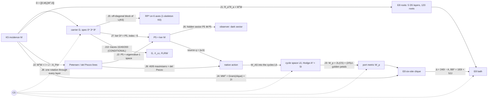

# OES — the end-to-end model

Lagrangian, spectral triple, spacetime, observer, energy, motion, gravity and cosmology, in one checked chain.

Research owner: Sachin Karia. Built 28 October 2026 against the canon cut **OMSOON736** (the "One Machine" 28 Oct edition), the 28 Oct consolidated Locked Memory, the 28 Oct collar/localization note, and the Through724 integrated model. This is an additive, unnumbered build. It mints no OMSOON or Matrix identifier and does not edit any workbook.

**AUTH = NOT_PASS · ScientificGold = FALSE · TIME_BIND = UNBOUND · DYN_BIND = NOT_INSTALLED · SCR6 absent · R6/A40/A52 frozen.**

Each statement below has one status, and `python verify.py` re-checks every one of them. The statuses are the canon's five: THEOREM, ARITHMETIC, OBSTRUCTION, REMOVED and UNFORMED. Two more are added here:

- **SELECTED_REFERENCE**: rebuilt from a stated definition because the saved original operand is absent.
- **CONDITIONAL**: needs an input the canon marks external.

A passing check is a statement about constructed matrices. It is not AUTH.

---

## 0. How the layers join

```
 K5 signless incidence M  ──►  D = [[0,M],[Mᵀ,0]] on ℓ²(V⊔E), dim 15        (layer 1, 2)
        │                         │
        │                         ├─► S[ψ] = ∫ ½|ψ̇|² − ½⟨ψ,D²ψ⟩ dt           carrier Lagrangian
        │                         ├─► heat trace, ζ_D, spectral dimension      spectral model
        │                         └─► readouts / hidden sectors                observer (layer 5)
        │
        ├─► P5 = ker M (source), L6 = cycles (port) ──► native action on E8 bath (layer 4)
        │                                                   │
        ├─► RP² on icosahedral axes, RP²×S¹, clock 125→120 ─┤   spacetime (layer 3)
        │                                                   │
        └─► E8 roots ──► Λ, Δ = 240I − A, ε(k), walks ──────┘
                                   │
     external M⁴, f, Λ, m  ───────►  spectral action of M⁴×F  ──► G, Λ_cc     gravity (layer 6, CONDITIONAL)
                                   └──► FLRW with homogeneous ψ               cosmology (layer 7, CONDITIONAL)
```

---

## 1. The carrier (`oes/carrier.py`)

**Datum.** K_n has the signless incidence M : ℝ^E → ℝ^V, where an edge maps to the sum of its two endpoints.

**Selection (THEOREM).** For n > 2, rank M = n, so dim ker M = n(n−3)/2. Setting dim ker M = |V| gives exactly n = 5. The signed incidence never satisfies this: its quadratic has discriminant 17. Checked for n = 3…12.

**Gram (THEOREM).**
- M Mᵀ = 3I + J, with (3I+J)⁻¹ = I/3 − J/24.
- The Smith invariants of M are 1, 1, 1, 1, 2.
- The S₅-equivariant maps ℝ^E → ℝ^V form a 2-dimensional space, spanned by M and J. Flag support kills J, and the remaining coefficient is the unit of time.

**Dirac and spectrum (THEOREM).** D = [[0, M], [Mᵀ, 0]] is self-adjoint and odd, with {D, γ} = 0 for γ = (+1 on V, −1 on E).
- D²(D² − 3)(D² − 8) = 0, so spec D² = {0⁵, 3⁸, 8²}.
- Tr D² = 40 and Tr D⁴ = 200. All odd traces vanish, and rank D² = 10.
- The signed Dirac has spectrum {0⁷, 5⁸}. It is not the carrier.

**The Lagrangian (THEOREM).** The action is

  S[ψ] = ∫ ( ½⟨ψ̇, ψ̇⟩ − ½⟨ψ, D²ψ⟩ ) dt,  with Euler–Lagrange equation ψ̈ + D²ψ = 0.

No second intertwiner, quartic or laboratory unit enters. It is fifteen oscillators: five with coefficient 0, eight with coefficient 3 and two with coefficient 8. The frequencies are 0, √3 and 2√2, and their squared ratio 8/3 is not the square of a rational.

**Energy and motion (THEOREM).** The energy is E = ½|ψ̇|² + ½⟨ψ, D²ψ⟩.

The canon datum has:
- vertex part (1,−1,0,0,0) + (1,1,1,1,1);
- edge part Mᵀ applied to the contrast;
- velocity the alternating 4-cycle on edges 01, 12, 23, 03.

On this datum ⟨ψ, D²ψ⟩ = 64, and E = 12 + 20 + 2 = 34 across the sectors λ = 3, 8 and 0. The closed form is

  ψ(t) = Σ_λ P_λ [ cos(√λ t) ψ₀ + sin(√λ t)/√λ · v₀ ]  (λ = 0: ψ₀ + t v₀),

where the P_λ are exact Lagrange-interpolation projectors. It conserves E to 1e−13, and a leapfrog integrator agrees with it.

**Joined finite objects (THEOREM).**
- Petersen graph, the disjointness graph on the 10 edges: A² + A − 2I = J, girth 5, projector ranks 1, 5, 4.
- Cycle Gram for the star tree: (G − I)(G − 5I) = 0 and det G = 125.
- Hodge block A = (6I − G)σ, with σ the signed opposite-edge exchange: A² = 5I.
- Signed edge Gram: G² = 5G.
- Edge tick: order 5, ∂T = R∂. Its unsigned form commutes with the Petersen adjacency, and it preserves the cycle space, where it acts as the order-5 rotor.

**Moments and harmonic obstruction (THEOREM).** On the contrast plane, M₂ = 10|x|² and M₄ = 6|x|⁴ + 10Σx⁴. The line 3|x|⁴ − 7Σx⁴ is harmonic. A quartic is not in the action (OBSTRUCTION).

> **Correction to the printed text.** The canon writes M₂ and M₄ as sums over the ten pairs i < j. The identities hold over the **twenty oriented roots** e_i − e_j. Over the ten pairs each sum is half: for example Σ_{i<j}(x_i − x_j)² = 5|x|². The check suite verifies both forms.

## 2. The spectral model (`oes/spectral.py`)

The finite spectral triple is (A = C^V ⊕ C^E, H = ℓ²(V⊔E), D, γ), with dim H = 15. All of its spectral content comes from {0⁵, 3⁸, 8²} (THEOREM):

- **Heat trace:** Z(β) = Tr e^{−βD²} = 5 + 8e^{−3β} + 2e^{−8β}.
- **Moments:** Tr D^{2k} = 15, 40, 200, 1240, 8840 for k = 0…4. These are all that a spectral action Tr f(D²/Λ²) can read.
- **Spectral zeta:** ζ_D(s) = 8·3^{−s} + 2·8^{−s}, with ζ_D(0) = 10 = rank D² and ζ_D(1) = 35/12.
- **Spectral dimension:** d_s(β) = −2 d log Z / d log β tends to 0 in both the UV and the IR, and peaks at 0.843 near β = 0.42.

The carrier has no emergent continuum dimension. This agrees with the canon's removal of "4 from 5 − 1" and of imported NC dimensions (REMOVED).

## 3. Spacetime (`oes/spacetime.py`)

The canon keeps three objects separate. None of them is a physical spacetime.

**(a) Surface and time-circle (THEOREM).**
- The six icosahedral axes carry the hemi-icosahedron and its complementary 10 triples. Both are closed RP² triangulations with χ = 1.
- H₀ = ℤ, H₁ = ℤ/2, H₂ = 0. rank ∂₂ is 10 over F₂₄₁ and 9 over F₂; the gap is the Bockstein of the 2-torsion.
- The 20-face union kills the torsion.
- The mapping torus of id is RP² × S¹, with H = ℤ, ℤ ⊕ ℤ/2, ℤ/2, 0 and F₂ Betti numbers 1, 2, 2, 1.
- The algebraic torus of −id is pure 2-torsion, with free Betti numbers 0, 0, 0, 0. It is a chain map and not a self-map (OBSTRUCTION).
- A₅ has element orders {1, 2, 3, 5}, with census 60 = 1 + 15 + 20 + 24. No rotation has order 4.
- The Hodge Laplacian on the 31 cells has nullity 1.
- K₄₀₃ = K_G ⊗ I₃₁ + I₁₃ ⊗ Δ has rank 400, and K_G has characteristic polynomial z³(z−4)²(z²−5z+5)²(z²−3z+1)².

**(b) Clock (THEOREM / OBSTRUCTION).**
- T on ℝ¹²⁵ is a Jordan block J₆(1) plus a permutation of order 90 (eleven 10-cycles and one 9-cycle).
- πσ = I₁₂₀, πT = Aπ, and A has order 90.
- g₁₂₀ = diag(I₁₁₉ + 11ᵀ, 1) is positive definite and A-invariant.
- (T − I)⁵ ≠ 0 on the chain, so T has no invariant positive metric. The memory lives upstairs and the metric clock lives on the quotient.

**(c) E8 lattice "space" with action time t (THEOREM).**
- **Roots and graph:** 240 roots (112 + 128) with Σαα^T = 60 I₈. The root graph is 56-regular, with spectrum 56¹ 28⁸ 8³⁵ (−2)¹¹² (−4)⁸⁴ and Gosset walks 1, 0, 56, 1512, 62160.
- **Returns:** lattice returns N₀…N₆ = 1, 0, 240, 13440, 1260720, 137813760, 17141798400, computed by exact walk convolution.
- **Symbol:** ε(k) = 240 − Σcos(α·k), with ε(0) = 0 and ε(π(1,1,1,1,0,0,0,0)) = 256.
- **Band range:** 20,000 random samples never exceed 256. That is ARITHMETIC evidence; the range proof is the canon's census.
- **Long waves:** ε ≈ 30|k|², so the bath sound speed is √30 in lattice units. No SI length or time is bound.
- **Ball:** the shells of |x|² ≤ 8 are 1, 240, 2160, 6720, 17520.
- **Green identity:** 240(G(0) − G(α)) = 1, exactly. It follows from ΔG = δ and the root-transitivity of W(E8); the solver confirms it on the W-symmetric ball.
- **Six-site clique** x₀ = 0, x_j = e₁ − e_{j+1}:
  - block A = 241I − J;
  - exterior coupling BB* = 183I + 52J = 183P_c + 495P_u, where 52 = 56 − 4 common neighbours.

## 4. The native action: source, port, bath (`oes/native.py`)

The declared boundary-pullback action, from Through724 and the collar note, is

```
L = ½ q̇ᵀM_s q̇ + ½|d g(q)/dt|² + ½|ẏ|² − 2 qᵀM_s q − ½ gᵀ(W_p + A) g − gᵀB y − ½⟨y, D y⟩
```

Its equations of motion are

```
M_s q̈ + 4 M_s q + J(q)ᵀ [ g̈ + (W_p + A) g + B y ] = 0,     ÿ + D y = −Bᵀ g,
```

where q = (a, b) ∈ P5 ⊕ P5, P5 = ker M, g is the six-port boundary value and y is the bath off the clique.

**Reconstructed parts (SELECTED_REFERENCE).** The saved native_source_matrices (SHA-256 73e07429…) are absent, so the port is rebuilt from its stated definition:

- **Source matrices.** A(a) is the symmetric zero-diagonal matrix with entries a_e. Since Ma = 0 its rows sum to zero, so [A(a), A(b)] is skew with zero row sums, which is an oriented cycle. This is W_AS : Λ²P5 → L6.
- **Source mass.** M_s = I/4 in an orthonormal basis of P5. P5 is the irreducible 5 of S₅, so this metric is unique up to an amplitude unit. The canon's det 8/9 refers to its saved basis.
- **Port metric.** W_p is the canon's explicit boundary metric: circulant (22, −8, 2, 2, −8)/5 on x₁…x₅ and 2/5 on x₀.
- **Adapter.** T : L6 → boundary intertwines the cycle rotor with x_j → x_{j+1}, and satisfies (TW_AS)ᵀ W_p (TW_AS) = (320/9) G P with G = Λ²M. It is fixed by a deterministic Reynolds average. The source and port energetics do not depend on that choice; the bath coupling does.

**Checked.**
- W_AS has rank 6 and kernel 4 (THEOREM).
- W_ASᵀW_AS = (10/9)P, by Schur (THEOREM).
- W_AS is rotor-equivariant (THEOREM).
- spec W_p = {2/5, 2, 5 ± √5 (×2)} and det W_p = 320 (THEOREM).
- Sharp quartic (THEOREM): max Q₄/ρ² = **40/9**, attained by a balanced visible pair; random sources stay below it. The maximisers form the degree-5 del Pezzo section Gr(2,5) ∩ ℙ⁵, as Through724 states.
- The port is quadratic: g(0) = 0, Dg(0) = 0 and Jq = 2g. At linear order the source equation is q̈ + 4q = 0, with frequency 2 and no linear channel into the bath (THEOREM).

**Energy and motion in the bath.**
- **Radiation channel (ARITHMETIC).** A port oscillating at frequency 4 (eigenvalue 16) lies inside the band [0, 256]. The bath density seen by the uniform channel at λ = 16 is 2.24×10⁻⁷ (Monte Carlo), against 2.03×10⁻⁷ from the long-wave estimate. The contrast channel sees 2.7×10⁻⁹. The channel is open but very thin, which fits the canon's long-lived periodic families.
- **Nonlinear flow (SELECTED_REFERENCE).** The full nonlinear system was integrated on the |x|² ≤ 8 ball (26,635 bath sites, Dirichlet outside) with RK4 to t = 4. Total energy is conserved to a relative 2×10⁻¹⁰ (r = 0.05) and 1×10⁻⁷ (r = 0.2).

  | preparation | r | bath gain / E₀ | source E ratio |
  |---|---|---|---|
  | circular (static port) | 0.05 | 9.0×10⁻⁵ | 1.12 |
  | breathing (port ∝ sin 4t) | 0.05 | 1.16×10⁻³ | 0.98 |
  | circular | 0.2 | 8.3×10⁻² | 3.61 (orbit breaks up) |
  | breathing | 0.2 | 1.0×10⁻² | 0.93 |

  At small amplitude the breathing source feeds the bath 13 times more than the circular one. At r = 0.2 the circular orbit falls apart. That matches the canon's statement that the rotating family is guaranteed only at tiny amplitude (|a| ≤ 8×10⁻⁶) and is nonlinearly unstable. The ball is a cavity, so these numbers are energy exchange, not a far-field rate.
- **Static tails (OBSTRUCTION, canon 28 Oct).** A nonzero port mean forces a non-ℓ¹ static tail, with annular lower bounds T1–T4. A zero-mean periodic source above frequency 2 with high port harmonics cannot be ℓ¹-localized (F5).

## 5. Observer (`oes/observer.py`)

The system is x = (ψ, ψ̇) with x' = Ax and A = [[0, I], [−D², 0]]. Observable subspaces come from iterated orthonormal Krylov spaces.

**Structure (THEOREM).**
- D² = diag(MMᵀ, MᵀM), so the vertex and edge systems never exchange energy. D intertwines them as a supersymmetric pair.
- The Witten index is Tr γ e^{−βD²} = −5 for every β.

**Observable dimensions out of 30 (THEOREM).**

| readout | observable | readout | observable |
|---|---|---|---|
| vertex positions | 10 | one vertex | 4 |
| edge positions | 20 | one edge | 6 |
| D ψ | 20 | vertex sum | 2 |
| all positions | 30 | | |

A scalar readout sees at most 6 dimensions, two for each of the three spectral lines. This is the canon's Firefly remark.

**Hidden controllable sector H = Ran K ∩ ker O (THEOREM).**
- Edge force with a Dψ observer gives **10**: the five kernel (cycle-drift) modes are reachable but invisible. This is the carrier's dark sector.
- Edge force with a vertex observer gives 20, and vertex force with an edge observer gives 10. All other pairings give 0.
- The finite-time Gramian W_o(6) of Dψ has rank 20.

The original Sākṣin operator and the 237-dimensional fiber observer remain **UNFORMED**.

## 6. Gravity (`oes/gravity.py`)

**Intrinsic (ARITHMETIC).** These are Lin–Lu–Yau (optimal-transport) Ricci curvatures:
- K5: **5/4**;
- the Petersen graph: **0**;
- the E8 root-lattice graph: **0**, so the bath space is discretely flat.

They are curvatures of discrete metric spaces, not Einstein gravity. The canon's integers (Einstein–Hilbert power 4 = cut rank, vacuum power 6 = cycle rank, 2 + 7 = 9) are shared integers only.

**Conditional: the spectral action of M⁴ × F (CONDITIONAL).** Take D = D_M ⊗ 1 + γ₅ ⊗ m D_F on a closed spin 4-manifold. Then

  Tr e^{−tD²} = Tr e^{−tD_M²} · Tr e^{−t m² D_F²},

and the expansion up to O(t²) reads

  (4πt)⁻² ∫√g [ 60 − t(160m² + 5R) + t²(400m⁴ + 40m²R/3) ].

This is checked symbolically. It uses only 15, 40, 200 and the spinor rank 4.

With f-moments F₀ = f(0), F₁ = ∫f and F₂ = ∫xf:

  1/(16πG) = 5F₁Λ²/(16π²),   Λ_cc = 6(F₂/F₁)Λ² − 16m² + 40(F₀/F₁)m⁴/Λ².

- For f = e^{−x} and Λ = 10m: G = π/(500m²) and Λ_cc = 584.4m².
- Choosing F₂/F₁ = 0.026 instead makes Λ_cc = 0. Λ_cc·G can take any value.

This is the canon's "physical scales and Wald coefficient underdetermined", made explicit. The inputs M⁴, f, Λ and m are external, so the Newton constant in SI units, the Wald coefficient and any horizon/area map stay **UNFORMED**. Curvature-squared a₄ terms are omitted.

## 7. Cosmology (`oes/cosmology.py`, CONDITIONAL)

Place the carrier field homogeneously on flat FLRW, with G and Λ_cc from layer 6:

  ψ̈ + 3Hψ̇ + m²D²ψ = 0,  H² = (8πG/3)ρ + Λ_cc/3,  Ḣ = −4πG|ψ̇|².

Integrated with DOP853 from the canon datum, with Λ = 10m and Λ_cc tuned to 0:
- the Friedmann constraint holds to 4×10⁻¹²;
- the kernel sector goes as ρ ∝ a^{−6.000} (stiff, massless);
- the λ = 3 and λ = 8 sectors go as ρ ∝ a^{−3.000} (dust);
- the scale factor grows as a ∝ t^{0.665}.

With the natural cutoff (f = e^{−x}), the evolution goes straight to de Sitter with H → √(Λ_cc/3) = 13.96m. That is the vacuum-energy problem, not a prediction.

No observed parameter (H₀, Ω, w) is produced. IceCube/LHAASO scales and the vacuum amplitude (27/5)³e^{−280} stay **REMOVED**.

## 8. Residual front (`oes/frontier.py`)

This section records the sibling update received after the 01:27 UTC Drive cut. Drive showed nothing newer at the time of the check.

**Replayed here.**
- **Band vertex (THEOREM).** At v* = π(1,1,1,1,0,0,0,0), every root gives cos = ±1: 112 give +1 and 128 give −1, so ε(v*) = 256.
- **Band-edge orbit (THEOREM).** The W(E8)-orbit of v* has 2160 points in ℝ⁸ and **135** classes modulo 2πΛ.
- **Local bound (ARITHMETIC, sampled).** S(v*+δ) ≥ −16 + |δ|²(2 − |δ|²) holds for |δ| ≤ √2. The minimum slack is −3×10⁻¹⁵, so the bound is attained.
- **224 saddle at πα (THEOREM, exact).** The expansion is ε = 224 + 6ρ² − 26z² − ρ⁴/2 + 3ρ²z² + (5/6)z⁴. On the cone 6ρ² = 26z² the quartic is exactly **(40/169)ρ⁴ > 0**, so the level set bends the convex way at the saddle.
- **Agni–Soma (THEOREM).** (5I − G)/5 is the cycle projector and fixes the image of W_AS. The two are not rival operators; only the naming needs settling.

**Reported, not replayed** (status REPORTED; the certificates and operands are not in this repository):
- the band is exactly [0, 256] by an alcove branch-and-bound (247,920 pieces);
- ε > 100 outside |k|² ≤ 6 (7,523 pieces);
- the W_n recurrence has order **11**, with (x+12)² dividing the leading coefficient, so the page line "at least 10, not 11" should be deleted (§15: the operator found has order 16; its characteristic polynomial has 11 roots in the band, (z+12)² among them, and 5 outside);
- 155 vs 4805 is a label error (155 = det T and 4805 = 5·31², the 4th cofactor of TTᵀ);
- rotor hex6 has m₁ = 242 ≥ 241.36;
- for the collar, the alcove reduction gives numerically positive curvature up to 223.999;
- 223.25 < 223.5 < 223.53 < 223.58 are successive lower bounds, so the standing value is the largest replayed one.

**Added at the 0741 cut (28 Oct, One_Machine_20261028_0741).**
- **Saddle law (THEOREM).** On the 224 level at distance d from the saddle πα, the tangent curvature is exactly **(15/16)d² + O(d⁴)**. It follows from the order-4 expansion, which is E7-isotropic to that order. On the true symbol the ratio is 0.937 at d = 0.1 and 0.932 at d = 0.3. The level set is convex near the saddle, but the margin vanishes there quadratically.
- **Collar survey (ARITHMETIC, evidence).** The open set is 218.9323 < ε < 224, √(313/20) < |k| < 35/8. I took 8×10⁶ samples and ran constrained optimisation from the worst points. The tangent curvature stays positive everywhere checked. Outside saddle caps of radius d₀ its minimum is 0.030, 0.083, 0.225, 0.424, 0.665 and 0.928 for d₀ = 0.2, 0.3, 0.5, 0.7, 0.9 and 1.1, always at ε → 224. This agrees numerically with U19.74's claimed floor.
- **Why a grid cannot close it (OBSTRUCTION, quantitative).** The Hessian moves at rate ≤ 85 per unit distance. Even outside a radius-1 cap, a first-order box certificate needs box radius < 0.011, which means more than 10¹³ boxes in a single Weyl chamber. Closing the collar needs two things: an analytic cap of radius about 1, built on the 15/16 law plus an explicit O(d⁴) remainder, and a bound outside the cap that does not use a grid.
- **Coil (THEOREM).** In ℤ/4320 the pada step 40 (order 108) and the yuga step 1728 (order 5) generate a cyclic subgroup of order 540 and index 8. The two cyclic subgroups meet only at 0. The Fibonacci recurrence mod 5 has period 20, and 20 divides 540.
- **U19.74 (REPORTED).** The note is not on Drive; the latest court note there is U19.56. Its r² = 9/40 sum-of-squares lock cannot be replayed without its definition. The 0741 paper also says 9/40 = 3²/(5·8) is not a count of the carrier.
- **Walk counts.** U19.53–U19.55 printed W₅ = 152697600 and W₆ = 22508998080. U19.56 corrected these to 137813760 and 17141798400, and layer 3 of this repository reproduces the corrected values.

**Still open.**
- A certified curvature bound away from the 224 saddle. This is the next step: a certified saddle analysis with an explicit radius.
- The complete scalar W_n recurrence.
- The five-port and the −8/9 moment operands.
- The decay-rate and prefactor conflicts.

## 9. Joining the dots (`oes/joins.py`)

A **join** is an identity between matrices built in different layers. Each one below is checked by `verify.py`. A **shared integer** is the same number appearing on two objects with no map between them. The canon is strict that "equal ranks are not the same maps", so the two are listed apart.



**Joins (THEOREM unless marked).**

| # | Join | What it says |
|---|---|---|
| J1 | r_(ij),a = μ_ij + ν_a are E8 roots, R_aᵀR_a = MᵀM, ker R_a = P5. Each layer with A4 is a 40-root D5, and the union has 120 roots. | The carrier edge gram *is* an E8 root gram. The part that disappears in E8 is exactly P5. |
| J2 | MᵀM = I + J − A_Petersen | The carrier edge spectrum {0⁵, 3⁴, 8} is the Petersen spectrum {1⁵, (−2)⁴, 3} under λ = 1 − θ (with +10 on the uniform line). P5 is the Petersen eigenvalue-1 space and the kernel of the del Pezzo line matrix. |
| J3 | W_p = 2L(C5) + (2/5)(J₅ ⊕ 1) | The port metric is twice the 5-cycle Laplacian. Its moving eigenvalues are 2(φ + 2) and 2(3 − φ), which are the golden petals (5 ± √5)/2 doubled. |
| J4 | Gram(x₁…x₅) = I + J, so MMᵀ = Gram + 2I | The carrier vertex gram is the bath clique gram shifted by 2. |
| J5 | The RP² 1-skeleton is K6, and D = A_L(K6) − diag(J − I, MᵀM − 2I) | Coning makes the 15 carrier atoms the 15 edges of the surface. D is the star/non-star block of the K6 line graph. |
| J6 | hidden(edge force, Dψ) = P5 ⊕ P5 | The carrier's dark sector is exactly the native source space. |
| J7 | Witten index −5 = −index(M) = −dim P5 | The count of dark modes is a topological index. |
| J8 | vertex rotation → tick → cycle rotor → W_AS → T → S → coordinate cycle in W(E8) | One C5 runs through every layer. The full nonlinear native vector field is equivariant to 8×10⁻¹⁵ (SELECTED_REFERENCE, because T was chosen equivariant). |
| J9 | The 40/9 maximisers are visible decomposable wedges, a locus of projective dimension 2 | This is the degree-5 del Pezzo surface whose line matrix appears in J2. |
| J10 | 15, 40, 200 → heat coefficients 60, 160m², 400m⁴ | The only route from the carrier to G and Λ_cc (CONDITIONAL). |

**Read as one sentence:**
1. One incidence M builds D.
2. D's kernel P5 is the source, and that source is invisible to the observer (J6, J7).
3. D's edge block is the Petersen complement (J2), the E8 root gram (J1) and, through coning, the surface (J5).
4. The source talks through the cycle space, with a port metric that is the golden C5 Laplacian (J3), to a clique whose gram is the carrier's vertex gram (J4). That clique is inside the E8 bath.
5. One C5 symmetry is kept from end to end (J8).
6. Gravity and cosmology attach only through the traces (J10), and only conditionally.

**Shared integers, no map (ARITHMETIC):**

| Integer | Where it appears | Map? |
|---|---|---|
| 15 | dim H; edges of K6; duads of 6 | J5 is the only map among these |
| 60 | E8 frame; \|A5\|; the Dirac trace coefficient | none |
| 240 | E8 roots; 6·Tr D²; the corner diagonal | none |
| 20 | five-port visible coordinates; observable dimensions of Dψ; Tr MᵀM | none |
| 125 | det of the cycle Gram; 5³ clock memory states | none |
| 120 | \|S5\|; clock quotient; D5 union | none |
| 9 | gravity's 2 + 7; E8 clique size | none |
| 36 | atlas addresses | none |
| 4320, 108, 69120 | yuga, japa and Human Design counts | integers only |

# Part II — From the mathematics to the operands and the physical gates

The canon's own state machine (S364 master lock) separates four kinds of transition:

> a new theorem head changes what is **known**; an authenticated root changes what can be **executed**; a binary receipt changes what can be **compared**; an independent warrant changes what can be **promoted**.

So "doing the maths to get to the gates" means two things: drive every gate to the edge of its own transition type, and prove exactly what input closes the rest. Layers 10–18 do this.

## 10. Operands recovered or formed

| Operand (canon status before) | What happened | Layer / file |
|---|---|---|
| saved `native_source_matrices`, SHA-256 73e07429… (ABSENT) | **Located** inside `OES_Standing_Model_Integrated_Proof_Packet_20261027.zip`. The bytes hash to the recorded value here, a cross-host byte receipt. | `data/native_matrices_input.json`, layer 10 |
| 6×6 adapter T of eq. 27, "155 vs 4805" (conflict) | Present in the same file as `T_OMSOON293`: det T = 155 = 5·31, cofactor₄₄(TTᵀ) = 4805 = 5·31², (TTᵀ)⁻¹₄₄ = 1/5. One adapter and its cofactor; **replayed**. | layer 10 |
| E8 glue map (ABSENT) | **Constructed** both ways: E8 = D8 ∪ (D8 + s) with isotropic s, and E8 ⊃ A4 ⊕ A4′ of index 5 with glue map x ↦ ±2x on ℤ/5. | layer 11 |
| lattice sequence W₆₀ (ABSENT) | **Computed exactly** to W₉₀ by a W(E8) dominant-weight DP with CRT. All 56 canon values W₀…W₅₅ are reproduced with zero mismatches, including W₂₅…W₅₅, which the canon had never independently regenerated. A second, independent engine (D8 + spinor factorisation) gives W₀…W₆₀₀ modulo primes and agrees with all 91 exact terms. | `data/walks90.json`, `data/walks_modp.json`, `oes/walks.py`, `oes/walkfast.py`, layer 14 |

**The literal operands against the earlier reconstruction (THEOREM, layer 10).**
- Every identity the canon states for the file replays exactly:
  - W = NᵀN with det 8/9, and M = diag(W/4, W/4);
  - W_p = 2FᵀF, with spectrum {2/5, 2, 5 ± √5};
  - WASᵀW_p WAS = (320/9)·Λ²M·P;
  - R⁵ = I, RᵀWR = W, WAS·Λ²R = Q·WAS.
- The printed literal R is exactly the K5 vertex 5-cycle.
- My layer-4 selected reference had the same W_p (exactly), the same metric up to basis, and the same Schur scale. Its adapter differed from the literal only by an explicit W_p-isometry U commuting with the C5 rotation (det U = −1). That is precisely the freedom the uniqueness analysis predicted.
- The native E8 flow was rerun on the **owner's literal operands** (apex 0 and eᵢ − e₆ clique). Energy is conserved to 5×10⁻¹¹, and a breathing source feeds the bath 11.7× more than a circular one (13× in the reference run).

**Uniqueness certificates (THEOREM).** These are why derived operands are not arbitrary surrogates:
- P5 is an irreducible S5-module, so its invariant metric is unique up to scale.
- Hom_S5(Λ²P5, L6) is one-dimensional, so W_AS is forced up to scale.
- No S5- or D5-equivariant isomorphism L6 → boundary exists: the characters agree only on the identity and the 5-cycles (layer 12, B0). So C5 is the maximal symmetry of any port adapter, and its moduli are an explicit commutant group.

**Searched and not present.** The reader packet and the 27 Oct proof packet do not contain:
- the six SCR6 operands;
- the 1401 → 1370 seams;
- the 502-dimensional Hodge–Dirac and the 237-dimensional operators;
- MPKG A_M;
- I6L, Jfix, Sawan or Hemkuver.

## 11. The E8 glue: the carrier sits inside the bath (`oes/glue.py`)

**Decomposition.**
- A4 = ⟨eᵢ − eⱼ⟩ is the carrier's own root system: its 20 roots are the oriented K5 edges.
- Its orthogonal complement in E8 is a second A4′.
- [E8 : A4 ⊕ A4′] = 5, and 240 = 20 + 20 + 200.

**The 200 mixed roots.**
- They project onto span(A4) as exactly the K5 vertex weights eᵢ − ⅕Σe and edge weights eᵢ + eⱼ − ⅖Σe, up to sign.
- A signed vertex pairs with the 10 weights of the twin 10; a signed edge pairs with the 5 weights of the twin 5. That gives 4 × 50 = (5,10′) + (5̄,10̄′) + (10,5̄′) + (10̄,5′).
- In SU(5) × SU(5)′ notation this is 248 = (24,1) + (1,24) + those four bifundamentals.

**Consequence (THEOREM).** ℓ²(V ⊔ E) is ℓ² of the A4 shadows of the mixed E8 roots. The carrier is not merely numerically related to the bath; it is a projection of it.

## 12. What a physical binding can be (`oes/binding.py`)

**Theorems.**
- **B1.** The only atom-diagonal symmetry of D is the global phase. No atom-dependent charge (hypercharge, colour, any diagonal gauge U(1)) commutes with the carrier dynamics. This sharpens the canon's removal of the hypercharge shell.
- **B2.** The commutant of D is M5 ⊕ M4 ⊕ M4 ⊕ ℂ ⊕ ℂ (dimension 59). The dark sector ker D = P5 carries an **exact U(5)** as its fundamental.
- **B3.** The native port breaks that dark O(5) completely: the stabiliser Lie algebra is 0. The only continuous symmetry left is the SO(2) rotating (a, b), whose Noether charge is the canon's angular charge.
- **B4.** The five zero modes have one chirality. Under any SU(5) ⊂ U(5) they are a single 5 with anomaly A(5) = 1 ≠ 0 (OBSTRUCTION). The minimal anomaly-free completion adds Λ²(ker D) = 10 at the opposite chirality, since A(Λ²5) = A(5) = 1. Λ²P5 is exactly where the native port's wedge a ∧ b lives, and 5 + 10 = 15 is the carrier's own state count.

**Conditional consequence (CONDITIONAL).** One carrier supports one anomaly-free 5 + 10, the state content of one Standard-Model generation. Nature has three (LEP N_ν = 2.984 ± 0.008), so the generation multiplicity is an explicit **operand of DYN_BIND**, not a carrier theorem.

**The structural route.** The route the mathematics points to is e8 ⊃ su(5) ⊕ su(5)′ (layer 11). Choosing it, and supplying the multiplicity and the chirality index, is the binding decision.

## 13. The gates, executed to the edge of their type (`oes/gatework.py`)

| Gate | Transition type | Done here | What closes it |
|---|---|---|---|
| **TIME_BIND** | metrology | Countermodel A replayed: τ and 2τ give identical records but frequencies in ratio 2:1. Sufficiency proved: one datum fixes τ uniquely, and frequency ratios are calibration-invariant. The canon's Salina square S·U_native(u) = U_phys(τu)·S holds to 6×10⁻¹⁵ (Prema follows). | **One authenticated clock datum** and the owner's choice of which native mode it labels. CTB9: unbound only for lack of metrology. (U7 recommends the electron Compton mode.) |
| **PredictionFreeze** | owner act | `data/prediction_register.json`: every calibration-invariant number the model fixes, with no fit; its SHA-256 is recorded in results.json. | The owner triggers the freeze, before any new comparison with data. |
| **W_L** (likelihood) | independent warrant | **Executed** on the canon's recorded physical candidate, the PMNS strict branch with sin²θ₁₂ = 1199/3759 and sin²θ₁₃ = 27/1280. The 22 Oct note calls it frozen; the PredictionFreeze gate itself was never triggered. Against the canon-recorded Bari Oct-2026 fit the pulls are +2.59σ and −1.98σ, χ² = 10.6 (2 dof), p = 0.005. Adding the reported NuFIT 6.0 strict-θ₂₃ pull (−4.8σ) gives χ² = 26.3 (3 dof), p ≈ 8×10⁻⁶. | **Result: NOT_PASS by evidence.** The candidate is excluded, which confirms the 28 Oct removal of PMNS from the carrier. |
| **T3081** | binary receipt | Maintainer side replayed on a second host: `dEchorate_room020002_src9_arr6_mics26-30.sofa` gives SHA-256 c39bc27f… and MD5 6f7aa37d… (1,724,358 bytes), identical to the FinalRun 15 Aug receipt. The method is also demonstrated on the native operand file. The official SOFA host (sofacoustics.org) and zenodo.org are denied by this environment's network policy. | Allow those hosts, then compare the maintainer copy `10E4VCAA1…` (SHA c39bc27f…) with the official bytes. |
| **AUTH / SCR6** | authenticated root | `data/owner_transaction.json` packages the canon's minimal ingress antichain {P_cl, SELECT_CERT, ROLE_BIND, G_role}, with SHA-256 for each operand and the uniqueness certificates. | **The research owner's signature.** SCR6 additionally needs its six physical operands, which belong to a chosen physical child. |
| **DYN_BIND** | physical choice | Constraints B1–B6 above. | The choice of physical child (H_sel), the generation multiplicity and the chirality index. |
| **ScientificGold** | independent warrant | Nothing can be promoted internally. | A frozen prediction, independent data and a preregistered test on a declared physical system. |

## 14. The six SCR6 operands

The canon defines them by shape only: H_D2 (2×2), C55 (55×55), F_phys (169×69, complex), Omega24 (24×24, skew), Z7 (31×7) and host_to_OES (5×18). It says they "cannot be filled with similarly shaped constructed matrices".

They are **physical by definition**: they are the interface to a chosen physical system. Mathematics cannot derive them; it can only reduce each to its minimal input. The 26 Oct U7 court did that reduction, and its table stands:
- gauge amplitudes need the scalar spectrum;
- Yukawas need running masses;
- the vacuum needs G_F;
- the M6 coframe needs a one-bit owner choice;
- the SI clock needs m_e;
- atomic H_Z needs α, m_e and nuclear data.

Its flavour benchmark rests on ε = 9/40 with "rationals chosen to fit", and §13 shows the recorded PMNS candidate fails. So the honest physical route is not to refit flavour. It is to declare the physical child, then freeze the register of §13 before testing.

**Choosing the physical child (CONDITIONAL; the owner's decision).** These options are compatible with the theorems above:

| Child | What the model already fixes | What the child adds | Status of its predictions |
|---|---|---|---|
| Particle physics (e8 ⊃ su(5) ⊕ su(5)′) | 5 + 10 per carrier, the glue, the anomaly structure | generation multiplicity 3, chirality index, scalar spectrum, one clock datum | flavour attempt (ε = 9/40) fitted; its recorded PMNS branch is excluded (§13) |
| Engineered network (LC or mechanical realisation of D, port and bath truncation) | every operand; only τ and an amplitude unit are free | fabrication tolerances | the register of §13 becomes directly testable; Gold would certify the model of that device, not of nature |
| Acoustic lane (dEchorate, T3081) | none of the room physics | host_to_OES (5×18) and the calibration chain | data lineage half-established (maintainer side replayed); no prediction frozen |

## 15. The scalar walk recurrence (`oes/recurrence.py`, `oes/walkfast.py`, `oes/ore.py`)

**Two engines.**
- The Weyl-orbit DP (`oes/walks.py`) gives exact integers W₀…W₉₀ (`data/walks90.json`).
- A second engine (`oes/walkfast.py`) uses E8 = D8 ∪ (D8 + s). With cᵢ = cos θᵢ the root sum is λ = 4e₂(c) + 128 ∏cos(θᵢ/2) + 128 ∏sin(θᵢ/2). Only even powers of the two spinor products survive the constant term, so

  W_n = Σ_q C(n,2q) 4^(n−2q) 64^q Σ_m C(2q,2m) E[e₂(c)^(n−2q) ∏ᵢ (1+cᵢ)^(q−m) (1−cᵢ)^m],

  where c₁…c₈ are independent cosines of uniform angles.
- One Gaussian variable removes the coupling e₂ = (e₁² − p₂)/2. Every step is then exact over F_p: Hermite–Gauss weights apply the Gaussian functional, and the eighth power is taken on roots of unity. W₀…W₆₀₀ mod p takes about 18 minutes per prime. `data/walks_modp.json` holds W₀…W₆₀₀ mod two primes and W₀…W₅₀₀ mod two more.
- The two engines agree on all 91 exact terms, mod all four primes.

**Exclusion.**
- A recurrence of shape (r, d) is also one of shape (r+1, d) and of shape (r, d+1). So the excluded region is a down-set, and only its corners need testing.
- Exact W₀…W₉₀: every recurrence has (r+1)(d+2) > 92. The canon's minimal admissible shape (10, 6) is excluded directly.
- W₀…W₆₀₀ mod p: every recurrence with **(r+1)(d+2) ≤ 455** is excluded. Full rank mod p implies full rank over ℚ, so given the residues this is a proof. In particular, order 10 needs degree ≥ 53, order 11 needs degree ≥ 49 and order 15 needs degree ≥ 36. The sibling's scalar-replay bound, (r+1)(d+2) ≥ 195 with order 11 needing degree ≥ 15, follows.

**The recurrence (THEOREM on the data; formed mod four primes).**
- The first kernels appear at product 456, shape (23, 17). Its kernel is 2-dimensional mod both 600-term primes, with 146 more equations than unknowns. Kernels follow at every order from 18 to 36, and at 39.
- These kernels are recurrences, and their greatest common right divisor over F_p(n) (`oes/ore.py`) is **one operator of order 16 and degree 58**, the same mod all four primes. Built from W₀…W₅₀₀, it also annihilates W₅₀₁…W₆₀₀.
- Its characteristic polynomial factors over ℚ. Every simple root has local exponent exactly −4 = −dim/2, the Morse value for a nondegenerate critical point in 8 dimensions. The double root −12 has indicial polynomial (α+4)(α+5). The 16 growth rates are:

  | in the band [−16, 240] (11, with multiplicity) | outside the real band (5) |
  |---|---|
  | 240 (band top), 16 (the 224 saddle), −3, −8, −10, −11, −185/16, −320/27, −12 (double), −16 (band bottom) | 340, −660, −20, −35, −120/7 |

- **The sibling's claims.** "(x+12)² divides the leading coefficient" holds: (z+12)² divides the characteristic polynomial. "Order 11" is the in-band part: 11 roots, counted with multiplicity. The operator found has order 16, because five growth rates lie off the real band. An order-11 annihilator is not excluded by the data (it would need degree ≥ 49), but it would have to be a right factor of this operator.
- **Still UNFORMED:** the rational coefficients (they need more primes), and a proof that the operator annihilates W_n for every n (by creative telescoping, or from an a-priori size bound).

## 16. Court U19.81, audited (`oes/court.py`)

The court (28 Oct) proposes an inverse-problem architecture: an 8-dimensional port split (5, 2, 1), Markov–Krein envelopes from moments through M₅₀, a Loewner–Pick test, H90 as a [9,3,7]₁₁ code, an observability-separation theorem and a clock-scaling obstruction. Its script is marked "pre-verified", but it does not run: its own assert fails. Each claim, checked:

| Claim | Finding | Status |
|---|---|---|
| sector eigenvalues A_bb = 241 on V₅, 235 on V₁; BB* = 183, 495 | correct | THEOREM |
| the script's walk generator | wrong from W₄ on (7,772,208 printed, 1,260,720 true) | OBSTRUCTION |
| the script's moment sequences | not positive definite at Lanczos step 3, so no measure has them | OBSTRUCTION |
| the script's uniform moment m_k − m_{k+1}/288 | wrong (39.17 at k = 1). The uniform moment over the clique is 6m_k − m_{k+1}/48 (= 235), because ⟨δ₀, Δᵏδ_α⟩ = m_k − m_{k+1}/240 for every root α | OBSTRUCTION; correction THEOREM |
| envelopes from M₀…M₅₀ (25 and 26 poles) | the script uses M₀…M₅. Rebuilt here from the true M₀…M₄₉: the true moments pass the Hausdorff test on [0, 256] exactly, and G₊ − G₋ ≈ 5×10⁻²⁸ at s = 64 | THEOREM |
| (G₋(s₁), G₊(s₂)) cannot be realized together | true, by Markov–Krein uniqueness of the extremal measure | THEOREM |
| the script's Loewner certificate for it | fails on the true moments: the "incompatible" cross choice also gives a positive slope (1.69×10⁹) | OBSTRUCTION |
| a [9,3,7]₁₁ MDS code correcting 3 errors | true (Cauchy construction, exhaustive decoding) | THEOREM |
| that code is H90 | nothing in the canon or this repository selects it | UNFORMED |
| ker O is the 4-dim cross block; 4 polarizations complete it | true | THEOREM |
| C5 clock symmetry reduces B to 2 parameters | false for every V₂ the court names. C5 acts as the identity on the 8² doublet of D², and on any C5-invariant 2-site probe (C5 has prime order, so orbits have 1 or 5 sites). So dim Hom_C5(V₂, U₂) is 0 or 4, never 2 | OBSTRUCTION |
| ω = Ω*√x fixes no clock scale | true; TIME_BIND stays UNBOUND | THEOREM |
| "complete expanded scalar polynomial annihilator" | not given anywhere. §15 forms one mod four primes (order 16, degree 58); its rational coefficients are not reconstructed | UNFORMED |

**Remarks in the same message.**
- **Cofactor 68 (THEOREM).** The literal 6×6 adapter's largest |cofactor| is 68, and no minor of size ≤ 5 equals 155 or 4805. By Cauchy–Binet, 4805 = cofactor₄₄(TTᵀ) = 21² + 48² + 43² + 11² + 3² + 9², the sum of the squared row-4 cofactors of T. So "cofactor 4805" supplies no five-dimensional operand, and that operand stays UNFORMED.
- **Scalar bound.** (r+1)(d+2) ≥ 195 is replayed and strengthened in §15, to ≥ 456, and the recurrence itself is then formed.
- **Preparation time (REPORTED).** With a port budget polynomial in 1/ε, preparation time must grow at least as ε^(−1/2) for the monopole families, or ε^(−1/3) for a specified dipole target. This is a necessary condition only. The sibling is checking its constants, and there is no matching preparation protocol yet.

## 17. The 28 Oct handover, audited (`oes/handover.py`)

The Locked Memory handover ("OES End-to-End & Spectral Model Handover — 28 Oct 2026") is replayed in layer 16. The paste-ready corrections are in [`HANDOVER_ADDENDUM.md`](HANDOVER_ADDENDUM.md).

- **Confirmed:** the gate banner and stoplines; ω₀ = 2; the carrier spectrum; the 7-design expansion; the root-line dispersive identities; the Schur boundary; the 156-coordinate realization; the MDS facts; and the critical census.
- **Critical census (new, THEOREM).** The vertices and edges of the E8 alcove carry **11 critical families, 243,600 points, Morse alternating sum 0**. Nine are vertices; two lie on edges (A6+A1 at λ = −185/16, A7 at λ = −320/27). Their 11 values are exactly the in-band characteristic roots of the order-16 recurrence of §15, so the band geometry and the walk data agree.
- **The literal five-dimensional operand (new, THEOREM).** Every column sum of the printed chart T₆ is 5, so T₆ preserves the contrast lattice V_c. T₆|V_c is a 5×5 integer operator with det 31 and irreducible characteristic polynomial x⁵ − 3x⁴ + 12x³ − 20x² + 31x − 31, so 155 = 5 × 31. The handover's "literal" T5×5 = (2I₄ − C_A4) ⊕ [5] is a construction (det 155). It is not in the operand file and not a block of T₆.
- **Corrections (OBSTRUCTION):**
  - the K6 wording of the carrier;
  - "order-11, degree-5" as an exact recurrence (excluded; the exact operator has order 16);
  - P25 as an annihilator of the moments or of W_n;
  - (15/13)r², which should be (15/16)r²;
  - ker O ⊆ ker C, which is reversed;
  - "multi-frequency criterion verified" for the court script.
- **UNFORMED:** H90 identified.
- **REPORTED:** the paper digest, Tr₁/Tr₂, the Miller recurrence, the 8-dim dispersive bound, the Floquet monodromy, the preparation constant, B_geom, and the mediant collar.

## 18. Sound, light, frequency and phase on the K5 edges (`oes/waves.py`)

The ten edges of K5 carry one Hodge complex. The canon's oriented boundary is the signed incidence B. The gradient is d0 = Bᵀ (vertices → edges), and the curl is Curl = ⋆d₁ (edges → the ten triangles → edges, by the Hodge star of the 4-simplex). d₁d₀ = 0 and the ranks are 4 + 6 = 10, so the complex is exact.

**Sound and light (THEOREM).**
- **Sound** is im d₀: the 4 longitudinal edge modes, the velocity fields of the acoustic system ṗ = −d₀ᵀu, u̇ = d₀p. Its operator is BBᵀ = 5I − J = ½Σ_{α∈A4} ααᵀ, the long-wave Hessian of the carrier's own root lattice.
- **Light** is ker d₀ᵀ: the 6 transverse edge modes. This is the cycle space L6, which is the native port space. Curl is symmetric, with Curl² = d₁ᵀd₁ and eigenvalues ±√5 (3 each) on light and 0 on sound. In the canon's fundamental-cycle basis, Curl on the cycles is exactly −A, where A = (6I − G)σ is the Hodge block of layer 1. The canon already had the light operator.
- **One frequency.** d₀d₀ᵀ + Curl² = 5·I₁₀, so sound and light are isochronous at ω = √5. The carrier's vertex frequencies are the complements: MMᵀ + BBᵀ = 8I, so ω²_carrier + ω²_sound = 8 on every vertex mode (8 + 0 uniform, 3 + 5 contrast).

**Phase (THEOREM).**
- The order-5 edge tick fixes both sectors. Sound carries the C5 phases ±72° and ±144°, and none at 0 (trace −1).
- The two curl eigenspaces are **helicities**. Odd permutations swap them and even ones keep them.
- Under the rotation group A5, the helicities are the two **icosahedral 3-dim irreps** and sound is the A5 **4**. Curl = −√5 carries the 72° class (5-cycle character φ), and Curl = +√5 carries the 144° class (character 1 − φ). Each also has one phase-0 mode.
- **Selection rules.** No S5- or A5-equivariant map takes sound to light. The C5 clock allows exactly 4 real phase-matched parameters. A 72° sound mode can only become light of the matching helicity, and the two phase-0 light modes stay dark to sound.
- **Resonant conversion (CONDITIONAL).** Because the sectors are isochronous, any C5-equivariant coupling converts a sound mode completely (fraction 0.99999) into its matched helicity. The other helicity and the phase-0 modes stay at 10⁻¹⁶. The coupling itself is not a canon operand.
- **Two C5 actions.** The carrier's edge operator MᵀM commutes with the unsigned tick and not with the signed one. Matter and sound/light carry two different C5 actions on the same ten edges.

**Through the native chain (THEOREM).**
- The literal port (source wedges → light, via `Fedge_native_inverse`) is S5-equivariant and drives each helicity with rank 3. Its 4-dimensional kernel is the A5 4, the same type as sound: the port cannot emit sound directly.
- A source at frequency 2 drives light only at frequencies 0 and 4. A circular source gives pure frequency 4 with doubled phase 2φ.
- The bath's sound speed² on the carrier's 4-plane is 30 = 5 (the A4 roots) + 0 (A4′) + 25 (the 200 mixed roots of layer 11), and it is isotropic.
- The band has no critical value in (0, 224), so the port frequency (ε = 16) radiates into its smooth acoustic part. There k ≈ 0.7404, with phase and group velocities 0.986 and 0.959 of √30 (ARITHMETIC; the directions differ only at order k⁸).

**Frequency ladder (native units).** 0 (dark) < √3 (carrier contrast) < 2 (source) < √5 (K5 sound = light) < 2√2 (carrier uniform) < 4 (port) < √224 (bath saddle) < 16 (band top).

**Physical sound and light (CONDITIONAL).** "Sound" and "light" name the longitudinal and transverse sectors. Binding them to physical fields needs DYN_BIND, and absolute frequencies need TIME_BIND. The calibration-invariant content is the ratios:
- light/sound = 1;
- carrier² + sound² = 8;
- port/source = 2;
- (bath/K5 speed)² = 6.

## 19. The 14:16 snapshot, rebuilt (`oes/snapshot.py`)

The sibling snapshot (`one-machine-20261028.pdf`, `oes-model-20261028.zip`, `STATUS_20261028.md`, Drive, 14:16 UTC) adds the cube, the 24-step readout, two Hankel matrices, the Spanda action on the 31 subsets, the frequency squares on the 4320-circle, and the Agni–clock–doubling chain. Its TypeScript audits mostly compare typed constants. Layer 18 recomputes each item from matrices, and settles three items the snapshot left open.

**Settled here (THEOREM).**
- **Density on the nine-torus.** The nine positive critical energies 224, 243, 248, 250, 251, 4025/16, 6800/27, 252, 256 (the two families at 252 share one) have the distinct square-free parts 14, 3, 62, 10, 251, 161, 51, 7, 1. By Besicovitch, their square roots are linearly independent over ℚ, so by Kronecker the flow of the nine bath frequencies is dense on T⁹.
- **The Hessians.** All eleven critical families are recomputed. sign det H = (−1)^index, and count · i^index/√|det H| reproduces every coherent coefficient printed in the snapshot paper. The determinants are 60⁸ at the maximum, 3⁸ for A8, 2¹⁶ for A7+A1 and D8, and 5⁸ for A4+A4.
- **Walk asymptotics from the 7-design alone.** log(1 − ε/240) = −s/8 − s²/640 − s³/23040 with s = |k|², and Laplace's method gives

  W_n = (16/π⁴)·240ⁿ·n⁻⁴·(1 − 2/n + (23/15)/n² + O(n⁻³)).

  The exact W₅₀…W₉₀ follow it. The residual ((R_n − 1 + 2/n)n² − 23/15) falls from −0.0069 at n = 50 to −0.0038 at n = 90.

**Replayed from matrices.**
- Agni = 5I − G is the light operator: Agni = Curl² = d₁ᵀd₁, G = d₀d₀ᵀ is the sound operator, and Agni + G = 5I (layer 17).
- The edge doubling T (10×20) has TTᵀ = 2I, every row is null for the pair signature, and rank BT = 4. All of this is immediate.
- The five-port site block (SELECTED_REFERENCE) has:
  - moments 0, 0, 0, 1/3, 0, −8/9, 0, 55/27 and recurrence H_{k+4} + (8/3)H_{k+2} + H_k = 0;
  - controllability determinant −1/3 and observability determinant −1/27;
  - Hankel determinant 1/81 (6561 once cleared by 27);
  - frequencies² (4 ± √7)/3.
- The cube:
  - Laplacian spectrum 0, 2³, 4³, 6;
  - middle operator L(6I − L) with M² = 8M and rank 6;
  - the reader pair sees ranks 2 then 4; four of the six third readers reach 6;
  - decoder det −1, with noise gains 46 and 66.
- Spanda on the 31 subsets: 7 fixed, 24 moved, traces 31, 7, and trace-Hankel determinant 912. On the K5 edges the same double transposition is even: it keeps both helicities, with traces 0 on sound and −1 on each helicity.
- The 4320-circle: the day has order 24 and the pada order 108; they meet in the order-12 step; the order-5 rotor misses the day. The squares 3, 4, 5, 8, 16 divide 4320, and no bath energy does.

**Corrections (OBSTRUCTION).**
- (I + S)/2 is a Markov projector of rank **19** (7 fixed subsets plus 12 symmetrized pairs), not 7.
- The snapshot paper's front table still says "the recurrence order is 11". The operator of §15 has order 16; 11 is the degree of its in-band characteristic part.

## 20. What stays open

**Unformed operands** (`oes/gates.py`; physical or historical, not derivable):
- the six SCR6 operands;
- the original 31 seam rows and the physical 1401 → 1370 sector;
- the 502-dimensional Hodge–Dirac and the 237-dimensional observer;
- MPKG A_M;
- the 4944- and 5048-dimensional transitions;
- the R1/025/250/Jfix/Sawan/Hemkuver ports;
- the historical Agni/Soma/Suraj and the original Sākṣin;
- I6L;
- the Wald coefficient;
- the physical child H_sel;
- the missing five-dimensional operand ("cofactor 4805" does not supply it, §16).

**Recovered in this build:** the native source matrices, the 155/4805 adapter, the E8 glue map, W₉₀ exactly, W₆₀₀ modulo primes, and the W_n recurrence modulo four primes (order 16, degree 58).

**Open mathematics:**
- the convexity collar inside (223.58, 224), now reduced to a certified bound away from the 224 saddle (with margin law 15/16·d²);
- the rational coefficients of the order-16 W_n recurrence, and a proof that it holds for every n;
- a preparation protocol matching the reported ε^(−1/2) and ε^(−1/3) lower bounds;
- a matching dispersive upper bound;
- maximal branch continuation.

**Owner decisions that would move gates:**
1. sign the transaction (AUTH);
2. name the physical child (DYN_BIND, SCR6);
3. supply one clock datum (TIME_BIND);
4. trigger the freeze (PredictionFreeze);
5. allow sofacoustics.org and zenodo.org (T3081).

## Sources read (Google Drive)

- `00 — OES CANON QUICK ACCESS — CURRENT` (1KZcWbz9cPalear_Ix-cqviNdJziYAw2jOuiH75pcIug)
- `one-machine-20261028-images.pdf` (1YUMCzBlkVw00gG3SnSO1zpH2DXNxArH-), the latest edition of OMSOON736
- `LOCKED_MEMORY_END_TO_END_2026-10-28.md` (1JUsXfoA-qEiieLeYvYy0r7kXjl_6XtgC)
- `LOCKED_MEMORY_OES_CONSOLIDATED_20261028.txt` (1NKSDKdMj5bEC2Dy6r2tSPWrX_uIE8Fq-)
- `OES_736_Collar_Localization_Proof_20261028.txt` (1hqOpJkdwL6unoO7SJmnTHbJp4fzJZ2Qu)
- `OES_All_Dots_Through724_Integrated_Model_20261027.txt` (1BiKs2qxqc1DD7T8fMegjJH01S3PVOF9U): the native action, Appendix A, and D5/del Pezzo
- `One_Machine_20261028_0741.typ` (1mhK9MDOiHVM_a14ItGk3IDRp84pnevr9) and `_model.zip` (12AhKsdq-KtyTUs6N9L7y15bMm5O71RKj): the coil of order 540 and the U19.74 note
- `OES Remaining Mathematical Frontiers — Proofs and Executed Courts — 2026-10-28` (1y1vP2TPAsYP8p_bUe_D_AIi9h1h57Bnou0U-Enzy8-s): the precise open collar set
- `OES_Standing_Model_Integrated_Proof_Packet_20261027.zip` (1ukVZgOnirGVQ1CJslWLmeyKj8ZAVIiGJ, SHA-256 f579e5f9…): the literal native operands, canon W₀…W₅₅, the U7 physical-operand court and the selection reconciliation
- `LOCKED_CANON_ADDENDUM_OMNOW_SCALE_TIME_TIMEBIND…_2026-09-23` (14LStBynVoEqDogWD8YEHhAeE7q2KBgLW): the Salina and Prema courts
- `OES_OM_EK_SACH_S364_…_SCR6_OPERAND_ABSENCE_MASTER_LOCK` (13NJ0DlCTjmHfLcmIds-mRZ9SEiqaReTv): the SCR6 transaction and the four transition types
- `LOCKED MEMORY — TO OMLIKELY1` (1PFlPL4wcK57LKGvDMReG-mInbyoinHH1urIN3-XkiHw): the SCR6 shapes and the Bari PMNS pulls
- `LOCKED_MEMORY_OES_OMTOOM7_…_TIMEBIND_2026-10-19` (1zjJVDyinGUG5oRawJULNZhQm_3-_7H1o): CTB2/CTB3/CTB9
- the dEchorate T3081 court (17_BHvmFJiemYFg5gzgwSYEayZ5p_tU5-i8Qk4tX8egc)
- Sibling handovers in OES › Locked Memory, OMSOON → OMSOON7, 22–25 Oct; titles and summaries only

The only claude.ai Code session visible from this environment is this one. Sibling *chats* are present only through the handover documents they saved to Drive.
