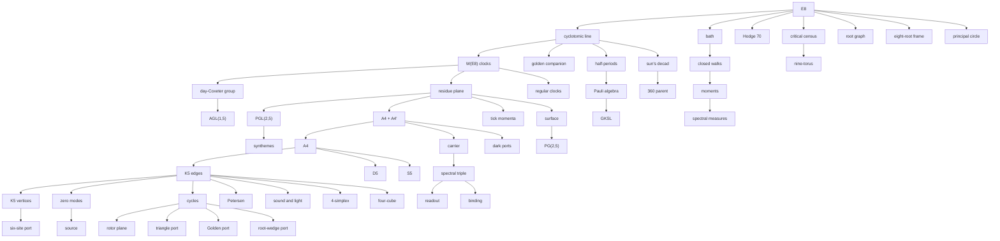

# One object

Layers 25 to 28 (`oes/unify.py`, `oes/cyclotomic.py`, `oes/primes.py`, `oes/places.py`, `oes/principal.py`). Generated by `unified_page()`; `tests/test_model.py` checks that this file is current.

E8 with a Coxeter element c′ has no parameters. It is E8 = Z[ζ₃₀] with the trace form Tr(α x ȳ), α = (2 + 2η + η²)/15, η = ζ + ζ⁻¹. Every structural dot of the diagram is built from it by THEOREM joins, and the rest are the canon's inputs, each meeting the derived part at a named interface.

## What the seed gives

- **The clocks are Galois.** The normalizer of ⟨c′⟩ is μ₃₀ ⋊ Gal(Q(ζ₃₀)/Q), 240 elements. The day is σ₇, the golden clock σ₁₁ and the mirror σ₂₉.
- **The tick's residue plane is F₂₅.** The tick g = c′⁶ fixes 25 momenta, E8/(1 − g)E8 = F₂₅, and c′ acts there as a primitive sixth root of unity. The 240 roots lie ten over each of its 24 nonzero points.
- **Six A4 + A4.** The six F₅-lines pull back to six A4 + A4 sublattices that partition the roots. The carrier's A4 + A4′ is one of them, and its glue classes are the parallel lines.
- **The tick's symmetry.** C_W(g) has 600 elements and acts on the plane as SL(2,5), the binary icosahedral group, and on the lines as PSL(2,5) = A5, the icosahedron on its six axes. With the day, N_W(⟨g⟩) acts on the lines as PGL(2,5), the exceptional S5.
- **The day is a Singer cycle.** On F₂₅ the day is 2 + 2ω of order 24, and AIR_801 mod 5 is conjugate to minus it.
- **The golden ratio is a Gauss sum.** The canon's A(h₀) is r + r⁴ − r² − r³, and on E8 the tick's Gauss sum squares to 5.
- **The carrier is a shadow.** The mixed roots project onto the carrier's A4 as its five vertices and ten edges, and their Gram plus 2/5 is the signless incidence M behind D.
- **The tick's hexad does not carry the parent.** The hub's A6 is generated on the tick's six lines by its PSL(2,5) and t = (23)(45). But the seed acts on those lines only through GL(2,5), so t is not one of its symmetries. The sun's decad carries the parent (below).
- **The three primes (layer 26).** h = 30 = 2 × 3 × 5, and c′ = (−1)·s·g: the half-turn, the sun s = c′¹⁰ and the tick. Their fixed momenta are the residue rings of Z[ζ₃₀]: F₁₆ × F₁₆ (256), F₈₁ (81) and F₂₅ (25). The roots lie 2, 3 and 10 over their points. The centralizers act there as GO₈⁺(2), Sp(4,3) and SL(2,5).
- **The regular clocks.** The regular numbers of E8 are the divisors of 30, 24 and 20, the orders of c′, the day and the golden clock. Their centralizers have the orders the degrees give, from 20 up to 155520. The three clocks make E8 a line over Z[ζ₃₀], Z[ζ₂₄] and Z[ζ₂₀]. Q(ζ₁₆) carries Z⁸ instead, since W(E8) has no element of order 16.
- **The sun's decad.** On the sun's momenta c′ + c′⁻¹ is the golden ratio, so F₈₁ = F₉². The ten F₉-lines pull back to ten 4A2 frames that partition the roots. The F₉-linear isometries act on them as PSL(2,9) = A6, the hub's parent, with r the Coxeter clock and the doubling the day.
- **No clock covers A6.** The orbit sizes 5⁴10²20¹⁶ add to 360, but every homomorphism from the circle to A6 has at most five elements in its image. Every clock group is solvable, and A6 is perfect. The parent is reached by the sun's symmetry, which is not a clock.

## The four places (layer 27)

The seed is read at four places, and each carries one sector of the model:

| place | what the seed gives there | the sector | band values |
|---|---|---|---|
| real | E8 ⊗ R with the bath Δ = 240 − Σ T_r | the bath, its walks, moments and measures | [0, 256] |
| 2 | the half-turn's 256 momenta, E8/2E8 = F₁₆ × F₁₆ | four qubits: the real Paulis, GKSL | 0, 224 (120), 256 (135) |
| 3 | the sun's 81 momenta, F₈₁ = F₉² | the decad: the 360 parent, A6 = PSL(2,9) | 0, 243 (80) |
| 5 | the tick's 25 momenta, F₂₅ = F₅² | the hexad: the carrier A4 + A4′, K5, D | 0, 250 (24) |

- **One formula joins them.** At a fixed momentum of a prime clock the band is ε = 240 − Σ_r χ(r) for the matching character χ of the residue space. Ten roots over each of the tick's nonzero points and three over each of the sun's give ε = 250 and 243. At 2 the quadric's character sums ∓16 give 256 and 224, the band's top and its saddle.
- **The golden ratio runs through all three primes.** Φ = 1 + g + g⁴ has Φ² = Φ + 1. At 5 it is the scalar 3 (ramified; 2Φ − 1 is the Gauss sum). At 3 it generates F₉, the decad's field. At 2 it is a cube root of unity on both primes. The Fibonacci companion has Pisano periods 3, 8 and 20.
- **The qubits.** The two primes over 2 are complementary stabilizer groups of 16 commuting symmetric real Paulis. c′ keeps both and the mirror swaps them. W(E8)/⟨−1⟩ = GO₈⁺(2) is the real Clifford group of four qubits modulo the Paulis (cited).
- **What the places cannot give.** An element of order n of GL₈(Z) needs ψ(n) ≤ 8. The memory clock (order 90, ψ = 10) and the circle (ψ = 38) are run by no lattice clock, and AIR_801 (determinant 12402) is none. So they stay inputs.

## The principal circle (layer 28)

No lattice clock runs the canon's circle, but a circle of the seed's momenta does. E8 is unimodular, so the momenta live on ℝ⁸/E8, the maximal torus of the compact group E8, where the band is 248 − χ for the adjoint character χ. The Weyl vector ρ = (46, 68, 91, 135, 110, 84, 57, 29) is primitive with ⟨r, ρ⟩ = ht(r), so k ↦ kρ/4320 embeds ℤ/4320 there.

- **The Coxeter step is Kostant's.** For each of the thirteen regular numbers d, ρ/d acts on the adjoint representation with the spectrum of a lift of the regular clock of order d. At d = 30 Kostant's theorem makes it conjugate to the lift of c′ (cited), so the canon's selection 144 → c′ is that identification. The steps 180 and 216 carry the day and the golden clock.
- **The band at the regular steps** is 248 − 8μ(d)/φ(d): 256 at the half-turn, 252, 248, 250, 244, 248, 246, 248, 247, 248, 248 and 249 at the Coxeter step.
- **The critical steps are the canon's small clocks.** The band is critical on the circle exactly at its nine elements of order 2 to 5: the half-turn 2160 (D8, 256), the 27-clock's 1440 and 2880 (A8, 252), the observer clock's 1080 and 3240 (D5 + A3, 248) and the time clock 864k (A4 + A4, 250, the carrier's root system). They are the alcove's vertices of marks 2, 3, 4 and 5. Every step of order above 29 is regular.

## The derivation

| dot | built from | by the join | check | depth |
|---|---|---|---|---|
| bath | E8 | Delta | `triangle_port` | 1 |
| critical census | E8 | the band on the alcove | `census` | 1 |
| cyclotomic line | E8 | the cyclotomic line | `cyclotomic_line` | 1 |
| eight-root frame | E8 | a maximal clique | `eight_roots` | 1 |
| Hodge 70 | E8 | Lambda^4 of the lattice | `hodge70` | 1 |
| principal circle | E8 | the Weyl vector | `principal.circle` | 1 |
| root graph | E8 | inner product 1 | `root_scheme` | 1 |
| W(E8) clocks | cyclotomic line | the clocks are Galois | `galois_clocks` | 2 |
| golden companion | cyclotomic line | the Gauss sum | `golden_gauss` | 2 |
| half-periods | cyclotomic line | the primes over 2 | `primes.half_turn` | 2 |
| sun's decad | cyclotomic line | the prime over 3 | `primes.prime_clocks` | 2 |
| nine-torus | critical census | nine frequencies | `nine_torus` | 2 |
| closed walks | bath | return counts | `walks_join` | 2 |
| day-Coxeter group | W(E8) clocks | c' and d | `clock_joins` | 3 |
| moments | closed walks | binomial transform | `walks_join` | 3 |
| 360 parent | sun's decad | the decad | `primes.decad` | 3 |
| Pauli algebra | half-periods | phi | `counts.pauli_quotient` | 3 |
| regular clocks | W(E8) clocks | Springer | `primes.regular_clocks` | 3 |
| residue plane | W(E8) clocks | the residue plane | `residue_plane` | 3 |
| AGL(1,5) | day-Coxeter group | day clocks | `clock_joins` | 4 |
| A4 + A4' | residue plane | one residue line | `residue_plane` | 4 |
| GKSL | Pauli algebra | GKSL | `counts.pauli_quotient` | 4 |
| spectral measures | moments | Hausdorff | `measure` | 4 |
| tick momenta | residue plane | Pontryagin duality | `places.band_at_places` | 4 |
| PGL(2,5) | residue plane | the tick's normalizer | `tick_normalizer` | 4 |
| surface | residue plane | the six axes | `tick_normalizer` | 4 |
| A4 | A4 + A4' | either factor | `tick_normalizer` | 5 |
| carrier | A4 + A4' | the shadows | `carrier_shadows` | 5 |
| dark ports | A4 + A4' | the norm-four shell | `dark_port` | 5 |
| PG(2,5) | surface | the Veronese conic | `projective_plane` | 5 |
| synthemes | PGL(2,5) | the exceptional action | `syntheme_bridge` | 5 |
| D5 | A4 | inclusion | `k5_roots` | 6 |
| K5 edges | A4 | B | `k5_roots` | 6 |
| S5 | A4 | W(A4) | `s5_weyl` | 6 |
| spectral triple | carrier | D | `triple` | 6 |
| K5 vertices | K5 edges | contraction | `exterior` | 7 |
| binding | spectral triple | commutant | `binding_joins` | 7 |
| four-cube | K5 edges | the cuts mod 2 | `cube_cuts` | 7 |
| cycles | K5 edges | Lambda^2 H | `exterior` | 7 |
| zero modes | K5 edges | relations | `k5_roots` | 7 |
| Petersen | K5 edges | orthogonality | `petersen_roots` | 7 |
| readout | spectral triple | first-order form | `readout` | 7 |
| 4-simplex | K5 edges | grade 2 | `simplex_grades` | 7 |
| sound and light | K5 edges | d0 = B^T | `sound_light` | 7 |
| Golden port | cycles | the root-site isometry | `golden_root_port` | 8 |
| rotor plane | cycles | area forms | `exterior` | 8 |
| six-site port | K5 vertices | cone | `cone` | 8 |
| source | zero modes | q = (a, b) | `source_port` | 8 |
| triangle port | cycles | odd lift | `triangle_port` | 8 |
| root-wedge port | cycles | an S5-isometry | `wedge_port` | 8 |

## The canon's inputs

| input | what the canon supplies | it meets | status | why it stays an input |
|---|---|---|---|---|
| circle | the canon's circle Z/4320; its step 144 goes to c', one of eight choices, all conjugate under the Galois clocks | W(E8) clocks (k 144 -> c'^k) | SELECTED_REFERENCE | psi(4320) = 38 > 8, so no lattice clock runs Z/4320 (layer 27); but it is the principal circle k -> k rho/4320 of the seed's momenta, whose step 144 is the Coxeter clock's lift and whose steps of order 2 to 5 are the band's critical vertices; only the number 4320 is the canon's (layer 28) |
| stages | the canon's fifteen stage indices on the circle | circle (k -> k) | THEOREM | the canon's fifteen indices on the circle |
| memory clock | the 120-state memory clock, stepped by the circle (a selection) | circle (one step, one step) | SELECTED_REFERENCE | order 90 and psi(90) = 10 > 8, so no lattice clock of the seed runs it (layer 27) |
| datum | the canon's datum (psi0, v0), a vector on the zero modes of energy 34 | zero modes (v0) | THEOREM | a vector the canon chooses on the zero modes; its S5-orbit is regular (layer 23) |
| literal operands | the owner's native source matrices | source (U) | THEOREM | the owner's matrices; they match the derived source up to an explicit isometry (layer 10) |
| fifteen words | the canon's words 088, 086 and 980 | A4 (the Coxeter five-cycle) | THEOREM | the canon's words; isometric to the oriented duads of K6 only over Q(sqrt2) (layer 23) |
| 801 matrix | the integers of AIR_801; mod 5 it is minus the day on the residue plane | residue plane (the Singer cycle) | THEOREM | determinant 12402, so no lattice clock; only its residue mod 5 is the seed's (layer 27) |
| five-site charges | the Standard-Model split of the five sites, colour 0, 1, 2 and weak 3, 4 | K5 vertices (a charge on the sites) | THEOREM | the 3 + 2 split chooses the Standard-Model gauge group; once chosen it is unique up to W(E8) (layer 24) |
| calibration | the time unit tau of t = tau u (TIME_BIND unbound) | readout (Salina-Prema) | THEOREM | no internal number binds physical time (an obstruction, layer 23) |
| product geometry | the product geometry M4 x F with M4, f, L and m free (conditional) | spectral triple (heat coefficients) | CONDITIONAL | M4, f, L and m are free parameters; conditional (layer 6) |

Built from the inputs: time clock (from circle), observer clock (from circle), 27-clock (from circle), atlas (from circle), coil (from circle), grain (from coil), vortex (from atlas), miss set (from circle), root assignment (from five-site charges), FLRW (from product geometry).
